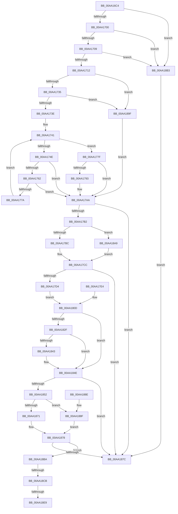

# SPCallServerHandleCallbackPaintComplete

- RVA: `0x00AA16C4`–`0x00AA18F0` (길이 `556` bytes)
- VA: `0x0000000140AA16C4`
- 실행 섹션: `PAGE`
- PDB 이름 있음: `예`; PDB Function 태그: `예`
- unwind 정보 RVA: `0x000BACAC`
- 디코드: `164`개 명령, `556/556` bytes 표시
- 미해석 바이트: `0` (있으면 어셈블리에 `.byte`로 보존)

> 이 문서는 커널 이미지의 기계어와 PDB 기호를 분석해 생성했습니다. 4번과 5번은 함수 원형과 자료형을 바이너리 사용 방식에서 추정한 C 해석이며 원본 소스 복구 결과는 아닙니다.

## 1. Dependencies

- 직접 호출 지점: **2**; 고유 호출 대상: **2**
- 직접 호출자로 확인된 함수: **1**
- RIP 상대 이미지 참조: **1**

### Outgoing calls
- `0x00AA17DD` → [KeReleaseMutex](../../text/39/KeReleaseMutex_function_00396810.md) (function, `0x00396810`)
- `0x00AA1867` → [ExAllocatePool2](../../poolcode/B8/ExAllocatePool2_function_00B820F0.md) (function, `0x00B820F0`)

### Direct callers
- [sub_00968AF6](../96/Unknown_function_00968AF6.md) at `0x0096A369`

### Static image references
- `0x00AA17D6` → RVA `0x00EF0DE0` (`.data`; read)

## 2. Other-region calls and transfers

- 다른 실행 섹션으로 향하는 call: **2**
  - `0x00AA17DD` → [KeReleaseMutex](../../text/39/KeReleaseMutex_function_00396810.md) (`PAGE` → `.text`)
  - `0x00AA1867` → [ExAllocatePool2](../../poolcode/B8/ExAllocatePool2_function_00B820F0.md) (`PAGE` → `POOLCODE`)
- call이 아닌 외부 분기/꼬리 이동: **3**
  - `0x00AA18C5` → [sub_00B496A8](../B4/Unknown_function_00B496A8.md) (`tail-transfer`)
  - `0x00AA18E3` → [sub_00B496A8 + 0x8C](../B4/Unknown_function_00B496A8.md) (`tail-transfer`)
  - `0x00AA18EB` → [sub_00B496A8 + 0x8A](../B4/Unknown_function_00B496A8.md) (`tail-transfer`)

## 3. Assembly (complete function range)

```asm
00AA16C4  48 8B C4                        mov rax, rsp
00AA16C7  4C 89 48 20                     mov qword ptr [rax + 0x20], r9
00AA16CB  44 89 40 18                     mov dword ptr [rax + 0x18], r8d
00AA16CF  48 89 50 10                     mov qword ptr [rax + 0x10], rdx
00AA16D3  53                              push rbx
00AA16D4  56                              push rsi
00AA16D5  57                              push rdi
00AA16D6  41 54                           push r12
00AA16D8  41 55                           push r13
00AA16DA  41 56                           push r14
00AA16DC  41 57                           push r15
00AA16DE  48 83 EC 50                     sub rsp, 0x50
00AA16E2  49 8B F1                        mov rsi, r9
00AA16E5  4C 8B EA                        mov r13, rdx
00AA16E8  4C 89 4C 24 40                  mov qword ptr [rsp + 0x40], r9
00AA16ED  33 FF                           xor edi, edi
00AA16EF  48 89 78 08                     mov qword ptr [rax + 8], rdi
00AA16F3  48 89 78 A8                     mov qword ptr [rax - 0x58], rdi
00AA16F7  48 85 C9                        test rcx, rcx
00AA16FA  0F 84 B3 01 00 00               je 0x140aa18b3
00AA1700  48 85 D2                        test rdx, rdx
00AA1703  0F 84 AA 01 00 00               je 0x140aa18b3
00AA1709  4D 85 C9                        test r9, r9
00AA170C  0F 84 A1 01 00 00               je 0x140aa18b3
00AA1712  8B D7                           mov edx, edi
00AA1714  48 89 50 B0                     mov qword ptr [rax - 0x50], rdx
00AA1718  44 8B C7                        mov r8d, edi
00AA171B  89 78 18                        mov dword ptr [rax + 0x18], edi
00AA171E  48 8B 41 08                     mov rax, qword ptr [rcx + 8]
00AA1722  49 83 CF FF                     or r15, 0xffffffffffffffff
00AA1726  41 BE 95 00 00 C0               mov r14d, 0xc0000095
00AA172C  48 85 C0                        test rax, rax
00AA172F  0F 84 6A 01 00 00               je 0x140aa189f
00AA1735  83 39 03                        cmp dword ptr [rcx], 3
00AA1738  0F 86 61 01 00 00               jbe 0x140aa189f
00AA173E  44 8B CF                        mov r9d, edi
00AA1741  44 8B 18                        mov r11d, dword ptr [rax]
00AA1744  48 8D 48 04                     lea rcx, [rax + 4]
00AA1748  41 83 F9 03                     cmp r9d, 3
00AA174C  73 31                           jae 0x140aa177f
00AA174E  4D 8B D7                        mov r10, r15
00AA1751  48 3B C8                        cmp rcx, rax
00AA1754  4C 0F 43 D1                     cmovae r10, rcx
00AA1758  1B DB                           sbb ebx, ebx
00AA175A  41 23 DE                        and ebx, r14d
00AA175D  48 3B C8                        cmp rcx, rax
00AA1760  72 48                           jb 0x140aa17aa
00AA1762  4B 8D 0C 1A                     lea rcx, [r10 + r11]
00AA1766  49 8B C7                        mov rax, r15
00AA1769  49 3B CA                        cmp rcx, r10
00AA176C  48 0F 43 C1                     cmovae rax, rcx
00AA1770  1B DB                           sbb ebx, ebx
00AA1772  41 23 DE                        and ebx, r14d
00AA1775  49 3B CA                        cmp rcx, r10
00AA1778  72 30                           jb 0x140aa17aa
00AA177A  41 FF C1                        inc r9d
00AA177D  EB C2                           jmp 0x140aa1741
00AA177F  4D 8B CF                        mov r9, r15
00AA1782  48 3B C8                        cmp rcx, rax
00AA1785  4C 0F 43 C9                     cmovae r9, rcx
00AA1789  1B DB                           sbb ebx, ebx
00AA178B  41 23 DE                        and ebx, r14d
00AA178E  48 3B C8                        cmp rcx, rax
00AA1791  72 17                           jb 0x140aa17aa
00AA1793  45 8B C3                        mov r8d, r11d
00AA1796  44 89 9C 24 A0 00 00 00         mov dword ptr [rsp + 0xa0], r11d
00AA179E  45 85 DB                        test r11d, r11d
00AA17A1  49 0F 45 D1                     cmovne rdx, r9
00AA17A5  48 89 54 24 38                  mov qword ptr [rsp + 0x38], rdx
00AA17AA  85 DB                           test ebx, ebx
00AA17AC  0F 88 CA 00 00 00               js 0x140aa187c
00AA17B2  41 83 F8 08                     cmp r8d, 8
00AA17B6  0F 85 ED 00 00 00               jne 0x140aa18a9
00AA17BC  48 8B 02                        mov rax, qword ptr [rdx]
00AA17BF  48 89 84 24 90 00 00 00         mov qword ptr [rsp + 0x90], rax
00AA17C7  48 89 44 24 30                  mov qword ptr [rsp + 0x30], rax
00AA17CC  85 DB                           test ebx, ebx
00AA17CE  0F 88 A8 00 00 00               js 0x140aa187c
00AA17D4  33 D2                           xor edx, edx
00AA17D6  48 8D 0D 03 F6 44 00            lea rcx, [rip + 0x44f603]
00AA17DD  E8 2E 50 8F FF                  call 0x140396810
00AA17E2  EB 29                           jmp 0x140aa180d
00AA17E4  33 FF                           xor edi, edi
00AA17E6  49 83 CF FF                     or r15, 0xffffffffffffffff
00AA17EA  41 BE 95 00 00 C0               mov r14d, 0xc0000095
00AA17F0  48 8B B4 24 A8 00 00 00         mov rsi, qword ptr [rsp + 0xa8]
00AA17F8  4C 8B AC 24 98 00 00 00         mov r13, qword ptr [rsp + 0x98]
00AA1800  48 8B 44 24 30                  mov rax, qword ptr [rsp + 0x30]
00AA1805  48 89 84 24 90 00 00 00         mov qword ptr [rsp + 0x90], rax
00AA180D  45 8B 45 20                     mov r8d, dword ptr [r13 + 0x20]
00AA1811  41 8B 45 10                     mov eax, dword ptr [r13 + 0x10]
00AA1815  83 C0 30                        add eax, 0x30
00AA1818  41 83 CC FF                     or r12d, 0xffffffff
00AA181C  41 8B CC                        mov ecx, r12d
00AA181F  83 F8 30                        cmp eax, 0x30
00AA1822  0F 43 C8                        cmovae ecx, eax
00AA1825  1B DB                           sbb ebx, ebx
00AA1827  41 23 DE                        and ebx, r14d
00AA182A  83 F8 30                        cmp eax, 0x30
00AA182D  72 1F                           jb 0x140aa184e
00AA182F  8D 41 04                        lea eax, [rcx + 4]
00AA1832  41 8B D4                        mov edx, r12d
00AA1835  3B C1                           cmp eax, ecx
00AA1837  0F 43 D0                        cmovae edx, eax
00AA183A  1B DB                           sbb ebx, ebx
00AA183C  41 23 DE                        and ebx, r14d
00AA183F  3B C1                           cmp eax, ecx
00AA1841  72 0B                           jb 0x140aa184e
00AA1843  42 8D 04 02                     lea eax, [rdx + r8]
00AA1847  3B C2                           cmp eax, edx
00AA1849  1B DB                           sbb ebx, ebx
00AA184B  41 23 DE                        and ebx, r14d
00AA184E  85 DB                           test ebx, ebx
00AA1850  78 2A                           js 0x140aa187c
00AA1852  BA 14 00 00 00                  mov edx, 0x14
00AA1857  89 56 04                        mov dword ptr [rsi + 4], edx
00AA185A  8B DF                           mov ebx, edi
00AA185C  B9 00 01 00 00                  mov ecx, 0x100
00AA1861  41 B8 53 4C 53 20               mov r8d, 0x20534c53
00AA1867  E8 84 08 0E 00                  call 0x140b820f0
00AA186C  48 85 C0                        test rax, rax
00AA186F  74 1E                           je 0x140aa188f
00AA1871  48 8D 56 08                     lea rdx, [rsi + 8]
00AA1875  48 89 02                        mov qword ptr [rdx], rax
00AA1878  85 DB                           test ebx, ebx
00AA187A  79 3E                           jns 0x140aa18ba
00AA187C  8B C3                           mov eax, ebx
00AA187E  48 83 C4 50                     add rsp, 0x50
00AA1882  41 5F                           pop r15
00AA1884  41 5E                           pop r14
00AA1886  41 5D                           pop r13
00AA1888  41 5C                           pop r12
00AA188A  5F                              pop rdi
00AA188B  5E                              pop rsi
00AA188C  5B                              pop rbx
00AA188D  C3                              ret
00AA188E  CC                              int3
00AA188F  BB 17 00 00 C0                  mov ebx, 0xc0000017
00AA1894  48 8B 54 24 40                  mov rdx, qword ptr [rsp + 0x40]
00AA1899  48 83 C2 08                     add rdx, 8
00AA189D  EB D9                           jmp 0x140aa1878
00AA189F  BB 0D 00 00 C0                  mov ebx, 0xc000000d
00AA18A4  E9 01 FF FF FF                  jmp 0x140aa17aa
00AA18A9  BB 23 00 00 C0                  mov ebx, 0xc0000023
00AA18AE  E9 19 FF FF FF                  jmp 0x140aa17cc
00AA18B3  BB 0D 00 00 C0                  mov ebx, 0xc000000d
00AA18B8  EB C2                           jmp 0x140aa187c
00AA18BA  89 3E                           mov dword ptr [rsi], edi
00AA18BC  44 8B CF                        mov r9d, edi
00AA18BF  48 8B 12                        mov rdx, qword ptr [rdx]
00AA18C2  48 85 D2                        test rdx, rdx
00AA18C5  0F 85 DD 7D 0A 00               jne 0x140b496a8
00AA18CB  8B 56 04                        mov edx, dword ptr [rsi + 4]
00AA18CE  8D 4A 08                        lea ecx, [rdx + 8]
00AA18D1  41 8B C4                        mov eax, r12d
00AA18D4  3B CA                           cmp ecx, edx
00AA18D6  0F 43 C1                        cmovae eax, ecx
00AA18D9  89 46 04                        mov dword ptr [rsi + 4], eax
00AA18DC  1B DB                           sbb ebx, ebx
00AA18DE  41 23 DE                        and ebx, r14d
00AA18E1  3B CA                           cmp ecx, edx
00AA18E3  0F 82 4B 7E 0A 00               jb 0x140b49734
00AA18E9  8B DF                           mov ebx, edi
00AA18EB  E9 42 7E 0A 00                  jmp 0x140b49732
```

## 4. C-style interpretation (structured pseudocode)

```c
__int64 __fastcall SPCallServerHandleCallbackPaintComplete(__int64 a1, __int64 a2, int a3, __int64 a4)
{
    __int64 result;
    __int64 v_r10;
    __int64 v_r12;
    __int64 v_r15;
    __int64 v_rbx;
    __int64 v_rdi;
    __int64 v_rsp;
    unsigned __int64 v_stack_m48;
    unsigned __int64 v_stack_m50;
    unsigned __int64 v_stack_m58;
    unsigned __int64 v_stack_p10;
    unsigned int v_stack_p18;
    unsigned __int64 v_stack_p20;
    unsigned __int64 v_stack_p40;
    unsigned __int64 v_stack_p8;

    *(unsigned __int64 *)(v_rsp + 32) = a4;
    *(unsigned int *)(v_rsp + 24) = a3;
    *(unsigned __int64 *)(v_rsp + 16) = a2;
    v_rsp = (v_rsp) - (80);
    v_stack_m48 = a4;
    v_rdi = 0;
    *(unsigned __int64 *)(v_rsp + 8) = 0;
    *(unsigned __int64 *)(v_rsp - 88) = 0;
    if (a1 == 0) goto loc_00AA18B3;
    if (a2 == 0) goto loc_00AA18B3;
    if (a4 == 0) goto loc_00AA18B3;
    *(unsigned __int64 *)(v_rsp - 80) = 0;
    *(unsigned int *)(v_rsp + 24) = 0;
    v_r15 = (v_r15) | (-1);
    if (*(unsigned __int64 *)(a1 + 8) == 0) goto loc_00AA189F;
    if ((*(unsigned int *)(a1)) <= 3) goto loc_00AA189F;
loc_00AA1741:
    if (0 >= 3) goto loc_00AA177F;
    v_r10 = v_r15;
    if ((*(unsigned __int64 *)(a1 + 8) + 4) >= (*(unsigned __int64 *)(a1 + 8))) { v_r10 = *(unsigned __int64 *)(a1 + 8) + 4; }
    v_rbx = (unsigned int)((v_rbx) & ((unsigned int)((unsigned int)(0xC0000095ULL))));
    if ((*(unsigned __int64 *)(a1 + 8) + 4) < (*(unsigned __int64 *)(a1 + 8))) goto loc_00AA17AA;
    result = v_r15;
    if ((v_r10 + (unsigned int)(*(unsigned int *)(*(unsigned __int64 *)(a1 + 8))) * 1) >= v_r10) { result = v_r10 + (unsigned int)(*(unsigned int *)(*(unsigned __int64 *)(a1 + 8))) * 1; }
    v_rbx = (unsigned int)((v_rbx) & ((unsigned int)((unsigned int)(0xC0000095ULL))));
    if ((v_r10 + (unsigned int)(*(unsigned int *)(*(unsigned __int64 *)(a1 + 8))) * 1) < v_r10) goto loc_00AA17AA;
    a4 = (unsigned int)((0) + 1);
    goto loc_00AA1741;
loc_00AA177F:
    a4 = v_r15;
    if ((v_r10 + (unsigned int)(*(unsigned int *)(*(unsigned __int64 *)(a1 + 8))) * 1) >= result) { a4 = v_r10 + (unsigned int)(*(unsigned int *)(*(unsigned __int64 *)(a1 + 8))) * 1; }
    v_rbx = (unsigned int)((v_rbx) & ((unsigned int)((unsigned int)(0xC0000095ULL))));
    if ((v_r10 + (unsigned int)(*(unsigned int *)(*(unsigned __int64 *)(a1 + 8))) * 1) >= result) {
        a3 = (unsigned int)((unsigned int)(*(unsigned int *)(*(unsigned __int64 *)(a1 + 8))));
        v_stack_p18 = (unsigned int)((unsigned int)(*(unsigned int *)(*(unsigned __int64 *)(a1 + 8))));
        a2 = 0;
        if ((unsigned int)((unsigned int)(*(unsigned int *)(*(unsigned __int64 *)(a1 + 8)))) != 0) { a2 = a4; }
        v_stack_m50 = a2;
    }
    if (sign_flag) goto loc_00AA187C;
    if (a3 != 8) goto loc_00AA18A9;
    v_stack_p8 = *(unsigned __int64 *)(a2);
    v_stack_m58 = *(unsigned __int64 *)(a2);
loc_00AA17CC:
    if (sign_flag) goto loc_00AA187C;
    a2 = 0;
    result = KeReleaseMutex(v_rip + 4519427, a2, a3, a4);
    goto loc_00AA180D;
loc_00AA180D:
    result = (unsigned int)(((unsigned int)(*(unsigned int *)(a2 + 16))) + (48));
    v_r12 = (unsigned int)((v_r12) | (0xFFFFFFFFULL));
    a1 = (unsigned int)((unsigned int)(v_r12));
    if (((unsigned int)(result)) >= 48) { a1 = (unsigned int)(result); }
    v_rbx = (unsigned int)((v_rbx) & ((unsigned int)((unsigned int)(0xC0000095ULL))));
    if (((unsigned int)(result)) < 48) goto loc_00AA184E;
    a2 = (unsigned int)((unsigned int)(v_r12));
    if (((unsigned int)(a1 + 4)) >= ((unsigned int)(a1))) { a2 = (unsigned int)(a1 + 4); }
    v_rbx = (unsigned int)((v_rbx) & ((unsigned int)((unsigned int)(0xC0000095ULL))));
    result = a1 + 4;
    if (((unsigned int)(a1 + 4)) >= ((unsigned int)(a1))) {
        result = a2 + (unsigned int)(*(unsigned int *)(a2 + 32)) * 1;
        v_rbx = (unsigned int)((v_rbx) & ((unsigned int)((unsigned int)(0xC0000095ULL))));
    }
    if (sign_flag) goto loc_00AA187C;
    *(unsigned int *)(a4 + 4) = 20;
    result = ExAllocatePool2(256, 20, (unsigned int)(0x20534C53ULL), a4);
    if (result == 0) goto loc_00AA188F;
    *(unsigned __int64 *)(a4 + 8) = result;
loc_00AA1878:
    if (!sign_flag) goto loc_00AA18BA;
loc_00AA187C:
    v_rsp = (v_rsp) + (80);
    return 0;
loc_00AA188F:
    a2 = (v_stack_p40) + (8);
    goto loc_00AA1878;
loc_00AA189F:
    goto loc_00AA17AA;
loc_00AA18A9:
    goto loc_00AA17CC;
loc_00AA18B3:
    goto loc_00AA187C;
loc_00AA18BA:
    *(unsigned int *)(a4) = 0;
    result = (unsigned int)((unsigned int)(v_r12));
    if (((unsigned int)((unsigned int)(*(unsigned int *)(a4 + 4)) + 8)) >= ((unsigned int)((unsigned int)(*(unsigned int *)(a4 + 4))))) { result = (unsigned int)((unsigned int)(*(unsigned int *)(a4 + 4)) + 8); }
    *(unsigned int *)(a4 + 4) = (unsigned int)(result);
    v_rbx = (unsigned int)(((unsigned int)(0xC000000DULL)) & ((unsigned int)((unsigned int)(0xC0000095ULL))));
}
```

## 5. (Beta) C Style

```c
int64_t SPCallServerHandleCallbackPaintComplete(int64_t Arg1, void *Arg2, int32_t Arg3, void *Arg4)
{
    uint8_t *arg2 = (uint8_t *)Arg2;
    uint8_t *arg4 = (uint8_t *)Arg4;

    int64_t result;
    int64_t local_r10;
    int64_t local_r12;
    int64_t local_r15;
    int64_t local_rbx;
    int64_t local_rdi;
    int64_t local_rsp;
    uint64_t v_stack_m48;
    uint64_t v_stack_m50;
    uint64_t v_stack_m58;
    uint64_t v_stack_p10;
    uint32_t v_stack_p18;
    uint64_t v_stack_p20;
    uint64_t v_stack_p40;
    uint64_t v_stack_p8;

    *(void **)(local_rsp + 0x20) = Arg4;
    *(uint32_t *)(local_rsp + 0x18) = Arg3;
    *(void **)(local_rsp + 0x10) = Arg2;
    local_rsp = (local_rsp) - (80);
    v_stack_m48 = Arg4;
    local_rdi = 0;
    *(uint64_t *)(local_rsp + 0x8) = 0;
    *(uint64_t *)(local_rsp - 0x58) = 0;
    if (Arg1 == 0) goto loc_00AA18B3;
    if (Arg2 == NULL) goto loc_00AA18B3;
    if (Arg4 == NULL) goto loc_00AA18B3;
    *(uint64_t *)(local_rsp - 0x50) = 0;
    *(uint32_t *)(local_rsp + 0x18) = 0;
    local_r15 = (local_r15) | (-1);
    if (*(uint64_t *)(Arg1 + 0x8) == 0) goto loc_00AA189F;
    if ((*(uint32_t *)(Arg1)) <= 3) goto loc_00AA189F;
loc_00AA1741:
    if (0 >= 3) goto loc_00AA177F;
    local_r10 = local_r15;
    if ((*(uint64_t *)(Arg1 + 0x8) + 4) >= (*(uint64_t *)(Arg1 + 0x8))) { local_r10 = *(uint64_t *)(Arg1 + 0x8) + 4; }
    local_rbx = (uint32_t)((local_rbx) & ((uint32_t)((uint32_t)(0xC0000095ULL))));
    if ((*(uint64_t *)(Arg1 + 0x8) + 4) < (*(uint64_t *)(Arg1 + 0x8))) goto loc_00AA17AA;
    result = local_r15;
    if ((local_r10 + (uint32_t)(*(uint32_t *)(*(uint64_t *)(Arg1 + 0x8))) * 1) >= local_r10) { result = local_r10 + (uint32_t)(*(uint32_t *)(*(uint64_t *)(Arg1 + 0x8))) * 1; }
    local_rbx = (uint32_t)((local_rbx) & ((uint32_t)((uint32_t)(0xC0000095ULL))));
    if ((local_r10 + (uint32_t)(*(uint32_t *)(*(uint64_t *)(Arg1 + 0x8))) * 1) < local_r10) goto loc_00AA17AA;
    Arg4 = (uint32_t)((0) + 1);
    goto loc_00AA1741;
loc_00AA177F:
    Arg4 = local_r15;
    if ((local_r10 + (uint32_t)(*(uint32_t *)(*(uint64_t *)(Arg1 + 0x8))) * 1) >= result) { Arg4 = local_r10 + (uint32_t)(*(uint32_t *)(*(uint64_t *)(Arg1 + 0x8))) * 1; }
    local_rbx = (uint32_t)((local_rbx) & ((uint32_t)((uint32_t)(0xC0000095ULL))));
    if ((local_r10 + (uint32_t)(*(uint32_t *)(*(uint64_t *)(Arg1 + 0x8))) * 1) >= result) {
        Arg3 = (uint32_t)((uint32_t)(*(uint32_t *)(*(uint64_t *)(Arg1 + 0x8))));
        v_stack_p18 = (uint32_t)((uint32_t)(*(uint32_t *)(*(uint64_t *)(Arg1 + 0x8))));
        Arg2 = 0;
        if ((uint32_t)((uint32_t)(*(uint32_t *)(*(uint64_t *)(Arg1 + 0x8)))) != 0) { Arg2 = Arg4; }
        v_stack_m50 = Arg2;
    }
    if (sign_flag) goto loc_00AA187C;
    if (Arg3 != 8) goto loc_00AA18A9;
    v_stack_p8 = *(uint64_t *)(arg2);
    v_stack_m58 = *(uint64_t *)(arg2);
loc_00AA17CC:
    if (sign_flag) goto loc_00AA187C;
    Arg2 = 0;
    result = KeReleaseMutex(v_rip + 4519427, Arg2, Arg3, Arg4);
    goto loc_00AA180D;
loc_00AA180D:
    result = (uint32_t)(((uint32_t)(*(uint32_t *)(arg2 + 0x10))) + (48));
    local_r12 = (uint32_t)((local_r12) | (0xFFFFFFFFULL));
    Arg1 = (uint32_t)((uint32_t)(local_r12));
    if (((uint32_t)(result)) >= 48) { Arg1 = (uint32_t)(result); }
    local_rbx = (uint32_t)((local_rbx) & ((uint32_t)((uint32_t)(0xC0000095ULL))));
    if (((uint32_t)(result)) < 48) goto loc_00AA184E;
    Arg2 = (uint32_t)((uint32_t)(local_r12));
    if (((uint32_t)(Arg1 + 4)) >= ((uint32_t)(Arg1))) { Arg2 = (uint32_t)(Arg1 + 4); }
    local_rbx = (uint32_t)((local_rbx) & ((uint32_t)((uint32_t)(0xC0000095ULL))));
    result = Arg1 + 4;
    if (((uint32_t)(Arg1 + 4)) >= ((uint32_t)(Arg1))) {
        result = Arg2 + (uint32_t)(*(uint32_t *)(arg2 + 0x20)) * 1;
        local_rbx = (uint32_t)((local_rbx) & ((uint32_t)((uint32_t)(0xC0000095ULL))));
    }
    if (sign_flag) goto loc_00AA187C;
    *(uint32_t *)(arg4 + 0x4) = 20;
    result = ExAllocatePool2(256, 20, (uint32_t)(0x20534C53ULL), Arg4);
    if (result == 0) goto loc_00AA188F;
    *(uint64_t *)(arg4 + 0x8) = result;
loc_00AA1878:
    if (!sign_flag) goto loc_00AA18BA;
loc_00AA187C:
    local_rsp = (local_rsp) + (80);
    return 0;
loc_00AA188F:
    Arg2 = (v_stack_p40) + (8);
    goto loc_00AA1878;
loc_00AA189F:
    goto loc_00AA17AA;
loc_00AA18A9:
    goto loc_00AA17CC;
loc_00AA18B3:
    goto loc_00AA187C;
loc_00AA18BA:
    *(uint32_t *)(arg4) = 0;
    result = (uint32_t)((uint32_t)(local_r12));
    if (((uint32_t)((uint32_t)(*(uint32_t *)(arg4 + 0x4)) + 8)) >= ((uint32_t)((uint32_t)(*(uint32_t *)(arg4 + 0x4))))) { result = (uint32_t)((uint32_t)(*(uint32_t *)(arg4 + 0x4)) + 8); }
    *(uint32_t *)(arg4 + 0x4) = (uint32_t)(result);
    local_rbx = (uint32_t)(((uint32_t)(0xC000000DULL)) & ((uint32_t)((uint32_t)(0xC0000095ULL))));
}
```

### 관측된 메모리 오프셋

구조체 형식이 확인되지 않은 접근은 인자 기준의 오프셋으로만 기록했습니다.

| 기준 인자 | 오프셋 표현 | 폭 (bit) | 접근 |
|---|---:|---:|---|
| `Arg2` | `+ 0x10` | `32` | `R` |
| `Arg2` | `+ 0x20` | `32` | `R` |
| `Arg4` | `+ 0x0` | `32` | `W` |
| `Arg4` | `+ 0x0` | `64` | `W` |
| `Arg4` | `+ 0x4` | `32` | `R` |
| `Arg4` | `+ 0x4` | `32` | `W` |
| `Arg4` | `+ 0x8` | `64` | `R` |

## 6. Execution-region graph

[열기: 2D/3D 그래프와 함수 탐색 컨트롤 패널](../../../control-panel.html?section=page&rva=0x00AA16C4&view=graph)

- 2D 그래프는 위에서 아래로 흐르고, 3D 그래프는 빈 공간을 드래그해 회전합니다. Shift+드래그는 이동, 휠은 확대·축소, 함수 노드 선택은 대상 보고서 이동입니다.

### Static fallback


