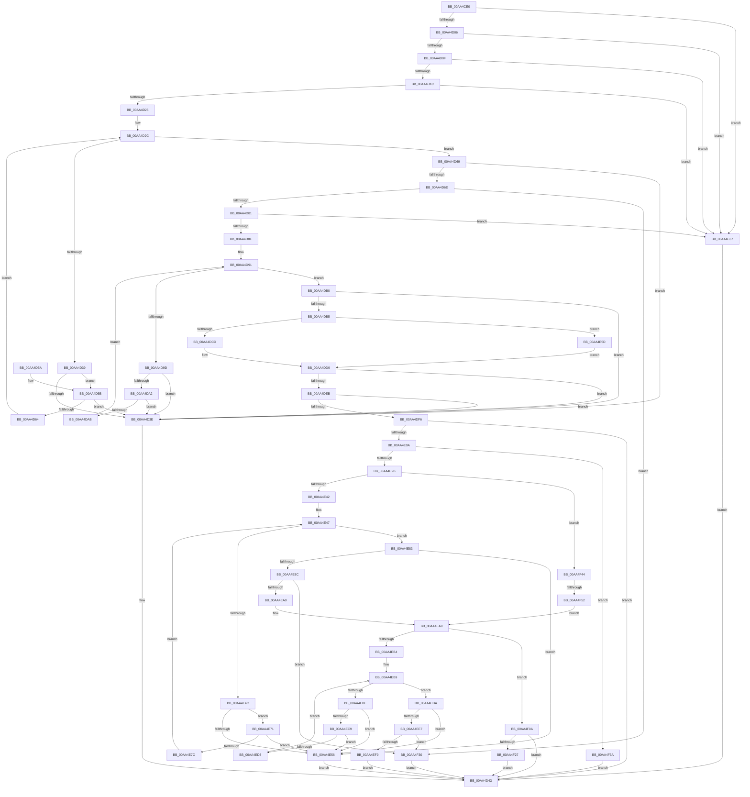

# SPCallServerHandleUpdateLicense

- RVA: `0x00AA4CE0`–`0x00AA4F5A` (길이 `634` bytes)
- VA: `0x0000000140AA4CE0`
- 실행 섹션: `PAGE`
- PDB 이름 있음: `예`; PDB Function 태그: `예`
- unwind 정보 RVA: `0x000BB594`
- 디코드: `186`개 명령, `634/634` bytes 표시
- 미해석 바이트: `0` (있으면 어셈블리에 `.byte`로 보존)

> 이 문서는 커널 이미지의 기계어와 PDB 기호를 분석해 생성했습니다. 4번과 5번은 함수 원형과 자료형을 바이너리 사용 방식에서 추정한 C 해석이며 원본 소스 복구 결과는 아닙니다.

## 1. Dependencies

- 직접 호출 지점: **2**; 고유 호출 대상: **2**
- 직접 호출자로 확인된 함수: **1**
- RIP 상대 이미지 참조: **1**

### Outgoing calls
- `0x00AA4DD2` → [guard_dispatch_icall](../../text/6B/guard_dispatch_icall_function_006BAAD0.md) (function, `0x006BAAD0`)
- `0x00AA4E1D` → [ExAllocatePool2](../../poolcode/B8/ExAllocatePool2_function_00B820F0.md) (function, `0x00B820F0`)

### Direct callers
- [sub_00968AF6](../96/Unknown_function_00968AF6.md) at `0x00969E26`

### Static image references
- `0x00AA4DB5` → RVA `0x00FD8348` (`PAGEDATA`; read)

## 2. Other-region calls and transfers

- 다른 실행 섹션으로 향하는 call: **2**
  - `0x00AA4DD2` → [guard_dispatch_icall](../../text/6B/guard_dispatch_icall_function_006BAAD0.md) (`PAGE` → `.text`)
  - `0x00AA4E1D` → [ExAllocatePool2](../../poolcode/B8/ExAllocatePool2_function_00B820F0.md) (`PAGE` → `POOLCODE`)
- call이 아닌 외부 분기/꼬리 이동: **1**
  - `0x00AA4F4C` → [sub_00B49CFE](../B4/Unknown_function_00B49CFE.md) (`tail-transfer`)

## 3. Assembly (complete function range)

```asm
00AA4CE0  48 89 5C 24 08                  mov qword ptr [rsp + 8], rbx
00AA4CE5  48 89 6C 24 10                  mov qword ptr [rsp + 0x10], rbp
00AA4CEA  48 89 74 24 18                  mov qword ptr [rsp + 0x18], rsi
00AA4CEF  57                              push rdi
00AA4CF0  48 83 EC 20                     sub rsp, 0x20
00AA4CF4  49 8B F9                        mov rdi, r9
00AA4CF7  48 8B DA                        mov rbx, rdx
00AA4CFA  4C 8B C1                        mov r8, rcx
00AA4CFD  48 85 D2                        test rdx, rdx
00AA4D00  0F 84 61 01 00 00               je 0x140aa4e67
00AA4D06  4D 85 C9                        test r9, r9
00AA4D09  0F 84 58 01 00 00               je 0x140aa4e67
00AA4D0F  48 8B 49 08                     mov rcx, qword ptr [rcx + 8]
00AA4D13  48 85 C9                        test rcx, rcx
00AA4D16  0F 84 4B 01 00 00               je 0x140aa4e67
00AA4D1C  41 83 38 03                     cmp dword ptr [r8], 3
00AA4D20  0F 86 41 01 00 00               jbe 0x140aa4e67
00AA4D26  48 8B C1                        mov rax, rcx
00AA4D29  45 33 C9                        xor r9d, r9d
00AA4D2C  44 8B 10                        mov r10d, dword ptr [rax]
00AA4D2F  48 8D 50 04                     lea rdx, [rax + 4]
00AA4D33  41 83 F9 03                     cmp r9d, 3
00AA4D37  73 30                           jae 0x140aa4d69
00AA4D39  48 3B D0                        cmp rdx, rax
00AA4D3C  73 1D                           jae 0x140aa4d5b
00AA4D3E  BA 95 00 00 C0                  mov edx, 0xc0000095
00AA4D43  48 8B 5C 24 30                  mov rbx, qword ptr [rsp + 0x30]
00AA4D48  8B C2                           mov eax, edx
00AA4D4A  48 8B 6C 24 38                  mov rbp, qword ptr [rsp + 0x38]
00AA4D4F  48 8B 74 24 40                  mov rsi, qword ptr [rsp + 0x40]
00AA4D54  48 83 C4 20                     add rsp, 0x20
00AA4D58  5F                              pop rdi
00AA4D59  C3                              ret
00AA4D5A  CC                              int3
00AA4D5B  4A 8D 04 12                     lea rax, [rdx + r10]
00AA4D5F  48 3B C2                        cmp rax, rdx
00AA4D62  72 DA                           jb 0x140aa4d3e
00AA4D64  41 FF C1                        inc r9d
00AA4D67  EB C3                           jmp 0x140aa4d2c
00AA4D69  48 3B D0                        cmp rdx, rax
00AA4D6C  72 D0                           jb 0x140aa4d3e
00AA4D6E  33 F6                           xor esi, esi
00AA4D70  45 85 D2                        test r10d, r10d
00AA4D73  48 0F 45 F2                     cmovne rsi, rdx
00AA4D77  41 83 FA 08                     cmp r10d, 8
00AA4D7B  0F 85 AF 01 00 00               jne 0x140aa4f30
00AA4D81  41 83 38 04                     cmp dword ptr [r8], 4
00AA4D85  48 8B 36                        mov rsi, qword ptr [rsi]
00AA4D88  0F 86 D9 00 00 00               jbe 0x140aa4e67
00AA4D8E  45 33 C0                        xor r8d, r8d
00AA4D91  8B 01                           mov eax, dword ptr [rcx]
00AA4D93  48 8D 51 04                     lea rdx, [rcx + 4]
00AA4D97  41 83 F8 04                     cmp r8d, 4
00AA4D9B  73 13                           jae 0x140aa4db0
00AA4D9D  48 3B D1                        cmp rdx, rcx
00AA4DA0  72 9C                           jb 0x140aa4d3e
00AA4DA2  48 8D 0C 02                     lea rcx, [rdx + rax]
00AA4DA6  48 3B CA                        cmp rcx, rdx
00AA4DA9  72 93                           jb 0x140aa4d3e
00AA4DAB  41 FF C0                        inc r8d
00AA4DAE  EB E1                           jmp 0x140aa4d91
00AA4DB0  48 3B D1                        cmp rdx, rcx
00AA4DB3  72 89                           jb 0x140aa4d3e
00AA4DB5  4C 8B 05 8C 35 53 00            mov r8, qword ptr [rip + 0x53358c]
00AA4DBC  33 C9                           xor ecx, ecx
00AA4DBE  85 C0                           test eax, eax
00AA4DC0  48 0F 45 CA                     cmovne rcx, rdx
00AA4DC4  4D 85 C0                        test r8, r8
00AA4DC7  0F 84 90 00 00 00               je 0x140aa4e5d
00AA4DCD  8B D0                           mov edx, eax
00AA4DCF  49 8B C0                        mov rax, r8
00AA4DD2  E8 F9 5C C1 FF                  call 0x1406baad0
00AA4DD7  8B E8                           mov ebp, eax
00AA4DD9  8B 43 10                        mov eax, dword ptr [rbx + 0x10]
00AA4DDC  8B 53 20                        mov edx, dword ptr [rbx + 0x20]
00AA4DDF  83 C0 30                        add eax, 0x30
00AA4DE2  83 F8 30                        cmp eax, 0x30
00AA4DE5  0F 82 53 FF FF FF               jb 0x140aa4d3e
00AA4DEB  8D 48 04                        lea ecx, [rax + 4]
00AA4DEE  3B C8                           cmp ecx, eax
00AA4DF0  0F 82 48 FF FF FF               jb 0x140aa4d3e
00AA4DF6  8D 04 11                        lea eax, [rcx + rdx]
00AA4DF9  BB 95 00 00 C0                  mov ebx, 0xc0000095
00AA4DFE  3B C1                           cmp eax, ecx
00AA4E00  1B D2                           sbb edx, edx
00AA4E02  23 D3                           and edx, ebx
00AA4E04  0F 8C 39 FF FF FF               jl 0x140aa4d43
00AA4E0A  BA 14 00 00 00                  mov edx, 0x14
00AA4E0F  B9 00 01 00 00                  mov ecx, 0x100
00AA4E14  41 B8 53 4C 53 20               mov r8d, 0x20534c53
00AA4E1A  89 57 04                        mov dword ptr [rdi + 4], edx
00AA4E1D  E8 CE D2 0D 00                  call 0x140b820f0
00AA4E22  48 85 C0                        test rax, rax
00AA4E25  0F 84 0F 01 00 00               je 0x140aa4f3a
00AA4E2B  48 89 47 08                     mov qword ptr [rdi + 8], rax
00AA4E2F  83 27 00                        and dword ptr [rdi], 0
00AA4E32  0F BA ED 1C                     bts ebp, 0x1c
00AA4E36  48 8B D0                        mov rdx, rax
00AA4E39  48 85 C0                        test rax, rax
00AA4E3C  0F 84 02 01 00 00               je 0x140aa4f44
00AA4E42  44 8B 0F                        mov r9d, dword ptr [rdi]
00AA4E45  33 C9                           xor ecx, ecx
00AA4E47  41 3B C9                        cmp ecx, r9d
00AA4E4A  73 37                           jae 0x140aa4e83
00AA4E4C  8B 02                           mov eax, dword ptr [rdx]
00AA4E4E  83 C0 04                        add eax, 4
00AA4E51  83 F8 04                        cmp eax, 4
00AA4E54  73 1B                           jae 0x140aa4e71
00AA4E56  8B D3                           mov edx, ebx
00AA4E58  E9 E6 FE FF FF                  jmp 0x140aa4d43
00AA4E5D  BD BB 00 00 C0                  mov ebp, 0xc00000bb
00AA4E62  E9 72 FF FF FF                  jmp 0x140aa4dd9
00AA4E67  BA 0D 00 00 C0                  mov edx, 0xc000000d
00AA4E6C  E9 D2 FE FF FF                  jmp 0x140aa4d43
00AA4E71  44 8B C0                        mov r8d, eax
00AA4E74  4C 03 C2                        add r8, rdx
00AA4E77  4C 3B C2                        cmp r8, rdx
00AA4E7A  72 DA                           jb 0x140aa4e56
00AA4E7C  49 8B D0                        mov rdx, r8
00AA4E7F  FF C1                           inc ecx
00AA4E81  EB C4                           jmp 0x140aa4e47
00AA4E83  4C 8D 42 04                     lea r8, [rdx + 4]
00AA4E87  4C 3B C2                        cmp r8, rdx
00AA4E8A  72 CA                           jb 0x140aa4e56
00AA4E8C  8B 4F 04                        mov ecx, dword ptr [rdi + 4]
00AA4E8F  48 8D 42 08                     lea rax, [rdx + 8]
00AA4E93  48 03 4F 08                     add rcx, qword ptr [rdi + 8]
00AA4E97  48 3B C1                        cmp rax, rcx
00AA4E9A  0F 87 90 00 00 00               ja 0x140aa4f30
00AA4EA0  C7 02 04 00 00 00               mov dword ptr [rdx], 4
00AA4EA6  41 89 28                        mov dword ptr [r8], ebp
00AA4EA9  FF 07                           inc dword ptr [rdi]
00AA4EAB  4C 8B 47 08                     mov r8, qword ptr [rdi + 8]
00AA4EAF  4D 85 C0                        test r8, r8
00AA4EB2  74 56                           je 0x140aa4f0a
00AA4EB4  44 8B 0F                        mov r9d, dword ptr [rdi]
00AA4EB7  33 C9                           xor ecx, ecx
00AA4EB9  41 3B C9                        cmp ecx, r9d
00AA4EBC  73 1C                           jae 0x140aa4eda
00AA4EBE  41 8B 00                        mov eax, dword ptr [r8]
00AA4EC1  83 C0 04                        add eax, 4
00AA4EC4  83 F8 04                        cmp eax, 4
00AA4EC7  72 8D                           jb 0x140aa4e56
00AA4EC9  8B D0                           mov edx, eax
00AA4ECB  49 03 D0                        add rdx, r8
00AA4ECE  49 3B D0                        cmp rdx, r8
00AA4ED1  72 83                           jb 0x140aa4e56
00AA4ED3  4C 8B C2                        mov r8, rdx
00AA4ED6  FF C1                           inc ecx
00AA4ED8  EB DF                           jmp 0x140aa4eb9
00AA4EDA  4D 8D 48 04                     lea r9, [r8 + 4]
00AA4EDE  4D 3B C8                        cmp r9, r8
00AA4EE1  0F 82 6F FF FF FF               jb 0x140aa4e56
00AA4EE7  8B 4F 04                        mov ecx, dword ptr [rdi + 4]
00AA4EEA  49 8D 40 0C                     lea rax, [r8 + 0xc]
00AA4EEE  48 03 4F 08                     add rcx, qword ptr [rdi + 8]
00AA4EF2  33 D2                           xor edx, edx
00AA4EF4  48 3B C1                        cmp rax, rcx
00AA4EF7  77 37                           ja 0x140aa4f30
00AA4EF9  41 C7 00 08 00 00 00            mov dword ptr [r8], 8
00AA4F00  49 89 31                        mov qword ptr [r9], rsi
00AA4F03  FF 07                           inc dword ptr [rdi]
00AA4F05  E9 39 FE FF FF                  jmp 0x140aa4d43
00AA4F0A  8B 4F 04                        mov ecx, dword ptr [rdi + 4]
00AA4F0D  83 CA FF                        or edx, 0xffffffff
00AA4F10  8D 41 0C                        lea eax, [rcx + 0xc]
00AA4F13  3B C1                           cmp eax, ecx
00AA4F15  0F 43 D0                        cmovae edx, eax
00AA4F18  89 57 04                        mov dword ptr [rdi + 4], edx
00AA4F1B  1B D2                           sbb edx, edx
00AA4F1D  23 D3                           and edx, ebx
00AA4F1F  3B C1                           cmp eax, ecx
00AA4F21  0F 82 1C FE FF FF               jb 0x140aa4d43
00AA4F27  FF 07                           inc dword ptr [rdi]
00AA4F29  33 D2                           xor edx, edx
00AA4F2B  E9 13 FE FF FF                  jmp 0x140aa4d43
00AA4F30  BA 23 00 00 C0                  mov edx, 0xc0000023
00AA4F35  E9 09 FE FF FF                  jmp 0x140aa4d43
00AA4F3A  BA 17 00 00 C0                  mov edx, 0xc0000017
00AA4F3F  E9 FF FD FF FF                  jmp 0x140aa4d43
00AA4F44  8B 47 04                        mov eax, dword ptr [rdi + 4]
00AA4F47  8D 48 08                        lea ecx, [rax + 8]
00AA4F4A  3B C8                           cmp ecx, eax
00AA4F4C  0F 82 AC 4D 0A 00               jb 0x140b49cfe
00AA4F52  89 4F 04                        mov dword ptr [rdi + 4], ecx
00AA4F55  E9 4F FF FF FF                  jmp 0x140aa4ea9
```

## 4. C-style interpretation (structured pseudocode)

```c
__int64 __fastcall SPCallServerHandleUpdateLicense(__int64 a1, __int64 a2, __int64 a3, __int64 a4)
{
    __int64 result;
    __int64 v_rsi;
    __int64 v_rsp;
    unsigned __int64 v_stack_p10;
    unsigned __int64 v_stack_p18;
    unsigned __int64 v_stack_p8;

    v_stack_p8 = v_rbx;
    v_stack_p10 = v_rbp;
    v_stack_p18 = v_rsi;
    v_rsp = (v_rsp) - (32);
    if (a2 == 0) goto loc_00AA4E67;
    if (a4 == 0) goto loc_00AA4E67;
    if (*(unsigned __int64 *)(a1 + 8) == 0) goto loc_00AA4E67;
    if ((*(unsigned int *)(a1)) <= 3) goto loc_00AA4E67;
    a4 = 0;
loc_00AA4D2C:
    if (0 >= 3) goto loc_00AA4D69;
    if ((*(unsigned __int64 *)(a1 + 8) + 4) >= (*(unsigned __int64 *)(a1 + 8))) goto loc_00AA4D5B;
loc_00AA4D3E:
loc_00AA4D43:
    v_rsp = (v_rsp) + (32);
    return (unsigned int)((unsigned int)((unsigned int)(0xC0000095ULL)));
loc_00AA4D5B:
    if (((unsigned int)(0xC0000095ULL) + (unsigned int)(*(unsigned int *)(*(unsigned __int64 *)(a1 + 8))) * 1) < ((unsigned int)(0xC0000095ULL))) goto loc_00AA4D3E;
    a4 = (unsigned int)((a4) + 1);
    goto loc_00AA4D2C;
loc_00AA4D69:
    if (((unsigned int)(0xC0000095ULL)) < ((unsigned int)(0xC0000095ULL) + (unsigned int)(*(unsigned int *)(*(unsigned __int64 *)(a1 + 8))) * 1)) goto loc_00AA4D3E;
    v_rsi = 0;
    if ((unsigned int)((unsigned int)(*(unsigned int *)(*(unsigned __int64 *)(a1 + 8)))) != 0) { v_rsi = (unsigned int)(0xC0000095ULL); }
    if (((unsigned int)((unsigned int)(*(unsigned int *)(*(unsigned __int64 *)(a1 + 8))))) != 8) goto loc_00AA4F30;
    if ((*(unsigned int *)(a1)) <= 4) goto loc_00AA4E67;
    a3 = 0;
loc_00AA4D91:
    if (0 >= 4) goto loc_00AA4DB0;
    if ((*(unsigned __int64 *)(a1 + 8) + 4) < (*(unsigned __int64 *)(a1 + 8))) goto loc_00AA4D3E;
    if ((*(unsigned __int64 *)(a1 + 8) + 4 + (unsigned int)(*(unsigned int *)(*(unsigned __int64 *)(a1 + 8))) * 1) < (*(unsigned __int64 *)(a1 + 8) + 4)) goto loc_00AA4D3E;
    a3 = (unsigned int)((a3) + 1);
    goto loc_00AA4D91;
loc_00AA4DB0:
    if ((*(unsigned __int64 *)(a1 + 8) + 4) < (*(unsigned __int64 *)(a1 + 8) + 4 + (unsigned int)(*(unsigned int *)(*(unsigned __int64 *)(a1 + 8))) * 1)) goto loc_00AA4D3E;
    a1 = 0;
    if ((unsigned int)((unsigned int)(*(unsigned int *)(*(unsigned __int64 *)(a1 + 8)))) != 0) { a1 = *(unsigned __int64 *)(a1 + 8) + 4; }
    if (*(unsigned __int64 *)(v_rip + 5453196) == 0) goto loc_00AA4E5D;
    result = guard_dispatch_icall(a1, (unsigned int)((unsigned int)((unsigned int)(*(unsigned int *)(*(unsigned __int64 *)(a1 + 8))))), *(unsigned __int64 *)(v_rip + 5453196), a4);
loc_00AA4DD9:
    result = (unsigned int)(((unsigned int)(*(unsigned int *)(v_stack_p8 + 16))) + (48));
    if (((unsigned int)(result)) < 48) goto loc_00AA4D3E;
    if (((unsigned int)(result + 4)) < ((unsigned int)(result))) goto loc_00AA4D3E;
    a2 = (unsigned int)(((unsigned int)(*(unsigned int *)(v_stack_p8 + 32))) & ((unsigned int)((unsigned int)(0xC0000095ULL))));
    if (condition_is_less) goto loc_00AA4D43;
    *(unsigned int *)(a4 + 4) = 20;
    result = ExAllocatePool2(256, 20, (unsigned int)(0x20534C53ULL), a4);
    if (result == 0) goto loc_00AA4F3A;
    *(unsigned __int64 *)(a4 + 8) = result;
    if (result == 0) goto loc_00AA4F44;
    a1 = 0;
loc_00AA4E47:
    if (0 >= ((unsigned int)((unsigned int)(*(unsigned int *)(a4))))) goto loc_00AA4E83;
    result = (unsigned int)(((unsigned int)(*(unsigned int *)(result))) + (4));
    if (((unsigned int)(result)) >= 4) goto loc_00AA4E71;
loc_00AA4E56:
    goto loc_00AA4D43;
loc_00AA4E5D:
    goto loc_00AA4DD9;
loc_00AA4E67:
    goto loc_00AA4D43;
loc_00AA4E71:
    a3 = ((unsigned int)((unsigned int)(result))) + ((unsigned int)(0xC000000DULL));
    if (a3 < ((unsigned int)(0xC000000DULL))) goto loc_00AA4E56;
    a1 = (unsigned int)((a1) + 1);
    goto loc_00AA4E47;
loc_00AA4E83:
    if ((a3 + 4) < a3) goto loc_00AA4E56;
    a1 = ((unsigned int)(*(unsigned int *)(a4 + 4))) + (*(unsigned __int64 *)(a4 + 8));
    if ((a3 + 8) > a1) goto loc_00AA4F30;
    *(unsigned int *)(a3) = 4;
    *(unsigned int *)(a3 + 4) = (unsigned int)((unsigned int)(0xC00000BBULL));
loc_00AA4EA9:
    if (*(unsigned __int64 *)(a4 + 8) == 0) goto loc_00AA4F0A;
    a1 = 0;
loc_00AA4EB9:
    if (0 >= ((unsigned int)((unsigned int)(*(unsigned int *)(a4))))) goto loc_00AA4EDA;
    result = (unsigned int)(((unsigned int)(*(unsigned int *)(*(unsigned __int64 *)(a4 + 8)))) + (4));
    if (((unsigned int)(result)) < 4) goto loc_00AA4E56;
    a2 = ((unsigned int)((unsigned int)(result))) + (*(unsigned __int64 *)(a4 + 8));
    if (a2 < (*(unsigned __int64 *)(a4 + 8))) goto loc_00AA4E56;
    a1 = (unsigned int)((a1) + 1);
    goto loc_00AA4EB9;
loc_00AA4EDA:
    if ((a2 + 4) < a2) goto loc_00AA4E56;
    a1 = ((unsigned int)(*(unsigned int *)(a4 + 4))) + (*(unsigned __int64 *)(a4 + 8));
    a2 = 0;
    if ((a2 + 12) > a1) goto loc_00AA4F30;
    *(unsigned int *)(a2) = 8;
    *(unsigned __int64 *)(a2 + 4) = *(unsigned __int64 *)(v_rsi);
    goto loc_00AA4D43;
loc_00AA4F0A:
    a2 = (unsigned int)((a2) | (0xFFFFFFFFULL));
    if (((unsigned int)((unsigned int)(*(unsigned int *)(a4 + 4)) + 12)) >= ((unsigned int)((unsigned int)(*(unsigned int *)(a4 + 4))))) { a2 = (unsigned int)((unsigned int)(*(unsigned int *)(a4 + 4)) + 12); }
    *(unsigned int *)(a4 + 4) = (unsigned int)(a2);
    a2 = (unsigned int)((a2) & ((unsigned int)((unsigned int)(0xC0000095ULL))));
    if (((unsigned int)((unsigned int)(*(unsigned int *)(a4 + 4)) + 12)) < ((unsigned int)((unsigned int)(*(unsigned int *)(a4 + 4))))) goto loc_00AA4D43;
    a2 = 0;
    goto loc_00AA4D43;
loc_00AA4F30:
    goto loc_00AA4D43;
loc_00AA4F3A:
    goto loc_00AA4D43;
loc_00AA4F44:
    *(unsigned int *)(a4 + 4) = (unsigned int)((unsigned int)(*(unsigned int *)(a4 + 4)) + 8);
    goto loc_00AA4EA9;
}
```

## 5. (Beta) C Style

```c
int64_t SPCallServerHandleUpdateLicense(void *Arg1, void *Arg2, int64_t Arg3, void *Arg4)
{
    uint8_t *arg1 = (uint8_t *)Arg1;
    uint8_t *arg2 = (uint8_t *)Arg2;
    uint8_t *arg4 = (uint8_t *)Arg4;

    int64_t result;
    int64_t local_rsi;
    int64_t local_rsp;
    uint64_t v_stack_p10;
    uint64_t v_stack_p18;
    uint64_t v_stack_p8;

    v_stack_p8 = local_rbx;
    v_stack_p10 = local_rbp;
    v_stack_p18 = local_rsi;
    local_rsp = (local_rsp) - (32);
    if (Arg2 == NULL) goto loc_00AA4E67;
    if (Arg4 == NULL) goto loc_00AA4E67;
    if (*(uint64_t *)(arg1 + 0x8) == 0) goto loc_00AA4E67;
    if ((*(uint32_t *)(arg1)) <= 3) goto loc_00AA4E67;
    Arg4 = 0;
loc_00AA4D2C:
    if (0 >= 3) goto loc_00AA4D69;
    if ((*(uint64_t *)(arg1 + 0x8) + 4) >= (*(uint64_t *)(arg1 + 0x8))) goto loc_00AA4D5B;
loc_00AA4D3E:
loc_00AA4D43:
    local_rsp = (local_rsp) + (32);
    return (uint32_t)((uint32_t)((uint32_t)(0xC0000095ULL)));
loc_00AA4D5B:
    if (((uint32_t)(0xC0000095ULL) + (uint32_t)(*(uint32_t *)(*(uint64_t *)(arg1 + 0x8))) * 1) < ((uint32_t)(0xC0000095ULL))) goto loc_00AA4D3E;
    Arg4 = (uint32_t)((Arg4) + 1);
    goto loc_00AA4D2C;
loc_00AA4D69:
    if (((uint32_t)(0xC0000095ULL)) < ((uint32_t)(0xC0000095ULL) + (uint32_t)(*(uint32_t *)(*(uint64_t *)(arg1 + 0x8))) * 1)) goto loc_00AA4D3E;
    local_rsi = 0;
    if ((uint32_t)((uint32_t)(*(uint32_t *)(*(uint64_t *)(arg1 + 0x8)))) != 0) { local_rsi = (uint32_t)(0xC0000095ULL); }
    if (((uint32_t)((uint32_t)(*(uint32_t *)(*(uint64_t *)(arg1 + 0x8))))) != 8) goto loc_00AA4F30;
    if ((*(uint32_t *)(arg1)) <= 4) goto loc_00AA4E67;
    Arg3 = 0;
loc_00AA4D91:
    if (0 >= 4) goto loc_00AA4DB0;
    if ((*(uint64_t *)(arg1 + 0x8) + 4) < (*(uint64_t *)(arg1 + 0x8))) goto loc_00AA4D3E;
    if ((*(uint64_t *)(arg1 + 0x8) + 4 + (uint32_t)(*(uint32_t *)(*(uint64_t *)(arg1 + 0x8))) * 1) < (*(uint64_t *)(arg1 + 0x8) + 4)) goto loc_00AA4D3E;
    Arg3 = (uint32_t)((Arg3) + 1);
    goto loc_00AA4D91;
loc_00AA4DB0:
    if ((*(uint64_t *)(arg1 + 0x8) + 4) < (*(uint64_t *)(arg1 + 0x8) + 4 + (uint32_t)(*(uint32_t *)(*(uint64_t *)(arg1 + 0x8))) * 1)) goto loc_00AA4D3E;
    Arg1 = 0;
    if ((uint32_t)((uint32_t)(*(uint32_t *)(*(uint64_t *)(arg1 + 0x8)))) != 0) { Arg1 = *(uint64_t *)(arg1 + 0x8) + 4; }
    if (*(uint64_t *)(v_rip + 0x53358C) == 0) goto loc_00AA4E5D;
    result = guard_dispatch_icall(Arg1, (uint32_t)((uint32_t)((uint32_t)(*(uint32_t *)(*(uint64_t *)(arg1 + 0x8))))), *(uint64_t *)(v_rip + 0x53358C), Arg4);
loc_00AA4DD9:
    result = (uint32_t)(((uint32_t)(*(uint32_t *)(v_stack_p8 + 0x10))) + (48));
    if (((uint32_t)(result)) < 48) goto loc_00AA4D3E;
    if (((uint32_t)(result + 4)) < ((uint32_t)(result))) goto loc_00AA4D3E;
    Arg2 = (uint32_t)(((uint32_t)(*(uint32_t *)(v_stack_p8 + 0x20))) & ((uint32_t)((uint32_t)(0xC0000095ULL))));
    if (condition_is_less) goto loc_00AA4D43;
    *(uint32_t *)(arg4 + 0x4) = 20;
    result = ExAllocatePool2(256, 20, (uint32_t)(0x20534C53ULL), Arg4);
    if (result == 0) goto loc_00AA4F3A;
    *(uint64_t *)(arg4 + 0x8) = result;
    if (result == 0) goto loc_00AA4F44;
    Arg1 = 0;
loc_00AA4E47:
    if (0 >= ((uint32_t)((uint32_t)(*(uint32_t *)(arg4))))) goto loc_00AA4E83;
    result = (uint32_t)(((uint32_t)(*(uint32_t *)(result))) + (4));
    if (((uint32_t)(result)) >= 4) goto loc_00AA4E71;
loc_00AA4E56:
    goto loc_00AA4D43;
loc_00AA4E5D:
    goto loc_00AA4DD9;
loc_00AA4E67:
    goto loc_00AA4D43;
loc_00AA4E71:
    Arg3 = ((uint32_t)((uint32_t)(result))) + ((uint32_t)(0xC000000DULL));
    if (Arg3 < ((uint32_t)(0xC000000DULL))) goto loc_00AA4E56;
    Arg1 = (uint32_t)((Arg1) + 1);
    goto loc_00AA4E47;
loc_00AA4E83:
    if ((Arg3 + 4) < Arg3) goto loc_00AA4E56;
    Arg1 = ((uint32_t)(*(uint32_t *)(arg4 + 0x4))) + (*(uint64_t *)(arg4 + 0x8));
    if ((Arg3 + 8) > Arg1) goto loc_00AA4F30;
    *(uint32_t *)(Arg3) = 4;
    *(uint32_t *)(Arg3 + 0x4) = (uint32_t)((uint32_t)(0xC00000BBULL));
loc_00AA4EA9:
    if (*(uint64_t *)(arg4 + 0x8) == 0) goto loc_00AA4F0A;
    Arg1 = 0;
loc_00AA4EB9:
    if (0 >= ((uint32_t)((uint32_t)(*(uint32_t *)(arg4))))) goto loc_00AA4EDA;
    result = (uint32_t)(((uint32_t)(*(uint32_t *)(*(uint64_t *)(arg4 + 0x8)))) + (4));
    if (((uint32_t)(result)) < 4) goto loc_00AA4E56;
    Arg2 = ((uint32_t)((uint32_t)(result))) + (*(uint64_t *)(arg4 + 0x8));
    if (Arg2 < (*(uint64_t *)(arg4 + 0x8))) goto loc_00AA4E56;
    Arg1 = (uint32_t)((Arg1) + 1);
    goto loc_00AA4EB9;
loc_00AA4EDA:
    if ((Arg2 + 4) < Arg2) goto loc_00AA4E56;
    Arg1 = ((uint32_t)(*(uint32_t *)(arg4 + 0x4))) + (*(uint64_t *)(arg4 + 0x8));
    Arg2 = 0;
    if ((Arg2 + 12) > Arg1) goto loc_00AA4F30;
    *(uint32_t *)(arg2) = 8;
    *(uint64_t *)(arg2 + 0x4) = *(uint64_t *)(local_rsi);
    goto loc_00AA4D43;
loc_00AA4F0A:
    Arg2 = (uint32_t)((Arg2) | (0xFFFFFFFFULL));
    if (((uint32_t)((uint32_t)(*(uint32_t *)(arg4 + 0x4)) + 12)) >= ((uint32_t)((uint32_t)(*(uint32_t *)(arg4 + 0x4))))) { Arg2 = (uint32_t)((uint32_t)(*(uint32_t *)(arg4 + 0x4)) + 12); }
    *(uint32_t *)(arg4 + 0x4) = (uint32_t)(Arg2);
    Arg2 = (uint32_t)((Arg2) & ((uint32_t)((uint32_t)(0xC0000095ULL))));
    if (((uint32_t)((uint32_t)(*(uint32_t *)(arg4 + 0x4)) + 12)) < ((uint32_t)((uint32_t)(*(uint32_t *)(arg4 + 0x4))))) goto loc_00AA4D43;
    Arg2 = 0;
    goto loc_00AA4D43;
loc_00AA4F30:
    goto loc_00AA4D43;
loc_00AA4F3A:
    goto loc_00AA4D43;
loc_00AA4F44:
    *(uint32_t *)(arg4 + 0x4) = (uint32_t)((uint32_t)(*(uint32_t *)(arg4 + 0x4)) + 8);
    goto loc_00AA4EA9;
}
```

### 관측된 메모리 오프셋

구조체 형식이 확인되지 않은 접근은 인자 기준의 오프셋으로만 기록했습니다.

| 기준 인자 | 오프셋 표현 | 폭 (bit) | 접근 |
|---|---:|---:|---|
| `Arg1` | `+ 0x0` | `32` | `R` |
| `Arg1` | `+ 0x8` | `64` | `R` |
| `Arg2` | `+ 0x10` | `32` | `R` |
| `Arg2` | `+ 0x20` | `32` | `R` |
| `Arg4` | `+ 0x0` | `32` | `R` |
| `Arg4` | `+ 0x0` | `32` | `R/W` |
| `Arg4` | `+ 0x4` | `32` | `R` |
| `Arg4` | `+ 0x4` | `32` | `W` |
| `Arg4` | `+ 0x8` | `64` | `R` |
| `Arg4` | `+ 0x8` | `64` | `W` |

## 6. Execution-region graph

[열기: 2D/3D 그래프와 함수 탐색 컨트롤 패널](../../../control-panel.html?section=page&rva=0x00AA4CE0&view=graph)

- 2D 그래프는 위에서 아래로 흐르고, 3D 그래프는 빈 공간을 드래그해 회전합니다. Shift+드래그는 이동, 휠은 확대·축소, 함수 노드 선택은 대상 보고서 이동입니다.

### Static fallback


