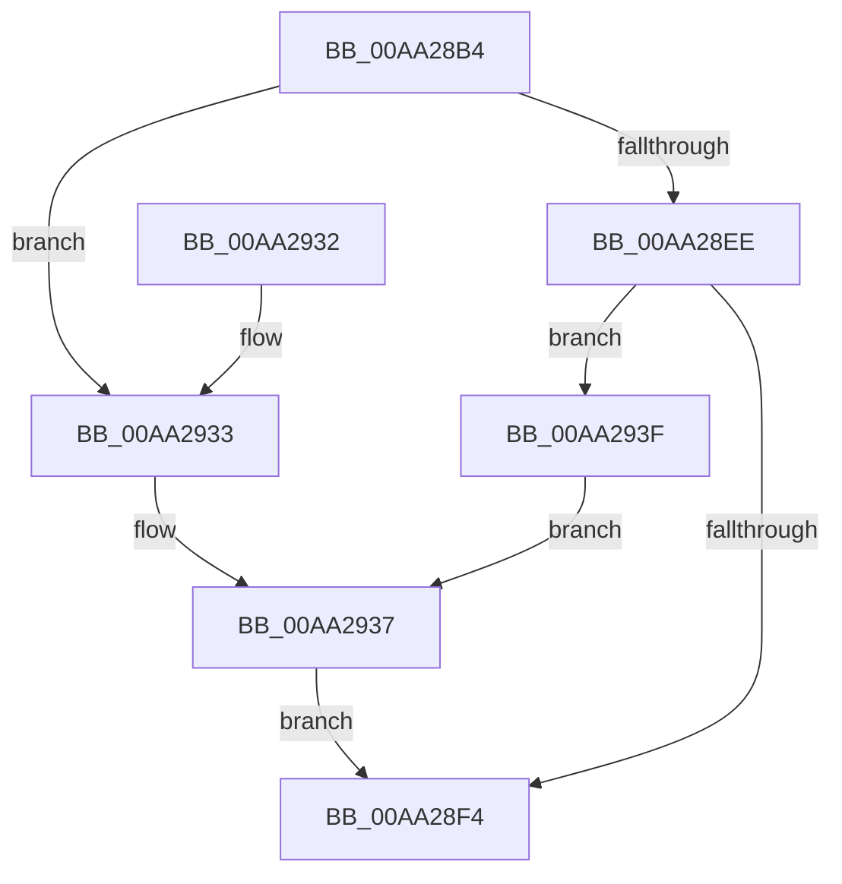

# SeSetVirtualizationToken

- RVA: `0x00AA28B4`–`0x00AA2945` (길이 `145` bytes)
- VA: `0x0000000140AA28B4`
- 실행 섹션: `PAGE`
- PDB 이름 있음: `예`; PDB Function 태그: `아니요`
- unwind 정보 RVA: `0x00093470`
- 디코드: `38`개 명령, `145/145` bytes 표시
- 미해석 바이트: `0` (있으면 어셈블리에 `.byte`로 보존)

> 이 문서는 커널 이미지의 기계어와 PDB 기호를 분석해 생성했습니다. 4번과 5번은 함수 원형과 자료형을 바이너리 사용 방식에서 추정한 C 해석이며 원본 소스 복구 결과는 아닙니다.

## 1. Dependencies

- 직접 호출 지점: **3**; 고유 호출 대상: **3**
- 직접 호출자로 확인된 함수: **2**
- RIP 상대 이미지 참조: **2**

### Outgoing calls
- `0x00AA28DA` → [ExAcquireResourceExclusiveLite](../../text/21/ExAcquireResourceExclusiveLite_function_00214E20.md) (function, `0x00214E20`)
- `0x00AA291D` → [ExReleaseResourceLite](../../text/25/ExReleaseResourceLite_function_0025FA10.md) (function, `0x0025FA10`)
- `0x00AA2922` → [KeLeaveCriticalRegion](../../text/25/KeLeaveCriticalRegion_function_0025D8B0.md) (function, `0x0025D8B0`)

### Direct callers
- [NtSetInformationProcess](../AE/NtSetInformationProcess_function_00AE5370.md) at `0x00AE796B`
- [NtSetInformationToken](../AF/NtSetInformationToken_function_00AF0530.md) at `0x00AF1169`

### Static image references
- `0x00AA28F4` → RVA `0x00012D08` (`.rdata`; read)
- `0x00AA28FE` → RVA `0x00E0EBF0` (`.data`; read/write)

## 2. Other-region calls and transfers

- 다른 실행 섹션으로 향하는 call: **3**
  - `0x00AA28DA` → [ExAcquireResourceExclusiveLite](../../text/21/ExAcquireResourceExclusiveLite_function_00214E20.md) (`PAGE` → `.text`)
  - `0x00AA291D` → [ExReleaseResourceLite](../../text/25/ExReleaseResourceLite_function_0025FA10.md) (`PAGE` → `.text`)
  - `0x00AA2922` → [KeLeaveCriticalRegion](../../text/25/KeLeaveCriticalRegion_function_0025D8B0.md) (`PAGE` → `.text`)
- 별도 외부 분기/꼬리 이동을 확인하지 못했습니다.

## 3. Assembly (complete function range)

```asm
00AA28B4  48 89 5C 24 08                  mov qword ptr [rsp + 8], rbx
00AA28B9  57                              push rdi
00AA28BA  48 83 EC 20                     sub rsp, 0x20
00AA28BE  65 48 8B 04 25 88 01 00 00      mov rax, qword ptr gs:[0x188]
00AA28C7  8B DA                           mov ebx, edx
00AA28C9  48 8B F9                        mov rdi, rcx
00AA28CC  B2 01                           mov dl, 1
00AA28CE  66 FF 88 E4 01 00 00            dec word ptr [rax + 0x1e4]
00AA28D5  90                              nop
00AA28D6  48 8B 49 30                     mov rcx, qword ptr [rcx + 0x30]
00AA28DA  E8 41 25 77 FF                  call 0x140214e20
00AA28DF  F0 83 0C 24 00                  lock or dword ptr [rsp], 0
00AA28E4  8B 87 C8 00 00 00               mov eax, dword ptr [rdi + 0xc8]
00AA28EA  85 DB                           test ebx, ebx
00AA28EC  74 45                           je 0x140aa2933
00AA28EE  0F BA E0 09                     bt eax, 9
00AA28F2  72 4B                           jb 0x140aa293f
00AA28F4  48 8B 0D 0D 04 57 FF            mov rcx, qword ptr [rip - 0xa8fbf3]
00AA28FB  48 8B C1                        mov rax, rcx
00AA28FE  F0 48 0F C1 05 E9 C2 36 00      lock xadd qword ptr [rip + 0x36c2e9], rax
00AA2907  48 03 C1                        add rax, rcx
00AA290A  89 47 38                        mov dword ptr [rdi + 0x38], eax
00AA290D  48 C1 E8 20                     shr rax, 0x20
00AA2911  89 47 3C                        mov dword ptr [rdi + 0x3c], eax
00AA2914  F0 83 0C 24 00                  lock or dword ptr [rsp], 0
00AA2919  48 8B 4F 30                     mov rcx, qword ptr [rdi + 0x30]
00AA291D  E8 EE D0 7B FF                  call 0x14025fa10
00AA2922  E8 89 AF 7B FF                  call 0x14025d8b0
00AA2927  48 8B 5C 24 30                  mov rbx, qword ptr [rsp + 0x30]
00AA292C  48 83 C4 20                     add rsp, 0x20
00AA2930  5F                              pop rdi
00AA2931  C3                              ret
00AA2932  CC                              int3
00AA2933  0F BA F0 0A                     btr eax, 0xa
00AA2937  89 87 C8 00 00 00               mov dword ptr [rdi + 0xc8], eax
00AA293D  EB B5                           jmp 0x140aa28f4
00AA293F  0F BA E8 0A                     bts eax, 0xa
00AA2943  EB F2                           jmp 0x140aa2937
```

## 4. C-style interpretation (structured pseudocode)

```c
__int64 __fastcall SeSetVirtualizationToken(__int64 a1, int a2)
{
    __int64 result;
    __int64 v_rsp;
    unsigned int v_stack_m28;
    unsigned __int64 v_stack_p8;

    v_stack_p8 = v_rbx;
    v_rsp = (v_rsp) - (32);
    result = ExAcquireResourceExclusiveLite(*(unsigned __int64 *)(a1 + 48), 1, a3, a4);
    if ((unsigned int)((unsigned int)(a2)) == 0) goto loc_00AA2933;
    if (condition_is_below) goto loc_00AA293F;
loc_00AA28F4:
    result = (*(unsigned __int64 *)(v_rip - 11074547)) + (*(unsigned __int64 *)(v_rip - 11074547));
    *(unsigned int *)(a1 + 56) = (unsigned int)(result);
    result = (result) >> (32);
    *(unsigned int *)(a1 + 60) = (unsigned int)(result);
    result = ExReleaseResourceLite(*(unsigned __int64 *)(a1 + 48), 1, a3, a4);
    result = KeLeaveCriticalRegion(*(unsigned __int64 *)(a1 + 48), 1, a3, a4);
    v_rsp = (v_rsp) + (32);
    return result;
loc_00AA2933:
loc_00AA2937:
    *(unsigned int *)(a1 + 200) = (unsigned int)(result);
    goto loc_00AA28F4;
loc_00AA293F:
    goto loc_00AA2937;
}
```

## 5. (Beta) C Style

```c
int64_t SeSetVirtualizationToken(void *Arg1, int32_t Arg2)
{
    uint8_t *arg1 = (uint8_t *)Arg1;

    int64_t result;
    int64_t local_rsp;
    uint32_t v_stack_m28;
    uint64_t v_stack_p8;

    v_stack_p8 = local_rbx;
    local_rsp = (local_rsp) - (32);
    result = ExAcquireResourceExclusiveLite(*(uint64_t *)(arg1 + 0x30), 1, a3, a4);
    if ((uint32_t)((uint32_t)(Arg2)) == 0) goto loc_00AA2933;
    if (condition_is_below) goto loc_00AA293F;
loc_00AA28F4:
    result = (*(uint64_t *)(v_rip - 0xA8FBF3)) + (*(uint64_t *)(v_rip - 0xA8FBF3));
    *(uint32_t *)(arg1 + 0x38) = (uint32_t)(result);
    result = (result) >> (32);
    *(uint32_t *)(arg1 + 0x3C) = (uint32_t)(result);
    result = ExReleaseResourceLite(*(uint64_t *)(arg1 + 0x30), 1, a3, a4);
    result = KeLeaveCriticalRegion(*(uint64_t *)(arg1 + 0x30), 1, a3, a4);
    local_rsp = (local_rsp) + (32);
    return result;
loc_00AA2933:
loc_00AA2937:
    *(uint32_t *)(arg1 + 0xC8) = (uint32_t)(result);
    goto loc_00AA28F4;
loc_00AA293F:
    goto loc_00AA2937;
}
```

### 관측된 메모리 오프셋

구조체 형식이 확인되지 않은 접근은 인자 기준의 오프셋으로만 기록했습니다.

| 기준 인자 | 오프셋 표현 | 폭 (bit) | 접근 |
|---|---:|---:|---|
| `Arg1` | `+ 0x30` | `64` | `R` |
| `Arg1` | `+ 0x38` | `32` | `W` |
| `Arg1` | `+ 0x3C` | `32` | `W` |
| `Arg1` | `+ 0xC8` | `32` | `R` |
| `Arg1` | `+ 0xC8` | `32` | `W` |

## 6. Execution-region graph

[열기: 2D/3D 그래프와 함수 탐색 컨트롤 패널](../../../control-panel.html?section=page&rva=0x00AA28B4&view=graph)

- 2D 그래프는 위에서 아래로 흐르고, 3D 그래프는 빈 공간을 드래그해 회전합니다. Shift+드래그는 이동, 휠은 확대·축소, 함수 노드 선택은 대상 보고서 이동입니다.

### Static fallback


