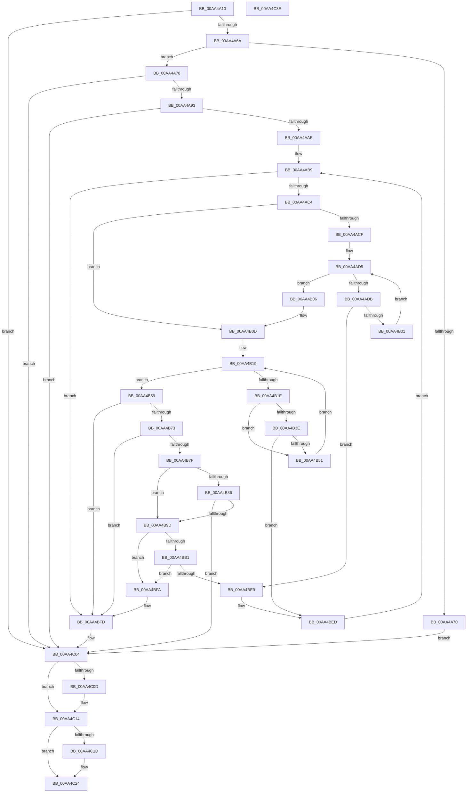

# SepCheckCapabilities

- RVA: `0x00AA4A10`–`0x00AA4C3F` (길이 `559` bytes)
- VA: `0x0000000140AA4A10`
- 실행 섹션: `PAGE`
- PDB 이름 있음: `예`; PDB Function 태그: `아니요`
- unwind 정보 RVA: `0x000BB578`
- 디코드: `166`개 명령, `559/559` bytes 표시
- 미해석 바이트: `0` (있으면 어셈블리에 `.byte`로 보존)

> 이 문서는 커널 이미지의 기계어와 PDB 기호를 분석해 생성했습니다. 4번과 5번은 함수 원형과 자료형을 바이너리 사용 방식에서 추정한 C 해석이며 원본 소스 복구 결과는 아닙니다.

## 1. Dependencies

- 직접 호출 지점: **13**; 고유 호출 대상: **6**
- 직접 호출자로 확인된 함수: **3**
- RIP 상대 이미지 참조: **1**

### Outgoing calls
- `0x00AA4A5B` → [SeQueryInformationToken](../8B/SeQueryInformationToken_function_008B5090.md) (function, `0x008B5090`)
- `0x00AA4A84` → [SeQueryInformationToken](../8B/SeQueryInformationToken_function_008B5090.md) (function, `0x008B5090`)
- `0x00AA4A9F` → [SeQueryInformationToken](../8B/SeQueryInformationToken_function_008B5090.md) (function, `0x008B5090`)
- `0x00AA4AF4` → [RtlEqualSid](../../text/40/RtlEqualSid_function_00400AD0.md) (function, `0x00400AD0`)
- `0x00AA4B31` → [RtlEqualSid](../../text/40/RtlEqualSid_function_00400AD0.md) (function, `0x00400AD0`)
- `0x00AA4B75` → [RtlSubAuthoritySid](../../text/45/RtlSubAuthoritySid_function_00456D10.md) (function, `0x00456D10`)
- `0x00AA4B92` → [SeQueryInformationToken](../8B/SeQueryInformationToken_function_008B5090.md) (function, `0x008B5090`)
- `0x00AA4BA7` → [RtlSubAuthorityCountSid](../../text/46/RtlSubAuthorityCountSid_function_00468F10.md) (function, `0x00468F10`)
- `0x00AA4BB9` → [RtlSubAuthoritySid](../../text/45/RtlSubAuthoritySid_function_00456D10.md) (function, `0x00456D10`)
- `0x00AA4BCD` → [RtlSubAuthoritySid](../../text/45/RtlSubAuthoritySid_function_00456D10.md) (function, `0x00456D10`)
- `0x00AA4BDE` → [RtlCompareMemory](../../text/6B/RtlCompareMemory_function_006BA670.md) (function, `0x006BA670`)
- `0x00AA4C0F` → [ExFreePoolWithTag](../../poolcode/B8/ExFreePoolWithTag_function_00B82870.md) (function, `0x00B82870`)
- `0x00AA4C1F` → [ExFreePoolWithTag](../../poolcode/B8/ExFreePoolWithTag_function_00B82870.md) (function, `0x00B82870`)

### Direct callers
- [SepCreateAppContainerToken](../../text/4F/SepCreateAppContainerToken_function_004F43AC.md) at `0x004F469F`
- [NtCreateLowBoxToken](../AB/NtCreateLowBoxToken_function_00AB9880.md) at `0x00AB9ED1`
- [sub_00B375D4](../B3/Unknown_function_00B375D4.md) at `0x00B37751`

### Static image references
- `0x00AA4ADB` → RVA `0x00FD8D90` (`PAGEDATA`; read)

## 2. Other-region calls and transfers

- 다른 실행 섹션으로 향하는 call: **9**
  - `0x00AA4AF4` → [RtlEqualSid](../../text/40/RtlEqualSid_function_00400AD0.md) (`PAGE` → `.text`)
  - `0x00AA4B31` → [RtlEqualSid](../../text/40/RtlEqualSid_function_00400AD0.md) (`PAGE` → `.text`)
  - `0x00AA4B75` → [RtlSubAuthoritySid](../../text/45/RtlSubAuthoritySid_function_00456D10.md) (`PAGE` → `.text`)
  - `0x00AA4BA7` → [RtlSubAuthorityCountSid](../../text/46/RtlSubAuthorityCountSid_function_00468F10.md) (`PAGE` → `.text`)
  - `0x00AA4BB9` → [RtlSubAuthoritySid](../../text/45/RtlSubAuthoritySid_function_00456D10.md) (`PAGE` → `.text`)
  - `0x00AA4BCD` → [RtlSubAuthoritySid](../../text/45/RtlSubAuthoritySid_function_00456D10.md) (`PAGE` → `.text`)
  - `0x00AA4BDE` → [RtlCompareMemory](../../text/6B/RtlCompareMemory_function_006BA670.md) (`PAGE` → `.text`)
  - `0x00AA4C0F` → [ExFreePoolWithTag](../../poolcode/B8/ExFreePoolWithTag_function_00B82870.md) (`PAGE` → `POOLCODE`)
  - `0x00AA4C1F` → [ExFreePoolWithTag](../../poolcode/B8/ExFreePoolWithTag_function_00B82870.md) (`PAGE` → `POOLCODE`)
- 별도 외부 분기/꼬리 이동을 확인하지 못했습니다.

## 3. Assembly (complete function range)

```asm
00AA4A10  48 8B C4                        mov rax, rsp
00AA4A13  48 89 58 08                     mov qword ptr [rax + 8], rbx
00AA4A17  44 88 48 20                     mov byte ptr [rax + 0x20], r9b
00AA4A1B  4C 89 40 18                     mov qword ptr [rax + 0x18], r8
00AA4A1F  89 50 10                        mov dword ptr [rax + 0x10], edx
00AA4A22  55                              push rbp
00AA4A23  56                              push rsi
00AA4A24  57                              push rdi
00AA4A25  41 54                           push r12
00AA4A27  41 55                           push r13
00AA4A29  41 56                           push r14
00AA4A2B  41 57                           push r15
00AA4A2D  48 8B EC                        mov rbp, rsp
00AA4A30  48 83 EC 40                     sub rsp, 0x40
00AA4A34  48 8B 75 60                     mov rsi, qword ptr [rbp + 0x60]
00AA4A38  4C 8D 45 58                     lea r8, [rbp + 0x58]
00AA4A3C  45 33 F6                        xor r14d, r14d
00AA4A3F  8B DA                           mov ebx, edx
00AA4A41  4C 8B E9                        mov r13, rcx
00AA4A44  4C 89 75 F0                     mov qword ptr [rbp - 0x10], r14
00AA4A48  4C 89 75 F8                     mov qword ptr [rbp - 8], r14
00AA4A4C  44 89 75 58                     mov dword ptr [rbp + 0x58], r14d
00AA4A50  41 8D 56 1D                     lea edx, [r14 + 0x1d]
00AA4A54  44 89 75 E0                     mov dword ptr [rbp - 0x20], r14d
00AA4A58  44 88 36                        mov byte ptr [rsi], r14b
00AA4A5B  E8 30 06 E1 FF                  call 0x1408b5090
00AA4A60  8B F8                           mov edi, eax
00AA4A62  85 C0                           test eax, eax
00AA4A64  0F 88 9A 01 00 00               js 0x140aa4c04
00AA4A6A  44 39 75 58                     cmp dword ptr [rbp + 0x58], r14d
00AA4A6E  75 08                           jne 0x140aa4a78
00AA4A70  C6 06 01                        mov byte ptr [rsi], 1
00AA4A73  E9 8C 01 00 00                  jmp 0x140aa4c04
00AA4A78  4C 8D 45 F0                     lea r8, [rbp - 0x10]
00AA4A7C  BA 1E 00 00 00                  mov edx, 0x1e
00AA4A81  49 8B CD                        mov rcx, r13
00AA4A84  E8 07 06 E1 FF                  call 0x1408b5090
00AA4A89  8B F8                           mov edi, eax
00AA4A8B  85 C0                           test eax, eax
00AA4A8D  0F 88 71 01 00 00               js 0x140aa4c04
00AA4A93  4C 8D 45 E0                     lea r8, [rbp - 0x20]
00AA4A97  BA 2E 00 00 00                  mov edx, 0x2e
00AA4A9C  49 8B CD                        mov rcx, r13
00AA4A9F  E8 EC 05 E1 FF                  call 0x1408b5090
00AA4AA4  8B F8                           mov edi, eax
00AA4AA6  85 C0                           test eax, eax
00AA4AA8  0F 88 56 01 00 00               js 0x140aa4c04
00AA4AAE  48 8B 4D F0                     mov rcx, qword ptr [rbp - 0x10]
00AA4AB2  41 8B F6                        mov esi, r14d
00AA4AB5  48 89 4D E8                     mov qword ptr [rbp - 0x18], rcx
00AA4AB9  41 B7 01                        mov r15b, 1
00AA4ABC  3B F3                           cmp esi, ebx
00AA4ABE  0F 83 39 01 00 00               jae 0x140aa4bfd
00AA4AC4  45 8A FE                        mov r15b, r14b
00AA4AC7  8B DE                           mov ebx, esi
00AA4AC9  44 39 75 E0                     cmp dword ptr [rbp - 0x20], r14d
00AA4ACD  75 3E                           jne 0x140aa4b0d
00AA4ACF  44 8B E3                        mov r12d, ebx
00AA4AD2  4D 03 E4                        add r12, r12
00AA4AD5  41 83 FE 12                     cmp r14d, 0x12
00AA4AD9  73 2B                           jae 0x140aa4b06
00AA4ADB  48 8D 05 AE 42 53 00            lea rax, [rip + 0x5342ae]
00AA4AE2  41 8B D6                        mov edx, r14d
00AA4AE5  48 8B 14 D0                     mov rdx, qword ptr [rax + rdx*8]
00AA4AE9  48 8B 45 50                     mov rax, qword ptr [rbp + 0x50]
00AA4AED  48 8B 12                        mov rdx, qword ptr [rdx]
00AA4AF0  4A 8B 0C E0                     mov rcx, qword ptr [rax + r12*8]
00AA4AF4  E8 D7 BF 95 FF                  call 0x140400ad0
00AA4AF9  84 C0                           test al, al
00AA4AFB  0F 85 E8 00 00 00               jne 0x140aa4be9
00AA4B01  41 FF C6                        inc r14d
00AA4B04  EB CF                           jmp 0x140aa4ad5
00AA4B06  48 8B 4D E8                     mov rcx, qword ptr [rbp - 0x18]
00AA4B0A  45 33 F6                        xor r14d, r14d
00AA4B0D  48 8B 45 F0                     mov rax, qword ptr [rbp - 0x10]
00AA4B11  48 03 DB                        add rbx, rbx
00AA4B14  8B 00                           mov eax, dword ptr [rax]
00AA4B16  89 45 E4                        mov dword ptr [rbp - 0x1c], eax
00AA4B19  44 3B F0                        cmp r14d, eax
00AA4B1C  73 3B                           jae 0x140aa4b59
00AA4B1E  48 8B 45 50                     mov rax, qword ptr [rbp + 0x50]
00AA4B22  45 8B E6                        mov r12d, r14d
00AA4B25  4D 03 E4                        add r12, r12
00AA4B28  48 8B 14 D8                     mov rdx, qword ptr [rax + rbx*8]
00AA4B2C  4A 8B 4C E1 08                  mov rcx, qword ptr [rcx + r12*8 + 8]
00AA4B31  E8 9A BF 95 FF                  call 0x140400ad0
00AA4B36  48 8B 4D E8                     mov rcx, qword ptr [rbp - 0x18]
00AA4B3A  84 C0                           test al, al
00AA4B3C  74 13                           je 0x140aa4b51
00AA4B3E  48 8B 45 50                     mov rax, qword ptr [rbp + 0x50]
00AA4B42  8B 44 D8 08                     mov eax, dword ptr [rax + rbx*8 + 8]
00AA4B46  42 39 44 E1 10                  cmp dword ptr [rcx + r12*8 + 0x10], eax
00AA4B4B  0F 84 9C 00 00 00               je 0x140aa4bed
00AA4B51  8B 45 E4                        mov eax, dword ptr [rbp - 0x1c]
00AA4B54  41 FF C6                        inc r14d
00AA4B57  EB C0                           jmp 0x140aa4b19
00AA4B59  4C 8B 65 50                     mov r12, qword ptr [rbp + 0x50]
00AA4B5D  8B C6                           mov eax, esi
00AA4B5F  48 03 C0                        add rax, rax
00AA4B62  44 8B F6                        mov r14d, esi
00AA4B65  49 8B 0C C4                     mov rcx, qword ptr [r12 + rax*8]
00AA4B69  80 79 01 09                     cmp byte ptr [rcx + 1], 9
00AA4B6D  0F 85 8A 00 00 00               jne 0x140aa4bfd
00AA4B73  33 D2                           xor edx, edx
00AA4B75  E8 96 21 9B FF                  call 0x140456d10
00AA4B7A  83 38 03                        cmp dword ptr [rax], 3
00AA4B7D  75 7E                           jne 0x140aa4bfd
00AA4B7F  48 83 7D F8 00                  cmp qword ptr [rbp - 8], 0
00AA4B84  75 17                           jne 0x140aa4b9d
00AA4B86  4C 8D 45 F8                     lea r8, [rbp - 8]
00AA4B8A  BA 1F 00 00 00                  mov edx, 0x1f
00AA4B8F  49 8B CD                        mov rcx, r13
00AA4B92  E8 F9 04 E1 FF                  call 0x1408b5090
00AA4B97  8B F8                           mov edi, eax
00AA4B99  85 C0                           test eax, eax
00AA4B9B  78 67                           js 0x140aa4c04
00AA4B9D  48 8B 45 F8                     mov rax, qword ptr [rbp - 8]
00AA4BA1  48 8B 18                        mov rbx, qword ptr [rax]
00AA4BA4  48 8B CB                        mov rcx, rbx
00AA4BA7  E8 64 43 9C FF                  call 0x140468f10
00AA4BAC  80 38 08                        cmp byte ptr [rax], 8
00AA4BAF  72 49                           jb 0x140aa4bfa
00AA4BB1  BA 01 00 00 00                  mov edx, 1
00AA4BB6  48 8B CB                        mov rcx, rbx
00AA4BB9  E8 52 21 9B FF                  call 0x140456d10
00AA4BBE  4D 03 F6                        add r14, r14
00AA4BC1  BA 01 00 00 00                  mov edx, 1
00AA4BC6  48 8B D8                        mov rbx, rax
00AA4BC9  4B 8B 0C F4                     mov rcx, qword ptr [r12 + r14*8]
00AA4BCD  E8 3E 21 9B FF                  call 0x140456d10
00AA4BD2  48 8B C8                        mov rcx, rax
00AA4BD5  41 B8 1C 00 00 00               mov r8d, 0x1c
00AA4BDB  48 8B D3                        mov rdx, rbx
00AA4BDE  E8 8D 5A C1 FF                  call 0x1406ba670
00AA4BE3  48 83 F8 1C                     cmp rax, 0x1c
00AA4BE7  75 11                           jne 0x140aa4bfa
00AA4BE9  48 8B 4D E8                     mov rcx, qword ptr [rbp - 0x18]
00AA4BED  8B 5D 48                        mov ebx, dword ptr [rbp + 0x48]
00AA4BF0  FF C6                           inc esi
00AA4BF2  45 33 F6                        xor r14d, r14d
00AA4BF5  E9 BF FE FF FF                  jmp 0x140aa4ab9
00AA4BFA  45 32 FF                        xor r15b, r15b
00AA4BFD  48 8B 45 60                     mov rax, qword ptr [rbp + 0x60]
00AA4C01  44 88 38                        mov byte ptr [rax], r15b
00AA4C04  48 8B 4D F0                     mov rcx, qword ptr [rbp - 0x10]
00AA4C08  48 85 C9                        test rcx, rcx
00AA4C0B  74 07                           je 0x140aa4c14
00AA4C0D  33 D2                           xor edx, edx
00AA4C0F  E8 5C DC 0D 00                  call 0x140b82870
00AA4C14  48 8B 4D F8                     mov rcx, qword ptr [rbp - 8]
00AA4C18  48 85 C9                        test rcx, rcx
00AA4C1B  74 07                           je 0x140aa4c24
00AA4C1D  33 D2                           xor edx, edx
00AA4C1F  E8 4C DC 0D 00                  call 0x140b82870
00AA4C24  48 8B 9C 24 80 00 00 00         mov rbx, qword ptr [rsp + 0x80]
00AA4C2C  8B C7                           mov eax, edi
00AA4C2E  48 83 C4 40                     add rsp, 0x40
00AA4C32  41 5F                           pop r15
00AA4C34  41 5E                           pop r14
00AA4C36  41 5D                           pop r13
00AA4C38  41 5C                           pop r12
00AA4C3A  5F                              pop rdi
00AA4C3B  5E                              pop rsi
00AA4C3C  5D                              pop rbp
00AA4C3D  C3                              ret
00AA4C3E  CC                              int3
```

## 4. C-style interpretation (structured pseudocode)

```c
__int64 __fastcall SepCheckCapabilities(__int64 a1, int a2, __int64 a3, unsigned __int8 a4, __int64 a5)
{
    __int64 result;
    __int64 v_r12;
    __int64 v_r14;
    __int64 v_r15;
    __int64 v_rbx;
    __int64 v_rsi;
    __int64 v_rsp;
    unsigned __int64 v_stack_m40;
    unsigned __int64 v_stack_m48;
    unsigned __int64 v_stack_m50;
    unsigned int v_stack_m54;
    unsigned int v_stack_m58;
    unsigned int v_stack_p10;
    unsigned __int64 v_stack_p18;
    unsigned __int64 v_stack_p20;
    unsigned __int64 v_stack_p8;

    *(unsigned __int64 *)(v_rsp + 8) = v_rbx;
    *(unsigned __int8 *)(v_rsp + 32) = a4;
    *(unsigned __int64 *)(v_rsp + 24) = a3;
    *(unsigned int *)(v_rsp + 16) = a2;
    v_rsp = (v_rsp) - (64);
    v_r14 = 0;
    v_stack_m48 = 0;
    v_stack_m40 = 0;
    v_stack_p20 = 0;
    v_stack_m58 = 0;
    *(unsigned __int8 *)(a5) = 0;
    result = SeQueryInformationToken(a1, v_r14 + 29, v_stack_p20, a4);
    if (sign_flag) goto loc_00AA4C04;
    if (v_stack_p20 != 0) goto loc_00AA4A78;
    *(unsigned __int8 *)(a5) = 1;
    goto loc_00AA4C04;
loc_00AA4A78:
    result = SeQueryInformationToken(a1, 30, v_stack_m48, a4);
    if (sign_flag) goto loc_00AA4C04;
    result = SeQueryInformationToken(a1, 46, v_stack_m58, a4);
    if (sign_flag) goto loc_00AA4C04;
    v_stack_m50 = v_stack_m48;
loc_00AA4AB9:
    if (0 >= ((unsigned int)((unsigned int)(a2)))) goto loc_00AA4BFD;
    if (v_stack_m58 != 0) goto loc_00AA4B0D;
    v_r12 = (0) + (0);
loc_00AA4AD5:
    if (0 >= 18) goto loc_00AA4B06;
    result = RtlEqualSid(*(unsigned __int64 *)(v_stack_p18 + v_r12 * 8), *(unsigned __int64 *)(*(unsigned __int64 *)(v_rip + 5456558 + 0 * 8)), v_stack_m58, a4);
    if ((unsigned __int8)(result) != 0) goto loc_00AA4BE9;
    v_r14 = (unsigned int)((v_r14) + 1);
    goto loc_00AA4AD5;
loc_00AA4B06:
    v_r14 = 0;
loc_00AA4B0D:
    v_rbx = (0) + (0);
    v_stack_m54 = (unsigned int)((unsigned int)(*(unsigned int *)(v_stack_m48)));
loc_00AA4B19:
    if (0 >= ((unsigned int)((unsigned int)(*(unsigned int *)(v_stack_m48))))) goto loc_00AA4B59;
    v_r12 = (0) + (0);
    result = RtlEqualSid(*(unsigned __int64 *)(v_stack_m50 + v_r12 * 8 + 8), *(unsigned __int64 *)(v_stack_p18 + v_rbx * 8), v_stack_m58, a4);
    if ((unsigned __int8)(result) == 0) goto loc_00AA4B51;
    if ((*(unsigned int *)(v_stack_m50 + v_r12 * 8 + 16)) == ((unsigned int)((unsigned int)(*(unsigned int *)(v_stack_p18 + v_rbx * 8 + 8))))) goto loc_00AA4BED;
loc_00AA4B51:
    v_r14 = (unsigned int)((v_r14) + 1);
    goto loc_00AA4B19;
loc_00AA4B59:
    result = (0) + (0);
    if ((*(unsigned __int8 *)(*(unsigned __int64 *)(v_stack_p18 + result * 8) + 1)) != 9) goto loc_00AA4BFD;
    a2 = 0;
    result = RtlSubAuthoritySid(*(unsigned __int64 *)(v_stack_p18 + result * 8), a2, v_stack_m58, a4);
    if ((*(unsigned int *)(result)) != 3) goto loc_00AA4BFD;
    if (v_stack_m40 != 0) goto loc_00AA4B9D;
    result = SeQueryInformationToken(a1, 31, v_stack_m40, a4);
    if (sign_flag) goto loc_00AA4C04;
loc_00AA4B9D:
    result = RtlSubAuthorityCountSid(*(unsigned __int64 *)(v_stack_m40), 31, v_stack_m40, a4);
    if ((*(unsigned __int8 *)(result)) < 8) goto loc_00AA4BFA;
    result = RtlSubAuthoritySid(*(unsigned __int64 *)(v_stack_m40), 1, v_stack_m40, a4);
    v_r14 = (0) + (0);
    result = RtlSubAuthoritySid(*(unsigned __int64 *)(v_stack_p18 + v_r14 * 8), 1, v_stack_m40, a4);
    result = RtlCompareMemory(result, result, 28, a4);
    if (result != 28) goto loc_00AA4BFA;
loc_00AA4BE9:
loc_00AA4BED:
    v_rsi = (unsigned int)((0) + 1);
    v_r14 = 0;
    goto loc_00AA4AB9;
loc_00AA4BFA:
    v_r15 = 0;
loc_00AA4BFD:
    *(unsigned __int8 *)(a5) = 0;
loc_00AA4C04:
    result = a5;
    if (v_stack_m48 != 0) {
        a2 = 0;
        result = ExFreePoolWithTag(v_stack_m48, a2, 28, a4);
    }
    if (v_stack_m40 != 0) {
        a2 = 0;
        result = ExFreePoolWithTag(v_stack_m40, a2, 28, a4);
    }
    v_rsp = (v_rsp) + (64);
    return (unsigned int)((unsigned int)((unsigned int)((unsigned int)(result))));
}
```

## 5. (Beta) C Style

```c
int64_t SepCheckCapabilities(int64_t Arg1, int32_t Arg2, int64_t Arg3, uint8_t Arg4, void *Arg5)
{
    uint8_t *arg5 = (uint8_t *)Arg5;

    int64_t result;
    int64_t local_r12;
    int64_t local_r14;
    int64_t local_r15;
    int64_t local_rbx;
    int64_t local_rsi;
    int64_t local_rsp;
    uint64_t v_stack_m40;
    uint64_t v_stack_m48;
    uint64_t v_stack_m50;
    uint32_t v_stack_m54;
    uint32_t v_stack_m58;
    uint32_t v_stack_p10;
    uint64_t v_stack_p18;
    uint64_t v_stack_p20;
    uint64_t v_stack_p8;

    *(uint64_t *)(local_rsp + 0x8) = local_rbx;
    *(uint8_t *)(local_rsp + 0x20) = Arg4;
    *(uint64_t *)(local_rsp + 0x18) = Arg3;
    *(uint32_t *)(local_rsp + 0x10) = Arg2;
    local_rsp = (local_rsp) - (64);
    local_r14 = 0;
    v_stack_m48 = 0;
    v_stack_m40 = 0;
    v_stack_p20 = 0;
    v_stack_m58 = 0;
    *(uint8_t *)(arg5) = 0;
    result = SeQueryInformationToken(Arg1, local_r14 + 29, v_stack_p20, Arg4);
    if (sign_flag) goto loc_00AA4C04;
    if (v_stack_p20 != 0) goto loc_00AA4A78;
    *(uint8_t *)(arg5) = 1;
    goto loc_00AA4C04;
loc_00AA4A78:
    result = SeQueryInformationToken(Arg1, 30, v_stack_m48, Arg4);
    if (sign_flag) goto loc_00AA4C04;
    result = SeQueryInformationToken(Arg1, 46, v_stack_m58, Arg4);
    if (sign_flag) goto loc_00AA4C04;
    v_stack_m50 = v_stack_m48;
loc_00AA4AB9:
    if (0 >= ((uint32_t)((uint32_t)(Arg2)))) goto loc_00AA4BFD;
    if (v_stack_m58 != 0) goto loc_00AA4B0D;
    local_r12 = (0) + (0);
loc_00AA4AD5:
    if (0 >= 18) goto loc_00AA4B06;
    result = RtlEqualSid(*(uint64_t *)(v_stack_p18 + local_r12 * 8), *(uint64_t *)(*(uint64_t *)(v_rip + 0x5342AE + 0x0 * 8)), v_stack_m58, Arg4);
    if ((uint8_t)(result) != 0) goto loc_00AA4BE9;
    local_r14 = (uint32_t)((local_r14) + 1);
    goto loc_00AA4AD5;
loc_00AA4B06:
    local_r14 = 0;
loc_00AA4B0D:
    local_rbx = (0) + (0);
    v_stack_m54 = (uint32_t)((uint32_t)(*(uint32_t *)(v_stack_m48)));
loc_00AA4B19:
    if (0 >= ((uint32_t)((uint32_t)(*(uint32_t *)(v_stack_m48))))) goto loc_00AA4B59;
    local_r12 = (0) + (0);
    result = RtlEqualSid(*(uint64_t *)(v_stack_m50 + local_r12 * 8 + 0x8), *(uint64_t *)(v_stack_p18 + local_rbx * 8), v_stack_m58, Arg4);
    if ((uint8_t)(result) == 0) goto loc_00AA4B51;
    if ((*(uint32_t *)(v_stack_m50 + local_r12 * 8 + 0x10)) == ((uint32_t)((uint32_t)(*(uint32_t *)(v_stack_p18 + local_rbx * 8 + 0x8))))) goto loc_00AA4BED;
loc_00AA4B51:
    local_r14 = (uint32_t)((local_r14) + 1);
    goto loc_00AA4B19;
loc_00AA4B59:
    result = (0) + (0);
    if ((*(uint8_t *)(*(uint64_t *)(v_stack_p18 + result * 8) + 0x1)) != 9) goto loc_00AA4BFD;
    Arg2 = 0;
    result = RtlSubAuthoritySid(*(uint64_t *)(v_stack_p18 + result * 8), Arg2, v_stack_m58, Arg4);
    if ((*(uint32_t *)(result)) != 3) goto loc_00AA4BFD;
    if (v_stack_m40 != 0) goto loc_00AA4B9D;
    result = SeQueryInformationToken(Arg1, 31, v_stack_m40, Arg4);
    if (sign_flag) goto loc_00AA4C04;
loc_00AA4B9D:
    result = RtlSubAuthorityCountSid(*(uint64_t *)(v_stack_m40), 31, v_stack_m40, Arg4);
    if ((*(uint8_t *)(result)) < 8) goto loc_00AA4BFA;
    result = RtlSubAuthoritySid(*(uint64_t *)(v_stack_m40), 1, v_stack_m40, Arg4);
    local_r14 = (0) + (0);
    result = RtlSubAuthoritySid(*(uint64_t *)(v_stack_p18 + local_r14 * 8), 1, v_stack_m40, Arg4);
    result = RtlCompareMemory(result, result, 28, Arg4);
    if (result != 28) goto loc_00AA4BFA;
loc_00AA4BE9:
loc_00AA4BED:
    local_rsi = (uint32_t)((0) + 1);
    local_r14 = 0;
    goto loc_00AA4AB9;
loc_00AA4BFA:
    local_r15 = 0;
loc_00AA4BFD:
    *(uint8_t *)(arg5) = 0;
loc_00AA4C04:
    result = Arg5;
    if (v_stack_m48 != 0) {
        Arg2 = 0;
        result = ExFreePoolWithTag(v_stack_m48, Arg2, 28, Arg4);
    }
    if (v_stack_m40 != 0) {
        Arg2 = 0;
        result = ExFreePoolWithTag(v_stack_m40, Arg2, 28, Arg4);
    }
    local_rsp = (local_rsp) + (64);
    return (uint32_t)((uint32_t)((uint32_t)((uint32_t)(result))));
}
```

### 관측된 메모리 오프셋

구조체 형식이 확인되지 않은 접근은 인자 기준의 오프셋으로만 기록했습니다.

| 기준 인자 | 오프셋 표현 | 폭 (bit) | 접근 |
|---|---:|---:|---|
| `Arg5` | `+ 0x0` | `8` | `W` |

## 6. Execution-region graph

[열기: 2D/3D 그래프와 함수 탐색 컨트롤 패널](../../../control-panel.html?section=page&rva=0x00AA4A10&view=graph)

- 2D 그래프는 위에서 아래로 흐르고, 3D 그래프는 빈 공간을 드래그해 회전합니다. Shift+드래그는 이동, 휠은 확대·축소, 함수 노드 선택은 대상 보고서 이동입니다.

### Static fallback


