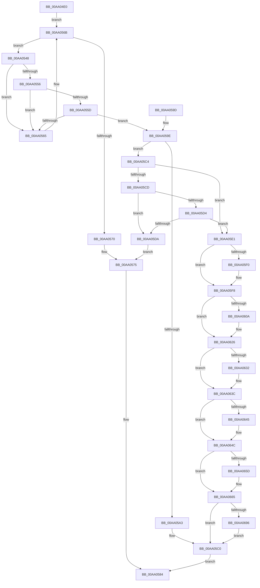

# SepDeleteLogonSessionTrack

- RVA: `0x00AA04E0`–`0x00AA06A0` (길이 `448` bytes)
- VA: `0x0000000140AA04E0`
- 실행 섹션: `PAGE`
- PDB 이름 있음: `예`; PDB Function 태그: `아니요`
- unwind 정보 RVA: `0x000BAB44`
- 디코드: `120`개 명령, `448/448` bytes 표시
- 미해석 바이트: `0` (있으면 어셈블리에 `.byte`로 보존)

> 이 문서는 커널 이미지의 기계어와 PDB 기호를 분석해 생성했습니다. 4번과 5번은 함수 원형과 자료형을 바이너리 사용 방식에서 추정한 C 해석이며 원본 소스 복구 결과는 아닙니다.

## 1. Dependencies

- 직접 호출 지점: **21**; 고유 호출 대상: **16**
- 직접 호출자로 확인된 함수: **4**
- RIP 상대 이미지 참조: **3**

### Outgoing calls
- `0x00AA053E` → [ExAcquireResourceExclusiveLite](../../text/21/ExAcquireResourceExclusiveLite_function_00214E20.md) (function, `0x00214E20`)
- `0x00AA0548` → [PsGetCurrentServerSilo](../../text/22/PsGetCurrentServerSilo_function_00225710.md) (function, `0x00225710`)
- `0x00AA0578` → [ExReleaseResourceLite](../../text/25/ExReleaseResourceLite_function_0025FA10.md) (function, `0x0025FA10`)
- `0x00AA057D` → [KeLeaveCriticalRegion](../../text/25/KeLeaveCriticalRegion_function_0025D8B0.md) (function, `0x0025D8B0`)
- `0x00AA05AE` → [ObRevokeHandles](../74/ObRevokeHandles_function_0074E838.md) (function, `0x0074E838`)
- `0x00AA05B6` → [ExReleaseResourceLite](../../text/25/ExReleaseResourceLite_function_0025FA10.md) (function, `0x0025FA10`)
- `0x00AA05BB` → [KeLeaveCriticalRegion](../../text/25/KeLeaveCriticalRegion_function_0025D8B0.md) (function, `0x0025D8B0`)
- `0x00AA05FB` → [ExReleaseResourceLite](../../text/25/ExReleaseResourceLite_function_0025FA10.md) (function, `0x0025FA10`)
- `0x00AA0600` → [KeLeaveCriticalRegion](../../text/25/KeLeaveCriticalRegion_function_0025D8B0.md) (function, `0x0025D8B0`)
- `0x00AA0614` → [SepCleanupLUIDDeviceMapDirectory](../A9/SepCleanupLUIDDeviceMapDirectory_function_00A98F24.md) (function, `0x00A98F24`)
- `0x00AA0621` → [ObDereferenceDeviceMap](../96/ObDereferenceDeviceMap_function_0096D0E8.md) (function, `0x0096D0E8`)
- `0x00AA0637` → [ObfDereferenceObjectWithTag](../../text/2F/ObfDereferenceObjectWithTag_function_002F78E0.md) (function, `0x002F78E0`)
- `0x00AA0647` → [ExFreePoolWithTag](../../poolcode/B8/ExFreePoolWithTag_function_00B82870.md) (function, `0x00B82870`)
- `0x00AA064F` → [SepDeleteLogonSessionClaims](SepDeleteLogonSessionClaims_function_00AAC8A4.md) (function, `0x00AAC8A4`)
- `0x00AA0660` → [SepDeleteLogonSessionSidValues](../7A/SepDeleteLogonSessionSidValues_function_007A0EC4.md) (function, `0x007A0EC4`)
- `0x00AA066C` → [ObDestroyHandleRevocationBlock](../A9/ObDestroyHandleRevocationBlock_function_00A924B8.md) (function, `0x00A924B8`)
- `0x00AA0675` → [SepDeleteCachedHandlesTable](../AC/SepDeleteCachedHandlesTable_function_00ACCE28.md) (function, `0x00ACCE28`)
- `0x00AA067F` → [ExFreePoolWithTag](../../poolcode/B8/ExFreePoolWithTag_function_00B82870.md) (function, `0x00B82870`)
- `0x00AA0684` → [SepDeleteSessionLowboxEntries](../../text/48/SepDeleteSessionLowboxEntries_function_0048C188.md) (function, `0x0048C188`)
- `0x00AA0689` → [Feature_OutsideInProtection__private_IsEnabledDeviceUsageNoInline](../../text/5C/Feature_OutsideInProtection__private_IsEnabledDeviceUsageNoInline_function_005CD968.md) (function, `0x005CD968`)
- `0x00AA0696` → [SepDeleteSessionAntiTamperEntries](../../text/60/SepDeleteSessionAntiTamperEntries_function_0060AAF8.md) (function, `0x0060AAF8`)

### Direct callers
- [SeInitServerSilo](../79/SeInitServerSilo_function_0079C3EC.md) at `0x0079C46D`
- [SepDeleteUnreferencedLogonSessionsInSilo](../7A/SepDeleteUnreferencedLogonSessionsInSilo_function_007A15D8.md) at `0x007A1678`
- [SepRmInteractiveLogoffLogonSessionWrkr](../7A/SepRmInteractiveLogoffLogonSessionWrkr_function_007A1B10.md) at `0x007A1B29`
- [SepRmDeleteLogonSessionWrkr](SepRmDeleteLogonSessionWrkr_function_00AA04B0.md) at `0x00AA04C9`

### Static image references
- `0x00AA0502` → RVA `0x00FD9AF0` (`PAGEDATA`; read)
- `0x00AA0530` → RVA `0x00E67F20` (`.data`; read)
- `0x00AA0654` → RVA `0x00E67BF0` (`.data`; read)

## 2. Other-region calls and transfers

- 다른 실행 섹션으로 향하는 call: **14**
  - `0x00AA053E` → [ExAcquireResourceExclusiveLite](../../text/21/ExAcquireResourceExclusiveLite_function_00214E20.md) (`PAGE` → `.text`)
  - `0x00AA0548` → [PsGetCurrentServerSilo](../../text/22/PsGetCurrentServerSilo_function_00225710.md) (`PAGE` → `.text`)
  - `0x00AA0578` → [ExReleaseResourceLite](../../text/25/ExReleaseResourceLite_function_0025FA10.md) (`PAGE` → `.text`)
  - `0x00AA057D` → [KeLeaveCriticalRegion](../../text/25/KeLeaveCriticalRegion_function_0025D8B0.md) (`PAGE` → `.text`)
  - `0x00AA05B6` → [ExReleaseResourceLite](../../text/25/ExReleaseResourceLite_function_0025FA10.md) (`PAGE` → `.text`)
  - `0x00AA05BB` → [KeLeaveCriticalRegion](../../text/25/KeLeaveCriticalRegion_function_0025D8B0.md) (`PAGE` → `.text`)
  - `0x00AA05FB` → [ExReleaseResourceLite](../../text/25/ExReleaseResourceLite_function_0025FA10.md) (`PAGE` → `.text`)
  - `0x00AA0600` → [KeLeaveCriticalRegion](../../text/25/KeLeaveCriticalRegion_function_0025D8B0.md) (`PAGE` → `.text`)
  - `0x00AA0637` → [ObfDereferenceObjectWithTag](../../text/2F/ObfDereferenceObjectWithTag_function_002F78E0.md) (`PAGE` → `.text`)
  - `0x00AA0647` → [ExFreePoolWithTag](../../poolcode/B8/ExFreePoolWithTag_function_00B82870.md) (`PAGE` → `POOLCODE`)
  - `0x00AA067F` → [ExFreePoolWithTag](../../poolcode/B8/ExFreePoolWithTag_function_00B82870.md) (`PAGE` → `POOLCODE`)
  - `0x00AA0684` → [SepDeleteSessionLowboxEntries](../../text/48/SepDeleteSessionLowboxEntries_function_0048C188.md) (`PAGE` → `.text`)
  - `0x00AA0689` → [Feature_OutsideInProtection__private_IsEnabledDeviceUsageNoInline](../../text/5C/Feature_OutsideInProtection__private_IsEnabledDeviceUsageNoInline_function_005CD968.md) (`PAGE` → `.text`)
  - `0x00AA0696` → [SepDeleteSessionAntiTamperEntries](../../text/60/SepDeleteSessionAntiTamperEntries_function_0060AAF8.md) (`PAGE` → `.text`)
- 별도 외부 분기/꼬리 이동을 확인하지 못했습니다.

## 3. Assembly (complete function range)

```asm
00AA04E0  48 89 5C 24 08                  mov qword ptr [rsp + 8], rbx
00AA04E5  48 89 6C 24 10                  mov qword ptr [rsp + 0x10], rbp
00AA04EA  48 89 74 24 18                  mov qword ptr [rsp + 0x18], rsi
00AA04EF  57                              push rdi
00AA04F0  41 56                           push r14
00AA04F2  41 57                           push r15
00AA04F4  48 83 EC 20                     sub rsp, 0x20
00AA04F8  44 69 01 24 0A 25 5B            imul r8d, dword ptr [rcx], 0x5b250a24
00AA04FF  44 8A FA                        mov r15b, dl
00AA0502  48 8B 05 E7 95 53 00            mov rax, qword ptr [rip + 0x5395e7]
00AA0509  48 8B F1                        mov rsi, rcx
00AA050C  33 ED                           xor ebp, ebp
00AA050E  B2 01                           mov dl, 1
00AA0510  49 C1 E8 1C                     shr r8, 0x1c
00AA0514  4E 8D 34 C0                     lea r14, [rax + r8*8]
00AA0518  65 48 8B 04 25 88 01 00 00      mov rax, qword ptr gs:[0x188]
00AA0521  41 83 E0 03                     and r8d, 3
00AA0525  49 6B F8 68                     imul rdi, r8, 0x68
00AA0529  66 FF 88 E4 01 00 00            dec word ptr [rax + 0x1e4]
00AA0530  48 8D 05 E9 79 3C 00            lea rax, [rip + 0x3c79e9]
00AA0537  48 03 F8                        add rdi, rax
00AA053A  90                              nop
00AA053B  48 8B CF                        mov rcx, rdi
00AA053E  E8 DD 48 77 FF                  call 0x140214e20
00AA0543  49 8B 1E                        mov rbx, qword ptr [r14]
00AA0546  EB 23                           jmp 0x140aa056b
00AA0548  E8 C3 51 78 FF                  call 0x140225710
00AA054D  48 39 83 A8 00 00 00            cmp qword ptr [rbx + 0xa8], rax
00AA0554  75 0F                           jne 0x140aa0565
00AA0556  8B 43 08                        mov eax, dword ptr [rbx + 8]
00AA0559  39 06                           cmp dword ptr [rsi], eax
00AA055B  75 08                           jne 0x140aa0565
00AA055D  8B 43 0C                        mov eax, dword ptr [rbx + 0xc]
00AA0560  39 46 04                        cmp dword ptr [rsi + 4], eax
00AA0563  74 39                           je 0x140aa059e
00AA0565  4C 8B F3                        mov r14, rbx
00AA0568  48 8B 1B                        mov rbx, qword ptr [rbx]
00AA056B  48 85 DB                        test rbx, rbx
00AA056E  75 D8                           jne 0x140aa0548
00AA0570  BB 5F 00 00 C0                  mov ebx, 0xc000005f
00AA0575  48 8B CF                        mov rcx, rdi
00AA0578  E8 93 F4 7B FF                  call 0x14025fa10
00AA057D  E8 2E D3 7B FF                  call 0x14025d8b0
00AA0582  8B C3                           mov eax, ebx
00AA0584  48 8B 5C 24 40                  mov rbx, qword ptr [rsp + 0x40]
00AA0589  48 8B 6C 24 48                  mov rbp, qword ptr [rsp + 0x48]
00AA058E  48 8B 74 24 50                  mov rsi, qword ptr [rsp + 0x50]
00AA0593  48 83 C4 20                     add rsp, 0x20
00AA0597  41 5F                           pop r15
00AA0599  41 5E                           pop r14
00AA059B  5F                              pop rdi
00AA059C  C3                              ret
00AA059D  CC                              int3
00AA059E  45 84 FF                        test r15b, r15b
00AA05A1  74 21                           je 0x140aa05c4
00AA05A3  83 4B 28 10                     or dword ptr [rbx + 0x28], 0x10
00AA05A7  48 8D 8B 88 00 00 00            lea rcx, [rbx + 0x88]
00AA05AE  E8 85 E2 CA FF                  call 0x14074e838
00AA05B3  48 8B CF                        mov rcx, rdi
00AA05B6  E8 55 F4 7B FF                  call 0x14025fa10
00AA05BB  E8 F0 D2 7B FF                  call 0x14025d8b0
00AA05C0  33 C0                           xor eax, eax
00AA05C2  EB C0                           jmp 0x140aa0584
00AA05C4  48 8B 4B 20                     mov rcx, qword ptr [rbx + 0x20]
00AA05C8  48 85 C9                        test rcx, rcx
00AA05CB  74 14                           je 0x140aa05e1
00AA05CD  8B 43 28                        mov eax, dword ptr [rbx + 0x28]
00AA05D0  A8 08                           test al, 8
00AA05D2  75 06                           jne 0x140aa05da
00AA05D4  48 83 F9 01                     cmp rcx, 1
00AA05D8  74 07                           je 0x140aa05e1
00AA05DA  BB 04 01 00 C0                  mov ebx, 0xc0000104
00AA05DF  EB 94                           jmp 0x140aa0575
00AA05E1  48 8B 03                        mov rax, qword ptr [rbx]
00AA05E4  49 89 06                        mov qword ptr [r14], rax
00AA05E7  48 8B 43 30                     mov rax, qword ptr [rbx + 0x30]
00AA05EB  48 85 C0                        test rax, rax
00AA05EE  74 08                           je 0x140aa05f8
00AA05F0  48 83 63 30 00                  and qword ptr [rbx + 0x30], 0
00AA05F5  48 8B E8                        mov rbp, rax
00AA05F8  48 8B CF                        mov rcx, rdi
00AA05FB  E8 10 F4 7B FF                  call 0x14025fa10
00AA0600  E8 AB D2 7B FF                  call 0x14025d8b0
00AA0605  48 85 ED                        test rbp, rbp
00AA0608  74 1C                           je 0x140aa0626
00AA060A  48 8B 93 A8 00 00 00            mov rdx, qword ptr [rbx + 0xa8]
00AA0611  48 8B CE                        mov rcx, rsi
00AA0614  E8 0B 89 FF FF                  call 0x140a98f24
00AA0619  BA 01 00 00 00                  mov edx, 1
00AA061E  48 8B CD                        mov rcx, rbp
00AA0621  E8 C2 CA EC FF                  call 0x14096d0e8
00AA0626  48 8B 8B A8 00 00 00            mov rcx, qword ptr [rbx + 0xa8]
00AA062D  48 85 C9                        test rcx, rcx
00AA0630  74 0A                           je 0x140aa063c
00AA0632  BA 53 65 4C 73                  mov edx, 0x734c6553
00AA0637  E8 A4 72 85 FF                  call 0x1402f78e0
00AA063C  48 8B 4B 48                     mov rcx, qword ptr [rbx + 0x48]
00AA0640  48 85 C9                        test rcx, rcx
00AA0643  74 07                           je 0x140aa064c
00AA0645  33 D2                           xor edx, edx
00AA0647  E8 24 22 0E 00                  call 0x140b82870
00AA064C  48 8B CB                        mov rcx, rbx
00AA064F  E8 50 C2 00 00                  call 0x140aac8a4
00AA0654  80 3D 95 75 3C 00 00            cmp byte ptr [rip + 0x3c7595], 0
00AA065B  74 08                           je 0x140aa0665
00AA065D  48 8B CB                        mov rcx, rbx
00AA0660  E8 5F 08 D0 FF                  call 0x1407a0ec4
00AA0665  48 8D 8B 88 00 00 00            lea rcx, [rbx + 0x88]
00AA066C  E8 47 1E FF FF                  call 0x140a924b8
00AA0671  48 8D 4B 60                     lea rcx, [rbx + 0x60]
00AA0675  E8 AE C7 02 00                  call 0x140acce28
00AA067A  33 D2                           xor edx, edx
00AA067C  48 8B CB                        mov rcx, rbx
00AA067F  E8 EC 21 0E 00                  call 0x140b82870
00AA0684  E8 FF BA 9E FF                  call 0x14048c188
00AA0689  E8 DA D2 B2 FF                  call 0x1405cd968
00AA068E  85 C0                           test eax, eax
00AA0690  0F 84 2A FF FF FF               je 0x140aa05c0
00AA0696  E8 5D A4 B6 FF                  call 0x14060aaf8
00AA069B  E9 20 FF FF FF                  jmp 0x140aa05c0
```

## 4. C-style interpretation (structured pseudocode)

```c
__int64 __fastcall SepDeleteLogonSessionTrack(__int64 a1, unsigned __int8 a2)
{
    __int64 result;
    __int64 v_rbp;
    __int64 v_rdi;
    __int64 v_rsp;
    unsigned __int64 v_stack_p10;
    unsigned __int64 v_stack_p18;
    unsigned __int64 v_stack_p8;

    v_stack_p8 = v_rbx;
    v_stack_p10 = v_rbp;
    v_stack_p18 = v_rsi;
    v_rsp = (v_rsp) - (32);
    a3 = (unsigned int)((a3) * (*(unsigned int *)(a1)));
    v_rbp = 0;
    a3 = (a3) >> (28);
    a3 = (unsigned int)((a3) & (3));
    v_rdi = (v_rdi) * (a3);
    v_rdi = (v_rdi) + (v_rip + 3963369);
    result = ExAcquireResourceExclusiveLite(v_rdi, 1, a3, a4);
    goto loc_00AA056B;
loc_00AA0548:
    result = PsGetCurrentServerSilo(v_rdi, 1, a3, a4);
    if ((*(unsigned __int64 *)(*(unsigned __int64 *)(*(unsigned __int64 *)(v_rip + 5477863) + a3 * 8) + 168)) != result) goto loc_00AA0565;
    if ((*(unsigned int *)(a1)) != ((unsigned int)((unsigned int)(*(unsigned int *)(*(unsigned __int64 *)(*(unsigned __int64 *)(v_rip + 5477863) + a3 * 8) + 8))))) goto loc_00AA0565;
    if ((*(unsigned int *)(a1 + 4)) == ((unsigned int)((unsigned int)(*(unsigned int *)(*(unsigned __int64 *)(*(unsigned __int64 *)(v_rip + 5477863) + a3 * 8) + 12))))) goto loc_00AA059E;
loc_00AA0565:
loc_00AA056B:
    if (*(unsigned __int64 *)(*(unsigned __int64 *)(*(unsigned __int64 *)(v_rip + 5477863) + a3 * 8)) != 0) goto loc_00AA0548;
loc_00AA0575:
    result = ExReleaseResourceLite(v_rdi, 1, a3, a4);
    result = KeLeaveCriticalRegion(v_rdi, 1, a3, a4);
loc_00AA0584:
    v_rsp = (v_rsp) + (32);
    return (unsigned int)((unsigned int)((unsigned int)(0xC000005FULL)));
loc_00AA059E:
    if (a2 == 0) goto loc_00AA05C4;
    result = ObRevokeHandles(v_stack_p8 + 136, 1, a3, a4);
    result = ExReleaseResourceLite(v_rdi, 1, a3, a4);
    result = KeLeaveCriticalRegion(v_rdi, 1, a3, a4);
loc_00AA05C0:
    result = 0;
    goto loc_00AA0584;
loc_00AA05C4:
    if (*(unsigned __int64 *)(v_stack_p8 + 32) == 0) goto loc_00AA05E1;
    if ((((unsigned __int8)((unsigned int)(*(unsigned int *)(v_stack_p8 + 40)))) & (8)) != 0) goto loc_00AA05DA;
    if ((*(unsigned __int64 *)(v_stack_p8 + 32)) == 1) goto loc_00AA05E1;
loc_00AA05DA:
    goto loc_00AA0575;
loc_00AA05E1:
    *(unsigned __int64 *)(*(unsigned __int64 *)(*(unsigned __int64 *)(v_rip + 5477863) + a3 * 8)) = *(unsigned __int64 *)((unsigned int)(0xC0000104ULL));
    v_rbp = v_stack_p10;
    if (*(unsigned __int64 *)((unsigned int)(0xC0000104ULL) + 48) != 0) {
        v_rbp = *(unsigned __int64 *)((unsigned int)(0xC0000104ULL) + 48);
    }
    result = ExReleaseResourceLite(v_rdi, 1, a3, a4);
    result = KeLeaveCriticalRegion(v_rdi, 1, a3, a4);
    if (v_rbp != 0) {
        a2 = *(unsigned __int64 *)((unsigned int)(0xC0000104ULL) + 168);
        a1 = v_stack_p18;
        result = SepCleanupLUIDDeviceMapDirectory(a1, a2, a3, a4);
        a2 = 1;
        a1 = v_rbp;
        result = ObDereferenceDeviceMap(a1, a2, a3, a4);
    }
    if (*(unsigned __int64 *)((unsigned int)(0xC0000104ULL) + 168) != 0) {
        a2 = 0x734C6553ULL;
        result = ObfDereferenceObjectWithTag(*(unsigned __int64 *)((unsigned int)(0xC0000104ULL) + 168), a2, a3, a4);
    }
    if (*(unsigned __int64 *)((unsigned int)(0xC0000104ULL) + 72) != 0) {
        a2 = 0;
        result = ExFreePoolWithTag(*(unsigned __int64 *)((unsigned int)(0xC0000104ULL) + 72), a2, a3, a4);
    }
    result = SepDeleteLogonSessionClaims((unsigned int)(0xC0000104ULL), a2, a3, a4);
    if ((*(unsigned __int8 *)(v_rip + 3962261)) != 0) {
        a1 = (unsigned int)(0xC0000104ULL);
        result = SepDeleteLogonSessionSidValues(a1, a2, a3, a4);
    }
    result = ObDestroyHandleRevocationBlock((unsigned int)(0xC0000104ULL) + 136, a2, a3, a4);
    result = SepDeleteCachedHandlesTable((unsigned int)(0xC0000104ULL) + 96, a2, a3, a4);
    a2 = 0;
    result = ExFreePoolWithTag((unsigned int)(0xC0000104ULL), a2, a3, a4);
    result = SepDeleteSessionLowboxEntries((unsigned int)(0xC0000104ULL), a2, a3, a4);
    result = Feature_OutsideInProtection__private_IsEnabledDeviceUsageNoInline((unsigned int)(0xC0000104ULL), a2, a3, a4);
    if ((unsigned int)(result) == 0) goto loc_00AA05C0;
    result = SepDeleteSessionAntiTamperEntries((unsigned int)(0xC0000104ULL), a2, a3, a4);
    goto loc_00AA05C0;
}
```

## 5. (Beta) C Style

```c
int64_t SepDeleteLogonSessionTrack(void *Arg1, uint8_t Arg2)
{
    uint8_t *arg1 = (uint8_t *)Arg1;

    int64_t result;
    int64_t local_rbp;
    int64_t local_rdi;
    int64_t local_rsp;
    uint64_t v_stack_p10;
    uint64_t v_stack_p18;
    uint64_t v_stack_p8;

    v_stack_p8 = local_rbx;
    v_stack_p10 = local_rbp;
    v_stack_p18 = local_rsi;
    local_rsp = (local_rsp) - (32);
    a3 = (uint32_t)((a3) * (*(uint32_t *)(arg1)));
    local_rbp = 0;
    a3 = (a3) >> (28);
    a3 = (uint32_t)((a3) & (3));
    local_rdi = (local_rdi) * (a3);
    local_rdi = (local_rdi) + (v_rip + 3963369);
    result = ExAcquireResourceExclusiveLite(local_rdi, 1, a3, a4);
    goto loc_00AA056B;
loc_00AA0548:
    result = PsGetCurrentServerSilo(local_rdi, 1, a3, a4);
    if ((*(uint64_t *)(*(uint64_t *)(*(uint64_t *)(v_rip + 0x5395E7) + a3 * 8) + 0xA8)) != result) goto loc_00AA0565;
    if ((*(uint32_t *)(arg1)) != ((uint32_t)((uint32_t)(*(uint32_t *)(*(uint64_t *)(*(uint64_t *)(v_rip + 0x5395E7) + a3 * 8) + 0x8))))) goto loc_00AA0565;
    if ((*(uint32_t *)(arg1 + 0x4)) == ((uint32_t)((uint32_t)(*(uint32_t *)(*(uint64_t *)(*(uint64_t *)(v_rip + 0x5395E7) + a3 * 8) + 0xC))))) goto loc_00AA059E;
loc_00AA0565:
loc_00AA056B:
    if (*(uint64_t *)(*(uint64_t *)(*(uint64_t *)(v_rip + 0x5395E7) + a3 * 8)) != 0) goto loc_00AA0548;
loc_00AA0575:
    result = ExReleaseResourceLite(local_rdi, 1, a3, a4);
    result = KeLeaveCriticalRegion(local_rdi, 1, a3, a4);
loc_00AA0584:
    local_rsp = (local_rsp) + (32);
    return (uint32_t)((uint32_t)((uint32_t)(0xC000005FULL)));
loc_00AA059E:
    if (Arg2 == 0) goto loc_00AA05C4;
    result = ObRevokeHandles(v_stack_p8 + 136, 1, a3, a4);
    result = ExReleaseResourceLite(local_rdi, 1, a3, a4);
    result = KeLeaveCriticalRegion(local_rdi, 1, a3, a4);
loc_00AA05C0:
    result = 0;
    goto loc_00AA0584;
loc_00AA05C4:
    if (*(uint64_t *)(v_stack_p8 + 0x20) == 0) goto loc_00AA05E1;
    if ((((uint8_t)((uint32_t)(*(uint32_t *)(v_stack_p8 + 0x28)))) & (8)) != 0) goto loc_00AA05DA;
    if ((*(uint64_t *)(v_stack_p8 + 0x20)) == 1) goto loc_00AA05E1;
loc_00AA05DA:
    goto loc_00AA0575;
loc_00AA05E1:
    *(uint64_t *)(*(uint64_t *)(*(uint64_t *)(v_rip + 0x5395E7) + a3 * 8)) = *(uint64_t *)((uint32_t)(0xC0000104ULL));
    local_rbp = v_stack_p10;
    if (*(uint64_t *)((uint32_t)(0xC0000104ULL) + 0x30) != 0) {
        local_rbp = *(uint64_t *)((uint32_t)(0xC0000104ULL) + 0x30);
    }
    result = ExReleaseResourceLite(local_rdi, 1, a3, a4);
    result = KeLeaveCriticalRegion(local_rdi, 1, a3, a4);
    if (local_rbp != 0) {
        Arg2 = *(uint64_t *)((uint32_t)(0xC0000104ULL) + 0xA8);
        Arg1 = v_stack_p18;
        result = SepCleanupLUIDDeviceMapDirectory(Arg1, Arg2, a3, a4);
        Arg2 = 1;
        Arg1 = local_rbp;
        result = ObDereferenceDeviceMap(Arg1, Arg2, a3, a4);
    }
    if (*(uint64_t *)((uint32_t)(0xC0000104ULL) + 0xA8) != 0) {
        Arg2 = 0x734C6553ULL;
        result = ObfDereferenceObjectWithTag(*(uint64_t *)((uint32_t)(0xC0000104ULL) + 0xA8), Arg2, a3, a4);
    }
    if (*(uint64_t *)((uint32_t)(0xC0000104ULL) + 0x48) != 0) {
        Arg2 = 0;
        result = ExFreePoolWithTag(*(uint64_t *)((uint32_t)(0xC0000104ULL) + 0x48), Arg2, a3, a4);
    }
    result = SepDeleteLogonSessionClaims((uint32_t)(0xC0000104ULL), Arg2, a3, a4);
    if ((*(uint8_t *)(v_rip + 0x3C7595)) != 0) {
        Arg1 = (uint32_t)(0xC0000104ULL);
        result = SepDeleteLogonSessionSidValues(Arg1, Arg2, a3, a4);
    }
    result = ObDestroyHandleRevocationBlock((uint32_t)(0xC0000104ULL) + 136, Arg2, a3, a4);
    result = SepDeleteCachedHandlesTable((uint32_t)(0xC0000104ULL) + 96, Arg2, a3, a4);
    Arg2 = 0;
    result = ExFreePoolWithTag((uint32_t)(0xC0000104ULL), Arg2, a3, a4);
    result = SepDeleteSessionLowboxEntries((uint32_t)(0xC0000104ULL), Arg2, a3, a4);
    result = Feature_OutsideInProtection__private_IsEnabledDeviceUsageNoInline((uint32_t)(0xC0000104ULL), Arg2, a3, a4);
    if ((uint32_t)(result) == 0) goto loc_00AA05C0;
    result = SepDeleteSessionAntiTamperEntries((uint32_t)(0xC0000104ULL), Arg2, a3, a4);
    goto loc_00AA05C0;
}
```

### 관측된 메모리 오프셋

구조체 형식이 확인되지 않은 접근은 인자 기준의 오프셋으로만 기록했습니다.

| 기준 인자 | 오프셋 표현 | 폭 (bit) | 접근 |
|---|---:|---:|---|
| `Arg1` | `+ 0x0` | `32` | `R` |
| `Arg1` | `+ 0x4` | `32` | `R` |

## 6. Execution-region graph

[열기: 2D/3D 그래프와 함수 탐색 컨트롤 패널](../../../control-panel.html?section=page&rva=0x00AA04E0&view=graph)

- 2D 그래프는 위에서 아래로 흐르고, 3D 그래프는 빈 공간을 드래그해 회전합니다. Shift+드래그는 이동, 휠은 확대·축소, 함수 노드 선택은 대상 보고서 이동입니다.

### Static fallback


