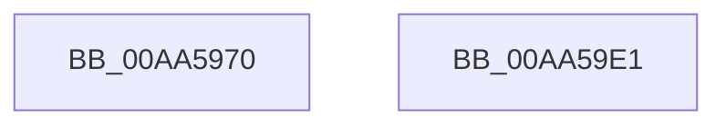

# SepImageVerificationCallbackPreProcess

- RVA: `0x00AA5970`–`0x00AA59E2` (길이 `114` bytes)
- VA: `0x0000000140AA5970`
- 실행 섹션: `PAGE`
- PDB 이름 있음: `예`; PDB Function 태그: `아니요`
- unwind 정보 RVA: `0x0005CAAC`
- 디코드: `34`개 명령, `114/114` bytes 표시
- 미해석 바이트: `0` (있으면 어셈블리에 `.byte`로 보존)

> 이 문서는 커널 이미지의 기계어와 PDB 기호를 분석해 생성했습니다. 4번과 5번은 함수 원형과 자료형을 바이너리 사용 방식에서 추정한 C 해석이며 원본 소스 복구 결과는 아닙니다.

## 1. Dependencies

- 직접 호출 지점: **1**; 고유 호출 대상: **1**
- 직접 호출자로 확인된 함수: **0**
- RIP 상대 이미지 참조: **0**

### Outgoing calls
- `0x00AA598B` → [memcpy](../../text/6C/memcpy_function_006C6840.md) (function, `0x006C6840`)

### Direct callers
- 이 함수 시작 RVA로 연결되는 직접 call은 확인되지 않았습니다. 간접 호출은 완전히 역산할 수 없습니다.

### Static image references
- 디코드된 RIP-relative 메모리 참조가 없습니다.

## 2. Other-region calls and transfers

- 다른 실행 섹션으로 향하는 call: **1**
  - `0x00AA598B` → [memcpy](../../text/6C/memcpy_function_006C6840.md) (`PAGE` → `.text`)
- 별도 외부 분기/꼬리 이동을 확인하지 못했습니다.

## 3. Assembly (complete function range)

```asm
00AA5970  48 89 5C 24 08                  mov qword ptr [rsp + 8], rbx
00AA5975  57                              push rdi
00AA5976  48 83 EC 20                     sub rsp, 0x20
00AA597A  49 8B F8                        mov rdi, r8
00AA597D  49 8B D1                        mov rdx, r9
00AA5980  44 8B 44 24 50                  mov r8d, dword ptr [rsp + 0x50]
00AA5985  48 8B CF                        mov rcx, rdi
00AA5988  49 8B D9                        mov rbx, r9
00AA598B  E8 B0 0E C2 FF                  call 0x1406c6840
00AA5990  48 8B 43 10                     mov rax, qword ptr [rbx + 0x10]
00AA5994  48 2B C3                        sub rax, rbx
00AA5997  48 03 C7                        add rax, rdi
00AA599A  48 89 47 10                     mov qword ptr [rdi + 0x10], rax
00AA599E  48 8B 43 30                     mov rax, qword ptr [rbx + 0x30]
00AA59A2  48 2B C3                        sub rax, rbx
00AA59A5  48 03 C7                        add rax, rdi
00AA59A8  48 89 47 30                     mov qword ptr [rdi + 0x30], rax
00AA59AC  48 8B 43 40                     mov rax, qword ptr [rbx + 0x40]
00AA59B0  48 2B C3                        sub rax, rbx
00AA59B3  48 03 C7                        add rax, rdi
00AA59B6  48 89 47 40                     mov qword ptr [rdi + 0x40], rax
00AA59BA  48 8B 43 48                     mov rax, qword ptr [rbx + 0x48]
00AA59BE  48 2B C3                        sub rax, rbx
00AA59C1  48 03 C7                        add rax, rdi
00AA59C4  48 89 47 48                     mov qword ptr [rdi + 0x48], rax
00AA59C8  48 8B 43 50                     mov rax, qword ptr [rbx + 0x50]
00AA59CC  48 2B C3                        sub rax, rbx
00AA59CF  48 8B 5C 24 30                  mov rbx, qword ptr [rsp + 0x30]
00AA59D4  48 03 C7                        add rax, rdi
00AA59D7  48 89 47 50                     mov qword ptr [rdi + 0x50], rax
00AA59DB  48 83 C4 20                     add rsp, 0x20
00AA59DF  5F                              pop rdi
00AA59E0  C3                              ret
00AA59E1  CC                              int3
```

## 4. C-style interpretation (structured pseudocode)

```c
__int64 __fastcall SepImageVerificationCallbackPreProcess(__int64 a1, __int64 a2, __int64 a3, __int64 a4, unsigned int a5)
{
    __int64 result;
    __int64 v_rsp;
    unsigned __int64 v_stack_p8;

    v_stack_p8 = v_rbx;
    v_rsp = (v_rsp) - (32);
    result = memcpy(a3, a4, (unsigned int)(a5), a4);
    result = (*(unsigned __int64 *)(a4 + 16)) - (a4);
    result = (result) + (a3);
    *(unsigned __int64 *)(a3 + 16) = result;
    result = (*(unsigned __int64 *)(a4 + 48)) - (a4);
    result = (result) + (a3);
    *(unsigned __int64 *)(a3 + 48) = result;
    result = (*(unsigned __int64 *)(a4 + 64)) - (a4);
    result = (result) + (a3);
    *(unsigned __int64 *)(a3 + 64) = result;
    result = (*(unsigned __int64 *)(a4 + 72)) - (a4);
    result = (result) + (a3);
    *(unsigned __int64 *)(a3 + 72) = result;
    result = (*(unsigned __int64 *)(a4 + 80)) - (a4);
    result = (result) + (a3);
    *(unsigned __int64 *)(a3 + 80) = result;
    v_rsp = (v_rsp) + (32);
    return result;
}
```

## 5. (Beta) C Style

```c
int64_t SepImageVerificationCallbackPreProcess(int64_t Arg1, int64_t Arg2, void *Arg3, void *Arg4, uint32_t Arg5)
{
    uint8_t *arg3 = (uint8_t *)Arg3;
    uint8_t *arg4 = (uint8_t *)Arg4;

    int64_t result;
    int64_t local_rsp;
    uint64_t v_stack_p8;

    v_stack_p8 = local_rbx;
    local_rsp = (local_rsp) - (32);
    result = memcpy(Arg3, Arg4, (uint32_t)(Arg5), Arg4);
    result = (*(uint64_t *)(arg4 + 0x10)) - (Arg4);
    result = (result) + (Arg3);
    *(uint64_t *)(arg3 + 0x10) = result;
    result = (*(uint64_t *)(arg4 + 0x30)) - (Arg4);
    result = (result) + (Arg3);
    *(uint64_t *)(arg3 + 0x30) = result;
    result = (*(uint64_t *)(arg4 + 0x40)) - (Arg4);
    result = (result) + (Arg3);
    *(uint64_t *)(arg3 + 0x40) = result;
    result = (*(uint64_t *)(arg4 + 0x48)) - (Arg4);
    result = (result) + (Arg3);
    *(uint64_t *)(arg3 + 0x48) = result;
    result = (*(uint64_t *)(arg4 + 0x50)) - (Arg4);
    result = (result) + (Arg3);
    *(uint64_t *)(arg3 + 0x50) = result;
    local_rsp = (local_rsp) + (32);
    return result;
}
```

### 관측된 메모리 오프셋

구조체 형식이 확인되지 않은 접근은 인자 기준의 오프셋으로만 기록했습니다.

| 기준 인자 | 오프셋 표현 | 폭 (bit) | 접근 |
|---|---:|---:|---|
| `Arg3` | `+ 0x10` | `64` | `W` |
| `Arg3` | `+ 0x30` | `64` | `W` |
| `Arg3` | `+ 0x40` | `64` | `W` |
| `Arg3` | `+ 0x48` | `64` | `W` |
| `Arg3` | `+ 0x50` | `64` | `W` |
| `Arg4` | `+ 0x10` | `64` | `R` |
| `Arg4` | `+ 0x30` | `64` | `R` |
| `Arg4` | `+ 0x40` | `64` | `R` |
| `Arg4` | `+ 0x48` | `64` | `R` |
| `Arg4` | `+ 0x50` | `64` | `R` |

## 6. Execution-region graph

[열기: 2D/3D 그래프와 함수 탐색 컨트롤 패널](../../../control-panel.html?section=page&rva=0x00AA5970&view=graph)

- 2D 그래프는 위에서 아래로 흐르고, 3D 그래프는 빈 공간을 드래그해 회전합니다. Shift+드래그는 이동, 휠은 확대·축소, 함수 노드 선택은 대상 보고서 이동입니다.

### Static fallback


