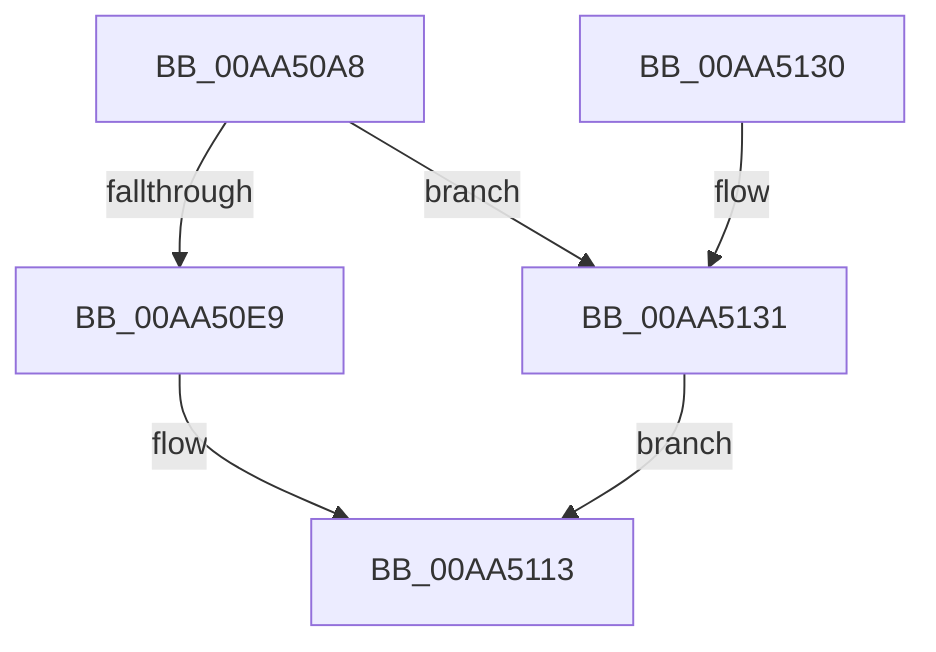

# SepScheduleImageVerificationCallbacks

- RVA: `0x00AA50A8`–`0x00AA5138` (길이 `144` bytes)
- VA: `0x0000000140AA50A8`
- 실행 섹션: `PAGE`
- PDB 이름 있음: `예`; PDB Function 태그: `아니요`
- unwind 정보 RVA: `0x0006B020`
- 디코드: `41`개 명령, `144/144` bytes 표시
- 미해석 바이트: `0` (있으면 어셈블리에 `.byte`로 보존)

> 이 문서는 커널 이미지의 기계어와 PDB 기호를 분석해 생성했습니다. 4번과 5번은 함수 원형과 자료형을 바이너리 사용 방식에서 추정한 C 해석이며 원본 소스 복구 결과는 아닙니다.

## 1. Dependencies

- 직접 호출 지점: **2**; 고유 호출 대상: **2**
- 직접 호출자로 확인된 함수: **1**
- RIP 상대 이미지 참조: **1**

### Outgoing calls
- `0x00AA50DD` → [ExAllocatePool2](../../poolcode/B8/ExAllocatePool2_function_00B820F0.md) (function, `0x00B820F0`)
- `0x00AA510E` → [ExQueueWorkItem](../../text/2F/ExQueueWorkItem_function_002F9520.md) (function, `0x002F9520`)

### Direct callers
- [MiValidateSectionCreate](../94/MiValidateSectionCreate_function_00940190.md) at `0x00940BBD`

### Static image references
- `0x00AA50ED` → RVA `0x0079BA40` (`SepImageVerificationCallbackWorker`; read)

## 2. Other-region calls and transfers

- 다른 실행 섹션으로 향하는 call: **2**
  - `0x00AA50DD` → [ExAllocatePool2](../../poolcode/B8/ExAllocatePool2_function_00B820F0.md) (`PAGE` → `POOLCODE`)
  - `0x00AA510E` → [ExQueueWorkItem](../../text/2F/ExQueueWorkItem_function_002F9520.md) (`PAGE` → `.text`)
- 별도 외부 분기/꼬리 이동을 확인하지 못했습니다.

## 3. Assembly (complete function range)

```asm
00AA50A8  48 8B C4                        mov rax, rsp
00AA50AB  48 89 58 08                     mov qword ptr [rax + 8], rbx
00AA50AF  48 89 68 10                     mov qword ptr [rax + 0x10], rbp
00AA50B3  48 89 70 18                     mov qword ptr [rax + 0x18], rsi
00AA50B7  48 89 78 20                     mov qword ptr [rax + 0x20], rdi
00AA50BB  41 56                           push r14
00AA50BD  48 83 EC 20                     sub rsp, 0x20
00AA50C1  8B FA                           mov edi, edx
00AA50C3  41 8B E8                        mov ebp, r8d
00AA50C6  8B D2                           mov edx, edx
00AA50C8  4C 8B F1                        mov r14, rcx
00AA50CB  48 83 C2 38                     add rdx, 0x38
00AA50CF  B9 40 00 00 00                  mov ecx, 0x40
00AA50D4  41 B8 43 49 73 63               mov r8d, 0x63734943
00AA50DA  41 8B F1                        mov esi, r9d
00AA50DD  E8 0E D0 0D 00                  call 0x140b820f0
00AA50E2  33 DB                           xor ebx, ebx
00AA50E4  48 85 C0                        test rax, rax
00AA50E7  74 48                           je 0x140aa5131
00AA50E9  48 89 40 18                     mov qword ptr [rax + 0x18], rax
00AA50ED  48 8D 0D 4C 69 CF FF            lea rcx, [rip - 0x3096b4]
00AA50F4  48 89 48 10                     mov qword ptr [rax + 0x10], rcx
00AA50F8  8D 53 01                        lea edx, [rbx + 1]
00AA50FB  48 89 18                        mov qword ptr [rax], rbx
00AA50FE  48 8B C8                        mov rcx, rax
00AA5101  89 68 20                        mov dword ptr [rax + 0x20], ebp
00AA5104  89 70 24                        mov dword ptr [rax + 0x24], esi
00AA5107  4C 89 70 28                     mov qword ptr [rax + 0x28], r14
00AA510B  89 78 30                        mov dword ptr [rax + 0x30], edi
00AA510E  E8 0D 44 85 FF                  call 0x1402f9520
00AA5113  48 8B 6C 24 38                  mov rbp, qword ptr [rsp + 0x38]
00AA5118  8B C3                           mov eax, ebx
00AA511A  48 8B 5C 24 30                  mov rbx, qword ptr [rsp + 0x30]
00AA511F  48 8B 74 24 40                  mov rsi, qword ptr [rsp + 0x40]
00AA5124  48 8B 7C 24 48                  mov rdi, qword ptr [rsp + 0x48]
00AA5129  48 83 C4 20                     add rsp, 0x20
00AA512D  41 5E                           pop r14
00AA512F  C3                              ret
00AA5130  CC                              int3
00AA5131  BB 17 00 00 C0                  mov ebx, 0xc0000017
00AA5136  EB DB                           jmp 0x140aa5113
```

## 4. C-style interpretation (structured pseudocode)

```c
__int64 __fastcall SepScheduleImageVerificationCallbacks(__int64 a1, int a2, int a3, int a4)
{
    __int64 result;
    __int64 v_rbx;
    __int64 v_rsp;
    unsigned __int64 v_stack_p10;
    unsigned __int64 v_stack_p18;
    unsigned __int64 v_stack_p20;
    unsigned __int64 v_stack_p8;

    *(unsigned __int64 *)(v_rsp + 8) = v_rbx;
    *(unsigned __int64 *)(v_rsp + 16) = v_rbp;
    *(unsigned __int64 *)(v_rsp + 24) = v_rsi;
    *(unsigned __int64 *)(v_rsp + 32) = v_rdi;
    v_rsp = (v_rsp) - (32);
    a2 = ((unsigned int)(a2)) + (56);
    result = ExAllocatePool2(64, a2, (unsigned int)(0x63734943ULL), a4);
    v_rbx = 0;
    if (result == 0) goto loc_00AA5131;
    *(unsigned __int64 *)(result + 24) = result;
    *(unsigned __int64 *)(result + 16) = v_rip - 3184308;
    *(unsigned __int64 *)(result) = 0;
    *(unsigned int *)(result + 32) = (unsigned int)((unsigned int)(a3));
    *(unsigned int *)(result + 36) = (unsigned int)((unsigned int)(a4));
    *(unsigned __int64 *)(result + 40) = a1;
    *(unsigned int *)(result + 48) = (unsigned int)((unsigned int)(a2));
    result = ExQueueWorkItem(result, v_rbx + 1, (unsigned int)(0x63734943ULL), a4);
loc_00AA5113:
    v_rsp = (v_rsp) + (32);
    return 0;
loc_00AA5131:
    goto loc_00AA5113;
}
```

## 5. (Beta) C Style

```c
int64_t SepScheduleImageVerificationCallbacks(int64_t Arg1, int32_t Arg2, int32_t Arg3, int32_t Arg4)
{
    int64_t result;
    int64_t local_rbx;
    int64_t local_rsp;
    uint64_t v_stack_p10;
    uint64_t v_stack_p18;
    uint64_t v_stack_p20;
    uint64_t v_stack_p8;

    *(uint64_t *)(local_rsp + 0x8) = local_rbx;
    *(uint64_t *)(local_rsp + 0x10) = local_rbp;
    *(uint64_t *)(local_rsp + 0x18) = local_rsi;
    *(uint64_t *)(local_rsp + 0x20) = local_rdi;
    local_rsp = (local_rsp) - (32);
    Arg2 = ((uint32_t)(Arg2)) + (56);
    result = ExAllocatePool2(64, Arg2, (uint32_t)(0x63734943ULL), Arg4);
    local_rbx = 0;
    if (result == 0) goto loc_00AA5131;
    *(uint64_t *)(result + 0x18) = result;
    *(uint64_t *)(result + 0x10) = v_rip - 3184308;
    *(uint64_t *)(result) = 0;
    *(uint32_t *)(result + 0x20) = (uint32_t)((uint32_t)(Arg3));
    *(uint32_t *)(result + 0x24) = (uint32_t)((uint32_t)(Arg4));
    *(uint64_t *)(result + 0x28) = Arg1;
    *(uint32_t *)(result + 0x30) = (uint32_t)((uint32_t)(Arg2));
    result = ExQueueWorkItem(result, local_rbx + 1, (uint32_t)(0x63734943ULL), Arg4);
loc_00AA5113:
    local_rsp = (local_rsp) + (32);
    return 0;
loc_00AA5131:
    goto loc_00AA5113;
}
```

## 6. Execution-region graph

[열기: 2D/3D 그래프와 함수 탐색 컨트롤 패널](../../../control-panel.html?section=page&rva=0x00AA50A8&view=graph)

- 2D 그래프는 위에서 아래로 흐르고, 3D 그래프는 빈 공간을 드래그해 회전합니다. Shift+드래그는 이동, 휠은 확대·축소, 함수 노드 선택은 대상 보고서 이동입니다.

### Static fallback


