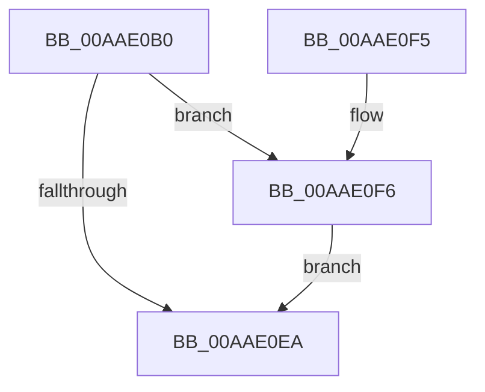

# SleepstudyHelper_Initialize

- RVA: `0x00AAE0B0`–`0x00AAE104` (길이 `84` bytes)
- VA: `0x0000000140AAE0B0`
- 실행 섹션: `PAGE`
- PDB 이름 있음: `예`; PDB Function 태그: `아니요`
- unwind 정보 RVA: `0x000BC21C`
- 디코드: `24`개 명령, `84/84` bytes 표시
- 미해석 바이트: `0` (있으면 어셈블리에 `.byte`로 보존)

> 이 문서는 커널 이미지의 기계어와 PDB 기호를 분석해 생성했습니다. 4번과 5번은 함수 원형과 자료형을 바이너리 사용 방식에서 추정한 C 해석이며 원본 소스 복구 결과는 아닙니다.

## 1. Dependencies

- 직접 호출 지점: **1**; 고유 호출 대상: **1**
- 직접 호출자로 확인된 함수: **0**
- RIP 상대 이미지 참조: **0**

### Outgoing calls
- `0x00AAE0E1` → [SleepstudyHelperCreateLibraryEx](../../text/4B/SleepstudyHelperCreateLibraryEx_function_004BAE50.md) (function, `0x004BAE50`)

### Direct callers
- 이 함수 시작 RVA로 연결되는 직접 call은 확인되지 않았습니다. 간접 호출은 완전히 역산할 수 없습니다.

### Static image references
- 디코드된 RIP-relative 메모리 참조가 없습니다.

## 2. Other-region calls and transfers

- 다른 실행 섹션으로 향하는 call: **1**
  - `0x00AAE0E1` → [SleepstudyHelperCreateLibraryEx](../../text/4B/SleepstudyHelperCreateLibraryEx_function_004BAE50.md) (`PAGE` → `.text`)
- 별도 외부 분기/꼬리 이동을 확인하지 못했습니다.

## 3. Assembly (complete function range)

```asm
00AAE0B0  48 8B C4                        mov rax, rsp
00AAE0B3  48 89 58 08                     mov qword ptr [rax + 8], rbx
00AAE0B7  57                              push rdi
00AAE0B8  48 83 EC 30                     sub rsp, 0x30
00AAE0BC  48 83 60 18 00                  and qword ptr [rax + 0x18], 0
00AAE0C1  48 8B DA                        mov rbx, rdx
00AAE0C4  83 60 F0 00                     and dword ptr [rax - 0x10], 0
00AAE0C8  48 8D 50 18                     lea rdx, [rax + 0x18]
00AAE0CC  48 8B F9                        mov rdi, rcx
00AAE0CF  C7 40 E8 01 00 00 00            mov dword ptr [rax - 0x18], 1
00AAE0D6  48 8D 48 E8                     lea rcx, [rax - 0x18]
00AAE0DA  C7 40 EC 73 73 68 6C            mov dword ptr [rax - 0x14], 0x6c687373
00AAE0E1  E8 6A CD A0 FF                  call 0x1404bae50
00AAE0E6  85 C0                           test eax, eax
00AAE0E8  79 0C                           jns 0x140aae0f6
00AAE0EA  48 8B 5C 24 40                  mov rbx, qword ptr [rsp + 0x40]
00AAE0EF  48 83 C4 30                     add rsp, 0x30
00AAE0F3  5F                              pop rdi
00AAE0F4  C3                              ret
00AAE0F5  CC                              int3
00AAE0F6  48 8B 54 24 50                  mov rdx, qword ptr [rsp + 0x50]
00AAE0FB  48 89 5A 20                     mov qword ptr [rdx + 0x20], rbx
00AAE0FF  48 89 17                        mov qword ptr [rdi], rdx
00AAE102  EB E6                           jmp 0x140aae0ea
```

## 4. C-style interpretation (structured pseudocode)

```c
__int64 __fastcall SleepstudyHelper_Initialize(__int64 a1, __int64 a2)
{
    __int64 result;
    __int64 v_rsp;
    unsigned __int64 v_stack_p50;
    unsigned __int64 v_stack_p8;

    *(unsigned __int64 *)(v_rsp + 8) = v_rbx;
    v_rsp = (v_rsp) - (48);
    *(unsigned int *)(v_rsp - 24) = 1;
    *(unsigned int *)(v_rsp - 20) = 0x6C687373ULL;
    result = SleepstudyHelperCreateLibraryEx(v_rsp - 24, v_rsp + 24, a3, a4);
    if (!sign_flag) goto loc_00AAE0F6;
loc_00AAE0EA:
    v_rsp = (v_rsp) + (48);
    return result;
loc_00AAE0F6:
    *(unsigned __int64 *)(v_stack_p50 + 32) = v_stack_p8;
    *(unsigned __int64 *)(a1) = v_stack_p50;
    goto loc_00AAE0EA;
}
```

## 5. (Beta) C Style

```c
int64_t SleepstudyHelper_Initialize(void *Arg1, int64_t Arg2)
{
    uint8_t *arg1 = (uint8_t *)Arg1;

    int64_t result;
    int64_t local_rsp;
    uint64_t v_stack_p50;
    uint64_t v_stack_p8;

    *(uint64_t *)(local_rsp + 0x8) = local_rbx;
    local_rsp = (local_rsp) - (48);
    *(uint32_t *)(local_rsp - 0x18) = 1;
    *(uint32_t *)(local_rsp - 0x14) = 0x6C687373ULL;
    result = SleepstudyHelperCreateLibraryEx(local_rsp - 24, local_rsp + 24, a3, a4);
    if (!sign_flag) goto loc_00AAE0F6;
loc_00AAE0EA:
    local_rsp = (local_rsp) + (48);
    return result;
loc_00AAE0F6:
    *(uint64_t *)(v_stack_p50 + 0x20) = v_stack_p8;
    *(uint64_t *)(arg1) = v_stack_p50;
    goto loc_00AAE0EA;
}
```

### 관측된 메모리 오프셋

구조체 형식이 확인되지 않은 접근은 인자 기준의 오프셋으로만 기록했습니다.

| 기준 인자 | 오프셋 표현 | 폭 (bit) | 접근 |
|---|---:|---:|---|
| `Arg1` | `+ 0x0` | `64` | `W` |

## 6. Execution-region graph

[열기: 2D/3D 그래프와 함수 탐색 컨트롤 패널](../../../control-panel.html?section=page&rva=0x00AAE0B0&view=graph)

- 2D 그래프는 위에서 아래로 흐르고, 3D 그래프는 빈 공간을 드래그해 회전합니다. Shift+드래그는 이동, 휠은 확대·축소, 함수 노드 선택은 대상 보고서 이동입니다.

### Static fallback


