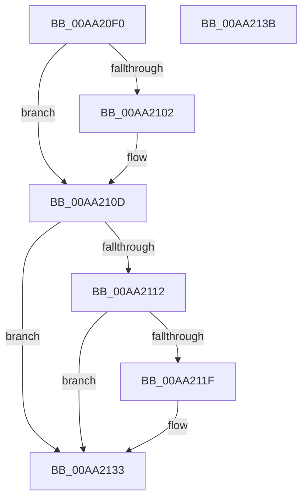

# SshpPowerSettingCallback

- RVA: `0x00AA20F0`–`0x00AA213C` (길이 `76` bytes)
- VA: `0x0000000140AA20F0`
- 실행 섹션: `PAGE`
- PDB 이름 있음: `예`; PDB Function 태그: `아니요`
- unwind 정보 RVA: `0x0005CF00`
- 디코드: `22`개 명령, `76/76` bytes 표시
- 미해석 바이트: `0` (있으면 어셈블리에 `.byte`로 보존)

> 이 문서는 커널 이미지의 기계어와 PDB 기호를 분석해 생성했습니다. 4번과 5번은 함수 원형과 자료형을 바이너리 사용 방식에서 추정한 C 해석이며 원본 소스 복구 결과는 아닙니다.

## 1. Dependencies

- 직접 호출 지점: **1**; 고유 호출 대상: **1**
- 직접 호출자로 확인된 함수: **0**
- RIP 상대 이미지 참조: **5**

### Outgoing calls
- `0x00AA2128` → [SshpSetCollectionActive](../../text/48/SshpSetCollectionActive_function_0048507C.md) (function, `0x0048507C`)

### Direct callers
- 이 함수 시작 RVA로 연결되는 직접 call은 확인되지 않았습니다. 간접 호출은 완전히 역산할 수 없습니다.

### Static image references
- `0x00AA20F9` → RVA `0x0001A268` (`.rdata`; read)
- `0x00AA2106` → RVA `0x0001A270` (`.rdata`; read)
- `0x00AA2117` → RVA `0x00F06B60` (`.data`; read)
- `0x00AA2121` → RVA `0x00E08400` (`.data`; read)
- `0x00AA212D` → RVA `0x00F06B60` (`.data`; write)

## 2. Other-region calls and transfers

- 다른 실행 섹션으로 향하는 call: **1**
  - `0x00AA2128` → [SshpSetCollectionActive](../../text/48/SshpSetCollectionActive_function_0048507C.md) (`PAGE` → `.text`)
- 별도 외부 분기/꼬리 이동을 확인하지 못했습니다.

## 3. Assembly (complete function range)

```asm
00AA20F0  40 53                           push rbx
00AA20F2  48 83 EC 20                     sub rsp, 0x20
00AA20F6  48 8B 01                        mov rax, qword ptr [rcx]
00AA20F9  48 2B 05 68 81 57 FF            sub rax, qword ptr [rip - 0xa87e98]
00AA2100  75 0B                           jne 0x140aa210d
00AA2102  48 8B 41 08                     mov rax, qword ptr [rcx + 8]
00AA2106  48 2B 05 63 81 57 FF            sub rax, qword ptr [rip - 0xa87e9d]
00AA210D  48 85 C0                        test rax, rax
00AA2110  75 21                           jne 0x140aa2133
00AA2112  39 02                           cmp dword ptr [rdx], eax
00AA2114  0F 95 C3                        setne bl
00AA2117  3A 1D 43 4A 46 00               cmp bl, byte ptr [rip + 0x464a43]
00AA211D  74 14                           je 0x140aa2133
00AA211F  8A D3                           mov dl, bl
00AA2121  48 8D 0D D8 62 36 00            lea rcx, [rip + 0x3662d8]
00AA2128  E8 4F 2F 9E FF                  call 0x14048507c
00AA212D  88 1D 2D 4A 46 00               mov byte ptr [rip + 0x464a2d], bl
00AA2133  33 C0                           xor eax, eax
00AA2135  48 83 C4 20                     add rsp, 0x20
00AA2139  5B                              pop rbx
00AA213A  C3                              ret
00AA213B  CC                              int3
```

## 4. C-style interpretation (structured pseudocode)

```c
__int64 __fastcall SshpPowerSettingCallback(__int64 a1, __int64 a2)
{
    __int64 result;
    __int64 v_rbx;
    __int64 v_rsp;

    v_rsp = (v_rsp) - (32);
    result = (*(unsigned __int64 *)(a1)) - (*(unsigned __int64 *)(v_rip - 11042456));
    if (!(condition_is_not_equal)) {
        result = *(unsigned __int64 *)(a1 + 8);
        result = (result) - (*(unsigned __int64 *)(v_rip - 11042461));
    }
    if (result != 0) goto loc_00AA2133;
    v_rbx = ((*(unsigned int *)(a2)) != ((unsigned int)(result))) ? 1 : 0;
    if (((unsigned __int8)(v_rbx)) != (*(unsigned __int8 *)(v_rip + 4606531))) {
        a2 = (unsigned __int8)(v_rbx);
        a1 = v_rip + 3564248;
        result = SshpSetCollectionActive(a1, a2, a3, a4);
        *(unsigned __int8 *)(v_rip + 4606509) = (unsigned __int8)(v_rbx);
    }
    result = 0;
    v_rsp = (v_rsp) + (32);
    return result;
}
```

## 5. (Beta) C Style

```c
int64_t SshpPowerSettingCallback(void *Arg1, void *Arg2)
{
    uint8_t *arg1 = (uint8_t *)Arg1;
    uint8_t *arg2 = (uint8_t *)Arg2;

    int64_t result;
    int64_t local_rbx;
    int64_t local_rsp;

    local_rsp = (local_rsp) - (32);
    result = (*(uint64_t *)(arg1)) - (*(uint64_t *)(v_rip - 0xA87E98));
    if (!(condition_is_not_equal)) {
        result = *(uint64_t *)(arg1 + 0x8);
        result = (result) - (*(uint64_t *)(v_rip - 0xA87E9D));
    }
    if (result != 0) goto loc_00AA2133;
    local_rbx = ((*(uint32_t *)(arg2)) != ((uint32_t)(result))) ? 1 : 0;
    if (((uint8_t)(local_rbx)) != (*(uint8_t *)(v_rip + 0x464A43))) {
        Arg2 = (uint8_t)(local_rbx);
        Arg1 = v_rip + 3564248;
        result = SshpSetCollectionActive(Arg1, Arg2, a3, a4);
        *(uint8_t *)(v_rip + 0x464A2D) = (uint8_t)(local_rbx);
    }
    result = 0;
    local_rsp = (local_rsp) + (32);
    return result;
}
```

### 관측된 메모리 오프셋

구조체 형식이 확인되지 않은 접근은 인자 기준의 오프셋으로만 기록했습니다.

| 기준 인자 | 오프셋 표현 | 폭 (bit) | 접근 |
|---|---:|---:|---|
| `Arg1` | `+ 0x0` | `64` | `R` |
| `Arg1` | `+ 0x8` | `64` | `R` |
| `Arg2` | `+ 0x0` | `32` | `R` |

## 6. Execution-region graph

[열기: 2D/3D 그래프와 함수 탐색 컨트롤 패널](../../../control-panel.html?section=page&rva=0x00AA20F0&view=graph)

- 2D 그래프는 위에서 아래로 흐르고, 3D 그래프는 빈 공간을 드래그해 회전합니다. Shift+드래그는 이동, 휠은 확대·축소, 함수 노드 선택은 대상 보고서 이동입니다.

### Static fallback


