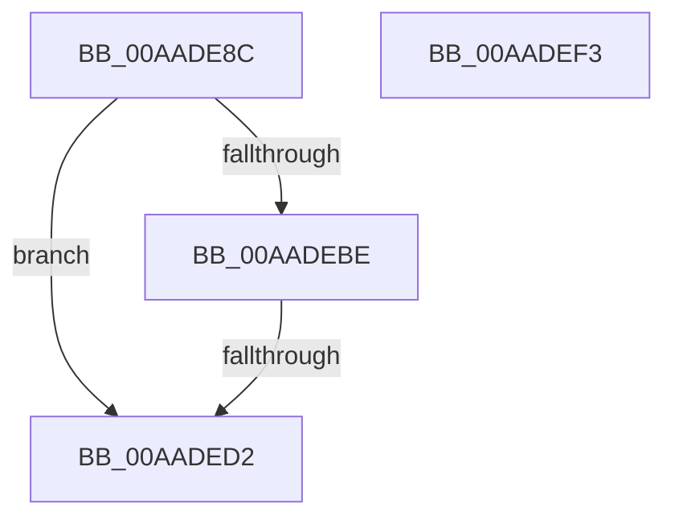

# SshpTracingWriteCollectionStateChange

- RVA: `0x00AADE8C`–`0x00AADEF4` (길이 `104` bytes)
- VA: `0x0000000140AADE8C`
- 실행 섹션: `PAGE`
- PDB 이름 있음: `예`; PDB Function 태그: `예`
- unwind 정보 RVA: `0x000936D0`
- 디코드: `27`개 명령, `104/104` bytes 표시
- 미해석 바이트: `0` (있으면 어셈블리에 `.byte`로 보존)

> 이 문서는 커널 이미지의 기계어와 PDB 기호를 분석해 생성했습니다. 4번과 5번은 함수 원형과 자료형을 바이너리 사용 방식에서 추정한 C 해석이며 원본 소스 복구 결과는 아닙니다.

## 1. Dependencies

- 직접 호출 지점: **2**; 고유 호출 대상: **2**
- 직접 호출자로 확인된 함수: **1**
- RIP 상대 이미지 참조: **3**

### Outgoing calls
- `0x00AADEC5` → [SSHSupportEtwEventEnabled](../../text/39/SSHSupportEtwEventEnabled_function_00391484.md) (function, `0x00391484`)
- `0x00AADED9` → [_security_check_cookie](../../text/6A/_security_check_cookie_function_006AC640.md) (function, `0x006AC640`)

### Direct callers
- [SshpSetCollectionActive](../../text/48/SshpSetCollectionActive_function_0048507C.md) at `0x0048516E`

### Static image references
- `0x00AADEA1` → RVA `0x00E0A740` (`.data`; read)
- `0x00AADEAF` → RVA `0x00F07038` (`.data`; read)
- `0x00AADEBE` → RVA `0x0001E0C8` (`.rdata`; read)

## 2. Other-region calls and transfers

- 다른 실행 섹션으로 향하는 call: **2**
  - `0x00AADEC5` → [SSHSupportEtwEventEnabled](../../text/39/SSHSupportEtwEventEnabled_function_00391484.md) (`PAGE` → `.text`)
  - `0x00AADED9` → [_security_check_cookie](../../text/6A/_security_check_cookie_function_006AC640.md) (`PAGE` → `.text`)
- call이 아닌 외부 분기/꼬리 이동: **1**
  - `0x00AADECC` → [sub_00B4A7C6](../B4/Unknown_function_00B4A7C6.md) (`tail-transfer`)

## 3. Assembly (complete function range)

```asm
00AADE8C  48 89 5C 24 08                  mov qword ptr [rsp + 8], rbx
00AADE91  48 89 7C 24 10                  mov qword ptr [rsp + 0x10], rdi
00AADE96  55                              push rbp
00AADE97  48 8B EC                        mov rbp, rsp
00AADE9A  48 81 EC 80 00 00 00            sub rsp, 0x80
00AADEA1  48 8B 05 98 C8 35 00            mov rax, qword ptr [rip + 0x35c898]
00AADEA8  48 33 C4                        xor rax, rsp
00AADEAB  48 89 45 F0                     mov qword ptr [rbp - 0x10], rax
00AADEAF  8B 05 83 91 45 00               mov eax, dword ptr [rip + 0x459183]
00AADEB5  8A DA                           mov bl, dl
00AADEB7  48 8B F9                        mov rdi, rcx
00AADEBA  85 C0                           test eax, eax
00AADEBC  74 14                           je 0x140aaded2
00AADEBE  48 8D 15 03 02 57 FF            lea rdx, [rip - 0xa8fdfd]
00AADEC5  E8 BA 35 8E FF                  call 0x140391484
00AADECA  84 C0                           test al, al
00AADECC  0F 85 F4 C8 09 00               jne 0x140b4a7c6
00AADED2  48 8B 4D F0                     mov rcx, qword ptr [rbp - 0x10]
00AADED6  48 33 CC                        xor rcx, rsp
00AADED9  E8 62 E7 BF FF                  call 0x1406ac640
00AADEDE  4C 8D 9C 24 80 00 00 00         lea r11, [rsp + 0x80]
00AADEE6  49 8B 5B 10                     mov rbx, qword ptr [r11 + 0x10]
00AADEEA  49 8B 7B 18                     mov rdi, qword ptr [r11 + 0x18]
00AADEEE  49 8B E3                        mov rsp, r11
00AADEF1  5D                              pop rbp
00AADEF2  C3                              ret
00AADEF3  CC                              int3
```

## 4. C-style interpretation (structured pseudocode)

```c
__int64 __fastcall SshpTracingWriteCollectionStateChange(__int64 a1, unsigned __int8 a2)
{
    __int64 result;
    __int64 v_rsp;
    unsigned __int64 v_stack_m18;
    unsigned __int64 v_stack_m8;
    unsigned __int64 v_stack_p10;
    unsigned __int64 v_stack_p8;

    v_stack_p8 = v_rbx;
    v_stack_p10 = v_rdi;
    v_rsp = (v_rsp) - (128);
    result = (*(unsigned __int64 *)(v_rip + 3524760)) ^ (v_rsp);
    v_stack_m18 = result;
    if ((unsigned int)((unsigned int)(*(unsigned int *)(v_rip + 4559235))) == 0) goto loc_00AADED2;
    result = SSHSupportEtwEventEnabled(a1, v_rip - 11075069, a3, a4);
loc_00AADED2:
    a1 = (v_stack_m18) ^ (v_rsp);
    result = _security_check_cookie(a1, v_rip - 11075069, a3, a4);
    return result;
}
```

## 5. (Beta) C Style

```c
int64_t SshpTracingWriteCollectionStateChange(int64_t Arg1, uint8_t Arg2)
{
    int64_t result;
    int64_t local_rsp;
    uint64_t v_stack_m18;
    uint64_t v_stack_m8;
    uint64_t v_stack_p10;
    uint64_t v_stack_p8;

    v_stack_p8 = local_rbx;
    v_stack_p10 = local_rdi;
    local_rsp = (local_rsp) - (128);
    result = (*(uint64_t *)(v_rip + 0x35C898)) ^ (local_rsp);
    v_stack_m18 = result;
    if ((uint32_t)((uint32_t)(*(uint32_t *)(v_rip + 0x459183))) == 0) goto loc_00AADED2;
    result = SSHSupportEtwEventEnabled(Arg1, v_rip - 11075069, a3, a4);
loc_00AADED2:
    Arg1 = (v_stack_m18) ^ (local_rsp);
    result = _security_check_cookie(Arg1, v_rip - 11075069, a3, a4);
    return result;
}
```

## 6. Execution-region graph

[열기: 2D/3D 그래프와 함수 탐색 컨트롤 패널](../../../control-panel.html?section=page&rva=0x00AADE8C&view=graph)

- 2D 그래프는 위에서 아래로 흐르고, 3D 그래프는 빈 공간을 드래그해 회전합니다. Shift+드래그는 이동, 휠은 확대·축소, 함수 노드 선택은 대상 보고서 이동입니다.

### Static fallback


