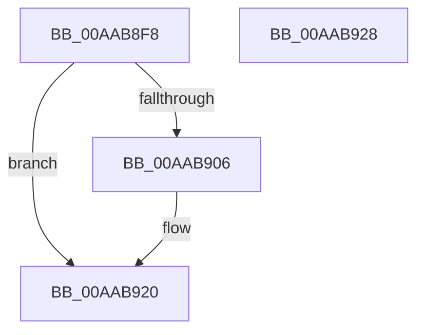

# sub_00AAB8F8

- RVA: `0x00AAB8F8`–`0x00AAB929` (길이 `49` bytes)
- VA: `0x0000000140AAB8F8`
- 실행 섹션: `PAGE`
- PDB 이름 있음: `아니요`; PDB Function 태그: `아니요`
- unwind 정보 RVA: `0x0005CF00`
- 디코드: `16`개 명령, `49/49` bytes 표시
- 미해석 바이트: `0` (있으면 어셈블리에 `.byte`로 보존)

> 이 문서는 커널 이미지의 기계어와 PDB 기호를 분석해 생성했습니다. 4번과 5번은 함수 원형과 자료형을 바이너리 사용 방식에서 추정한 C 해석이며 원본 소스 복구 결과는 아닙니다.

## 1. Dependencies

- 직접 호출 지점: **3**; 고유 호출 대상: **1**
- 직접 호출자로 확인된 함수: **2**
- RIP 상대 이미지 참조: **0**

### Outgoing calls
- `0x00AAB90A` → [PdcCloseEvent](../8D/PdcCloseEvent_function_008D2404.md) (function, `0x008D2404`)
- `0x00AAB913` → [PdcCloseEvent](../8D/PdcCloseEvent_function_008D2404.md) (function, `0x008D2404`)
- `0x00AAB91B` → [PdcCloseEvent](../8D/PdcCloseEvent_function_008D2404.md) (function, `0x008D2404`)

### Direct callers
- [sub_008D4104](../8D/Unknown_function_008D4104.md) at `0x008D41BA`
- [sub_009A0698](../9A/Unknown_function_009A0698.md) at `0x009A06BE`

### Static image references
- 디코드된 RIP-relative 메모리 참조가 없습니다.

## 2. Other-region calls and transfers

- 다른 실행 섹션으로 향하는 call: **0**
- 별도 외부 분기/꼬리 이동을 확인하지 못했습니다.

## 3. Assembly (complete function range)

```asm
00AAB8F8  40 53                           push rbx
00AAB8FA  48 83 EC 20                     sub rsp, 0x20
00AAB8FE  48 8B D9                        mov rbx, rcx
00AAB901  48 85 C9                        test rcx, rcx
00AAB904  74 1A                           je 0x140aab920
00AAB906  48 8B 49 28                     mov rcx, qword ptr [rcx + 0x28]
00AAB90A  E8 F5 6A E2 FF                  call 0x1408d2404
00AAB90F  48 8B 4B 38                     mov rcx, qword ptr [rbx + 0x38]
00AAB913  E8 EC 6A E2 FF                  call 0x1408d2404
00AAB918  48 8B CB                        mov rcx, rbx
00AAB91B  E8 E4 6A E2 FF                  call 0x1408d2404
00AAB920  33 C0                           xor eax, eax
00AAB922  48 83 C4 20                     add rsp, 0x20
00AAB926  5B                              pop rbx
00AAB927  C3                              ret
00AAB928  CC                              int3
```

## 4. C-style interpretation (structured pseudocode)

```c
__int64 __fastcall sub_00AAB8F8(__int64 a1)
{
    __int64 result;
    __int64 v_rsp;

    v_rsp = (v_rsp) - (32);
    if (a1 != 0) {
        a1 = *(unsigned __int64 *)(a1 + 40);
        result = PdcCloseEvent(a1, a2, a3, a4);
        a1 = *(unsigned __int64 *)(a1 + 56);
        result = PdcCloseEvent(a1, a2, a3, a4);
        a1 = a1;
        result = PdcCloseEvent(a1, a2, a3, a4);
    }
    result = 0;
    v_rsp = (v_rsp) + (32);
    return result;
}
```

## 5. (Beta) C Style

```c
int64_t sub_00AAB8F8(void *Arg1)
{
    uint8_t *arg1 = (uint8_t *)Arg1;

    int64_t result;
    int64_t local_rsp;

    local_rsp = (local_rsp) - (32);
    if (Arg1 != NULL) {
        Arg1 = *(uint64_t *)(arg1 + 0x28);
        result = PdcCloseEvent(Arg1, a2, a3, a4);
        Arg1 = *(uint64_t *)(arg1 + 0x38);
        result = PdcCloseEvent(Arg1, a2, a3, a4);
        Arg1 = Arg1;
        result = PdcCloseEvent(Arg1, a2, a3, a4);
    }
    result = 0;
    local_rsp = (local_rsp) + (32);
    return result;
}
```

### 관측된 메모리 오프셋

구조체 형식이 확인되지 않은 접근은 인자 기준의 오프셋으로만 기록했습니다.

| 기준 인자 | 오프셋 표현 | 폭 (bit) | 접근 |
|---|---:|---:|---|
| `Arg1` | `+ 0x38` | `64` | `R` |

## 6. Execution-region graph

[열기: 2D/3D 그래프와 함수 탐색 컨트롤 패널](../../../control-panel.html?section=page&rva=0x00AAB8F8&view=graph)

- 2D 그래프는 위에서 아래로 흐르고, 3D 그래프는 빈 공간을 드래그해 회전합니다. Shift+드래그는 이동, 휠은 확대·축소, 함수 노드 선택은 대상 보고서 이동입니다.

### Static fallback


