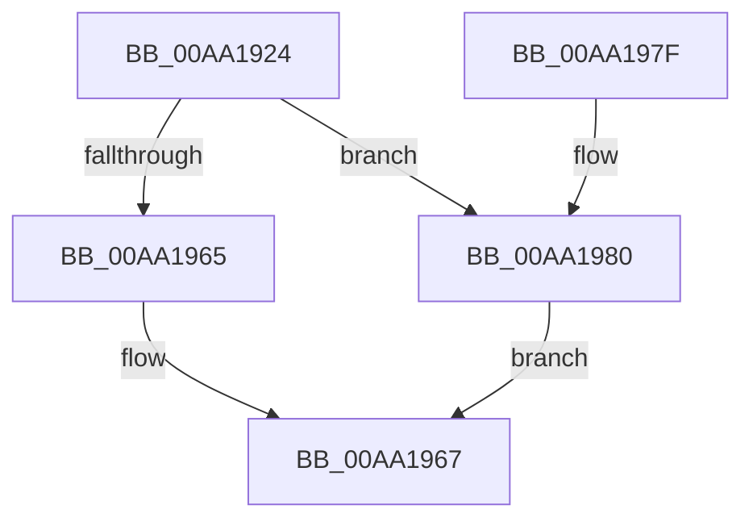

# VslIsEncryptionKeyAvailable

- RVA: `0x00AA1924`–`0x00AA198B` (길이 `103` bytes)
- VA: `0x0000000140AA1924`
- 실행 섹션: `PAGE`
- PDB 이름 있음: `예`; PDB Function 태그: `아니요`
- unwind 정보 RVA: `0x000BACF8`
- 디코드: `25`개 명령, `103/103` bytes 표시
- 미해석 바이트: `0` (있으면 어셈블리에 `.byte`로 보존)

> 이 문서는 커널 이미지의 기계어와 PDB 기호를 분석해 생성했습니다. 4번과 5번은 함수 원형과 자료형을 바이너리 사용 방식에서 추정한 C 해석이며 원본 소스 복구 결과는 아닙니다.

## 1. Dependencies

- 직접 호출 지점: **3**; 고유 호출 대상: **3**
- 직접 호출자로 확인된 함수: **1**
- RIP 상대 이미지 참조: **1**

### Outgoing calls
- `0x00AA1948` → [memset](../../text/6C/memset_function_006C6C40.md) (function, `0x006C6C40`)
- `0x00AA195C` → [VslpEnterIumSecureMode](../../text/23/VslpEnterIumSecureMode_function_00235E50.md) (function, `0x00235E50`)
- `0x00AA1972` → [_security_check_cookie](../../text/6A/_security_check_cookie_function_006AC640.md) (function, `0x006AC640`)

### Direct callers
- [ExpQuerySystemInformation](../A5/ExpQuerySystemInformation_function_00A57858.md) at `0x00A5A4CB`

### Static image references
- `0x00AA192B` → RVA `0x00E0A740` (`.data`; read)

## 2. Other-region calls and transfers

- 다른 실행 섹션으로 향하는 call: **3**
  - `0x00AA1948` → [memset](../../text/6C/memset_function_006C6C40.md) (`PAGE` → `.text`)
  - `0x00AA195C` → [VslpEnterIumSecureMode](../../text/23/VslpEnterIumSecureMode_function_00235E50.md) (`PAGE` → `.text`)
  - `0x00AA1972` → [_security_check_cookie](../../text/6A/_security_check_cookie_function_006AC640.md) (`PAGE` → `.text`)
- 별도 외부 분기/꼬리 이동을 확인하지 못했습니다.

## 3. Assembly (complete function range)

```asm
00AA1924  48 81 EC A8 00 00 00            sub rsp, 0xa8
00AA192B  48 8B 05 0E 8E 36 00            mov rax, qword ptr [rip + 0x368e0e]
00AA1932  48 33 C4                        xor rax, rsp
00AA1935  48 89 84 24 90 00 00 00         mov qword ptr [rsp + 0x90], rax
00AA193D  33 D2                           xor edx, edx
00AA193F  48 8D 4C 24 20                  lea rcx, [rsp + 0x20]
00AA1944  44 8D 42 68                     lea r8d, [rdx + 0x68]
00AA1948  E8 F3 52 C2 FF                  call 0x1406c6c40
00AA194D  BA 24 00 00 00                  mov edx, 0x24
00AA1952  4C 8D 4C 24 20                  lea r9, [rsp + 0x20]
00AA1957  45 33 C0                        xor r8d, r8d
00AA195A  B1 02                           mov cl, 2
00AA195C  E8 EF 44 79 FF                  call 0x140235e50
00AA1961  85 C0                           test eax, eax
00AA1963  79 1B                           jns 0x140aa1980
00AA1965  32 C0                           xor al, al
00AA1967  48 8B 8C 24 90 00 00 00         mov rcx, qword ptr [rsp + 0x90]
00AA196F  48 33 CC                        xor rcx, rsp
00AA1972  E8 C9 AC C0 FF                  call 0x1406ac640
00AA1977  48 81 C4 A8 00 00 00            add rsp, 0xa8
00AA197E  C3                              ret
00AA197F  CC                              int3
00AA1980  48 83 7C 24 30 00               cmp qword ptr [rsp + 0x30], 0
00AA1986  0F 95 C0                        setne al
00AA1989  EB DC                           jmp 0x140aa1967
```

## 4. C-style interpretation (structured pseudocode)

```c
__int64 __fastcall VslIsEncryptionKeyAvailable(__int64 a1, int a2)
{
    __int64 result;
    __int64 v_rsp;
    unsigned __int64 v_stack_m18;
    unsigned __int64 v_stack_m88;
    unsigned __int64 v_stack_p30;

    v_rsp = (v_rsp) - (168);
    result = (*(unsigned __int64 *)(v_rip + 3575310)) ^ (v_rsp);
    v_stack_m18 = result;
    a2 = 0;
    result = memset(v_stack_m88, a2, a2 + 104, a4);
    a3 = 0;
    result = VslpEnterIumSecureMode(2, 36, a3, v_stack_m88);
    if (!sign_flag) goto loc_00AA1980;
    result = 0;
loc_00AA1967:
    a1 = (v_stack_m18) ^ (v_rsp);
    result = _security_check_cookie(a1, 36, a3, v_stack_m88);
    v_rsp = (v_rsp) + (168);
    return result;
loc_00AA1980:
    result = (v_stack_p30 != 0) ? 1 : 0;
    goto loc_00AA1967;
}
```

## 5. (Beta) C Style

```c
int64_t VslIsEncryptionKeyAvailable(int64_t Arg1, int32_t Arg2)
{
    int64_t result;
    int64_t local_rsp;
    uint64_t v_stack_m18;
    uint64_t v_stack_m88;
    uint64_t v_stack_p30;

    local_rsp = (local_rsp) - (168);
    result = (*(uint64_t *)(v_rip + 0x368E0E)) ^ (local_rsp);
    v_stack_m18 = result;
    Arg2 = 0;
    result = memset(v_stack_m88, Arg2, Arg2 + 104, a4);
    a3 = 0;
    result = VslpEnterIumSecureMode(2, 36, a3, v_stack_m88);
    if (!sign_flag) goto loc_00AA1980;
    result = 0;
loc_00AA1967:
    Arg1 = (v_stack_m18) ^ (local_rsp);
    result = _security_check_cookie(Arg1, 36, a3, v_stack_m88);
    local_rsp = (local_rsp) + (168);
    return result;
loc_00AA1980:
    result = (v_stack_p30 != 0) ? 1 : 0;
    goto loc_00AA1967;
}
```

## 6. Execution-region graph

[열기: 2D/3D 그래프와 함수 탐색 컨트롤 패널](../../../control-panel.html?section=page&rva=0x00AA1924&view=graph)

- 2D 그래프는 위에서 아래로 흐르고, 3D 그래프는 빈 공간을 드래그해 회전합니다. Shift+드래그는 이동, 휠은 확대·축소, 함수 노드 선택은 대상 보고서 이동입니다.

### Static fallback


