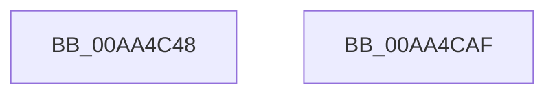

# VslLiveDumpCaptureProcess

- RVA: `0x00AA4C48`–`0x00AA4CB0` (길이 `104` bytes)
- VA: `0x0000000140AA4C48`
- 실행 섹션: `PAGE`
- PDB 이름 있음: `예`; PDB Function 태그: `아니요`
- unwind 정보 RVA: `0x000AF554`
- 디코드: `24`개 명령, `104/104` bytes 표시
- 미해석 바이트: `0` (있으면 어셈블리에 `.byte`로 보존)

> 이 문서는 커널 이미지의 기계어와 PDB 기호를 분석해 생성했습니다. 4번과 5번은 함수 원형과 자료형을 바이너리 사용 방식에서 추정한 C 해석이며 원본 소스 복구 결과는 아닙니다.

## 1. Dependencies

- 직접 호출 지점: **3**; 고유 호출 대상: **3**
- 직접 호출자로 확인된 함수: **1**
- RIP 상대 이미지 참조: **1**

### Outgoing calls
- `0x00AA4C71` → [memset](../../text/6C/memset_function_006C6C40.md) (function, `0x006C6C40`)
- `0x00AA4C91` → [VslpEnterIumSecureMode](../../text/23/VslpEnterIumSecureMode_function_00235E50.md) (function, `0x00235E50`)
- `0x00AA4CA1` → [_security_check_cookie](../../text/6A/_security_check_cookie_function_006AC640.md) (function, `0x006AC640`)

### Direct callers
- [NtQueryInformationProcess](../9A/NtQueryInformationProcess_function_009AA250.md) at `0x009AE2D5`

### Static image references
- `0x00AA4C51` → RVA `0x00E0A740` (`.data`; read)

## 2. Other-region calls and transfers

- 다른 실행 섹션으로 향하는 call: **3**
  - `0x00AA4C71` → [memset](../../text/6C/memset_function_006C6C40.md) (`PAGE` → `.text`)
  - `0x00AA4C91` → [VslpEnterIumSecureMode](../../text/23/VslpEnterIumSecureMode_function_00235E50.md) (`PAGE` → `.text`)
  - `0x00AA4CA1` → [_security_check_cookie](../../text/6A/_security_check_cookie_function_006AC640.md) (`PAGE` → `.text`)
- 별도 외부 분기/꼬리 이동을 확인하지 못했습니다.

## 3. Assembly (complete function range)

```asm
00AA4C48  40 53                           push rbx
00AA4C4A  48 81 EC A0 00 00 00            sub rsp, 0xa0
00AA4C51  48 8B 05 E8 5A 36 00            mov rax, qword ptr [rip + 0x365ae8]
00AA4C58  48 33 C4                        xor rax, rsp
00AA4C5B  48 89 84 24 90 00 00 00         mov qword ptr [rsp + 0x90], rax
00AA4C63  33 D2                           xor edx, edx
00AA4C65  48 8B D9                        mov rbx, rcx
00AA4C68  48 8D 4C 24 20                  lea rcx, [rsp + 0x20]
00AA4C6D  44 8D 42 68                     lea r8d, [rdx + 0x68]
00AA4C71  E8 CA 1F C2 FF                  call 0x1406c6c40
00AA4C76  48 8B 83 70 01 00 00            mov rax, qword ptr [rbx + 0x170]
00AA4C7D  4C 8D 4C 24 20                  lea r9, [rsp + 0x20]
00AA4C82  BA 40 00 00 00                  mov edx, 0x40
00AA4C87  48 89 44 24 28                  mov qword ptr [rsp + 0x28], rax
00AA4C8C  45 33 C0                        xor r8d, r8d
00AA4C8F  B1 02                           mov cl, 2
00AA4C91  E8 BA 11 79 FF                  call 0x140235e50
00AA4C96  48 8B 8C 24 90 00 00 00         mov rcx, qword ptr [rsp + 0x90]
00AA4C9E  48 33 CC                        xor rcx, rsp
00AA4CA1  E8 9A 79 C0 FF                  call 0x1406ac640
00AA4CA6  48 81 C4 A0 00 00 00            add rsp, 0xa0
00AA4CAD  5B                              pop rbx
00AA4CAE  C3                              ret
00AA4CAF  CC                              int3
```

## 4. C-style interpretation (structured pseudocode)

```c
__int64 __fastcall VslLiveDumpCaptureProcess(__int64 a1, int a2)
{
    __int64 result;
    __int64 v_rsp;
    unsigned __int64 v_stack_m18;
    unsigned __int64 v_stack_m80;
    unsigned __int64 v_stack_m88;

    v_rsp = (v_rsp) - (160);
    result = (*(unsigned __int64 *)(v_rip + 3562216)) ^ (v_rsp);
    v_stack_m18 = result;
    a2 = 0;
    result = memset(v_stack_m88, a2, a2 + 104, a4);
    v_stack_m80 = *(unsigned __int64 *)(a1 + 368);
    a3 = 0;
    result = VslpEnterIumSecureMode(2, 64, a3, v_stack_m88);
    a1 = (v_stack_m18) ^ (v_rsp);
    result = _security_check_cookie(a1, 64, a3, v_stack_m88);
    v_rsp = (v_rsp) + (160);
    return result;
}
```

## 5. (Beta) C Style

```c
int64_t VslLiveDumpCaptureProcess(void *Arg1, int32_t Arg2)
{
    uint8_t *arg1 = (uint8_t *)Arg1;

    int64_t result;
    int64_t local_rsp;
    uint64_t v_stack_m18;
    uint64_t v_stack_m80;
    uint64_t v_stack_m88;

    local_rsp = (local_rsp) - (160);
    result = (*(uint64_t *)(v_rip + 0x365AE8)) ^ (local_rsp);
    v_stack_m18 = result;
    Arg2 = 0;
    result = memset(v_stack_m88, Arg2, Arg2 + 104, a4);
    v_stack_m80 = *(uint64_t *)(arg1 + 0x170);
    a3 = 0;
    result = VslpEnterIumSecureMode(2, 64, a3, v_stack_m88);
    Arg1 = (v_stack_m18) ^ (local_rsp);
    result = _security_check_cookie(Arg1, 64, a3, v_stack_m88);
    local_rsp = (local_rsp) + (160);
    return result;
}
```

### 관측된 메모리 오프셋

구조체 형식이 확인되지 않은 접근은 인자 기준의 오프셋으로만 기록했습니다.

| 기준 인자 | 오프셋 표현 | 폭 (bit) | 접근 |
|---|---:|---:|---|
| `Arg1` | `+ 0x170` | `64` | `R` |

## 6. Execution-region graph

[열기: 2D/3D 그래프와 함수 탐색 컨트롤 패널](../../../control-panel.html?section=page&rva=0x00AA4C48&view=graph)

- 2D 그래프는 위에서 아래로 흐르고, 3D 그래프는 빈 공간을 드래그해 회전합니다. Shift+드래그는 이동, 휠은 확대·축소, 함수 노드 선택은 대상 보고서 이동입니다.

### Static fallback


