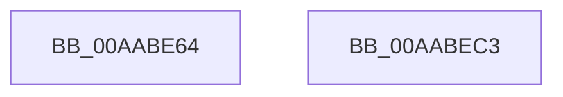

# VslStartSecureThread

- RVA: `0x00AABE64`–`0x00AABEC4` (길이 `96` bytes)
- VA: `0x0000000140AABE64`
- 실행 섹션: `PAGE`
- PDB 이름 있음: `예`; PDB Function 태그: `아니요`
- unwind 정보 RVA: `0x000AA6F8`
- 디코드: `20`개 명령, `96/96` bytes 표시
- 미해석 바이트: `0` (있으면 어셈블리에 `.byte`로 보존)

> 이 문서는 커널 이미지의 기계어와 PDB 기호를 분석해 생성했습니다. 4번과 5번은 함수 원형과 자료형을 바이너리 사용 방식에서 추정한 C 해석이며 원본 소스 복구 결과는 아닙니다.

## 1. Dependencies

- 직접 호출 지점: **3**; 고유 호출 대상: **3**
- 직접 호출자로 확인된 함수: **1**
- RIP 상대 이미지 참조: **1**

### Outgoing calls
- `0x00AABE88` → [memset](../../text/6C/memset_function_006C6C40.md) (function, `0x006C6C40`)
- `0x00AABEA6` → [VslpEnterIumSecureMode](../../text/23/VslpEnterIumSecureMode_function_00235E50.md) (function, `0x00235E50`)
- `0x00AABEB6` → [_security_check_cookie](../../text/6A/_security_check_cookie_function_006AC640.md) (function, `0x006AC640`)

### Direct callers
- [PspSecureThreadStartup](PspSecureThreadStartup_function_00AABDF0.md) at `0x00AABE32`

### Static image references
- `0x00AABE6B` → RVA `0x00E0A740` (`.data`; read)

## 2. Other-region calls and transfers

- 다른 실행 섹션으로 향하는 call: **3**
  - `0x00AABE88` → [memset](../../text/6C/memset_function_006C6C40.md) (`PAGE` → `.text`)
  - `0x00AABEA6` → [VslpEnterIumSecureMode](../../text/23/VslpEnterIumSecureMode_function_00235E50.md) (`PAGE` → `.text`)
  - `0x00AABEB6` → [_security_check_cookie](../../text/6A/_security_check_cookie_function_006AC640.md) (`PAGE` → `.text`)
- 별도 외부 분기/꼬리 이동을 확인하지 못했습니다.

## 3. Assembly (complete function range)

```asm
00AABE64  48 81 EC A8 00 00 00            sub rsp, 0xa8
00AABE6B  48 8B 05 CE E8 35 00            mov rax, qword ptr [rip + 0x35e8ce]
00AABE72  48 33 C4                        xor rax, rsp
00AABE75  48 89 84 24 90 00 00 00         mov qword ptr [rsp + 0x90], rax
00AABE7D  33 D2                           xor edx, edx
00AABE7F  48 8D 4C 24 20                  lea rcx, [rsp + 0x20]
00AABE84  44 8D 42 68                     lea r8d, [rdx + 0x68]
00AABE88  E8 B3 AD C1 FF                  call 0x1406c6c40
00AABE8D  65 48 8B 04 25 88 01 00 00      mov rax, qword ptr gs:[0x188]
00AABE96  4C 8D 4C 24 20                  lea r9, [rsp + 0x20]
00AABE9B  33 D2                           xor edx, edx
00AABE9D  33 C9                           xor ecx, ecx
00AABE9F  44 8B 80 1C 03 00 00            mov r8d, dword ptr [rax + 0x31c]
00AABEA6  E8 A5 9F 78 FF                  call 0x140235e50
00AABEAB  48 8B 8C 24 90 00 00 00         mov rcx, qword ptr [rsp + 0x90]
00AABEB3  48 33 CC                        xor rcx, rsp
00AABEB6  E8 85 07 C0 FF                  call 0x1406ac640
00AABEBB  48 81 C4 A8 00 00 00            add rsp, 0xa8
00AABEC2  C3                              ret
00AABEC3  CC                              int3
```

## 4. C-style interpretation (structured pseudocode)

```c
__int64 __fastcall VslStartSecureThread(__int64 a1, int a2)
{
    __int64 result;
    __int64 v_rsp;
    unsigned __int64 v_stack_m18;
    unsigned __int64 v_stack_m88;

    v_rsp = (v_rsp) - (168);
    result = (*(unsigned __int64 *)(v_rip + 3533006)) ^ (v_rsp);
    v_stack_m18 = result;
    a2 = 0;
    result = memset(v_stack_m88, a2, a2 + 104, a4);
    a2 = 0;
    a1 = 0;
    result = VslpEnterIumSecureMode(a1, a2, (unsigned int)(*(unsigned int *)(*(unsigned __int64 *)(gs_base + (0 + 392)) + 796)), v_stack_m88);
    a1 = (v_stack_m18) ^ (v_rsp);
    result = _security_check_cookie(a1, a2, (unsigned int)(*(unsigned int *)(*(unsigned __int64 *)(gs_base + (0 + 392)) + 796)), v_stack_m88);
    v_rsp = (v_rsp) + (168);
    return result;
}
```

## 5. (Beta) C Style

```c
int64_t VslStartSecureThread(int64_t Arg1, int32_t Arg2)
{
    int64_t result;
    int64_t local_rsp;
    uint64_t v_stack_m18;
    uint64_t v_stack_m88;

    local_rsp = (local_rsp) - (168);
    result = (*(uint64_t *)(v_rip + 0x35E8CE)) ^ (local_rsp);
    v_stack_m18 = result;
    Arg2 = 0;
    result = memset(v_stack_m88, Arg2, Arg2 + 104, a4);
    Arg2 = 0;
    Arg1 = 0;
    result = VslpEnterIumSecureMode(Arg1, Arg2, (uint32_t)(*(uint32_t *)(*(uint64_t *)(gs_base + (0 + 0x188)) + 0x31C)), v_stack_m88);
    Arg1 = (v_stack_m18) ^ (local_rsp);
    result = _security_check_cookie(Arg1, Arg2, (uint32_t)(*(uint32_t *)(*(uint64_t *)(gs_base + (0 + 0x188)) + 0x31C)), v_stack_m88);
    local_rsp = (local_rsp) + (168);
    return result;
}
```

## 6. Execution-region graph

[열기: 2D/3D 그래프와 함수 탐색 컨트롤 패널](../../../control-panel.html?section=page&rva=0x00AABE64&view=graph)

- 2D 그래프는 위에서 아래로 흐르고, 3D 그래프는 빈 공간을 드래그해 회전합니다. Shift+드래그는 이동, 휠은 확대·축소, 함수 노드 선택은 대상 보고서 이동입니다.

### Static fallback


