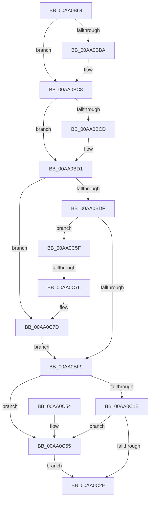

# WdipSemAllocatePool

- RVA: `0x00AA0B64`–`0x00AA0C9D` (길이 `313` bytes)
- VA: `0x0000000140AA0B64`
- 실행 섹션: `PAGE`
- PDB 이름 있음: `예`; PDB Function 태그: `예`
- unwind 정보 RVA: `0x000A2B2C`
- 디코드: `77`개 명령, `313/313` bytes 표시
- 미해석 바이트: `0` (있으면 어셈블리에 `.byte`로 보존)

> 이 문서는 커널 이미지의 기계어와 PDB 기호를 분석해 생성했습니다. 4번과 5번은 함수 원형과 자료형을 바이너리 사용 방식에서 추정한 C 해석이며 원본 소스 복구 결과는 아닙니다.

## 1. Dependencies

- 직접 호출 지점: **6**; 고유 호출 대상: **6**
- 직접 호출자로 확인된 함수: **1**
- RIP 상대 이미지 참조: **7**

### Outgoing calls
- `0x00AA0BA9` → [KeAbPreAcquire](../../text/21/KeAbPreAcquire_function_00210230.md) (function, `0x00210230`)
- `0x00AA0BC3` → [ExfAcquirePushLockExclusiveEx](../../text/20/ExfAcquirePushLockExclusiveEx_function_0020FC90.md) (function, `0x0020FC90`)
- `0x00AA0BEF` → [ExAllocatePool2](../../poolcode/B8/ExAllocatePool2_function_00B820F0.md) (function, `0x00B820F0`)
- `0x00AA0C2C` → [KeAbPostRelease](../../text/2E/KeAbPostRelease_function_002E1600.md) (function, `0x002E1600`)
- `0x00AA0C31` → [KeLeaveCriticalRegion](../../text/25/KeLeaveCriticalRegion_function_0025D8B0.md) (function, `0x0025D8B0`)
- `0x00AA0C58` → [ExfReleasePushLock](../../text/26/ExfReleasePushLock_function_002638D0.md) (function, `0x002638D0`)

### Direct callers
- [WdipSemFastAllocate](../A5/WdipSemFastAllocate_function_00A5DC04.md) at `0x00A5DC30`

### Static image references
- `0x00AA0B89` → RVA `0x00E28C80` (`.data`; read)
- `0x00AA0BD1` → RVA `0x00E28C70` (`.data`; read)
- `0x00AA0C5F` → RVA `0x00E28C68` (`.data`; read)
- `0x00AA0C66` → RVA `0x00E28C60` (`.data`; read)
- `0x00AA0C7D` → RVA `0x00E28C78` (`.data`; read)
- `0x00AA0C8B` → RVA `0x00E28C78` (`.data`; write)
- `0x00AA0C92` → RVA `0x00E28C70` (`.data`; write)

## 2. Other-region calls and transfers

- 다른 실행 섹션으로 향하는 call: **6**
  - `0x00AA0BA9` → [KeAbPreAcquire](../../text/21/KeAbPreAcquire_function_00210230.md) (`PAGE` → `.text`)
  - `0x00AA0BC3` → [ExfAcquirePushLockExclusiveEx](../../text/20/ExfAcquirePushLockExclusiveEx_function_0020FC90.md) (`PAGE` → `.text`)
  - `0x00AA0BEF` → [ExAllocatePool2](../../poolcode/B8/ExAllocatePool2_function_00B820F0.md) (`PAGE` → `POOLCODE`)
  - `0x00AA0C2C` → [KeAbPostRelease](../../text/2E/KeAbPostRelease_function_002E1600.md) (`PAGE` → `.text`)
  - `0x00AA0C31` → [KeLeaveCriticalRegion](../../text/25/KeLeaveCriticalRegion_function_0025D8B0.md) (`PAGE` → `.text`)
  - `0x00AA0C58` → [ExfReleasePushLock](../../text/26/ExfReleasePushLock_function_002638D0.md) (`PAGE` → `.text`)
- call이 아닌 외부 분기/꼬리 이동: **1**
  - `0x00AA0C70` → [sub_00B492EC](../B4/Unknown_function_00B492EC.md) (`tail-transfer`)

## 3. Assembly (complete function range)

```asm
00AA0B64  48 8B C4                        mov rax, rsp
00AA0B67  48 89 58 08                     mov qword ptr [rax + 8], rbx
00AA0B6B  48 89 68 10                     mov qword ptr [rax + 0x10], rbp
00AA0B6F  48 89 70 18                     mov qword ptr [rax + 0x18], rsi
00AA0B73  48 89 78 20                     mov qword ptr [rax + 0x20], rdi
00AA0B77  41 56                           push r14
00AA0B79  48 83 EC 20                     sub rsp, 0x20
00AA0B7D  65 48 8B 04 25 88 01 00 00      mov rax, qword ptr gs:[0x188]
00AA0B86  8D 59 0F                        lea ebx, [rcx + 0xf]
00AA0B89  48 8D 2D F0 80 38 00            lea rbp, [rip + 0x3880f0]
00AA0B90  45 33 F6                        xor r14d, r14d
00AA0B93  45 33 C0                        xor r8d, r8d
00AA0B96  33 D2                           xor edx, edx
00AA0B98  48 8B CD                        mov rcx, rbp
00AA0B9B  83 E3 F0                        and ebx, 0xfffffff0
00AA0B9E  66 FF 88 E4 01 00 00            dec word ptr [rax + 0x1e4]
00AA0BA5  41 8B F6                        mov esi, r14d
00AA0BA8  90                              nop
00AA0BA9  E8 82 F6 76 FF                  call 0x140210230
00AA0BAE  F0 48 0F BA 6D 00 00            lock bts qword ptr [rbp], 0
00AA0BB5  48 8B F8                        mov rdi, rax
00AA0BB8  73 0E                           jae 0x140aa0bc8
00AA0BBA  4C 8B C5                        mov r8, rbp
00AA0BBD  48 8B D0                        mov rdx, rax
00AA0BC0  48 8B CD                        mov rcx, rbp
00AA0BC3  E8 C8 F0 76 FF                  call 0x14020fc90
00AA0BC8  48 85 FF                        test rdi, rdi
00AA0BCB  74 04                           je 0x140aa0bd1
00AA0BCD  C6 47 0A 01                     mov byte ptr [rdi + 0xa], 1
00AA0BD1  8B 0D 99 80 38 00               mov ecx, dword ptr [rip + 0x388099]
00AA0BD7  3B D9                           cmp ebx, ecx
00AA0BD9  0F 86 9E 00 00 00               jbe 0x140aa0c7d
00AA0BDF  BA 00 10 00 00                  mov edx, 0x1000
00AA0BE4  B9 00 01 00 00                  mov ecx, 0x100
00AA0BE9  41 B8 57 44 49 73               mov r8d, 0x73494457
00AA0BEF  E8 FC 14 0E 00                  call 0x140b820f0
00AA0BF4  48 85 C0                        test rax, rax
00AA0BF7  75 66                           jne 0x140aa0c5f
00AA0BF9  0F 0D 0D 80 80 38 00            prefetchw byte ptr [rip + 0x388080]
00AA0C00  48 8B 05 79 80 38 00            mov rax, qword ptr [rip + 0x388079]
00AA0C07  48 8B C8                        mov rcx, rax
00AA0C0A  48 83 E1 F0                     and rcx, 0xfffffffffffffff0
00AA0C0E  48 83 F9 10                     cmp rcx, 0x10
00AA0C12  48 8D 50 F0                     lea rdx, [rax - 0x10]
00AA0C16  49 0F 46 D6                     cmovbe rdx, r14
00AA0C1A  A8 02                           test al, 2
00AA0C1C  75 37                           jne 0x140aa0c55
00AA0C1E  F0 48 0F B1 15 59 80 38 00      lock cmpxchg qword ptr [rip + 0x388059], rdx
00AA0C27  75 2C                           jne 0x140aa0c55
00AA0C29  48 8B CD                        mov rcx, rbp
00AA0C2C  E8 CF 09 84 FF                  call 0x1402e1600
00AA0C31  E8 7A CC 7B FF                  call 0x14025d8b0
00AA0C36  48 8B 5C 24 30                  mov rbx, qword ptr [rsp + 0x30]
00AA0C3B  48 8B C6                        mov rax, rsi
00AA0C3E  48 8B 74 24 40                  mov rsi, qword ptr [rsp + 0x40]
00AA0C43  48 8B 6C 24 38                  mov rbp, qword ptr [rsp + 0x38]
00AA0C48  48 8B 7C 24 48                  mov rdi, qword ptr [rsp + 0x48]
00AA0C4D  48 83 C4 20                     add rsp, 0x20
00AA0C51  41 5E                           pop r14
00AA0C53  C3                              ret
00AA0C54  CC                              int3
00AA0C55  48 8B CD                        mov rcx, rbp
00AA0C58  E8 73 2C 7C FF                  call 0x1402638d0
00AA0C5D  EB CA                           jmp 0x140aa0c29
00AA0C5F  48 8B 0D 02 80 38 00            mov rcx, qword ptr [rip + 0x388002]
00AA0C66  48 8D 15 F3 7F 38 00            lea rdx, [rip + 0x387ff3]
00AA0C6D  48 39 11                        cmp qword ptr [rcx], rdx
00AA0C70  0F 84 76 86 0A 00               je 0x140b492ec
00AA0C76  B9 03 00 00 00                  mov ecx, 3
00AA0C7B  CD 29                           int 0x29
00AA0C7D  48 8B 35 F4 7F 38 00            mov rsi, qword ptr [rip + 0x387ff4]
00AA0C84  8B C3                           mov eax, ebx
00AA0C86  48 03 C6                        add rax, rsi
00AA0C89  2B CB                           sub ecx, ebx
00AA0C8B  48 89 05 E6 7F 38 00            mov qword ptr [rip + 0x387fe6], rax
00AA0C92  89 0D D8 7F 38 00               mov dword ptr [rip + 0x387fd8], ecx
00AA0C98  E9 5C FF FF FF                  jmp 0x140aa0bf9
```

## 4. C-style interpretation (structured pseudocode)

```c
__int64 __fastcall WdipSemAllocatePool(__int64 a1, int a2, int a3)
{
    __int64 result;
    __int64 v_r14;
    __int64 v_rbx;
    __int64 v_rsp;
    unsigned __int64 v_stack_p10;
    unsigned __int64 v_stack_p18;
    unsigned __int64 v_stack_p20;
    unsigned __int64 v_stack_p8;

    *(unsigned __int64 *)(v_rsp + 8) = v_rbx;
    *(unsigned __int64 *)(v_rsp + 16) = v_rbp;
    *(unsigned __int64 *)(v_rsp + 24) = v_rsi;
    *(unsigned __int64 *)(v_rsp + 32) = v_rdi;
    v_rsp = (v_rsp) - (32);
    v_r14 = 0;
    a3 = 0;
    a2 = 0;
    v_rbx = (unsigned int)((a1 + 15) & (0xFFFFFFF0ULL));
    result = KeAbPreAcquire(v_rip + 3703024, a2, a3, a4);
    if (!(condition_is_above_or_equal)) {
        a3 = v_rip + 3703024;
        a2 = result;
        a1 = v_rip + 3703024;
        result = ExfAcquirePushLockExclusiveEx(a1, a2, a3, a4);
    }
    if (result != 0) {
        *(unsigned __int8 *)(result + 10) = 1;
    }
    if (((unsigned int)(v_rbx)) <= ((unsigned int)((unsigned int)(*(unsigned int *)(v_rip + 3702937))))) goto loc_00AA0C7D;
    result = ExAllocatePool2(256, (unsigned int)(0x1000ULL), (unsigned int)(0x73494457ULL), a4);
    if (result != 0) goto loc_00AA0C5F;
loc_00AA0BF9:
    a1 = (*(unsigned __int64 *)(v_rip + 3702905)) & (-16);
    a2 = *(unsigned __int64 *)(v_rip + 3702905) - 16;
    if (a1 <= 16) { a2 = 0; }
    if ((((unsigned __int8)(*(unsigned __int64 *)(v_rip + 3702905))) & (2)) != 0) goto loc_00AA0C55;
    if ((((unsigned __int8)(*(unsigned __int64 *)(v_rip + 3702905))) & (2)) != 0) goto loc_00AA0C55;
loc_00AA0C29:
    result = KeAbPostRelease(v_rip + 3703024, a2, (unsigned int)(0x73494457ULL), a4);
    result = KeLeaveCriticalRegion(v_rip + 3703024, a2, (unsigned int)(0x73494457ULL), a4);
    v_rsp = (v_rsp) + (32);
    return 0;
loc_00AA0C55:
    result = ExfReleasePushLock(v_stack_p10, a2, (unsigned int)(0x73494457ULL), a4);
    goto loc_00AA0C29;
loc_00AA0C5F:
loc_00AA0C7D:
    result = ((unsigned int)((unsigned int)(v_stack_p8))) + (*(unsigned __int64 *)(v_rip + 3702772));
    a1 = (unsigned int)((3) - ((unsigned int)(v_stack_p8)));
    *(unsigned __int64 *)(v_rip + 3702758) = result;
    *(unsigned int *)(v_rip + 3702744) = (unsigned int)(a1);
    goto loc_00AA0BF9;
}
```

## 5. (Beta) C Style

```c
int64_t WdipSemAllocatePool(void *Arg1, int32_t Arg2, int32_t Arg3)
{
    uint8_t *arg1 = (uint8_t *)Arg1;

    int64_t result;
    int64_t local_r14;
    int64_t local_rbx;
    int64_t local_rsp;
    uint64_t v_stack_p10;
    uint64_t v_stack_p18;
    uint64_t v_stack_p20;
    uint64_t v_stack_p8;

    *(uint64_t *)(local_rsp + 0x8) = local_rbx;
    *(uint64_t *)(local_rsp + 0x10) = local_rbp;
    *(uint64_t *)(local_rsp + 0x18) = local_rsi;
    *(uint64_t *)(local_rsp + 0x20) = local_rdi;
    local_rsp = (local_rsp) - (32);
    local_r14 = 0;
    Arg3 = 0;
    Arg2 = 0;
    local_rbx = (uint32_t)((Arg1 + 15) & (0xFFFFFFF0ULL));
    result = KeAbPreAcquire(v_rip + 3703024, Arg2, Arg3, a4);
    if (!(condition_is_above_or_equal)) {
        Arg3 = v_rip + 3703024;
        Arg2 = result;
        Arg1 = v_rip + 3703024;
        result = ExfAcquirePushLockExclusiveEx(Arg1, Arg2, Arg3, a4);
    }
    if (result != 0) {
        *(uint8_t *)(result + 0xA) = 1;
    }
    if (((uint32_t)(local_rbx)) <= ((uint32_t)((uint32_t)(*(uint32_t *)(v_rip + 0x388099))))) goto loc_00AA0C7D;
    result = ExAllocatePool2(256, (uint32_t)(0x1000ULL), (uint32_t)(0x73494457ULL), a4);
    if (result != 0) goto loc_00AA0C5F;
loc_00AA0BF9:
    Arg1 = (*(uint64_t *)(v_rip + 0x388079)) & (-16);
    Arg2 = *(uint64_t *)(v_rip + 0x388079) - 16;
    if (Arg1 <= 16) { Arg2 = 0; }
    if ((((uint8_t)(*(uint64_t *)(v_rip + 0x388079))) & (2)) != 0) goto loc_00AA0C55;
    if ((((uint8_t)(*(uint64_t *)(v_rip + 0x388079))) & (2)) != 0) goto loc_00AA0C55;
loc_00AA0C29:
    result = KeAbPostRelease(v_rip + 3703024, Arg2, (uint32_t)(0x73494457ULL), a4);
    result = KeLeaveCriticalRegion(v_rip + 3703024, Arg2, (uint32_t)(0x73494457ULL), a4);
    local_rsp = (local_rsp) + (32);
    return 0;
loc_00AA0C55:
    result = ExfReleasePushLock(v_stack_p10, Arg2, (uint32_t)(0x73494457ULL), a4);
    goto loc_00AA0C29;
loc_00AA0C5F:
loc_00AA0C7D:
    result = ((uint32_t)((uint32_t)(v_stack_p8))) + (*(uint64_t *)(v_rip + 0x387FF4));
    Arg1 = (uint32_t)((3) - ((uint32_t)(v_stack_p8)));
    *(uint64_t *)(v_rip + 0x387FE6) = result;
    *(uint32_t *)(v_rip + 0x387FD8) = (uint32_t)(Arg1);
    goto loc_00AA0BF9;
}
```

### 관측된 메모리 오프셋

구조체 형식이 확인되지 않은 접근은 인자 기준의 오프셋으로만 기록했습니다.

| 기준 인자 | 오프셋 표현 | 폭 (bit) | 접근 |
|---|---:|---:|---|
| `Arg1` | `+ 0xF` | `32` | `R` |

## 6. Execution-region graph

[열기: 2D/3D 그래프와 함수 탐색 컨트롤 패널](../../../control-panel.html?section=page&rva=0x00AA0B64&view=graph)

- 2D 그래프는 위에서 아래로 흐르고, 3D 그래프는 빈 공간을 드래그해 회전합니다. Shift+드래그는 이동, 휠은 확대·축소, 함수 노드 선택은 대상 보고서 이동입니다.

### Static fallback


