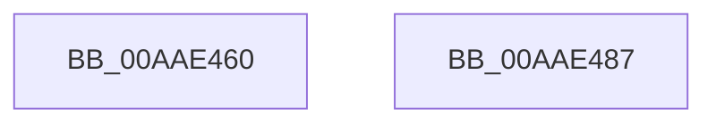

# WmipDeliverWnodeToDS

- RVA: `0x00AAE460`–`0x00AAE488` (길이 `40` bytes)
- VA: `0x0000000140AAE460`
- 실행 섹션: `PAGE`
- PDB 이름 있음: `예`; PDB Function 태그: `아니요`
- unwind 정보 RVA: `0x00063458`
- 디코드: `11`개 명령, `40/40` bytes 표시
- 미해석 바이트: `0` (있으면 어셈블리에 `.byte`로 보존)

> 이 문서는 커널 이미지의 기계어와 PDB 기호를 분석해 생성했습니다. 4번과 5번은 함수 원형과 자료형을 바이너리 사용 방식에서 추정한 C 해석이며 원본 소스 복구 결과는 아닙니다.

## 1. Dependencies

- 직접 호출 지점: **1**; 고유 호출 대상: **1**
- 직접 호출자로 확인된 함수: **3**
- RIP 상대 이미지 참조: **0**

### Outgoing calls
- `0x00AAE47D` → [WmipSendWmiIrp](../9E/WmipSendWmiIrp_function_009E0484.md) (function, `0x009E0484`)

### Direct callers
- [WmipDereferenceEvent](../AC/WmipDereferenceEvent_function_00ACE6E4.md) at `0x00ACE8A8`
- [sub_00B2FD86](../B2/Unknown_function_00B2FD86.md) at `0x00B2FDC7`
- [sub_00B2FF46](../B2/Unknown_function_00B2FF46.md) at `0x00B2FF97`

### Static image references
- 디코드된 RIP-relative 메모리 참조가 없습니다.

## 2. Other-region calls and transfers

- 다른 실행 섹션으로 향하는 call: **0**
- 별도 외부 분기/꼬리 이동을 확인하지 못했습니다.

## 3. Assembly (complete function range)

```asm
00AAE460  48 83 EC 48                     sub rsp, 0x48
00AAE464  8B 52 38                        mov edx, dword ptr [rdx + 0x38]
00AAE467  4C 8D 54 24 30                  lea r10, [rsp + 0x30]
00AAE46C  49 8B C0                        mov rax, r8
00AAE46F  4C 89 54 24 28                  mov qword ptr [rsp + 0x28], r10
00AAE474  49 83 C0 18                     add r8, 0x18
00AAE478  48 89 44 24 20                  mov qword ptr [rsp + 0x20], rax
00AAE47D  E8 02 20 F3 FF                  call 0x1409e0484
00AAE482  48 83 C4 48                     add rsp, 0x48
00AAE486  C3                              ret
00AAE487  CC                              int3
```

## 4. C-style interpretation (structured pseudocode)

```c
__int64 __fastcall WmipDeliverWnodeToDS(__int64 a1, __int64 a2, __int64 a3)
{
    __int64 result;
    __int64 v_rsp;
    unsigned __int64 v_stack_m18;
    unsigned __int64 v_stack_m20;
    unsigned __int64 v_stack_m28;

    v_rsp = (v_rsp) - (72);
    v_stack_m20 = v_stack_m18;
    a3 = (a3) + (24);
    v_stack_m28 = a3;
    result = WmipSendWmiIrp(a1, (unsigned int)(*(unsigned int *)(a2 + 56)), a3, a4);
    v_rsp = (v_rsp) + (72);
    return result;
}
```

## 5. (Beta) C Style

```c
int64_t WmipDeliverWnodeToDS(int64_t Arg1, void *Arg2, int64_t Arg3)
{
    uint8_t *arg2 = (uint8_t *)Arg2;

    int64_t result;
    int64_t local_rsp;
    uint64_t v_stack_m18;
    uint64_t v_stack_m20;
    uint64_t v_stack_m28;

    local_rsp = (local_rsp) - (72);
    v_stack_m20 = v_stack_m18;
    Arg3 = (Arg3) + (24);
    v_stack_m28 = Arg3;
    result = WmipSendWmiIrp(Arg1, (uint32_t)(*(uint32_t *)(arg2 + 0x38)), Arg3, a4);
    local_rsp = (local_rsp) + (72);
    return result;
}
```

### 관측된 메모리 오프셋

구조체 형식이 확인되지 않은 접근은 인자 기준의 오프셋으로만 기록했습니다.

| 기준 인자 | 오프셋 표현 | 폭 (bit) | 접근 |
|---|---:|---:|---|
| `Arg2` | `+ 0x38` | `32` | `R` |

## 6. Execution-region graph

[열기: 2D/3D 그래프와 함수 탐색 컨트롤 패널](../../../control-panel.html?section=page&rva=0x00AAE460&view=graph)

- 2D 그래프는 위에서 아래로 흐르고, 3D 그래프는 빈 공간을 드래그해 회전합니다. Shift+드래그는 이동, 휠은 확대·축소, 함수 노드 선택은 대상 보고서 이동입니다.

### Static fallback


