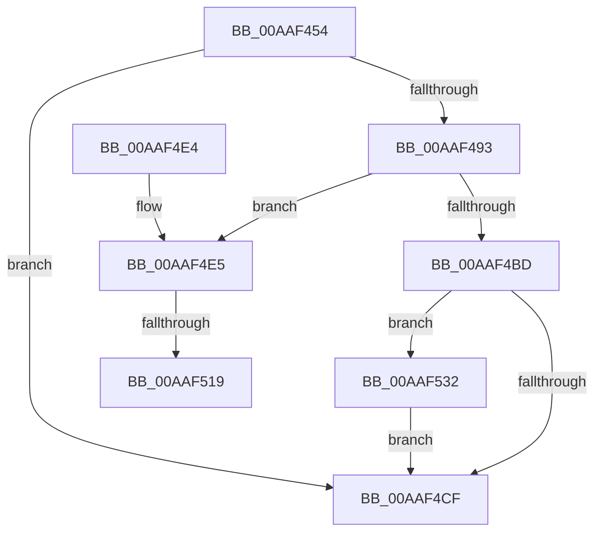

# WmipGetFilePDO

- RVA: `0x00AAF454`–`0x00AAF53C` (길이 `232` bytes)
- VA: `0x0000000140AAF454`
- 실행 섹션: `PAGE`
- PDB 이름 있음: `예`; PDB Function 태그: `예`
- unwind 정보 RVA: `0x000BC3B4`
- 디코드: `66`개 명령, `232/232` bytes 표시
- 미해석 바이트: `0` (있으면 어셈블리에 `.byte`로 보존)

> 이 문서는 커널 이미지의 기계어와 PDB 기호를 분석해 생성했습니다. 4번과 5번은 함수 원형과 자료형을 바이너리 사용 방식에서 추정한 C 해석이며 원본 소스 복구 결과는 아닙니다.

## 1. Dependencies

- 직접 호출 지점: **8**; 고유 호출 대상: **7**
- 직접 호출자로 확인된 함수: **2**
- RIP 상대 이미지 참조: **1**

### Outgoing calls
- `0x00AAF488` → [ObReferenceObjectByHandle](../86/ObReferenceObjectByHandle_function_00868DB0.md) (function, `0x00868DB0`)
- `0x00AAF49B` → [IoGetRelatedDeviceObject](../../text/29/IoGetRelatedDeviceObject_function_0029B120.md) (function, `0x0029B120`)
- `0x00AAF4A3` → [IoGetAttachedDeviceReference](../../text/41/IoGetAttachedDeviceReference_function_0041D940.md) (function, `0x0041D940`)
- `0x00AAF4B0` → [IoAllocateIrp](../../text/20/IoAllocateIrp_function_002065D0.md) (function, `0x002065D0`)
- `0x00AAF4C5` → [ObfDereferenceObject](../../text/2F/ObfDereferenceObject_function_002F9350.md) (function, `0x002F9350`)
- `0x00AAF50A` → [IoSynchronousCallDriver](../../text/48/IoSynchronousCallDriver_function_00484050.md) (function, `0x00484050`)
- `0x00AAF526` → [ExFreePoolWithTag](../../poolcode/B8/ExFreePoolWithTag_function_00B82870.md) (function, `0x00B82870`)
- `0x00AAF535` → [ObfDereferenceObject](../../text/2F/ObfDereferenceObject_function_002F9350.md) (function, `0x002F9350`)

### Direct callers
- [WmipTranslateFileHandle](../7B/WmipTranslateFileHandle_function_007B3DA4.md) at `0x007B3DD9`
- [IoWMIHandleToInstanceName](IoWMIHandleToInstanceName_function_00AAF3E0.md) at `0x00AAF407`

### Static image references
- `0x00AAF478` → RVA `0x00FC6AE0` (`ALMOSTRO`; read)

## 2. Other-region calls and transfers

- 다른 실행 섹션으로 향하는 call: **7**
  - `0x00AAF49B` → [IoGetRelatedDeviceObject](../../text/29/IoGetRelatedDeviceObject_function_0029B120.md) (`PAGE` → `.text`)
  - `0x00AAF4A3` → [IoGetAttachedDeviceReference](../../text/41/IoGetAttachedDeviceReference_function_0041D940.md) (`PAGE` → `.text`)
  - `0x00AAF4B0` → [IoAllocateIrp](../../text/20/IoAllocateIrp_function_002065D0.md) (`PAGE` → `.text`)
  - `0x00AAF4C5` → [ObfDereferenceObject](../../text/2F/ObfDereferenceObject_function_002F9350.md) (`PAGE` → `.text`)
  - `0x00AAF50A` → [IoSynchronousCallDriver](../../text/48/IoSynchronousCallDriver_function_00484050.md) (`PAGE` → `.text`)
  - `0x00AAF526` → [ExFreePoolWithTag](../../poolcode/B8/ExFreePoolWithTag_function_00B82870.md) (`PAGE` → `POOLCODE`)
  - `0x00AAF535` → [ObfDereferenceObject](../../text/2F/ObfDereferenceObject_function_002F9350.md) (`PAGE` → `.text`)
- call이 아닌 외부 분기/꼬리 이동: **2**
  - `0x00AAF513` → [sub_00B4A87C](../B4/Unknown_function_00B4A87C.md) (`tail-transfer`)
  - `0x00AAF52D` → [sub_00B4A87C](../B4/Unknown_function_00B4A87C.md) (`tail-transfer`)

## 3. Assembly (complete function range)

```asm
00AAF454  4C 8B DC                        mov r11, rsp
00AAF457  49 89 5B 08                     mov qword ptr [r11 + 8], rbx
00AAF45B  49 89 6B 10                     mov qword ptr [r11 + 0x10], rbp
00AAF45F  56                              push rsi
00AAF460  57                              push rdi
00AAF461  41 56                           push r14
00AAF463  48 83 EC 30                     sub rsp, 0x30
00AAF467  49 83 63 E0 00                  and qword ptr [r11 - 0x20], 0
00AAF46C  49 8D 43 20                     lea rax, [r11 + 0x20]
00AAF470  49 83 63 20 00                  and qword ptr [r11 + 0x20], 0
00AAF475  4D 8B F0                        mov r14, r8
00AAF478  4C 8B 05 61 76 51 00            mov r8, qword ptr [rip + 0x517661]
00AAF47F  44 8A CA                        mov r9b, dl
00AAF482  33 D2                           xor edx, edx
00AAF484  49 89 43 D8                     mov qword ptr [r11 - 0x28], rax
00AAF488  E8 23 99 DB FF                  call 0x140868db0
00AAF48D  8B D8                           mov ebx, eax
00AAF48F  85 C0                           test eax, eax
00AAF491  78 3C                           js 0x140aaf4cf
00AAF493  48 8B 74 24 68                  mov rsi, qword ptr [rsp + 0x68]
00AAF498  48 8B CE                        mov rcx, rsi
00AAF49B  E8 80 BC 7E FF                  call 0x14029b120
00AAF4A0  48 8B C8                        mov rcx, rax
00AAF4A3  E8 98 E4 96 FF                  call 0x14041d940
00AAF4A8  33 D2                           xor edx, edx
00AAF4AA  48 8B E8                        mov rbp, rax
00AAF4AD  8A 48 4C                        mov cl, byte ptr [rax + 0x4c]
00AAF4B0  E8 1B 71 75 FF                  call 0x1402065d0
00AAF4B5  48 8B F8                        mov rdi, rax
00AAF4B8  48 85 C0                        test rax, rax
00AAF4BB  75 28                           jne 0x140aaf4e5
00AAF4BD  BB 9A 00 00 C0                  mov ebx, 0xc000009a
00AAF4C2  48 8B CD                        mov rcx, rbp
00AAF4C5  E8 86 9E 84 FF                  call 0x1402f9350
00AAF4CA  48 85 F6                        test rsi, rsi
00AAF4CD  75 63                           jne 0x140aaf532
00AAF4CF  48 8B 6C 24 58                  mov rbp, qword ptr [rsp + 0x58]
00AAF4D4  8B C3                           mov eax, ebx
00AAF4D6  48 8B 5C 24 50                  mov rbx, qword ptr [rsp + 0x50]
00AAF4DB  48 83 C4 30                     add rsp, 0x30
00AAF4DF  41 5E                           pop r14
00AAF4E1  5F                              pop rdi
00AAF4E2  5E                              pop rsi
00AAF4E3  C3                              ret
00AAF4E4  CC                              int3
00AAF4E5  48 8B 80 B8 00 00 00            mov rax, qword ptr [rax + 0xb8]
00AAF4EC  48 8B D7                        mov rdx, rdi
00AAF4EF  48 8B CD                        mov rcx, rbp
00AAF4F2  66 C7 40 B8 1B 07               mov word ptr [rax - 0x48], 0x71b
00AAF4F8  C7 40 C0 04 00 00 00            mov dword ptr [rax - 0x40], 4
00AAF4FF  48 89 70 E8                     mov qword ptr [rax - 0x18], rsi
00AAF503  C7 47 30 BB 00 00 C0            mov dword ptr [rdi + 0x30], 0xc00000bb
00AAF50A  E8 41 4B 9D FF                  call 0x140484050
00AAF50F  8B D8                           mov ebx, eax
00AAF511  85 C0                           test eax, eax
00AAF513  0F 88 63 B3 09 00               js 0x140b4a87c
00AAF519  48 8B 4F 38                     mov rcx, qword ptr [rdi + 0x38]
00AAF51D  33 D2                           xor edx, edx
00AAF51F  48 8B 41 08                     mov rax, qword ptr [rcx + 8]
00AAF523  49 89 06                        mov qword ptr [r14], rax
00AAF526  E8 45 33 0D 00                  call 0x140b82870
00AAF52B  33 DB                           xor ebx, ebx
00AAF52D  E9 4A B3 09 00                  jmp 0x140b4a87c
00AAF532  48 8B CE                        mov rcx, rsi
00AAF535  E8 16 9E 84 FF                  call 0x1402f9350
00AAF53A  EB 93                           jmp 0x140aaf4cf
```

## 4. C-style interpretation (structured pseudocode)

```c
__int64 __fastcall WmipGetFilePDO(__int64 a1, int a2, __int64 a3)
{
    __int64 result;
    __int64 v_rbx;
    __int64 v_rsp;
    unsigned __int64 v_stack_p10;
    unsigned __int64 v_stack_p20;
    unsigned __int64 v_stack_p8;

    *(unsigned __int64 *)(v_rsp + 8) = v_rbx;
    *(unsigned __int64 *)(v_rsp + 16) = v_rbp;
    v_rsp = (v_rsp) - (48);
    a2 = 0;
    *(unsigned __int64 *)(v_rsp - 40) = v_rsp + 32;
    result = ObReferenceObjectByHandle(a1, a2, *(unsigned __int64 *)(v_rip + 5338721), (unsigned __int8)(a2));
    if (sign_flag) goto loc_00AAF4CF;
    result = IoGetRelatedDeviceObject(v_stack_p20, a2, *(unsigned __int64 *)(v_rip + 5338721), (unsigned __int8)(a2));
    result = IoGetAttachedDeviceReference(result, a2, *(unsigned __int64 *)(v_rip + 5338721), (unsigned __int8)(a2));
    a2 = 0;
    result = IoAllocateIrp(*(unsigned __int8 *)(result + 76), a2, *(unsigned __int64 *)(v_rip + 5338721), (unsigned __int8)(a2));
    if (result != 0) goto loc_00AAF4E5;
    result = ObfDereferenceObject(result, a2, *(unsigned __int64 *)(v_rip + 5338721), (unsigned __int8)(a2));
    if (v_stack_p20 != 0) goto loc_00AAF532;
loc_00AAF4CF:
    v_rsp = (v_rsp) + (48);
    return (unsigned int)((unsigned int)((unsigned int)(0xC000009AULL)));
loc_00AAF4E5:
    *(unsigned __int16 *)(*(unsigned __int64 *)((unsigned int)((unsigned int)((unsigned int)(0xC000009AULL))) + 184) - 72) = 0x71BULL;
    *(unsigned int *)(*(unsigned __int64 *)((unsigned int)((unsigned int)((unsigned int)(0xC000009AULL))) + 184) - 64) = 4;
    *(unsigned __int64 *)(*(unsigned __int64 *)((unsigned int)((unsigned int)((unsigned int)(0xC000009AULL))) + 184) - 24) = v_stack_p20;
    *(unsigned int *)(result + 48) = 0xC00000BBULL;
    result = IoSynchronousCallDriver(v_stack_p10, result, *(unsigned __int64 *)(v_rip + 5338721), (unsigned __int8)(a2));
    a2 = 0;
    *(unsigned __int64 *)(a3) = *(unsigned __int64 *)(*(unsigned __int64 *)(result + 56) + 8);
    result = ExFreePoolWithTag(*(unsigned __int64 *)(result + 56), a2, *(unsigned __int64 *)(v_rip + 5338721), (unsigned __int8)(a2));
    v_rbx = 0;
loc_00AAF532:
    result = ObfDereferenceObject(v_stack_p20, a2, *(unsigned __int64 *)(v_rip + 5338721), (unsigned __int8)(a2));
    goto loc_00AAF4CF;
}
```

## 5. (Beta) C Style

```c
int64_t WmipGetFilePDO(int64_t Arg1, int32_t Arg2, void *Arg3)
{
    uint8_t *arg3 = (uint8_t *)Arg3;

    int64_t result;
    int64_t local_rbx;
    int64_t local_rsp;
    uint64_t v_stack_p10;
    uint64_t v_stack_p20;
    uint64_t v_stack_p8;

    *(uint64_t *)(local_rsp + 0x8) = local_rbx;
    *(uint64_t *)(local_rsp + 0x10) = local_rbp;
    local_rsp = (local_rsp) - (48);
    Arg2 = 0;
    *(uint64_t *)(local_rsp - 0x28) = local_rsp + 32;
    result = ObReferenceObjectByHandle(Arg1, Arg2, *(uint64_t *)(v_rip + 0x517661), (uint8_t)(Arg2));
    if (sign_flag) goto loc_00AAF4CF;
    result = IoGetRelatedDeviceObject(v_stack_p20, Arg2, *(uint64_t *)(v_rip + 0x517661), (uint8_t)(Arg2));
    result = IoGetAttachedDeviceReference(result, Arg2, *(uint64_t *)(v_rip + 0x517661), (uint8_t)(Arg2));
    Arg2 = 0;
    result = IoAllocateIrp(*(uint8_t *)(result + 0x4C), Arg2, *(uint64_t *)(v_rip + 0x517661), (uint8_t)(Arg2));
    if (result != 0) goto loc_00AAF4E5;
    result = ObfDereferenceObject(result, Arg2, *(uint64_t *)(v_rip + 0x517661), (uint8_t)(Arg2));
    if (v_stack_p20 != 0) goto loc_00AAF532;
loc_00AAF4CF:
    local_rsp = (local_rsp) + (48);
    return (uint32_t)((uint32_t)((uint32_t)(0xC000009AULL)));
loc_00AAF4E5:
    *(uint16_t *)(*(uint64_t *)((uint32_t)((uint32_t)((uint32_t)(0xC000009AULL))) + 0xB8) - 0x48) = 0x71BULL;
    *(uint32_t *)(*(uint64_t *)((uint32_t)((uint32_t)((uint32_t)(0xC000009AULL))) + 0xB8) - 0x40) = 4;
    *(uint64_t *)(*(uint64_t *)((uint32_t)((uint32_t)((uint32_t)(0xC000009AULL))) + 0xB8) - 0x18) = v_stack_p20;
    *(uint32_t *)(result + 0x30) = 0xC00000BBULL;
    result = IoSynchronousCallDriver(v_stack_p10, result, *(uint64_t *)(v_rip + 0x517661), (uint8_t)(Arg2));
    Arg2 = 0;
    *(uint64_t *)(arg3) = *(uint64_t *)(*(uint64_t *)(result + 0x38) + 0x8);
    result = ExFreePoolWithTag(*(uint64_t *)(result + 0x38), Arg2, *(uint64_t *)(v_rip + 0x517661), (uint8_t)(Arg2));
    local_rbx = 0;
loc_00AAF532:
    result = ObfDereferenceObject(v_stack_p20, Arg2, *(uint64_t *)(v_rip + 0x517661), (uint8_t)(Arg2));
    goto loc_00AAF4CF;
}
```

### 관측된 메모리 오프셋

구조체 형식이 확인되지 않은 접근은 인자 기준의 오프셋으로만 기록했습니다.

| 기준 인자 | 오프셋 표현 | 폭 (bit) | 접근 |
|---|---:|---:|---|
| `Arg3` | `+ 0x0` | `64` | `W` |

## 6. Execution-region graph

[열기: 2D/3D 그래프와 함수 탐색 컨트롤 패널](../../../control-panel.html?section=page&rva=0x00AAF454&view=graph)

- 2D 그래프는 위에서 아래로 흐르고, 3D 그래프는 빈 공간을 드래그해 회전합니다. Shift+드래그는 이동, 휠은 확대·축소, 함수 노드 선택은 대상 보고서 이동입니다.

### Static fallback


