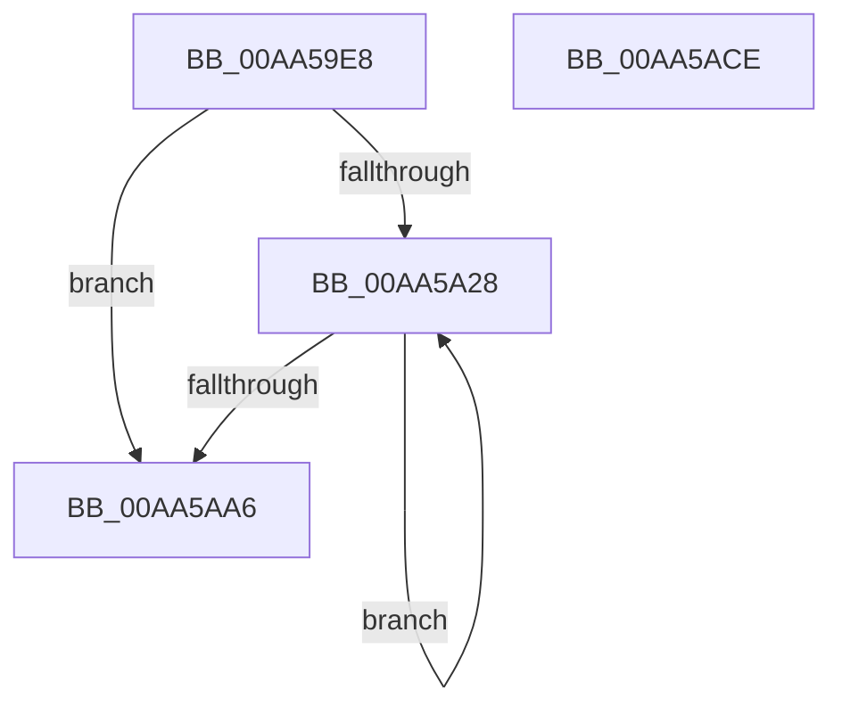

# WmipProcessLegacyEtwCallback

- RVA: `0x00AA59E8`–`0x00AA5ACF` (길이 `231` bytes)
- VA: `0x0000000140AA59E8`
- 실행 섹션: `PAGE`
- PDB 이름 있음: `예`; PDB Function 태그: `아니요`
- unwind 정보 RVA: `0x000BB770`
- 디코드: `57`개 명령, `231/231` bytes 표시
- 미해석 바이트: `0` (있으면 어셈블리에 `.byte`로 보존)

> 이 문서는 커널 이미지의 기계어와 PDB 기호를 분석해 생성했습니다. 4번과 5번은 함수 원형과 자료형을 바이너리 사용 방식에서 추정한 C 해석이며 원본 소스 복구 결과는 아닙니다.

## 1. Dependencies

- 직접 호출 지점: **4**; 고유 호출 대상: **4**
- 직접 호출자로 확인된 함수: **1**
- RIP 상대 이미지 참조: **2**

### Outgoing calls
- `0x00AA5A33` → [memset](../../text/6C/memset_function_006C6C40.md) (function, `0x006C6C40`)
- `0x00AA5A8B` → [WmipSendWmiIrp](../9E/WmipSendWmiIrp_function_009E0484.md) (function, `0x009E0484`)
- `0x00AA5A9A` → [WmipUnreferenceEntry](../9E/WmipUnreferenceEntry_function_009E0CC8.md) (function, `0x009E0CC8`)
- `0x00AA5AB1` → [_security_check_cookie](../../text/6A/_security_check_cookie_function_006AC640.md) (function, `0x006AC640`)

### Direct callers
- [WmipLegacyEtwWorker](../9E/WmipLegacyEtwWorker_function_009E3290.md) at `0x009E33AD`

### Static image references
- `0x00AA59FD` → RVA `0x00E0A740` (`.data`; read)
- `0x00AA5A93` → RVA `0x00E03648` (`.data`; read)

## 2. Other-region calls and transfers

- 다른 실행 섹션으로 향하는 call: **2**
  - `0x00AA5A33` → [memset](../../text/6C/memset_function_006C6C40.md) (`PAGE` → `.text`)
  - `0x00AA5AB1` → [_security_check_cookie](../../text/6A/_security_check_cookie_function_006AC640.md) (`PAGE` → `.text`)
- 별도 외부 분기/꼬리 이동을 확인하지 못했습니다.

## 3. Assembly (complete function range)

```asm
00AA59E8  48 89 5C 24 18                  mov qword ptr [rsp + 0x18], rbx
00AA59ED  48 89 6C 24 20                  mov qword ptr [rsp + 0x20], rbp
00AA59F2  56                              push rsi
00AA59F3  57                              push rdi
00AA59F4  41 56                           push r14
00AA59F6  48 81 EC 90 00 00 00            sub rsp, 0x90
00AA59FD  48 8B 05 3C 4D 36 00            mov rax, qword ptr [rip + 0x364d3c]
00AA5A04  48 33 C4                        xor rax, rsp
00AA5A07  48 89 84 24 80 00 00 00         mov qword ptr [rsp + 0x80], rax
00AA5A0F  8A 41 24                        mov al, byte ptr [rcx + 0x24]
00AA5A12  4C 8B F2                        mov r14, rdx
00AA5A15  F6 D8                           neg al
00AA5A17  48 8B F9                        mov rdi, rcx
00AA5A1A  40 1A F6                        sbb sil, sil
00AA5A1D  33 ED                           xor ebp, ebp
00AA5A1F  40 80 C6 05                     add sil, 5
00AA5A23  39 69 20                        cmp dword ptr [rcx + 0x20], ebp
00AA5A26  76 7E                           jbe 0x140aa5aa6
00AA5A28  33 D2                           xor edx, edx
00AA5A2A  48 8D 4C 24 40                  lea rcx, [rsp + 0x40]
00AA5A2F  44 8D 42 40                     lea r8d, [rdx + 0x40]
00AA5A33  E8 08 12 C2 FF                  call 0x1406c6c40
00AA5A38  48 8B 47 18                     mov rax, qword ptr [rdi + 0x18]
00AA5A3C  4C 8D 44 24 58                  lea r8, [rsp + 0x58]
00AA5A41  41 0F 10 46 48                  movups xmm0, xmmword ptr [r14 + 0x48]
00AA5A46  48 8B 5C EF 28                  mov rbx, qword ptr [rdi + rbp*8 + 0x28]
00AA5A4B  41 B9 40 00 00 00               mov r9d, 0x40
00AA5A51  48 89 44 24 48                  mov qword ptr [rsp + 0x48], rax
00AA5A56  40 8A CE                        mov cl, sil
00AA5A59  48 89 44 24 70                  mov qword ptr [rsp + 0x70], rax
00AA5A5E  48 8D 44 24 30                  lea rax, [rsp + 0x30]
00AA5A63  48 89 44 24 28                  mov qword ptr [rsp + 0x28], rax
00AA5A68  48 8D 44 24 40                  lea rax, [rsp + 0x40]
00AA5A6D  F3 0F 7F 44 24 58               movdqu xmmword ptr [rsp + 0x58], xmm0
00AA5A73  C7 44 24 40 40 00 00 00         mov dword ptr [rsp + 0x40], 0x40
00AA5A7B  C7 44 24 6C 00 00 02 00         mov dword ptr [rsp + 0x6c], 0x20000
00AA5A83  8B 53 38                        mov edx, dword ptr [rbx + 0x38]
00AA5A86  48 89 44 24 20                  mov qword ptr [rsp + 0x20], rax
00AA5A8B  E8 F4 A9 F3 FF                  call 0x1409e0484
00AA5A90  48 8B D3                        mov rdx, rbx
00AA5A93  48 8D 0D AE DB 35 00            lea rcx, [rip + 0x35dbae]
00AA5A9A  E8 29 B2 F3 FF                  call 0x1409e0cc8
00AA5A9F  FF C5                           inc ebp
00AA5AA1  3B 6F 20                        cmp ebp, dword ptr [rdi + 0x20]
00AA5AA4  72 82                           jb 0x140aa5a28
00AA5AA6  48 8B 8C 24 80 00 00 00         mov rcx, qword ptr [rsp + 0x80]
00AA5AAE  48 33 CC                        xor rcx, rsp
00AA5AB1  E8 8A 6B C0 FF                  call 0x1406ac640
00AA5AB6  4C 8D 9C 24 90 00 00 00         lea r11, [rsp + 0x90]
00AA5ABE  49 8B 5B 30                     mov rbx, qword ptr [r11 + 0x30]
00AA5AC2  49 8B 6B 38                     mov rbp, qword ptr [r11 + 0x38]
00AA5AC6  49 8B E3                        mov rsp, r11
00AA5AC9  41 5E                           pop r14
00AA5ACB  5F                              pop rdi
00AA5ACC  5E                              pop rsi
00AA5ACD  C3                              ret
00AA5ACE  CC                              int3
```

## 4. C-style interpretation (structured pseudocode)

```c
__int64 __fastcall WmipProcessLegacyEtwCallback(__int64 a1, __int64 a2)
{
    __int64 result;
    __int64 v_rbp;
    __int64 v_rsi;
    __int64 v_rsp;
    unsigned __int64 v_stack_m18;
    unsigned __int64 v_stack_m28;
    unsigned __int64 v_stack_m38;
    unsigned int v_stack_m3C;
    unsigned __int64 v_stack_m50;
    unsigned __int64 v_stack_m60;
    unsigned __int64 v_stack_m68;
    unsigned __int64 v_stack_m78;
    unsigned __int64 v_stack_m80;
    unsigned __int64 v_stack_m88;
    unsigned __int64 v_stack_p18;
    unsigned __int64 v_stack_p20;

    v_stack_p18 = v_rbx;
    v_stack_p20 = v_rbp;
    v_rsp = (v_rsp) - (144);
    result = (*(unsigned __int64 *)(v_rip + 3558716)) ^ (v_rsp);
    v_stack_m28 = result;
    result = (unsigned __int8)(-(*(unsigned __int8 *)(a1 + 36)));
    v_rbp = 0;
    v_rsi = (unsigned __int8)((v_rsi) + (5));
    if ((*(unsigned int *)(a1 + 32)) <= 0) goto loc_00AA5AA6;
loc_00AA5A28:
    a2 = 0;
    result = memset(v_stack_m68, a2, a2 + 64, a4);
    v_stack_m60 = *(unsigned __int64 *)(a1 + 24);
    v_stack_m38 = *(unsigned __int64 *)(a1 + 24);
    v_stack_m80 = v_stack_m78;
    v_stack_m50 = v_xmm0;
    v_stack_m68 = 64;
    v_stack_m3C = 0x20000ULL;
    v_stack_m88 = v_stack_m68;
    result = WmipSendWmiIrp((unsigned __int8)(v_rsi), (unsigned int)(*(unsigned int *)(*(unsigned __int64 *)(a1 + v_rbp * 8 + 40) + 56)), v_stack_m50, 64);
    result = WmipUnreferenceEntry(v_rip + 3529646, *(unsigned __int64 *)(a1 + v_rbp * 8 + 40), v_stack_m50, 64);
    v_rbp = (unsigned int)((v_rbp) + 1);
    if (((unsigned int)(v_rbp)) < (*(unsigned int *)(a1 + 32))) goto loc_00AA5A28;
loc_00AA5AA6:
    a1 = (v_stack_m28) ^ (v_rsp);
    result = _security_check_cookie(a1, *(unsigned __int64 *)(a1 + v_rbp * 8 + 40), v_stack_m50, 64);
    return result;
}
```

## 5. (Beta) C Style

```c
int64_t WmipProcessLegacyEtwCallback(void *Arg1, void *Arg2)
{
    uint8_t *arg1 = (uint8_t *)Arg1;
    uint8_t *arg2 = (uint8_t *)Arg2;

    int64_t result;
    int64_t local_rbp;
    int64_t local_rsi;
    int64_t local_rsp;
    uint64_t v_stack_m18;
    uint64_t v_stack_m28;
    uint64_t v_stack_m38;
    uint32_t v_stack_m3C;
    uint64_t v_stack_m50;
    uint64_t v_stack_m60;
    uint64_t v_stack_m68;
    uint64_t v_stack_m78;
    uint64_t v_stack_m80;
    uint64_t v_stack_m88;
    uint64_t v_stack_p18;
    uint64_t v_stack_p20;

    v_stack_p18 = local_rbx;
    v_stack_p20 = local_rbp;
    local_rsp = (local_rsp) - (144);
    result = (*(uint64_t *)(v_rip + 0x364D3C)) ^ (local_rsp);
    v_stack_m28 = result;
    result = (uint8_t)(-(*(uint8_t *)(arg1 + 0x24)));
    local_rbp = 0;
    local_rsi = (uint8_t)((local_rsi) + (5));
    if ((*(uint32_t *)(arg1 + 0x20)) <= 0) goto loc_00AA5AA6;
loc_00AA5A28:
    Arg2 = 0;
    result = memset(v_stack_m68, Arg2, Arg2 + 64, a4);
    v_stack_m60 = *(uint64_t *)(arg1 + 0x18);
    v_stack_m38 = *(uint64_t *)(arg1 + 0x18);
    v_stack_m80 = v_stack_m78;
    v_stack_m50 = v_xmm0;
    v_stack_m68 = 64;
    v_stack_m3C = 0x20000ULL;
    v_stack_m88 = v_stack_m68;
    result = WmipSendWmiIrp((uint8_t)(local_rsi), (uint32_t)(*(uint32_t *)(*(uint64_t *)(arg1 + local_rbp * 8 + 0x28) + 0x38)), v_stack_m50, 64);
    result = WmipUnreferenceEntry(v_rip + 3529646, *(uint64_t *)(arg1 + local_rbp * 8 + 0x28), v_stack_m50, 64);
    local_rbp = (uint32_t)((local_rbp) + 1);
    if (((uint32_t)(local_rbp)) < (*(uint32_t *)(arg1 + 0x20))) goto loc_00AA5A28;
loc_00AA5AA6:
    Arg1 = (v_stack_m28) ^ (local_rsp);
    result = _security_check_cookie(Arg1, *(uint64_t *)(arg1 + local_rbp * 8 + 0x28), v_stack_m50, 64);
    return result;
}
```

### 관측된 메모리 오프셋

구조체 형식이 확인되지 않은 접근은 인자 기준의 오프셋으로만 기록했습니다.

| 기준 인자 | 오프셋 표현 | 폭 (bit) | 접근 |
|---|---:|---:|---|
| `Arg1` | `+ 0x18` | `64` | `R` |
| `Arg1` | `+ 0x20` | `32` | `R` |
| `Arg1` | `+ 0x24` | `8` | `R` |
| `Arg1` | `+ 0x28 + rbp*8` | `64` | `R` |
| `Arg2` | `+ 0x48` | `128` | `R` |

## 6. Execution-region graph

[열기: 2D/3D 그래프와 함수 탐색 컨트롤 패널](../../../control-panel.html?section=page&rva=0x00AA59E8&view=graph)

- 2D 그래프는 위에서 아래로 흐르고, 3D 그래프는 빈 공간을 드래그해 회전합니다. Shift+드래그는 이동, 휠은 확대·축소, 함수 노드 선택은 대상 보고서 이동입니다.

### Static fallback


