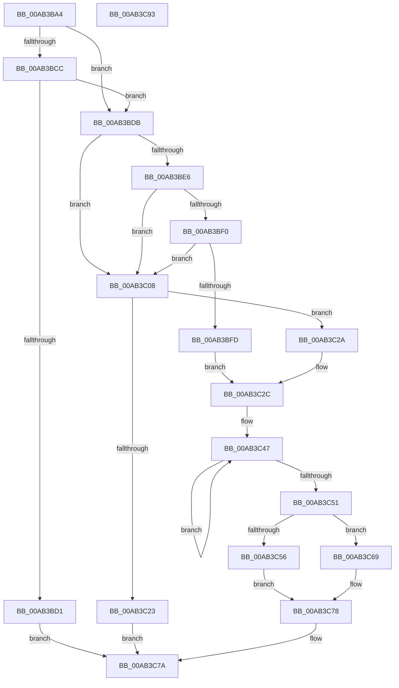

# AdtpBuildUlongString

- RVA: `0x00AB3BA4`–`0x00AB3C94` (길이 `240` bytes)
- VA: `0x0000000140AB3BA4`
- 실행 섹션: `PAGE`
- PDB 이름 있음: `예`; PDB Function 태그: `아니요`
- unwind 정보 RVA: `0x00060300`
- 디코드: `72`개 명령, `240/240` bytes 표시
- 미해석 바이트: `0` (있으면 어셈블리에 `.byte`로 보존)

> 이 문서는 커널 이미지의 기계어와 PDB 기호를 분석해 생성했습니다. 4번과 5번은 함수 원형과 자료형을 바이너리 사용 방식에서 추정한 C 해석이며 원본 소스 복구 결과는 아닙니다.

## 1. Dependencies

- 직접 호출 지점: **2**; 고유 호출 대상: **2**
- 직접 호출자로 확인된 함수: **2**
- RIP 상대 이미지 참조: **0**

### Outgoing calls
- `0x00AB3C16` → [ExAllocatePool2](../../poolcode/B8/ExAllocatePool2_function_00B820F0.md) (function, `0x00B820F0`)
- `0x00AB3C3E` → [ultow](../../text/4F/ultow_function_004FFA80.md) (function, `0x004FFA80`)

### Direct callers
- [AdtpPackageParameters](../../text/45/AdtpPackageParameters_function_00459964.md) at `0x0045A148`
- [AdtpBuildRegistryValueString](../82/AdtpBuildRegistryValueString_function_00822194.md) at `0x008221F3`

### Static image references
- 디코드된 RIP-relative 메모리 참조가 없습니다.

## 2. Other-region calls and transfers

- 다른 실행 섹션으로 향하는 call: **2**
  - `0x00AB3C16` → [ExAllocatePool2](../../poolcode/B8/ExAllocatePool2_function_00B820F0.md) (`PAGE` → `POOLCODE`)
  - `0x00AB3C3E` → [ultow](../../text/4F/ultow_function_004FFA80.md) (`PAGE` → `.text`)
- 별도 외부 분기/꼬리 이동을 확인하지 못했습니다.

## 3. Assembly (complete function range)

```asm
00AB3BA4  48 89 5C 24 08                  mov qword ptr [rsp + 8], rbx
00AB3BA9  48 89 6C 24 10                  mov qword ptr [rsp + 0x10], rbp
00AB3BAE  48 89 74 24 18                  mov qword ptr [rsp + 0x18], rsi
00AB3BB3  57                              push rdi
00AB3BB4  41 56                           push r14
00AB3BB6  41 57                           push r15
00AB3BB8  48 83 EC 20                     sub rsp, 0x20
00AB3BBC  45 33 F6                        xor r14d, r14d
00AB3BBF  49 8B F8                        mov rdi, r8
00AB3BC2  48 8B F2                        mov rsi, rdx
00AB3BC5  8B E9                           mov ebp, ecx
00AB3BC7  4D 85 C0                        test r8, r8
00AB3BCA  75 0F                           jne 0x140ab3bdb
00AB3BCC  48 85 D2                        test rdx, rdx
00AB3BCF  75 0A                           jne 0x140ab3bdb
00AB3BD1  B8 0D 00 00 C0                  mov eax, 0xc000000d
00AB3BD6  E9 9F 00 00 00                  jmp 0x140ab3c7a
00AB3BDB  41 BF 16 00 00 00               mov r15d, 0x16
00AB3BE1  4D 85 C9                        test r9, r9
00AB3BE4  74 22                           je 0x140ab3c08
00AB3BE6  48 8B 4C 24 60                  mov rcx, qword ptr [rsp + 0x60]
00AB3BEB  48 85 C9                        test rcx, rcx
00AB3BEE  74 18                           je 0x140ab3c08
00AB3BF0  8B 01                           mov eax, dword ptr [rcx]
00AB3BF2  8D 50 0B                        lea edx, [rax + 0xb]
00AB3BF5  81 FA 00 04 00 00               cmp edx, 0x400
00AB3BFB  73 0B                           jae 0x140ab3c08
00AB3BFD  89 11                           mov dword ptr [rcx], edx
00AB3BFF  49 8D 1C 41                     lea rbx, [r9 + rax*2]
00AB3C03  41 8A CE                        mov cl, r14b
00AB3C06  EB 24                           jmp 0x140ab3c2c
00AB3C08  41 B8 53 65 41 6B               mov r8d, 0x6b416553
00AB3C0E  49 8B D7                        mov rdx, r15
00AB3C11  B9 00 01 00 00                  mov ecx, 0x100
00AB3C16  E8 D5 E4 0C 00                  call 0x140b820f0
00AB3C1B  48 8B D8                        mov rbx, rax
00AB3C1E  48 85 C0                        test rax, rax
00AB3C21  75 07                           jne 0x140ab3c2a
00AB3C23  B8 17 00 00 C0                  mov eax, 0xc0000017
00AB3C28  EB 50                           jmp 0x140ab3c7a
00AB3C2A  B1 01                           mov cl, 1
00AB3C2C  48 8B 44 24 68                  mov rax, qword ptr [rsp + 0x68]
00AB3C31  41 B8 0A 00 00 00               mov r8d, 0xa
00AB3C37  48 8B D3                        mov rdx, rbx
00AB3C3A  88 08                           mov byte ptr [rax], cl
00AB3C3C  8B CD                           mov ecx, ebp
00AB3C3E  E8 3D BE A4 FF                  call 0x1404ffa80
00AB3C43  48 83 C8 FF                     or rax, 0xffffffffffffffff
00AB3C47  48 FF C0                        inc rax
00AB3C4A  66 44 39 34 43                  cmp word ptr [rbx + rax*2], r14w
00AB3C4F  75 F6                           jne 0x140ab3c47
00AB3C51  48 85 FF                        test rdi, rdi
00AB3C54  74 13                           je 0x140ab3c69
00AB3C56  8D 04 45 02 00 00 00            lea eax, [rax*2 + 2]
00AB3C5D  48 89 1F                        mov qword ptr [rdi], rbx
00AB3C60  89 47 08                        mov dword ptr [rdi + 8], eax
00AB3C63  44 89 77 0C                     mov dword ptr [rdi + 0xc], r14d
00AB3C67  EB 0F                           jmp 0x140ab3c78
00AB3C69  66 03 C0                        add ax, ax
00AB3C6C  66 44 89 7E 02                  mov word ptr [rsi + 2], r15w
00AB3C71  66 89 06                        mov word ptr [rsi], ax
00AB3C74  48 89 5E 08                     mov qword ptr [rsi + 8], rbx
00AB3C78  33 C0                           xor eax, eax
00AB3C7A  48 8B 5C 24 40                  mov rbx, qword ptr [rsp + 0x40]
00AB3C7F  48 8B 6C 24 48                  mov rbp, qword ptr [rsp + 0x48]
00AB3C84  48 8B 74 24 50                  mov rsi, qword ptr [rsp + 0x50]
00AB3C89  48 83 C4 20                     add rsp, 0x20
00AB3C8D  41 5F                           pop r15
00AB3C8F  41 5E                           pop r14
00AB3C91  5F                              pop rdi
00AB3C92  C3                              ret
00AB3C93  CC                              int3
```

## 4. C-style interpretation (structured pseudocode)

```c
__int64 __fastcall AdtpBuildUlongString(int a1, __int64 a2, __int64 a3, __int64 a4, __int64 a5, __int64 a6)
{
    __int64 result;
    __int64 v_r14;
    __int64 v_rsp;
    unsigned __int64 v_stack_p10;
    unsigned __int64 v_stack_p18;
    unsigned __int64 v_stack_p8;

    v_stack_p8 = v_rbx;
    v_stack_p10 = v_rbp;
    v_stack_p18 = v_rsi;
    v_rsp = (v_rsp) - (32);
    v_r14 = 0;
    if (a3 != 0) goto loc_00AB3BDB;
    if (a2 != 0) goto loc_00AB3BDB;
    goto loc_00AB3C7A;
loc_00AB3BDB:
    if (a4 == 0) goto loc_00AB3C08;
    if (a5 == 0) goto loc_00AB3C08;
    if (((unsigned int)((unsigned int)(*(unsigned int *)(a5)) + 11)) >= 0x400ULL) goto loc_00AB3C08;
    *(unsigned int *)(a5) = (unsigned int)((unsigned int)(*(unsigned int *)(a5)) + 11);
    goto loc_00AB3C2C;
loc_00AB3C08:
    result = ExAllocatePool2(256, 22, (unsigned int)(0x6B416553ULL), a4);
    if (result != 0) goto loc_00AB3C2A;
    goto loc_00AB3C7A;
loc_00AB3C2A:
loc_00AB3C2C:
    *(unsigned __int8 *)(a6) = 1;
    result = ultow((unsigned int)((unsigned int)((unsigned int)(a1))), result, 10, a4);
    result = (result) | (-1);
loc_00AB3C47:
    result = (result) + 1;
    if ((*(unsigned __int16 *)(result + result * 2)) != 0) goto loc_00AB3C47;
    if (a3 == 0) goto loc_00AB3C69;
    *(unsigned __int64 *)(a3) = result;
    *(unsigned int *)(a3 + 8) = (unsigned int)(result * 2 + 2);
    *(unsigned int *)(a3 + 12) = 0;
    goto loc_00AB3C78;
loc_00AB3C69:
    result = (unsigned __int16)((result * 2 + 2) + ((unsigned __int16)(result * 2 + 2)));
    *(unsigned __int16 *)(a2 + 2) = 22;
    *(unsigned __int16 *)(a2) = (unsigned __int16)(result);
    *(unsigned __int64 *)(a2 + 8) = result;
loc_00AB3C78:
    result = 0;
loc_00AB3C7A:
    v_rsp = (v_rsp) + (32);
    return result;
}
```

## 5. (Beta) C Style

```c
int64_t AdtpBuildUlongString(int32_t Arg1, void *Arg2, int64_t Arg3, int64_t Arg4, int64_t Arg5, void *Arg6)
{
    uint8_t *arg2 = (uint8_t *)Arg2;
    uint8_t *arg6 = (uint8_t *)Arg6;

    int64_t result;
    int64_t local_r14;
    int64_t local_rsp;
    uint64_t v_stack_p10;
    uint64_t v_stack_p18;
    uint64_t v_stack_p8;

    v_stack_p8 = local_rbx;
    v_stack_p10 = local_rbp;
    v_stack_p18 = local_rsi;
    local_rsp = (local_rsp) - (32);
    local_r14 = 0;
    if (Arg3 != 0) goto loc_00AB3BDB;
    if (Arg2 != NULL) goto loc_00AB3BDB;
    goto loc_00AB3C7A;
loc_00AB3BDB:
    if (Arg4 == 0) goto loc_00AB3C08;
    if (Arg5 == 0) goto loc_00AB3C08;
    if (((uint32_t)((uint32_t)(*(uint32_t *)(Arg5)) + 11)) >= 0x400ULL) goto loc_00AB3C08;
    *(uint32_t *)(Arg5) = (uint32_t)((uint32_t)(*(uint32_t *)(Arg5)) + 11);
    goto loc_00AB3C2C;
loc_00AB3C08:
    result = ExAllocatePool2(256, 22, (uint32_t)(0x6B416553ULL), Arg4);
    if (result != 0) goto loc_00AB3C2A;
    goto loc_00AB3C7A;
loc_00AB3C2A:
loc_00AB3C2C:
    *(uint8_t *)(arg6) = 1;
    result = ultow((uint32_t)((uint32_t)((uint32_t)(Arg1))), result, 10, Arg4);
    result = (result) | (-1);
loc_00AB3C47:
    result = (result) + 1;
    if ((*(uint16_t *)(result + result * 2)) != 0) goto loc_00AB3C47;
    if (Arg3 == 0) goto loc_00AB3C69;
    *(uint64_t *)(Arg3) = result;
    *(uint32_t *)(Arg3 + 0x8) = (uint32_t)(result * 2 + 2);
    *(uint32_t *)(Arg3 + 0xC) = 0;
    goto loc_00AB3C78;
loc_00AB3C69:
    result = (uint16_t)((result * 2 + 2) + ((uint16_t)(result * 2 + 2)));
    *(uint16_t *)(arg2 + 0x2) = 22;
    *(uint16_t *)(arg2) = (uint16_t)(result);
    *(uint64_t *)(arg2 + 0x8) = result;
loc_00AB3C78:
    result = 0;
loc_00AB3C7A:
    local_rsp = (local_rsp) + (32);
    return result;
}
```

### 관측된 메모리 오프셋

구조체 형식이 확인되지 않은 접근은 인자 기준의 오프셋으로만 기록했습니다.

| 기준 인자 | 오프셋 표현 | 폭 (bit) | 접근 |
|---|---:|---:|---|
| `Arg2` | `+ 0x0` | `16` | `W` |
| `Arg2` | `+ 0x2` | `16` | `W` |
| `Arg2` | `+ 0x8` | `64` | `W` |
| `Arg6` | `+ 0x0` | `8` | `W` |

## 6. Execution-region graph

[열기: 2D/3D 그래프와 함수 탐색 컨트롤 패널](../../../control-panel.html?section=page&rva=0x00AB3BA4&view=graph)

- 2D 그래프는 위에서 아래로 흐르고, 3D 그래프는 빈 공간을 드래그해 회전합니다. Shift+드래그는 이동, 휠은 확대·축소, 함수 노드 선택은 대상 보고서 이동입니다.

### Static fallback


