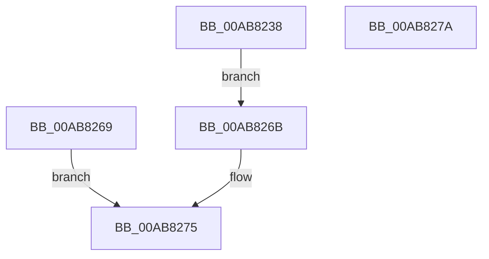

# AlpcpCaptureHandleAttribute32

- RVA: `0x00AB8238`–`0x00AB827B` (길이 `67` bytes)
- VA: `0x0000000140AB8238`
- 실행 섹션: `PAGE`
- PDB 이름 있음: `예`; PDB Function 태그: `아니요`
- unwind 정보 RVA: `0x000BD180`
- 디코드: `20`개 명령, `67/67` bytes 표시
- 미해석 바이트: `0` (있으면 어셈블리에 `.byte`로 보존)

> 이 문서는 커널 이미지의 기계어와 PDB 기호를 분석해 생성했습니다. 4번과 5번은 함수 원형과 자료형을 바이너리 사용 방식에서 추정한 C 해석이며 원본 소스 복구 결과는 아닙니다.

## 1. Dependencies

- 직접 호출 지점: **1**; 고유 호출 대상: **1**
- 직접 호출자로 확인된 함수: **1**
- RIP 상대 이미지 참조: **0**

### Outgoing calls
- `0x00AB8270` → [AlpcpCaptureHandleAttributeInternal](../89/AlpcpCaptureHandleAttributeInternal_function_00892CDC.md) (function, `0x00892CDC`)

### Direct callers
- [AlpcpCaptureAttributes](../88/AlpcpCaptureAttributes_function_0088CD20.md) at `0x0088D27A`

### Static image references
- 디코드된 RIP-relative 메모리 참조가 없습니다.

## 2. Other-region calls and transfers

- 다른 실행 섹션으로 향하는 call: **0**
- 별도 외부 분기/꼬리 이동을 확인하지 못했습니다.

## 3. Assembly (complete function range)

```asm
00AB8238  48 83 EC 58                     sub rsp, 0x58
00AB823C  33 C0                           xor eax, eax
00AB823E  0F 57 C0                        xorps xmm0, xmm0
00AB8241  0F 11 44 24 30                  movups xmmword ptr [rsp + 0x30], xmm0
00AB8246  89 44 24 40                     mov dword ptr [rsp + 0x40], eax
00AB824A  8B 01                           mov eax, dword ptr [rcx]
00AB824C  89 44 24 30                     mov dword ptr [rsp + 0x30], eax
00AB8250  48 63 41 04                     movsxd rax, dword ptr [rcx + 4]
00AB8254  48 89 44 24 38                  mov qword ptr [rsp + 0x38], rax
00AB8259  8B 41 08                        mov eax, dword ptr [rcx + 8]
00AB825C  89 44 24 40                     mov dword ptr [rsp + 0x40], eax
00AB8260  8B 41 0C                        mov eax, dword ptr [rcx + 0xc]
00AB8263  89 44 24 44                     mov dword ptr [rsp + 0x44], eax
00AB8267  EB 02                           jmp 0x140ab826b
00AB8269  EB 0A                           jmp 0x140ab8275
00AB826B  48 8D 4C 24 30                  lea rcx, [rsp + 0x30]
00AB8270  E8 67 AA DD FF                  call 0x140892cdc
00AB8275  48 83 C4 58                     add rsp, 0x58
00AB8279  C3                              ret
00AB827A  CC                              int3
```

## 4. C-style interpretation (structured pseudocode)

```c
__int64 __fastcall AlpcpCaptureHandleAttribute32(__int64 a1)
{
    __int64 result;
    __int64 v_rsp;
    unsigned int v_stack_m14;
    unsigned int v_stack_m18;
    unsigned __int64 v_stack_m20;
    unsigned __int64 v_stack_m28;

    v_rsp = (v_rsp) - (88);
    result = 0;
    v_stack_m28 = v_xmm0;
    v_stack_m18 = 0;
    v_stack_m28 = (unsigned int)((unsigned int)(*(unsigned int *)(a1)));
    v_stack_m20 = (int)(*(unsigned int *)(a1 + 4));
    v_stack_m18 = (unsigned int)((unsigned int)(*(unsigned int *)(a1 + 8)));
    v_stack_m14 = (unsigned int)((unsigned int)(*(unsigned int *)(a1 + 12)));
    goto loc_00AB826B;
loc_00AB826B:
    result = AlpcpCaptureHandleAttributeInternal(v_stack_m28, a2, a3, a4);
loc_00AB8275:
    v_rsp = (v_rsp) + (88);
    return result;
}
```

## 5. (Beta) C Style

```c
int64_t AlpcpCaptureHandleAttribute32(void *Arg1)
{
    uint8_t *arg1 = (uint8_t *)Arg1;

    int64_t result;
    int64_t local_rsp;
    uint32_t v_stack_m14;
    uint32_t v_stack_m18;
    uint64_t v_stack_m20;
    uint64_t v_stack_m28;

    local_rsp = (local_rsp) - (88);
    result = 0;
    v_stack_m28 = v_xmm0;
    v_stack_m18 = 0;
    v_stack_m28 = (uint32_t)((uint32_t)(*(uint32_t *)(arg1)));
    v_stack_m20 = (int32_t)(*(uint32_t *)(arg1 + 0x4));
    v_stack_m18 = (uint32_t)((uint32_t)(*(uint32_t *)(arg1 + 0x8)));
    v_stack_m14 = (uint32_t)((uint32_t)(*(uint32_t *)(arg1 + 0xC)));
    goto loc_00AB826B;
loc_00AB826B:
    result = AlpcpCaptureHandleAttributeInternal(v_stack_m28, a2, a3, a4);
loc_00AB8275:
    local_rsp = (local_rsp) + (88);
    return result;
}
```

### 관측된 메모리 오프셋

구조체 형식이 확인되지 않은 접근은 인자 기준의 오프셋으로만 기록했습니다.

| 기준 인자 | 오프셋 표현 | 폭 (bit) | 접근 |
|---|---:|---:|---|
| `Arg1` | `+ 0x0` | `32` | `R` |
| `Arg1` | `+ 0x4` | `32` | `R` |
| `Arg1` | `+ 0x8` | `32` | `R` |
| `Arg1` | `+ 0xC` | `32` | `R` |

## 6. Execution-region graph

[열기: 2D/3D 그래프와 함수 탐색 컨트롤 패널](../../../control-panel.html?section=page&rva=0x00AB8238&view=graph)

- 2D 그래프는 위에서 아래로 흐르고, 3D 그래프는 빈 공간을 드래그해 회전합니다. Shift+드래그는 이동, 휠은 확대·축소, 함수 노드 선택은 대상 보고서 이동입니다.

### Static fallback


