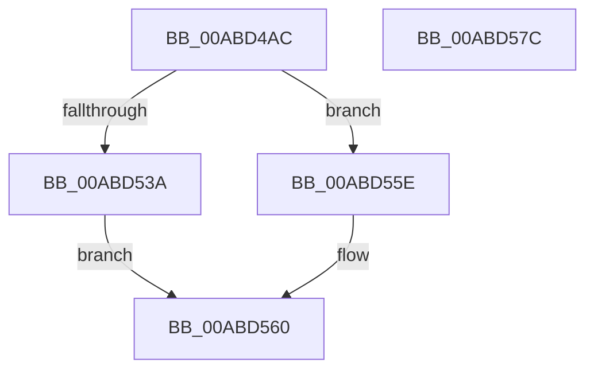

# AslGuidToString

- RVA: `0x00ABD4AC`–`0x00ABD57D` (길이 `209` bytes)
- VA: `0x0000000140ABD4AC`
- 실행 섹션: `PAGE`
- PDB 이름 있음: `예`; PDB Function 태그: `아니요`
- unwind 정보 RVA: `0x000BD554`
- 디코드: `53`개 명령, `209/209` bytes 표시
- 미해석 바이트: `0` (있으면 어셈블리에 `.byte`로 보존)

> 이 문서는 커널 이미지의 기계어와 PDB 기호를 분석해 생성했습니다. 4번과 5번은 함수 원형과 자료형을 바이너리 사용 방식에서 추정한 C 해석이며 원본 소스 복구 결과는 아닙니다.

## 1. Dependencies

- 직접 호출 지점: **2**; 고유 호출 대상: **2**
- 직접 호출자로 확인된 함수: **2**
- RIP 상대 이미지 참조: **3**

### Outgoing calls
- `0x00ABD52F` → [RtlStringCchPrintfW](../../text/48/RtlStringCchPrintfW_function_00482D5C.md) (function, `0x00482D5C`)
- `0x00ABD557` → [AslLogCallPrintf](../95/AslLogCallPrintf_function_0095E4EC.md) (function, `0x0095E4EC`)

### Direct callers
- [SdbpGetCustomSdbFileName](../81/SdbpGetCustomSdbFileName_function_00817DA0.md) at `0x00817DBA`
- [SdbGetEntryFlags](SdbGetEntryFlags_function_00ABD3E0.md) at `0x00ABD40E`

### Static image references
- `0x00ABD502` → RVA `0x0001E390` (`.rdata`; read)
- `0x00ABD53A` → RVA `0x0001E420` (`.rdata`; read)
- `0x00ABD54B` → RVA `0x0001E410` (`.rdata`; read)

## 2. Other-region calls and transfers

- 다른 실행 섹션으로 향하는 call: **1**
  - `0x00ABD52F` → [RtlStringCchPrintfW](../../text/48/RtlStringCchPrintfW_function_00482D5C.md) (`PAGE` → `.text`)
- 별도 외부 분기/꼬리 이동을 확인하지 못했습니다.

## 3. Assembly (complete function range)

```asm
00ABD4AC  48 89 5C 24 08                  mov qword ptr [rsp + 8], rbx
00ABD4B1  48 89 6C 24 10                  mov qword ptr [rsp + 0x10], rbp
00ABD4B6  48 89 74 24 18                  mov qword ptr [rsp + 0x18], rsi
00ABD4BB  57                              push rdi
00ABD4BC  41 56                           push r14
00ABD4BE  41 57                           push r15
00ABD4C0  48 83 EC 70                     sub rsp, 0x70
00ABD4C4  45 0F B6 48 0E                  movzx r9d, byte ptr [r8 + 0xe]
00ABD4C9  41 0F B6 40 0F                  movzx eax, byte ptr [r8 + 0xf]
00ABD4CE  45 0F B6 50 0D                  movzx r10d, byte ptr [r8 + 0xd]
00ABD4D3  45 0F B6 58 0C                  movzx r11d, byte ptr [r8 + 0xc]
00ABD4D8  41 0F B6 58 0B                  movzx ebx, byte ptr [r8 + 0xb]
00ABD4DD  41 0F B6 78 0A                  movzx edi, byte ptr [r8 + 0xa]
00ABD4E2  41 0F B6 70 09                  movzx esi, byte ptr [r8 + 9]
00ABD4E7  41 0F B6 68 08                  movzx ebp, byte ptr [r8 + 8]
00ABD4EC  45 0F B7 70 06                  movzx r14d, word ptr [r8 + 6]
00ABD4F1  45 0F B7 78 04                  movzx r15d, word ptr [r8 + 4]
00ABD4F6  89 44 24 68                     mov dword ptr [rsp + 0x68], eax
00ABD4FA  44 89 4C 24 60                  mov dword ptr [rsp + 0x60], r9d
00ABD4FF  45 8B 08                        mov r9d, dword ptr [r8]
00ABD502  4C 8D 05 87 0E 56 FF            lea r8, [rip - 0xa9f179]
00ABD509  44 89 54 24 58                  mov dword ptr [rsp + 0x58], r10d
00ABD50E  44 89 5C 24 50                  mov dword ptr [rsp + 0x50], r11d
00ABD513  89 5C 24 48                     mov dword ptr [rsp + 0x48], ebx
00ABD517  89 7C 24 40                     mov dword ptr [rsp + 0x40], edi
00ABD51B  89 74 24 38                     mov dword ptr [rsp + 0x38], esi
00ABD51F  89 6C 24 30                     mov dword ptr [rsp + 0x30], ebp
00ABD523  44 89 74 24 28                  mov dword ptr [rsp + 0x28], r14d
00ABD528  8B D2                           mov edx, edx
00ABD52A  44 89 7C 24 20                  mov dword ptr [rsp + 0x20], r15d
00ABD52F  E8 28 58 9C FF                  call 0x140482d5c
00ABD534  8B D8                           mov ebx, eax
00ABD536  85 C0                           test eax, eax
00ABD538  79 24                           jns 0x140abd55e
00ABD53A  4C 8D 0D DF 0E 56 FF            lea r9, [rip - 0xa9f121]
00ABD541  89 44 24 20                     mov dword ptr [rsp + 0x20], eax
00ABD545  41 B8 4E 01 00 00               mov r8d, 0x14e
00ABD54B  48 8D 15 BE 0E 56 FF            lea rdx, [rip - 0xa9f142]
00ABD552  B9 01 00 00 00                  mov ecx, 1
00ABD557  E8 90 0F EA FF                  call 0x14095e4ec
00ABD55C  EB 02                           jmp 0x140abd560
00ABD55E  33 DB                           xor ebx, ebx
00ABD560  4C 8D 5C 24 70                  lea r11, [rsp + 0x70]
00ABD565  8B C3                           mov eax, ebx
00ABD567  49 8B 5B 20                     mov rbx, qword ptr [r11 + 0x20]
00ABD56B  49 8B 6B 28                     mov rbp, qword ptr [r11 + 0x28]
00ABD56F  49 8B 73 30                     mov rsi, qword ptr [r11 + 0x30]
00ABD573  49 8B E3                        mov rsp, r11
00ABD576  41 5F                           pop r15
00ABD578  41 5E                           pop r14
00ABD57A  5F                              pop rdi
00ABD57B  C3                              ret
00ABD57C  CC                              int3
```

## 4. C-style interpretation (structured pseudocode)

```c
__int64 __fastcall AslGuidToString(__int64 a1, int a2, __int64 a3)
{
    __int64 result;
    __int64 v_rbx;
    __int64 v_rsp;
    unsigned __int64 v_stack_m18;
    unsigned int v_stack_m20;
    unsigned int v_stack_m28;
    unsigned int v_stack_m30;
    unsigned int v_stack_m38;
    unsigned int v_stack_m40;
    unsigned int v_stack_m48;
    unsigned int v_stack_m50;
    unsigned int v_stack_m58;
    unsigned int v_stack_m60;
    unsigned int v_stack_m68;
    unsigned __int64 v_stack_p10;
    unsigned __int64 v_stack_p18;
    unsigned __int64 v_stack_p8;

    v_stack_p8 = v_rbx;
    v_stack_p10 = v_rbp;
    v_stack_p18 = v_rsi;
    v_rsp = (v_rsp) - (112);
    v_stack_m20 = (unsigned int)(*(unsigned __int8 *)(a3 + 15));
    v_stack_m28 = (unsigned int)(*(unsigned __int8 *)(a3 + 14));
    v_stack_m30 = (unsigned int)(*(unsigned __int8 *)(a3 + 13));
    v_stack_m38 = (unsigned int)(*(unsigned __int8 *)(a3 + 12));
    v_stack_m40 = (unsigned int)(*(unsigned __int8 *)(a3 + 11));
    v_stack_m48 = (unsigned int)(*(unsigned __int8 *)(a3 + 10));
    v_stack_m50 = (unsigned int)(*(unsigned __int8 *)(a3 + 9));
    v_stack_m58 = (unsigned int)(*(unsigned __int8 *)(a3 + 8));
    v_stack_m60 = (unsigned int)(*(unsigned __int16 *)(a3 + 6));
    v_stack_m68 = (unsigned int)(*(unsigned __int16 *)(a3 + 4));
    result = RtlStringCchPrintfW(a1, (unsigned int)(a2), v_rip - 11137401, (unsigned int)(*(unsigned int *)(a3)));
    if (!sign_flag) goto loc_00ABD55E;
    v_stack_m68 = (unsigned int)(result);
    result = AslLogCallPrintf(1, v_rip - 11137346, 334, v_rip - 11137313);
    goto loc_00ABD560;
loc_00ABD55E:
    v_rbx = 0;
loc_00ABD560:
    return 0;
}
```

## 5. (Beta) C Style

```c
int64_t AslGuidToString(int64_t Arg1, int32_t Arg2, void *Arg3)
{
    uint8_t *arg3 = (uint8_t *)Arg3;

    int64_t result;
    int64_t local_rbx;
    int64_t local_rsp;
    uint64_t v_stack_m18;
    uint32_t v_stack_m20;
    uint32_t v_stack_m28;
    uint32_t v_stack_m30;
    uint32_t v_stack_m38;
    uint32_t v_stack_m40;
    uint32_t v_stack_m48;
    uint32_t v_stack_m50;
    uint32_t v_stack_m58;
    uint32_t v_stack_m60;
    uint32_t v_stack_m68;
    uint64_t v_stack_p10;
    uint64_t v_stack_p18;
    uint64_t v_stack_p8;

    v_stack_p8 = local_rbx;
    v_stack_p10 = local_rbp;
    v_stack_p18 = local_rsi;
    local_rsp = (local_rsp) - (112);
    v_stack_m20 = (uint32_t)(*(uint8_t *)(arg3 + 0xF));
    v_stack_m28 = (uint32_t)(*(uint8_t *)(arg3 + 0xE));
    v_stack_m30 = (uint32_t)(*(uint8_t *)(arg3 + 0xD));
    v_stack_m38 = (uint32_t)(*(uint8_t *)(arg3 + 0xC));
    v_stack_m40 = (uint32_t)(*(uint8_t *)(arg3 + 0xB));
    v_stack_m48 = (uint32_t)(*(uint8_t *)(arg3 + 0xA));
    v_stack_m50 = (uint32_t)(*(uint8_t *)(arg3 + 0x9));
    v_stack_m58 = (uint32_t)(*(uint8_t *)(arg3 + 0x8));
    v_stack_m60 = (uint32_t)(*(uint16_t *)(arg3 + 0x6));
    v_stack_m68 = (uint32_t)(*(uint16_t *)(arg3 + 0x4));
    result = RtlStringCchPrintfW(Arg1, (uint32_t)(Arg2), v_rip - 11137401, (uint32_t)(*(uint32_t *)(arg3)));
    if (!sign_flag) goto loc_00ABD55E;
    v_stack_m68 = (uint32_t)(result);
    result = AslLogCallPrintf(1, v_rip - 11137346, 334, v_rip - 11137313);
    goto loc_00ABD560;
loc_00ABD55E:
    local_rbx = 0;
loc_00ABD560:
    return 0;
}
```

### 관측된 메모리 오프셋

구조체 형식이 확인되지 않은 접근은 인자 기준의 오프셋으로만 기록했습니다.

| 기준 인자 | 오프셋 표현 | 폭 (bit) | 접근 |
|---|---:|---:|---|
| `Arg3` | `+ 0x0` | `32` | `R` |
| `Arg3` | `+ 0x4` | `16` | `R` |
| `Arg3` | `+ 0x6` | `16` | `R` |
| `Arg3` | `+ 0x8` | `8` | `R` |
| `Arg3` | `+ 0x9` | `8` | `R` |
| `Arg3` | `+ 0xA` | `8` | `R` |
| `Arg3` | `+ 0xB` | `8` | `R` |
| `Arg3` | `+ 0xC` | `8` | `R` |
| `Arg3` | `+ 0xD` | `8` | `R` |
| `Arg3` | `+ 0xE` | `8` | `R` |
| `Arg3` | `+ 0xF` | `8` | `R` |

## 6. Execution-region graph

[열기: 2D/3D 그래프와 함수 탐색 컨트롤 패널](../../../control-panel.html?section=page&rva=0x00ABD4AC&view=graph)

- 2D 그래프는 위에서 아래로 흐르고, 3D 그래프는 빈 공간을 드래그해 회전합니다. Shift+드래그는 이동, 휠은 확대·축소, 함수 노드 선택은 대상 보고서 이동입니다.

### Static fallback


