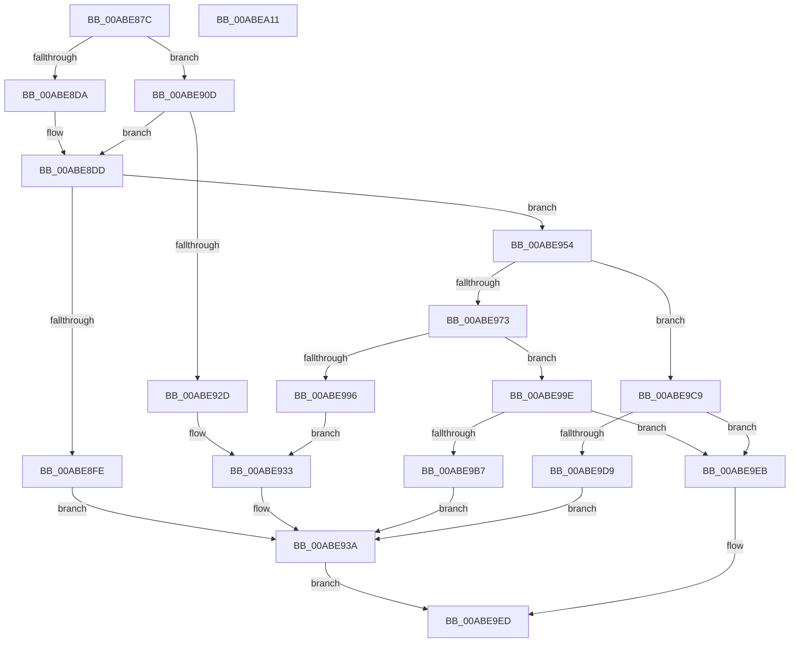

# AslPathSplit

- RVA: `0x00ABE87C`–`0x00ABEA12` (길이 `406` bytes)
- VA: `0x0000000140ABE87C`
- 실행 섹션: `PAGE`
- PDB 이름 있음: `예`; PDB Function 태그: `아니요`
- unwind 정보 RVA: `0x000BD6BC`
- 디코드: `113`개 명령, `406/406` bytes 표시
- 미해석 바이트: `0` (있으면 어셈블리에 `.byte`로 보존)

> 이 문서는 커널 이미지의 기계어와 PDB 기호를 분석해 생성했습니다. 4번과 5번은 함수 원형과 자료형을 바이너리 사용 방식에서 추정한 C 해석이며 원본 소스 복구 결과는 아닙니다.

## 1. Dependencies

- 직접 호출 지점: **9**; 고유 호출 대상: **5**
- 직접 호출자로 확인된 함수: **1**
- RIP 상대 이미지 참조: **4**

### Outgoing calls
- `0x00ABE8CD` → [wcsrchr](../../text/50/wcsrchr_function_00501E50.md) (function, `0x00501E50`)
- `0x00ABE8F3` → [RtlStringCchCopyW](../../text/26/RtlStringCchCopyW_function_0026E9A4.md) (function, `0x0026E9A4`)
- `0x00ABE922` → [RtlStringCchCopyNW](../../text/47/RtlStringCchCopyNW_function_0047169C.md) (function, `0x0047169C`)
- `0x00ABE94A` → [AslLogCallPrintf](../95/AslLogCallPrintf_function_0095E4EC.md) (function, `0x0095E4EC`)
- `0x00ABE95E` → [wcsrchr](../../text/50/wcsrchr_function_00501E50.md) (function, `0x00501E50`)
- `0x00ABE98B` → [RtlStringCchCopyNW](../../text/47/RtlStringCchCopyNW_function_0047169C.md) (function, `0x0047169C`)
- `0x00ABE9AC` → [RtlStringCchCopyW](../../text/26/RtlStringCchCopyW_function_0026E9A4.md) (function, `0x0026E9A4`)
- `0x00ABE9CE` → [RtlStringCchCopyW](../../text/26/RtlStringCchCopyW_function_0026E9A4.md) (function, `0x0026E9A4`)
- `0x00ABE9FA` → [_security_check_cookie](../../text/6A/_security_check_cookie_function_006AC640.md) (function, `0x006AC640`)

### Direct callers
- [SdbpCreateSearchDBContext](../A9/SdbpCreateSearchDBContext_function_00A9D544.md) at `0x00A9D639`

### Static image references
- `0x00ABE88E` → RVA `0x00E0A740` (`.data`; read)
- `0x00ABE8FE` → RVA `0x0003E680` (`.rdata`; read)
- `0x00ABE933` → RVA `0x0001E520` (`.rdata`; read)
- `0x00ABE93A` → RVA `0x0001E510` (`.rdata`; read)

## 2. Other-region calls and transfers

- 다른 실행 섹션으로 향하는 call: **8**
  - `0x00ABE8CD` → [wcsrchr](../../text/50/wcsrchr_function_00501E50.md) (`PAGE` → `.text`)
  - `0x00ABE8F3` → [RtlStringCchCopyW](../../text/26/RtlStringCchCopyW_function_0026E9A4.md) (`PAGE` → `.text`)
  - `0x00ABE922` → [RtlStringCchCopyNW](../../text/47/RtlStringCchCopyNW_function_0047169C.md) (`PAGE` → `.text`)
  - `0x00ABE95E` → [wcsrchr](../../text/50/wcsrchr_function_00501E50.md) (`PAGE` → `.text`)
  - `0x00ABE98B` → [RtlStringCchCopyNW](../../text/47/RtlStringCchCopyNW_function_0047169C.md) (`PAGE` → `.text`)
  - `0x00ABE9AC` → [RtlStringCchCopyW](../../text/26/RtlStringCchCopyW_function_0026E9A4.md) (`PAGE` → `.text`)
  - `0x00ABE9CE` → [RtlStringCchCopyW](../../text/26/RtlStringCchCopyW_function_0026E9A4.md) (`PAGE` → `.text`)
  - `0x00ABE9FA` → [_security_check_cookie](../../text/6A/_security_check_cookie_function_006AC640.md) (`PAGE` → `.text`)
- 별도 외부 분기/꼬리 이동을 확인하지 못했습니다.

## 3. Assembly (complete function range)

```asm
00ABE87C  40 53                           push rbx
00ABE87E  55                              push rbp
00ABE87F  56                              push rsi
00ABE880  57                              push rdi
00ABE881  41 55                           push r13
00ABE883  41 56                           push r14
00ABE885  41 57                           push r15
00ABE887  48 81 EC 50 02 00 00            sub rsp, 0x250
00ABE88E  48 8B 05 AB BE 34 00            mov rax, qword ptr [rip + 0x34beab]
00ABE895  48 33 C4                        xor rax, rsp
00ABE898  48 89 84 24 40 02 00 00         mov qword ptr [rsp + 0x240], rax
00ABE8A0  4C 8B BC 24 B8 02 00 00         mov r15, qword ptr [rsp + 0x2b8]
00ABE8A8  33 ED                           xor ebp, ebp
00ABE8AA  66 89 2A                        mov word ptr [rdx], bp
00ABE8AD  48 8B FA                        mov rdi, rdx
00ABE8B0  4D 8B F1                        mov r14, r9
00ABE8B3  41 8B F0                        mov esi, r8d
00ABE8B6  48 8B D9                        mov rbx, rcx
00ABE8B9  66 89 6C 24 30                  mov word ptr [rsp + 0x30], bp
00ABE8BE  66 41 89 2F                     mov word ptr [r15], bp
00ABE8C2  44 8D 6D 5C                     lea r13d, [rbp + 0x5c]
00ABE8C6  41 8B D5                        mov edx, r13d
00ABE8C9  66 41 89 29                     mov word ptr [r9], bp
00ABE8CD  E8 7E 35 A4 FF                  call 0x140501e50
00ABE8D2  4C 8B D8                        mov r11, rax
00ABE8D5  48 85 C0                        test rax, rax
00ABE8D8  75 33                           jne 0x140abe90d
00ABE8DA  4C 8B DB                        mov r11, rbx
00ABE8DD  66 45 39 2B                     cmp word ptr [r11], r13w
00ABE8E1  4D 8D 43 02                     lea r8, [r11 + 2]
00ABE8E5  BA 05 01 00 00                  mov edx, 0x105
00ABE8EA  48 8D 4C 24 30                  lea rcx, [rsp + 0x30]
00ABE8EF  4D 0F 45 C3                     cmovne r8, r11
00ABE8F3  E8 AC 00 7B FF                  call 0x14026e9a4
00ABE8F8  8B D8                           mov ebx, eax
00ABE8FA  85 C0                           test eax, eax
00ABE8FC  79 56                           jns 0x140abe954
00ABE8FE  4C 8D 0D 7B FD 57 FF            lea r9, [rip - 0xa80285]
00ABE905  41 B8 E9 04 00 00               mov r8d, 0x4e9
00ABE90B  EB 2D                           jmp 0x140abe93a
00ABE90D  4C 8B C8                        mov r9, rax
00ABE910  48 8B D6                        mov rdx, rsi
00ABE913  4C 2B CB                        sub r9, rbx
00ABE916  4C 8B C3                        mov r8, rbx
00ABE919  49 D1 F9                        sar r9, 1
00ABE91C  48 8B CF                        mov rcx, rdi
00ABE91F  49 FF C1                        inc r9
00ABE922  E8 75 2D 9B FF                  call 0x14047169c
00ABE927  8B D8                           mov ebx, eax
00ABE929  85 C0                           test eax, eax
00ABE92B  79 B0                           jns 0x140abe8dd
00ABE92D  41 B8 D5 04 00 00               mov r8d, 0x4d5
00ABE933  4C 8D 0D E6 FB 55 FF            lea r9, [rip - 0xaa041a]
00ABE93A  48 8D 15 CF FB 55 FF            lea rdx, [rip - 0xaa0431]
00ABE941  89 44 24 20                     mov dword ptr [rsp + 0x20], eax
00ABE945  B9 01 00 00 00                  mov ecx, 1
00ABE94A  E8 9D FB E9 FF                  call 0x14095e4ec
00ABE94F  E9 99 00 00 00                  jmp 0x140abe9ed
00ABE954  BA 2E 00 00 00                  mov edx, 0x2e
00ABE959  48 8D 4C 24 30                  lea rcx, [rsp + 0x30]
00ABE95E  E8 ED 34 A4 FF                  call 0x140501e50
00ABE963  4C 8D 44 24 30                  lea r8, [rsp + 0x30]
00ABE968  48 8B F0                        mov rsi, rax
00ABE96B  49 8B CE                        mov rcx, r14
00ABE96E  48 85 C0                        test rax, rax
00ABE971  74 56                           je 0x140abe9c9
00ABE973  48 8D 44 24 30                  lea rax, [rsp + 0x30]
00ABE978  4C 8B DE                        mov r11, rsi
00ABE97B  4C 2B D8                        sub r11, rax
00ABE97E  BF 04 01 00 00                  mov edi, 0x104
00ABE983  49 D1 FB                        sar r11, 1
00ABE986  8B D7                           mov edx, edi
00ABE988  4D 8B CB                        mov r9, r11
00ABE98B  E8 0C 2D 9B FF                  call 0x14047169c
00ABE990  8B D8                           mov ebx, eax
00ABE992  85 C0                           test eax, eax
00ABE994  79 08                           jns 0x140abe99e
00ABE996  41 B8 F6 04 00 00               mov r8d, 0x4f6
00ABE99C  EB 95                           jmp 0x140abe933
00ABE99E  4C 8B C6                        mov r8, rsi
00ABE9A1  66 43 89 2C 5E                  mov word ptr [r14 + r11*2], bp
00ABE9A6  48 8B D7                        mov rdx, rdi
00ABE9A9  49 8B CF                        mov rcx, r15
00ABE9AC  E8 F3 FF 7A FF                  call 0x14026e9a4
00ABE9B1  8B D8                           mov ebx, eax
00ABE9B3  85 C0                           test eax, eax
00ABE9B5  79 34                           jns 0x140abe9eb
00ABE9B7  4C 8D 0D C2 FC 57 FF            lea r9, [rip - 0xa8033e]
00ABE9BE  41 B8 FD 04 00 00               mov r8d, 0x4fd
00ABE9C4  E9 71 FF FF FF                  jmp 0x140abe93a
00ABE9C9  BA 04 01 00 00                  mov edx, 0x104
00ABE9CE  E8 D1 FF 7A FF                  call 0x14026e9a4
00ABE9D3  8B D8                           mov ebx, eax
00ABE9D5  85 C0                           test eax, eax
00ABE9D7  79 12                           jns 0x140abe9eb
00ABE9D9  4C 8D 0D A0 FC 57 FF            lea r9, [rip - 0xa80360]
00ABE9E0  41 B8 04 05 00 00               mov r8d, 0x504
00ABE9E6  E9 4F FF FF FF                  jmp 0x140abe93a
00ABE9EB  8B DD                           mov ebx, ebp
00ABE9ED  8B C3                           mov eax, ebx
00ABE9EF  48 8B 8C 24 40 02 00 00         mov rcx, qword ptr [rsp + 0x240]
00ABE9F7  48 33 CC                        xor rcx, rsp
00ABE9FA  E8 41 DC BE FF                  call 0x1406ac640
00ABE9FF  48 81 C4 50 02 00 00            add rsp, 0x250
00ABEA06  41 5F                           pop r15
00ABEA08  41 5E                           pop r14
00ABEA0A  41 5D                           pop r13
00ABEA0C  5F                              pop rdi
00ABEA0D  5E                              pop rsi
00ABEA0E  5D                              pop rbp
00ABEA0F  5B                              pop rbx
00ABEA10  C3                              ret
00ABEA11  CC                              int3
```

## 4. C-style interpretation (structured pseudocode)

```c
__int64 __fastcall AslPathSplit(__int64 a1, __int64 a2, int a3, __int64 a4, __int64 a5, __int64 a6)
{
    __int64 result;
    __int64 v_r11;
    __int64 v_rbp;
    __int64 v_rsp;
    unsigned __int16 v_stack_m258;
    unsigned int v_stack_m268;
    unsigned __int64 v_stack_m48;

    v_rsp = (v_rsp) - (592);
    result = (*(unsigned __int64 *)(v_rip + 3456683)) ^ (v_rsp);
    v_stack_m48 = result;
    v_rbp = 0;
    *(unsigned __int16 *)(a2) = 0;
    v_stack_m258 = 0;
    *(unsigned __int16 *)(a6) = 0;
    *(unsigned __int16 *)(a4) = 0;
    result = wcsrchr(a1, (unsigned int)((unsigned int)(v_rbp + 92)), a3, a4);
    if (result != 0) goto loc_00ABE90D;
loc_00ABE8DD:
    a3 = a1 + 2;
    if ((*(unsigned __int16 *)(a1)) != ((unsigned __int16)(v_rbp + 92))) { a3 = a1; }
    result = RtlStringCchCopyW(v_stack_m258, 261, a3, a4);
    if (!sign_flag) goto loc_00ABE954;
    goto loc_00ABE93A;
loc_00ABE90D:
    a4 = (result) - ((unsigned int)((unsigned int)(result)));
    a4 = (a4) >> (1);
    a4 = (a4) + 1;
    result = RtlStringCchCopyNW(a2, (unsigned int)(a3), (unsigned int)((unsigned int)(result)), a4);
    if (!sign_flag) goto loc_00ABE8DD;
loc_00ABE933:
loc_00ABE93A:
    v_stack_m268 = (unsigned int)(result);
    result = AslLogCallPrintf(1, v_rip - 11142193, (unsigned int)(0x4D5ULL), v_rip - 11142170);
    goto loc_00ABE9ED;
loc_00ABE954:
    result = wcsrchr(v_stack_m258, 46, (unsigned int)(0x4D5ULL), v_rip - 11142170);
    if (result == 0) goto loc_00ABE9C9;
    v_r11 = (result) - (v_stack_m258);
    v_r11 = (v_r11) >> (1);
    result = RtlStringCchCopyNW(a4, 260, v_stack_m258, v_r11);
    if (!sign_flag) goto loc_00ABE99E;
    goto loc_00ABE933;
loc_00ABE99E:
    *(unsigned __int16 *)(a4 + v_r11 * 2) = 0;
    result = RtlStringCchCopyW(a6, 260, result, v_r11);
    if (!sign_flag) goto loc_00ABE9EB;
    goto loc_00ABE93A;
loc_00ABE9C9:
    result = RtlStringCchCopyW(a6, 260, (unsigned int)(0x4FDULL), v_rip - 11010878);
    if (!sign_flag) goto loc_00ABE9EB;
    goto loc_00ABE93A;
loc_00ABE9EB:
loc_00ABE9ED:
    a1 = (v_stack_m48) ^ (v_rsp);
    result = _security_check_cookie(a1, 260, (unsigned int)(0x504ULL), v_rip - 11010912);
    v_rsp = (v_rsp) + (592);
    return result;
}
```

## 5. (Beta) C Style

```c
int64_t AslPathSplit(int64_t Arg1, void *Arg2, int32_t Arg3, void *Arg4, uint64_t Arg5, void *Arg6)
{
    uint8_t *arg2 = (uint8_t *)Arg2;
    uint8_t *arg4 = (uint8_t *)Arg4;
    uint8_t *arg6 = (uint8_t *)Arg6;

    int64_t result;
    int64_t local_r11;
    int64_t local_rbp;
    int64_t local_rsp;
    uint16_t v_stack_m258;
    uint32_t v_stack_m268;
    uint64_t v_stack_m48;

    local_rsp = (local_rsp) - (592);
    result = (*(uint64_t *)(v_rip + 0x34BEAB)) ^ (local_rsp);
    v_stack_m48 = result;
    local_rbp = 0;
    *(uint16_t *)(arg2) = 0;
    v_stack_m258 = 0;
    *(uint16_t *)(arg6) = 0;
    *(uint16_t *)(arg4) = 0;
    result = wcsrchr(Arg1, (uint32_t)((uint32_t)(local_rbp + 92)), Arg3, Arg4);
    if (result != 0) goto loc_00ABE90D;
loc_00ABE8DD:
    Arg3 = Arg1 + 2;
    if ((*(uint16_t *)(Arg1)) != ((uint16_t)(local_rbp + 92))) { Arg3 = Arg1; }
    result = RtlStringCchCopyW(v_stack_m258, 261, Arg3, Arg4);
    if (!sign_flag) goto loc_00ABE954;
    goto loc_00ABE93A;
loc_00ABE90D:
    Arg4 = (result) - ((uint32_t)((uint32_t)(result)));
    Arg4 = (Arg4) >> (1);
    Arg4 = (Arg4) + 1;
    result = RtlStringCchCopyNW(Arg2, (uint32_t)(Arg3), (uint32_t)((uint32_t)(result)), Arg4);
    if (!sign_flag) goto loc_00ABE8DD;
loc_00ABE933:
loc_00ABE93A:
    v_stack_m268 = (uint32_t)(result);
    result = AslLogCallPrintf(1, v_rip - 11142193, (uint32_t)(0x4D5ULL), v_rip - 11142170);
    goto loc_00ABE9ED;
loc_00ABE954:
    result = wcsrchr(v_stack_m258, 46, (uint32_t)(0x4D5ULL), v_rip - 11142170);
    if (result == 0) goto loc_00ABE9C9;
    local_r11 = (result) - (v_stack_m258);
    local_r11 = (local_r11) >> (1);
    result = RtlStringCchCopyNW(Arg4, 260, v_stack_m258, local_r11);
    if (!sign_flag) goto loc_00ABE99E;
    goto loc_00ABE933;
loc_00ABE99E:
    *(uint16_t *)(arg4 + local_r11 * 2) = 0;
    result = RtlStringCchCopyW(Arg6, 260, result, local_r11);
    if (!sign_flag) goto loc_00ABE9EB;
    goto loc_00ABE93A;
loc_00ABE9C9:
    result = RtlStringCchCopyW(Arg6, 260, (uint32_t)(0x4FDULL), v_rip - 11010878);
    if (!sign_flag) goto loc_00ABE9EB;
    goto loc_00ABE93A;
loc_00ABE9EB:
loc_00ABE9ED:
    Arg1 = (v_stack_m48) ^ (local_rsp);
    result = _security_check_cookie(Arg1, 260, (uint32_t)(0x504ULL), v_rip - 11010912);
    local_rsp = (local_rsp) + (592);
    return result;
}
```

### 관측된 메모리 오프셋

구조체 형식이 확인되지 않은 접근은 인자 기준의 오프셋으로만 기록했습니다.

| 기준 인자 | 오프셋 표현 | 폭 (bit) | 접근 |
|---|---:|---:|---|
| `Arg2` | `+ 0x0` | `16` | `W` |
| `Arg4` | `+ 0x0` | `16` | `W` |
| `Arg4` | `+ 0x0 + r11*2` | `16` | `W` |
| `Arg6` | `+ 0x0` | `16` | `W` |

## 6. Execution-region graph

[열기: 2D/3D 그래프와 함수 탐색 컨트롤 패널](../../../control-panel.html?section=page&rva=0x00ABE87C&view=graph)

- 2D 그래프는 위에서 아래로 흐르고, 3D 그래프는 빈 공간을 드래그해 회전합니다. Shift+드래그는 이동, 휠은 확대·축소, 함수 노드 선택은 대상 보고서 이동입니다.

### Static fallback


