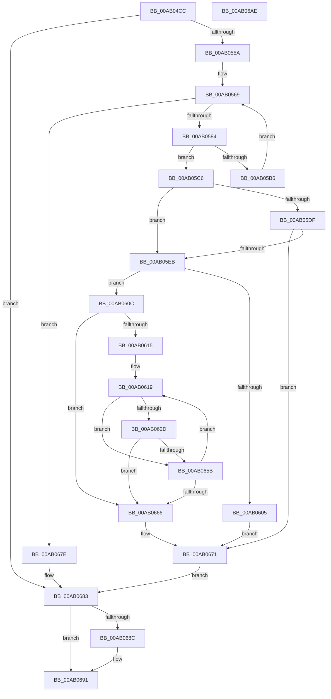

# BcdEnumerateDisks

- RVA: `0x00AB04CC`–`0x00AB06AF` (길이 `483` bytes)
- VA: `0x0000000140AB04CC`
- 실행 섹션: `PAGE`
- PDB 이름 있음: `예`; PDB Function 태그: `아니요`
- unwind 정보 RVA: `0x000BC564`
- 디코드: `132`개 명령, `483/483` bytes 표시
- 미해석 바이트: `0` (있으면 어셈블리에 `.byte`로 보존)

> 이 문서는 커널 이미지의 기계어와 PDB 기호를 분석해 생성했습니다. 4번과 5번은 함수 원형과 자료형을 바이너리 사용 방식에서 추정한 C 해석이며 원본 소스 복구 결과는 아닙니다.

## 1. Dependencies

- 직접 호출 지점: **13**; 고유 호출 대상: **9**
- 직접 호출자로 확인된 함수: **1**
- RIP 상대 이미지 참조: **2**

### Outgoing calls
- `0x00AB0517` → [RtlInitUnicodeString](../../text/42/RtlInitUnicodeString_function_0042A780.md) (function, `0x0042A780`)
- `0x00AB054B` → [ZwOpenDirectoryObject](../../text/6A/ZwOpenDirectoryObject_function_006ADBD0.md) (function, `0x006ADBD0`)
- `0x00AB0573` → [ExAllocatePool2](../../poolcode/B8/ExAllocatePool2_function_00B820F0.md) (function, `0x00B820F0`)
- `0x00AB05A8` → [ZwQueryDirectoryObject](../../text/6A/ZwQueryDirectoryObject_function_006AFAB0.md) (function, `0x006AFAB0`)
- `0x00AB05BC` → [ExFreePoolWithTag](../../poolcode/B8/ExFreePoolWithTag_function_00B82870.md) (function, `0x00B82870`)
- `0x00AB05CA` → [ZwClose](../../text/6A/ZwClose_function_006AD2B0.md) (function, `0x006AD2B0`)
- `0x00AB05F8` → [ExAllocatePool2](../../poolcode/B8/ExAllocatePool2_function_00B820F0.md) (function, `0x00B820F0`)
- `0x00AB0624` → [BiIsValidDiskDevice](../70/BiIsValidDiskDevice_function_00703190.md) (function, `0x00703190`)
- `0x00AB0644` → [swprintf_s](../../text/50/swprintf_s_function_00504B20.md) (function, `0x00504B20`)
- `0x00AB0652` → [ExpDiskEnumCallback](../../text/4F/ExpDiskEnumCallback_function_004FB9AC.md) (function, `0x004FB9AC`)
- `0x00AB066C` → [ExFreePoolWithTag](../../poolcode/B8/ExFreePoolWithTag_function_00B82870.md) (function, `0x00B82870`)
- `0x00AB0677` → [ExFreePoolWithTag](../../poolcode/B8/ExFreePoolWithTag_function_00B82870.md) (function, `0x00B82870`)
- `0x00AB068C` → [ZwClose](../../text/6A/ZwClose_function_006AD2B0.md) (function, `0x006AD2B0`)

### Direct callers
- [ExpTranslateNtPath](../7C/ExpTranslateNtPath_function_007CCEF4.md) at `0x007CD1A4`

### Static image references
- `0x00AB0500` → RVA `0x00B0BD30` (` ?? ::NNGAKEGL::`string'`; read)
- `0x00AB0630` → RVA `0x00B0BD40` (` ?? ::NNGAKEGL::`string'`; read)

## 2. Other-region calls and transfers

- 다른 실행 섹션으로 향하는 call: **12**
  - `0x00AB0517` → [RtlInitUnicodeString](../../text/42/RtlInitUnicodeString_function_0042A780.md) (`PAGE` → `.text`)
  - `0x00AB054B` → [ZwOpenDirectoryObject](../../text/6A/ZwOpenDirectoryObject_function_006ADBD0.md) (`PAGE` → `.text`)
  - `0x00AB0573` → [ExAllocatePool2](../../poolcode/B8/ExAllocatePool2_function_00B820F0.md) (`PAGE` → `POOLCODE`)
  - `0x00AB05A8` → [ZwQueryDirectoryObject](../../text/6A/ZwQueryDirectoryObject_function_006AFAB0.md) (`PAGE` → `.text`)
  - `0x00AB05BC` → [ExFreePoolWithTag](../../poolcode/B8/ExFreePoolWithTag_function_00B82870.md) (`PAGE` → `POOLCODE`)
  - `0x00AB05CA` → [ZwClose](../../text/6A/ZwClose_function_006AD2B0.md) (`PAGE` → `.text`)
  - `0x00AB05F8` → [ExAllocatePool2](../../poolcode/B8/ExAllocatePool2_function_00B820F0.md) (`PAGE` → `POOLCODE`)
  - `0x00AB0644` → [swprintf_s](../../text/50/swprintf_s_function_00504B20.md) (`PAGE` → `.text`)
  - `0x00AB0652` → [ExpDiskEnumCallback](../../text/4F/ExpDiskEnumCallback_function_004FB9AC.md) (`PAGE` → `.text`)
  - `0x00AB066C` → [ExFreePoolWithTag](../../poolcode/B8/ExFreePoolWithTag_function_00B82870.md) (`PAGE` → `POOLCODE`)
  - `0x00AB0677` → [ExFreePoolWithTag](../../poolcode/B8/ExFreePoolWithTag_function_00B82870.md) (`PAGE` → `POOLCODE`)
  - `0x00AB068C` → [ZwClose](../../text/6A/ZwClose_function_006AD2B0.md) (`PAGE` → `.text`)
- 별도 외부 분기/꼬리 이동을 확인하지 못했습니다.

## 3. Assembly (complete function range)

```asm
00AB04CC  48 89 5C 24 10                  mov qword ptr [rsp + 0x10], rbx
00AB04D1  48 89 4C 24 08                  mov qword ptr [rsp + 8], rcx
00AB04D6  55                              push rbp
00AB04D7  56                              push rsi
00AB04D8  57                              push rdi
00AB04D9  41 54                           push r12
00AB04DB  41 55                           push r13
00AB04DD  41 56                           push r14
00AB04DF  41 57                           push r15
00AB04E1  48 8B EC                        mov rbp, rsp
00AB04E4  48 81 EC 80 00 00 00            sub rsp, 0x80
00AB04EB  45 33 E4                        xor r12d, r12d
00AB04EE  48 8D 4D C0                     lea rcx, [rbp - 0x40]
00AB04F2  4C 8B FA                        mov r15, rdx
00AB04F5  44 89 65 D4                     mov dword ptr [rbp - 0x2c], r12d
00AB04F9  0F 57 C0                        xorps xmm0, xmm0
00AB04FC  44 89 65 EC                     mov dword ptr [rbp - 0x14], r12d
00AB0500  48 8D 15 29 B8 05 00            lea rdx, [rip + 0x5b829]
00AB0507  44 89 65 40                     mov dword ptr [rbp + 0x40], r12d
00AB050B  0F 11 45 C0                     movups xmmword ptr [rbp - 0x40], xmm0
00AB050F  44 89 65 50                     mov dword ptr [rbp + 0x50], r12d
00AB0513  4C 89 65 58                     mov qword ptr [rbp + 0x58], r12
00AB0517  E8 64 A2 97 FF                  call 0x14042a780
00AB051C  48 8D 45 C0                     lea rax, [rbp - 0x40]
00AB0520  C7 45 D0 30 00 00 00            mov dword ptr [rbp - 0x30], 0x30
00AB0527  0F 57 C0                        xorps xmm0, xmm0
00AB052A  48 89 45 E0                     mov qword ptr [rbp - 0x20], rax
00AB052E  4C 8D 45 D0                     lea r8, [rbp - 0x30]
00AB0532  4C 89 65 D8                     mov qword ptr [rbp - 0x28], r12
00AB0536  41 8D 54 24 01                  lea edx, [r12 + 1]
00AB053B  C7 45 E8 40 02 00 00            mov dword ptr [rbp - 0x18], 0x240
00AB0542  48 8D 4D 58                     lea rcx, [rbp + 0x58]
00AB0546  F3 0F 7F 45 F0                  movdqu xmmword ptr [rbp - 0x10], xmm0
00AB054B  E8 80 D6 BF FF                  call 0x1406adbd0
00AB0550  8B D8                           mov ebx, eax
00AB0552  85 C0                           test eax, eax
00AB0554  0F 88 29 01 00 00               js 0x140ab0683
00AB055A  41 BE 00 10 00 00               mov r14d, 0x1000
00AB0560  41 BD 42 43 44 4B               mov r13d, 0x4b444342
00AB0566  41 8B FE                        mov edi, r14d
00AB0569  8B D7                           mov edx, edi
00AB056B  45 8B C5                        mov r8d, r13d
00AB056E  B9 02 01 00 00                  mov ecx, 0x102
00AB0573  E8 78 1B 0D 00                  call 0x140b820f0
00AB0578  48 8B F0                        mov rsi, rax
00AB057B  48 85 C0                        test rax, rax
00AB057E  0F 84 FA 00 00 00               je 0x140ab067e
00AB0584  48 8B 4D 58                     mov rcx, qword ptr [rbp + 0x58]
00AB0588  48 8D 45 40                     lea rax, [rbp + 0x40]
00AB058C  4C 89 64 24 30                  mov qword ptr [rsp + 0x30], r12
00AB0591  45 33 C9                        xor r9d, r9d
00AB0594  48 89 44 24 28                  mov qword ptr [rsp + 0x28], rax
00AB0599  44 8B C7                        mov r8d, edi
00AB059C  48 8B D6                        mov rdx, rsi
00AB059F  C6 44 24 20 01                  mov byte ptr [rsp + 0x20], 1
00AB05A4  44 89 65 40                     mov dword ptr [rbp + 0x40], r12d
00AB05A8  E8 03 F5 BF FF                  call 0x1406afab0
00AB05AD  8B D8                           mov ebx, eax
00AB05AF  3D 05 01 00 00                  cmp eax, 0x105
00AB05B4  75 10                           jne 0x140ab05c6
00AB05B6  41 8B D5                        mov edx, r13d
00AB05B9  48 8B CE                        mov rcx, rsi
00AB05BC  E8 AF 22 0D 00                  call 0x140b82870
00AB05C1  41 03 FE                        add edi, r14d
00AB05C4  EB A3                           jmp 0x140ab0569
00AB05C6  48 8B 4D 58                     mov rcx, qword ptr [rbp + 0x58]
00AB05CA  E8 E1 CC BF FF                  call 0x1406ad2b0
00AB05CF  BA 00 00 00 80                  mov edx, 0x80000000
00AB05D4  4C 89 65 58                     mov qword ptr [rbp + 0x58], r12
00AB05D8  8D 04 13                        lea eax, [rbx + rdx]
00AB05DB  85 C2                           test edx, eax
00AB05DD  75 0C                           jne 0x140ab05eb
00AB05DF  81 FB 1A 00 00 80               cmp ebx, 0x8000001a
00AB05E5  0F 85 86 00 00 00               jne 0x140ab0671
00AB05EB  45 8B C5                        mov r8d, r13d
00AB05EE  BA 58 00 00 00                  mov edx, 0x58
00AB05F3  B9 02 01 00 00                  mov ecx, 0x102
00AB05F8  E8 F3 1A 0D 00                  call 0x140b820f0
00AB05FD  4C 8B F0                        mov r14, rax
00AB0600  48 85 C0                        test rax, rax
00AB0603  75 07                           jne 0x140ab060c
00AB0605  BB 17 00 00 C0                  mov ebx, 0xc0000017
00AB060A  EB 65                           jmp 0x140ab0671
00AB060C  41 8B DC                        mov ebx, r12d
00AB060F  66 44 39 26                     cmp word ptr [rsi], r12w
00AB0613  74 51                           je 0x140ab0666
00AB0615  48 8D 7E 08                     lea rdi, [rsi + 8]
00AB0619  48 8B 57 10                     mov rdx, qword ptr [rdi + 0x10]
00AB061D  4C 8D 45 50                     lea r8, [rbp + 0x50]
00AB0621  48 8B 0F                        mov rcx, qword ptr [rdi]
00AB0624  E8 67 2B C5 FF                  call 0x140703190
00AB0629  84 C0                           test al, al
00AB062B  74 2E                           je 0x140ab065b
00AB062D  4C 8B 0F                        mov r9, qword ptr [rdi]
00AB0630  4C 8D 05 09 B7 05 00            lea r8, [rip + 0x5b709]
00AB0637  BA 2C 00 00 00                  mov edx, 0x2c
00AB063C  4C 89 64 24 20                  mov qword ptr [rsp + 0x20], r12
00AB0641  49 8B CE                        mov rcx, r14
00AB0644  E8 D7 44 A5 FF                  call 0x140504b20
00AB0649  8B 55 50                        mov edx, dword ptr [rbp + 0x50]
00AB064C  4D 8B C7                        mov r8, r15
00AB064F  49 8B CE                        mov rcx, r14
00AB0652  E8 55 B3 A4 FF                  call 0x1404fb9ac
00AB0657  84 C0                           test al, al
00AB0659  75 0B                           jne 0x140ab0666
00AB065B  48 83 C7 20                     add rdi, 0x20
00AB065F  66 44 39 67 F8                  cmp word ptr [rdi - 8], r12w
00AB0664  75 B3                           jne 0x140ab0619
00AB0666  41 8B D5                        mov edx, r13d
00AB0669  49 8B CE                        mov rcx, r14
00AB066C  E8 FF 21 0D 00                  call 0x140b82870
00AB0671  41 8B D5                        mov edx, r13d
00AB0674  48 8B CE                        mov rcx, rsi
00AB0677  E8 F4 21 0D 00                  call 0x140b82870
00AB067C  EB 05                           jmp 0x140ab0683
00AB067E  BB 17 00 00 C0                  mov ebx, 0xc0000017
00AB0683  48 8B 4D 58                     mov rcx, qword ptr [rbp + 0x58]
00AB0687  48 85 C9                        test rcx, rcx
00AB068A  74 05                           je 0x140ab0691
00AB068C  E8 1F CC BF FF                  call 0x1406ad2b0
00AB0691  8B C3                           mov eax, ebx
00AB0693  48 8B 9C 24 C8 00 00 00         mov rbx, qword ptr [rsp + 0xc8]
00AB069B  48 81 C4 80 00 00 00            add rsp, 0x80
00AB06A2  41 5F                           pop r15
00AB06A4  41 5E                           pop r14
00AB06A6  41 5D                           pop r13
00AB06A8  41 5C                           pop r12
00AB06AA  5F                              pop rdi
00AB06AB  5E                              pop rsi
00AB06AC  5D                              pop rbp
00AB06AD  C3                              ret
00AB06AE  CC                              int3
```

## 4. C-style interpretation (structured pseudocode)

```c
__int64 __fastcall BcdEnumerateDisks(__int64 a1, __int64 a2, __int64 a3, int a4)
{
    __int64 result;
    __int64 v_r12;
    __int64 v_rdi;
    __int64 v_rsp;
    unsigned __int64 v_stack_m48;
    unsigned int v_stack_m4C;
    unsigned int v_stack_m50;
    unsigned __int64 v_stack_m58;
    unsigned __int64 v_stack_m60;
    unsigned int v_stack_m64;
    unsigned int v_stack_m68;
    unsigned __int64 v_stack_m78;
    unsigned __int64 v_stack_m88;
    unsigned __int64 v_stack_m90;
    unsigned __int8 v_stack_m98;
    unsigned __int64 v_stack_p10;
    unsigned int v_stack_p18;
    unsigned __int64 v_stack_p20;
    unsigned __int64 v_stack_p8;

    v_stack_p10 = v_rbx;
    v_stack_p8 = a1;
    v_rsp = (v_rsp) - (128);
    v_r12 = 0;
    v_stack_m64 = 0;
    v_stack_m4C = 0;
    v_stack_p8 = 0;
    v_stack_m78 = v_xmm0;
    v_stack_p18 = 0;
    v_stack_p20 = 0;
    result = RtlInitUnicodeString(v_stack_m78, v_rip + 374825, a3, a4);
    v_stack_m68 = 48;
    v_stack_m58 = v_stack_m78;
    v_stack_m60 = 0;
    v_stack_m50 = 576;
    v_stack_m48 = v_xmm0;
    result = ZwOpenDirectoryObject(v_stack_p20, v_r12 + 1, v_stack_m68, a4);
    if (sign_flag) goto loc_00AB0683;
loc_00AB0569:
    result = ExAllocatePool2(258, (unsigned int)((unsigned int)((unsigned int)((unsigned int)((unsigned int)(0x1000ULL))))), (unsigned int)((unsigned int)((unsigned int)(0x4B444342ULL))), a4);
    if (result == 0) goto loc_00AB067E;
    v_stack_m88 = 0;
    a4 = 0;
    v_stack_m90 = v_stack_p8;
    v_stack_m98 = 1;
    v_stack_p8 = 0;
    result = ZwQueryDirectoryObject(v_stack_p20, result, (unsigned int)((unsigned int)((unsigned int)((unsigned int)((unsigned int)(0x1000ULL))))), a4);
    if (((unsigned int)(result)) != 261) goto loc_00AB05C6;
    result = ExFreePoolWithTag(result, (unsigned int)((unsigned int)((unsigned int)(0x4B444342ULL))), (unsigned int)((unsigned int)((unsigned int)((unsigned int)((unsigned int)(0x1000ULL))))), a4);
    v_rdi = (unsigned int)(((unsigned int)((unsigned int)((unsigned int)(0x1000ULL)))) + ((unsigned int)((unsigned int)(0x1000ULL))));
    goto loc_00AB0569;
loc_00AB05C6:
    result = ZwClose(v_stack_p20, (unsigned int)((unsigned int)((unsigned int)(0x4B444342ULL))), (unsigned int)((unsigned int)((unsigned int)((unsigned int)((unsigned int)(0x1000ULL))))), a4);
    v_stack_p20 = 0;
    if ((((unsigned int)((unsigned int)(0x80000000ULL))) & ((unsigned int)((unsigned int)((unsigned int)(result)) + (unsigned int)(0x80000000ULL) * 1))) != 0) goto loc_00AB05EB;
    if (((unsigned int)((unsigned int)((unsigned int)(result)))) != 0x8000001AULL) goto loc_00AB0671;
loc_00AB05EB:
    result = ExAllocatePool2(258, 88, (unsigned int)((unsigned int)((unsigned int)(0x4B444342ULL))), a4);
    if (result != 0) goto loc_00AB060C;
    goto loc_00AB0671;
loc_00AB060C:
    if ((*(unsigned __int16 *)(result)) == 0) goto loc_00AB0666;
loc_00AB0619:
    result = BiIsValidDiskDevice(*(unsigned __int64 *)(result + 8), *(unsigned __int64 *)(result + 8 + 16), v_stack_p18, a4);
    if ((unsigned __int8)(result) == 0) goto loc_00AB065B;
    v_stack_m98 = 0;
    result = swprintf_s(result, 44, v_rip + 374537, *(unsigned __int64 *)(result + 8));
    result = ExpDiskEnumCallback(result, (unsigned int)(v_stack_p18), a2, *(unsigned __int64 *)(result + 8));
    if ((unsigned __int8)(result) != 0) goto loc_00AB0666;
loc_00AB065B:
    v_rdi = (result + 8) + (32);
    if ((*(unsigned __int16 *)(v_rdi - 8)) != 0) goto loc_00AB0619;
loc_00AB0666:
    result = ExFreePoolWithTag(result, (unsigned int)((unsigned int)((unsigned int)(0x4B444342ULL))), a2, *(unsigned __int64 *)(result + 8));
loc_00AB0671:
    result = ExFreePoolWithTag(result, (unsigned int)((unsigned int)((unsigned int)(0x4B444342ULL))), a2, *(unsigned __int64 *)(result + 8));
    goto loc_00AB0683;
loc_00AB067E:
loc_00AB0683:
    if (v_stack_p20 != 0) {
        result = ZwClose(v_stack_p20, (unsigned int)((unsigned int)((unsigned int)(0x4B444342ULL))), a2, *(unsigned __int64 *)(result + 8));
    }
    v_rsp = (v_rsp) + (128);
    return (unsigned int)((unsigned int)((unsigned int)(0xC0000017ULL)));
}
```

## 5. (Beta) C Style

```c
int64_t BcdEnumerateDisks(int64_t Arg1, int64_t Arg2, int64_t Arg3, int32_t Arg4)
{
    int64_t result;
    int64_t local_r12;
    int64_t local_rdi;
    int64_t local_rsp;
    uint64_t v_stack_m48;
    uint32_t v_stack_m4C;
    uint32_t v_stack_m50;
    uint64_t v_stack_m58;
    uint64_t v_stack_m60;
    uint32_t v_stack_m64;
    uint32_t v_stack_m68;
    uint64_t v_stack_m78;
    uint64_t v_stack_m88;
    uint64_t v_stack_m90;
    uint8_t v_stack_m98;
    uint64_t v_stack_p10;
    uint32_t v_stack_p18;
    uint64_t v_stack_p20;
    uint64_t v_stack_p8;

    v_stack_p10 = local_rbx;
    v_stack_p8 = Arg1;
    local_rsp = (local_rsp) - (128);
    local_r12 = 0;
    v_stack_m64 = 0;
    v_stack_m4C = 0;
    v_stack_p8 = 0;
    v_stack_m78 = v_xmm0;
    v_stack_p18 = 0;
    v_stack_p20 = 0;
    result = RtlInitUnicodeString(v_stack_m78, v_rip + 374825, Arg3, Arg4);
    v_stack_m68 = 48;
    v_stack_m58 = v_stack_m78;
    v_stack_m60 = 0;
    v_stack_m50 = 576;
    v_stack_m48 = v_xmm0;
    result = ZwOpenDirectoryObject(v_stack_p20, local_r12 + 1, v_stack_m68, Arg4);
    if (sign_flag) goto loc_00AB0683;
loc_00AB0569:
    result = ExAllocatePool2(258, (uint32_t)((uint32_t)((uint32_t)((uint32_t)((uint32_t)(0x1000ULL))))), (uint32_t)((uint32_t)((uint32_t)(0x4B444342ULL))), Arg4);
    if (result == 0) goto loc_00AB067E;
    v_stack_m88 = 0;
    Arg4 = 0;
    v_stack_m90 = v_stack_p8;
    v_stack_m98 = 1;
    v_stack_p8 = 0;
    result = ZwQueryDirectoryObject(v_stack_p20, result, (uint32_t)((uint32_t)((uint32_t)((uint32_t)((uint32_t)(0x1000ULL))))), Arg4);
    if (((uint32_t)(result)) != 261) goto loc_00AB05C6;
    result = ExFreePoolWithTag(result, (uint32_t)((uint32_t)((uint32_t)(0x4B444342ULL))), (uint32_t)((uint32_t)((uint32_t)((uint32_t)((uint32_t)(0x1000ULL))))), Arg4);
    local_rdi = (uint32_t)(((uint32_t)((uint32_t)((uint32_t)(0x1000ULL)))) + ((uint32_t)((uint32_t)(0x1000ULL))));
    goto loc_00AB0569;
loc_00AB05C6:
    result = ZwClose(v_stack_p20, (uint32_t)((uint32_t)((uint32_t)(0x4B444342ULL))), (uint32_t)((uint32_t)((uint32_t)((uint32_t)((uint32_t)(0x1000ULL))))), Arg4);
    v_stack_p20 = 0;
    if ((((uint32_t)((uint32_t)(0x80000000ULL))) & ((uint32_t)((uint32_t)((uint32_t)(result)) + (uint32_t)(0x80000000ULL) * 1))) != 0) goto loc_00AB05EB;
    if (((uint32_t)((uint32_t)((uint32_t)(result)))) != 0x8000001AULL) goto loc_00AB0671;
loc_00AB05EB:
    result = ExAllocatePool2(258, 88, (uint32_t)((uint32_t)((uint32_t)(0x4B444342ULL))), Arg4);
    if (result != 0) goto loc_00AB060C;
    goto loc_00AB0671;
loc_00AB060C:
    if ((*(uint16_t *)(result)) == 0) goto loc_00AB0666;
loc_00AB0619:
    result = BiIsValidDiskDevice(*(uint64_t *)(result + 0x8), *(uint64_t *)(result + 0x8 + 0x10), v_stack_p18, Arg4);
    if ((uint8_t)(result) == 0) goto loc_00AB065B;
    v_stack_m98 = 0;
    result = swprintf_s(result, 44, v_rip + 374537, *(uint64_t *)(result + 0x8));
    result = ExpDiskEnumCallback(result, (uint32_t)(v_stack_p18), Arg2, *(uint64_t *)(result + 0x8));
    if ((uint8_t)(result) != 0) goto loc_00AB0666;
loc_00AB065B:
    local_rdi = (result + 8) + (32);
    if ((*(uint16_t *)(local_rdi - 0x8)) != 0) goto loc_00AB0619;
loc_00AB0666:
    result = ExFreePoolWithTag(result, (uint32_t)((uint32_t)((uint32_t)(0x4B444342ULL))), Arg2, *(uint64_t *)(result + 0x8));
loc_00AB0671:
    result = ExFreePoolWithTag(result, (uint32_t)((uint32_t)((uint32_t)(0x4B444342ULL))), Arg2, *(uint64_t *)(result + 0x8));
    goto loc_00AB0683;
loc_00AB067E:
loc_00AB0683:
    if (v_stack_p20 != 0) {
        result = ZwClose(v_stack_p20, (uint32_t)((uint32_t)((uint32_t)(0x4B444342ULL))), Arg2, *(uint64_t *)(result + 0x8));
    }
    local_rsp = (local_rsp) + (128);
    return (uint32_t)((uint32_t)((uint32_t)(0xC0000017ULL)));
}
```

## 6. Execution-region graph

[열기: 2D/3D 그래프와 함수 탐색 컨트롤 패널](../../../control-panel.html?section=page&rva=0x00AB04CC&view=graph)

- 2D 그래프는 위에서 아래로 흐르고, 3D 그래프는 빈 공간을 드래그해 회전합니다. Shift+드래그는 이동, 휠은 확대·축소, 함수 노드 선택은 대상 보고서 이동입니다.

### Static fallback


