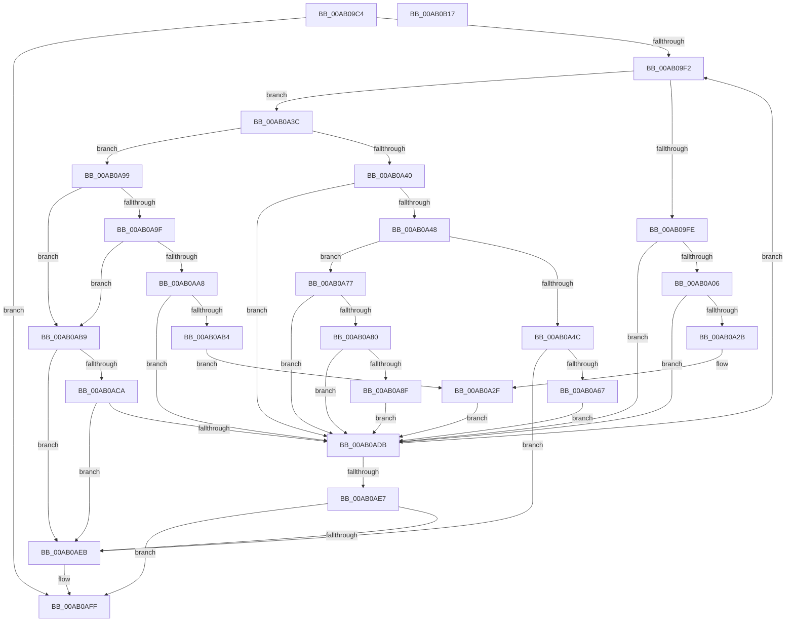

# BiBindEfiEntries

- RVA: `0x00AB09C4`–`0x00AB0B18` (길이 `340` bytes)
- VA: `0x0000000140AB09C4`
- 실행 섹션: `PAGE`
- PDB 이름 있음: `예`; PDB Function 태그: `아니요`
- unwind 정보 RVA: `0x0008CED4`
- 디코드: `100`개 명령, `340/340` bytes 표시
- 미해석 바이트: `0` (있으면 어셈블리에 `.byte`로 보존)

> 이 문서는 커널 이미지의 기계어와 PDB 기호를 분석해 생성했습니다. 4번과 5번은 함수 원형과 자료형을 바이너리 사용 방식에서 추정한 C 해석이며 원본 소스 복구 결과는 아닙니다.

## 1. Dependencies

- 직접 호출 지점: **13**; 고유 호출 대상: **10**
- 직접 호출자로 확인된 함수: **1**
- RIP 상대 이미지 참조: **2**

### Outgoing calls
- `0x00AB0A16` → [BiLogMessage](../A3/BiLogMessage_function_00A3D3A8.md) (function, `0x00A3D3A8`)
- `0x00AB0A1E` → [BiDeleteBootEntry](../82/BiDeleteBootEntry_function_00826AB0.md) (function, `0x00826AB0`)
- `0x00AB0A32` → [BiRemoveBootEntryFromNvramDisplayOrder](../82/BiRemoveBootEntryFromNvramDisplayOrder_function_00826EEC.md) (function, `0x00826EEC`)
- `0x00AB0A58` → [BcdOpenObject](../91/BcdOpenObject_function_00916704.md) (function, `0x00916704`)
- `0x00AB0A6C` → [BcdDeleteObject](../A3/BcdDeleteObject_function_00A3C578.md) (function, `0x00A3C578`)
- `0x00AB0A77` → [BiIsPortableWorkspaceBoot](../82/BiIsPortableWorkspaceBoot_function_008261C0.md) (function, `0x008261C0`)
- `0x00AB0A86` → [BiCreateEfiEntry](../82/BiCreateEfiEntry_function_008268C4.md) (function, `0x008268C4`)
- `0x00AB0A92` → [BiAddBootEntryToNvramDisplayOrder](../82/BiAddBootEntryToNvramDisplayOrder_function_00826428.md) (function, `0x00826428`)
- `0x00AB0A9F` → [BiIsPortableWorkspaceBoot](../82/BiIsPortableWorkspaceBoot_function_008261C0.md) (function, `0x008261C0`)
- `0x00AB0AAB` → [BiDeleteBootEntry](../82/BiDeleteBootEntry_function_00826AB0.md) (function, `0x00826AB0`)
- `0x00AB0ABF` → [BiBindEfiEntryToBcdObject](../AD/BiBindEfiEntryToBcdObject_function_00AD502C.md) (function, `0x00AD502C`)
- `0x00AB0AD0` → [BiUpdateBcdObject](../82/BiUpdateBcdObject_function_008270D0.md) (function, `0x008270D0`)
- `0x00AB0AFA` → [BiLogMessage](../A3/BiLogMessage_function_00A3D3A8.md) (function, `0x00A3D3A8`)

### Direct callers
- [BiBindEfiNamespaceObjects](../A4/BiBindEfiNamespaceObjects_function_00A40EB4.md) at `0x00A40F01`

### Static image references
- `0x00AB0A0A` → RVA `0x00B0CA60` (` ?? ::NNGAKEGL::`string'`; read)
- `0x00AB0AEE` → RVA `0x00B0CAC0` (` ?? ::NNGAKEGL::`string'`; read)

## 2. Other-region calls and transfers

- 다른 실행 섹션으로 향하는 call: **0**
- 별도 외부 분기/꼬리 이동을 확인하지 못했습니다.

## 3. Assembly (complete function range)

```asm
00AB09C4  48 8B C4                        mov rax, rsp
00AB09C7  48 89 58 08                     mov qword ptr [rax + 8], rbx
00AB09CB  48 89 70 18                     mov qword ptr [rax + 0x18], rsi
00AB09CF  48 89 78 20                     mov qword ptr [rax + 0x20], rdi
00AB09D3  41 56                           push r14
00AB09D5  48 83 EC 20                     sub rsp, 0x20
00AB09D9  48 83 60 10 00                  and qword ptr [rax + 0x10], 0
00AB09DE  33 FF                           xor edi, edi
00AB09E0  48 8B 1A                        mov rbx, qword ptr [rdx]
00AB09E3  4C 8B F2                        mov r14, rdx
00AB09E6  48 8B F1                        mov rsi, rcx
00AB09E9  48 3B DA                        cmp rbx, rdx
00AB09EC  0F 84 0D 01 00 00               je 0x140ab0aff
00AB09F2  8B 43 30                        mov eax, dword ptr [rbx + 0x30]
00AB09F5  8B C8                           mov ecx, eax
00AB09F7  83 E1 01                        and ecx, 1
00AB09FA  A8 10                           test al, 0x10
00AB09FC  74 3E                           je 0x140ab0a3c
00AB09FE  85 C9                           test ecx, ecx
00AB0A00  0F 84 D5 00 00 00               je 0x140ab0adb
00AB0A06  44 8B 43 20                     mov r8d, dword ptr [rbx + 0x20]
00AB0A0A  48 8D 15 4F C0 05 00            lea rdx, [rip + 0x5c04f]
00AB0A11  B9 03 00 00 00                  mov ecx, 3
00AB0A16  E8 8D C9 F8 FF                  call 0x140a3d3a8
00AB0A1B  8B 4B 20                        mov ecx, dword ptr [rbx + 0x20]
00AB0A1E  E8 8D 60 D7 FF                  call 0x140826ab0
00AB0A23  85 C0                           test eax, eax
00AB0A25  0F 88 B0 00 00 00               js 0x140ab0adb
00AB0A2B  83 63 30 FE                     and dword ptr [rbx + 0x30], 0xfffffffe
00AB0A2F  48 8B CB                        mov rcx, rbx
00AB0A32  E8 B5 64 D7 FF                  call 0x140826eec
00AB0A37  E9 9F 00 00 00                  jmp 0x140ab0adb
00AB0A3C  85 C9                           test ecx, ecx
00AB0A3E  75 59                           jne 0x140ab0a99
00AB0A40  A8 04                           test al, 4
00AB0A42  0F 84 93 00 00 00               je 0x140ab0adb
00AB0A48  A8 08                           test al, 8
00AB0A4A  74 2B                           je 0x140ab0a77
00AB0A4C  48 8D 53 10                     lea rdx, [rbx + 0x10]
00AB0A50  48 8B CE                        mov rcx, rsi
00AB0A53  4C 8D 44 24 38                  lea r8, [rsp + 0x38]
00AB0A58  E8 A7 5C E6 FF                  call 0x140916704
00AB0A5D  8B F8                           mov edi, eax
00AB0A5F  85 C0                           test eax, eax
00AB0A61  0F 88 84 00 00 00               js 0x140ab0aeb
00AB0A67  48 8B 4C 24 38                  mov rcx, qword ptr [rsp + 0x38]
00AB0A6C  E8 07 BB F8 FF                  call 0x140a3c578
00AB0A71  83 63 30 F9                     and dword ptr [rbx + 0x30], 0xfffffff9
00AB0A75  EB 64                           jmp 0x140ab0adb
00AB0A77  E8 44 57 D7 FF                  call 0x1408261c0
00AB0A7C  84 C0                           test al, al
00AB0A7E  75 5B                           jne 0x140ab0adb
00AB0A80  48 8B D3                        mov rdx, rbx
00AB0A83  48 8B CE                        mov rcx, rsi
00AB0A86  E8 39 5E D7 FF                  call 0x1408268c4
00AB0A8B  85 C0                           test eax, eax
00AB0A8D  78 4C                           js 0x140ab0adb
00AB0A8F  48 8B CB                        mov rcx, rbx
00AB0A92  E8 91 59 D7 FF                  call 0x140826428
00AB0A97  EB 42                           jmp 0x140ab0adb
00AB0A99  24 24                           and al, 0x24
00AB0A9B  3C 20                           cmp al, 0x20
00AB0A9D  75 1A                           jne 0x140ab0ab9
00AB0A9F  E8 1C 57 D7 FF                  call 0x1408261c0
00AB0AA4  84 C0                           test al, al
00AB0AA6  75 11                           jne 0x140ab0ab9
00AB0AA8  8B 4B 20                        mov ecx, dword ptr [rbx + 0x20]
00AB0AAB  E8 00 60 D7 FF                  call 0x140826ab0
00AB0AB0  85 C0                           test eax, eax
00AB0AB2  78 27                           js 0x140ab0adb
00AB0AB4  E9 76 FF FF FF                  jmp 0x140ab0a2f
00AB0AB9  48 8B D3                        mov rdx, rbx
00AB0ABC  48 8B CE                        mov rcx, rsi
00AB0ABF  E8 68 45 02 00                  call 0x140ad502c
00AB0AC4  8B F8                           mov edi, eax
00AB0AC6  85 C0                           test eax, eax
00AB0AC8  78 21                           js 0x140ab0aeb
00AB0ACA  48 8B D3                        mov rdx, rbx
00AB0ACD  48 8B CE                        mov rcx, rsi
00AB0AD0  E8 FB 65 D7 FF                  call 0x1408270d0
00AB0AD5  8B F8                           mov edi, eax
00AB0AD7  85 C0                           test eax, eax
00AB0AD9  78 10                           js 0x140ab0aeb
00AB0ADB  48 8B 1B                        mov rbx, qword ptr [rbx]
00AB0ADE  49 3B DE                        cmp rbx, r14
00AB0AE1  0F 85 0B FF FF FF               jne 0x140ab09f2
00AB0AE7  85 FF                           test edi, edi
00AB0AE9  79 14                           jns 0x140ab0aff
00AB0AEB  44 8B C7                        mov r8d, edi
00AB0AEE  48 8D 15 CB BF 05 00            lea rdx, [rip + 0x5bfcb]
00AB0AF5  B9 04 00 00 00                  mov ecx, 4
00AB0AFA  E8 A9 C8 F8 FF                  call 0x140a3d3a8
00AB0AFF  48 8B 5C 24 30                  mov rbx, qword ptr [rsp + 0x30]
00AB0B04  8B C7                           mov eax, edi
00AB0B06  48 8B 7C 24 48                  mov rdi, qword ptr [rsp + 0x48]
00AB0B0B  48 8B 74 24 40                  mov rsi, qword ptr [rsp + 0x40]
00AB0B10  48 83 C4 20                     add rsp, 0x20
00AB0B14  41 5E                           pop r14
00AB0B16  C3                              ret
00AB0B17  CC                              int3
```

## 4. C-style interpretation (structured pseudocode)

```c
__int64 __fastcall BiBindEfiEntries(__int64 a1, __int64 a2)
{
    __int64 result;
    __int64 v_rdi;
    __int64 v_rsp;
    unsigned __int64 v_stack_p10;
    unsigned __int64 v_stack_p18;
    unsigned __int64 v_stack_p20;
    unsigned __int64 v_stack_p8;

    *(unsigned __int64 *)(v_rsp + 8) = v_rbx;
    *(unsigned __int64 *)(v_rsp + 24) = v_rsi;
    *(unsigned __int64 *)(v_rsp + 32) = v_rdi;
    v_rsp = (v_rsp) - (32);
    v_rdi = 0;
    if ((*(unsigned __int64 *)(a2)) == a2) goto loc_00AB0AFF;
loc_00AB09F2:
    a1 = (unsigned int)(((unsigned int)((unsigned int)((unsigned int)(*(unsigned int *)(*(unsigned __int64 *)(a2) + 48))))) & (1));
    if ((((unsigned __int8)((unsigned int)(*(unsigned int *)(*(unsigned __int64 *)(a2) + 48)))) & (16)) == 0) goto loc_00AB0A3C;
    if ((unsigned int)(a1) == 0) goto loc_00AB0ADB;
    result = BiLogMessage(3, v_rip + 376911, (unsigned int)(*(unsigned int *)(*(unsigned __int64 *)(a2) + 32)), a4);
    result = BiDeleteBootEntry((unsigned int)(*(unsigned int *)(*(unsigned __int64 *)(a2) + 32)), v_rip + 376911, (unsigned int)(*(unsigned int *)(*(unsigned __int64 *)(a2) + 32)), a4);
    if (sign_flag) goto loc_00AB0ADB;
loc_00AB0A2F:
    result = BiRemoveBootEntryFromNvramDisplayOrder(*(unsigned __int64 *)(a2), v_rip + 376911, (unsigned int)(*(unsigned int *)(*(unsigned __int64 *)(a2) + 32)), a4);
    goto loc_00AB0ADB;
loc_00AB0A3C:
    if ((unsigned int)(*(unsigned __int64 *)(a2)) != 0) goto loc_00AB0A99;
    if ((((unsigned __int8)(result)) & (4)) == 0) goto loc_00AB0ADB;
    if ((((unsigned __int8)(result)) & (8)) == 0) goto loc_00AB0A77;
    result = BcdOpenObject(a1, *(unsigned __int64 *)(a2) + 16, v_stack_p10, a4);
    if (sign_flag) goto loc_00AB0AEB;
    result = BcdDeleteObject(v_stack_p10, *(unsigned __int64 *)(a2) + 16, v_stack_p10, a4);
    goto loc_00AB0ADB;
loc_00AB0A77:
    result = BiIsPortableWorkspaceBoot(v_stack_p10, *(unsigned __int64 *)(a2) + 16, v_stack_p10, a4);
    if ((unsigned __int8)(result) != 0) goto loc_00AB0ADB;
    result = BiCreateEfiEntry(a1, *(unsigned __int64 *)(a2), v_stack_p10, a4);
    if (sign_flag) goto loc_00AB0ADB;
    result = BiAddBootEntryToNvramDisplayOrder(*(unsigned __int64 *)(a2), *(unsigned __int64 *)(a2), v_stack_p10, a4);
    goto loc_00AB0ADB;
loc_00AB0A99:
    result = (unsigned __int8)((result) & (36));
    if (((unsigned __int8)(result)) != 32) goto loc_00AB0AB9;
    result = BiIsPortableWorkspaceBoot(*(unsigned __int64 *)(a2), *(unsigned __int64 *)(a2), v_stack_p10, a4);
    if ((unsigned __int8)(result) != 0) goto loc_00AB0AB9;
    result = BiDeleteBootEntry((unsigned int)(*(unsigned int *)(*(unsigned __int64 *)(a2) + 32)), *(unsigned __int64 *)(a2), v_stack_p10, a4);
    if (sign_flag) goto loc_00AB0ADB;
    goto loc_00AB0A2F;
loc_00AB0AB9:
    result = BiBindEfiEntryToBcdObject(a1, *(unsigned __int64 *)(a2), v_stack_p10, a4);
    if (sign_flag) goto loc_00AB0AEB;
    result = BiUpdateBcdObject(a1, *(unsigned __int64 *)(a2), v_stack_p10, a4);
    if (sign_flag) goto loc_00AB0AEB;
loc_00AB0ADB:
    if ((*(unsigned __int64 *)(*(unsigned __int64 *)(a2))) != a2) goto loc_00AB09F2;
    if (sign_flag) {
        a3 = (unsigned int)((unsigned int)((unsigned int)(result)));
        a2 = v_rip + 376779;
        a1 = 4;
        result = BiLogMessage(a1, a2, a3, a4);
    }
    v_rsp = (v_rsp) + (32);
    return (unsigned int)((unsigned int)((unsigned int)((unsigned int)(result))));
}
```

## 5. (Beta) C Style

```c
int64_t BiBindEfiEntries(int64_t Arg1, void *Arg2)
{
    uint8_t *arg2 = (uint8_t *)Arg2;

    int64_t result;
    int64_t local_rdi;
    int64_t local_rsp;
    uint64_t v_stack_p10;
    uint64_t v_stack_p18;
    uint64_t v_stack_p20;
    uint64_t v_stack_p8;

    *(uint64_t *)(local_rsp + 0x8) = local_rbx;
    *(uint64_t *)(local_rsp + 0x18) = local_rsi;
    *(uint64_t *)(local_rsp + 0x20) = local_rdi;
    local_rsp = (local_rsp) - (32);
    local_rdi = 0;
    if ((*(uint64_t *)(arg2)) == Arg2) goto loc_00AB0AFF;
loc_00AB09F2:
    Arg1 = (uint32_t)(((uint32_t)((uint32_t)((uint32_t)(*(uint32_t *)(*(uint64_t *)(arg2) + 0x30))))) & (1));
    if ((((uint8_t)((uint32_t)(*(uint32_t *)(*(uint64_t *)(arg2) + 0x30)))) & (16)) == 0) goto loc_00AB0A3C;
    if ((uint32_t)(Arg1) == 0) goto loc_00AB0ADB;
    result = BiLogMessage(3, v_rip + 376911, (uint32_t)(*(uint32_t *)(*(uint64_t *)(arg2) + 0x20)), a4);
    result = BiDeleteBootEntry((uint32_t)(*(uint32_t *)(*(uint64_t *)(arg2) + 0x20)), v_rip + 376911, (uint32_t)(*(uint32_t *)(*(uint64_t *)(arg2) + 0x20)), a4);
    if (sign_flag) goto loc_00AB0ADB;
loc_00AB0A2F:
    result = BiRemoveBootEntryFromNvramDisplayOrder(*(uint64_t *)(arg2), v_rip + 376911, (uint32_t)(*(uint32_t *)(*(uint64_t *)(arg2) + 0x20)), a4);
    goto loc_00AB0ADB;
loc_00AB0A3C:
    if ((uint32_t)(*(uint64_t *)(arg2)) != 0) goto loc_00AB0A99;
    if ((((uint8_t)(result)) & (4)) == 0) goto loc_00AB0ADB;
    if ((((uint8_t)(result)) & (8)) == 0) goto loc_00AB0A77;
    result = BcdOpenObject(Arg1, *(uint64_t *)(arg2) + 16, v_stack_p10, a4);
    if (sign_flag) goto loc_00AB0AEB;
    result = BcdDeleteObject(v_stack_p10, *(uint64_t *)(arg2) + 16, v_stack_p10, a4);
    goto loc_00AB0ADB;
loc_00AB0A77:
    result = BiIsPortableWorkspaceBoot(v_stack_p10, *(uint64_t *)(arg2) + 16, v_stack_p10, a4);
    if ((uint8_t)(result) != 0) goto loc_00AB0ADB;
    result = BiCreateEfiEntry(Arg1, *(uint64_t *)(arg2), v_stack_p10, a4);
    if (sign_flag) goto loc_00AB0ADB;
    result = BiAddBootEntryToNvramDisplayOrder(*(uint64_t *)(arg2), *(uint64_t *)(arg2), v_stack_p10, a4);
    goto loc_00AB0ADB;
loc_00AB0A99:
    result = (uint8_t)((result) & (36));
    if (((uint8_t)(result)) != 32) goto loc_00AB0AB9;
    result = BiIsPortableWorkspaceBoot(*(uint64_t *)(arg2), *(uint64_t *)(arg2), v_stack_p10, a4);
    if ((uint8_t)(result) != 0) goto loc_00AB0AB9;
    result = BiDeleteBootEntry((uint32_t)(*(uint32_t *)(*(uint64_t *)(arg2) + 0x20)), *(uint64_t *)(arg2), v_stack_p10, a4);
    if (sign_flag) goto loc_00AB0ADB;
    goto loc_00AB0A2F;
loc_00AB0AB9:
    result = BiBindEfiEntryToBcdObject(Arg1, *(uint64_t *)(arg2), v_stack_p10, a4);
    if (sign_flag) goto loc_00AB0AEB;
    result = BiUpdateBcdObject(Arg1, *(uint64_t *)(arg2), v_stack_p10, a4);
    if (sign_flag) goto loc_00AB0AEB;
loc_00AB0ADB:
    if ((*(uint64_t *)(*(uint64_t *)(arg2))) != Arg2) goto loc_00AB09F2;
    if (sign_flag) {
        a3 = (uint32_t)((uint32_t)((uint32_t)(result)));
        Arg2 = v_rip + 376779;
        Arg1 = 4;
        result = BiLogMessage(Arg1, Arg2, a3, a4);
    }
    local_rsp = (local_rsp) + (32);
    return (uint32_t)((uint32_t)((uint32_t)((uint32_t)(result))));
}
```

### 관측된 메모리 오프셋

구조체 형식이 확인되지 않은 접근은 인자 기준의 오프셋으로만 기록했습니다.

| 기준 인자 | 오프셋 표현 | 폭 (bit) | 접근 |
|---|---:|---:|---|
| `Arg2` | `+ 0x0` | `64` | `R` |

## 6. Execution-region graph

[열기: 2D/3D 그래프와 함수 탐색 컨트롤 패널](../../../control-panel.html?section=page&rva=0x00AB09C4&view=graph)

- 2D 그래프는 위에서 아래로 흐르고, 3D 그래프는 빈 공간을 드래그해 회전합니다. Shift+드래그는 이동, 휠은 확대·축소, 함수 노드 선택은 대상 보고서 이동입니다.

### Static fallback


