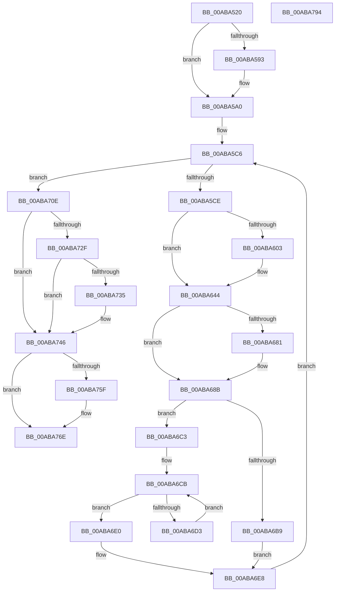

# CcMdlRead

- RVA: `0x00ABA520`–`0x00ABA795` (길이 `629` bytes)
- VA: `0x0000000140ABA520`
- 실행 섹션: `PAGE`
- PDB 이름 있음: `예`; PDB Function 태그: `아니요`
- unwind 정보 RVA: `0x000BD39C`
- 디코드: `154`개 명령, `629/629` bytes 표시
- 미해석 바이트: `0` (있으면 어셈블리에 `.byte`로 보존)

> 이 문서는 커널 이미지의 기계어와 PDB 기호를 분석해 생성했습니다. 4번과 5번은 함수 원형과 자료형을 바이너리 사용 방식에서 추정한 C 해석이며 원본 소스 복구 결과는 아닙니다.

## 1. Dependencies

- 직접 호출 지점: **10**; 고유 호출 대상: **9**
- 직접 호출자로 확인된 함수: **1**
- RIP 상대 이미지 참조: **0**

### Outgoing calls
- `0x00ABA599` → [CcScheduleReadAheadEx](../../text/38/CcScheduleReadAheadEx_function_00388820.md) (function, `0x00388820`)
- `0x00ABA5EA` → [CcGetVirtualAddress](../../text/34/CcGetVirtualAddress_function_00340C9C.md) (function, `0x00340C9C`)
- `0x00ABA63F` → [CcFetchDataForRead](../../text/2F/CcFetchDataForRead_function_002F8720.md) (function, `0x002F8720`)
- `0x00ABA672` → [IoAllocateMdl](../../text/29/IoAllocateMdl_function_0029EBF0.md) (function, `0x0029EBF0`)
- `0x00ABA686` → [RtlRaiseStatus](../../text/2F/RtlRaiseStatus_function_002F6A50.md) (function, `0x002F6A50`)
- `0x00ABA693` → [MmProbeAndLockPages](../../text/23/MmProbeAndLockPages_function_0023B990.md) (function, `0x0023B990`)
- `0x00ABA69D` → [CcFreeVirtualAddress](../../text/33/CcFreeVirtualAddress_function_0033F2C0.md) (function, `0x0033F2C0`)
- `0x00ABA741` → [CcScheduleReadAheadEx](../../text/38/CcScheduleReadAheadEx_function_00388820.md) (function, `0x00388820`)
- `0x00ABA74F` → [CcUpdateReadHistory](../../text/45/CcUpdateReadHistory_function_0045E76C.md) (function, `0x0045E76C`)
- `0x00ABA769` → [CcUpdateSharedCacheMapFlag](../../text/45/CcUpdateSharedCacheMapFlag_function_0045EC14.md) (function, `0x0045EC14`)

### Direct callers
- [FsRtlMdlReadDev](../71/FsRtlMdlReadDev_function_00713980.md) at `0x00713ADE`

### Static image references
- 디코드된 RIP-relative 메모리 참조가 없습니다.

## 2. Other-region calls and transfers

- 다른 실행 섹션으로 향하는 call: **10**
  - `0x00ABA599` → [CcScheduleReadAheadEx](../../text/38/CcScheduleReadAheadEx_function_00388820.md) (`PAGE` → `.text`)
  - `0x00ABA5EA` → [CcGetVirtualAddress](../../text/34/CcGetVirtualAddress_function_00340C9C.md) (`PAGE` → `.text`)
  - `0x00ABA63F` → [CcFetchDataForRead](../../text/2F/CcFetchDataForRead_function_002F8720.md) (`PAGE` → `.text`)
  - `0x00ABA672` → [IoAllocateMdl](../../text/29/IoAllocateMdl_function_0029EBF0.md) (`PAGE` → `.text`)
  - `0x00ABA686` → [RtlRaiseStatus](../../text/2F/RtlRaiseStatus_function_002F6A50.md) (`PAGE` → `.text`)
  - `0x00ABA693` → [MmProbeAndLockPages](../../text/23/MmProbeAndLockPages_function_0023B990.md) (`PAGE` → `.text`)
  - `0x00ABA69D` → [CcFreeVirtualAddress](../../text/33/CcFreeVirtualAddress_function_0033F2C0.md) (`PAGE` → `.text`)
  - `0x00ABA741` → [CcScheduleReadAheadEx](../../text/38/CcScheduleReadAheadEx_function_00388820.md) (`PAGE` → `.text`)
  - `0x00ABA74F` → [CcUpdateReadHistory](../../text/45/CcUpdateReadHistory_function_0045E76C.md) (`PAGE` → `.text`)
  - `0x00ABA769` → [CcUpdateSharedCacheMapFlag](../../text/45/CcUpdateSharedCacheMapFlag_function_0045EC14.md) (`PAGE` → `.text`)
- 별도 외부 분기/꼬리 이동을 확인하지 못했습니다.

## 3. Assembly (complete function range)

```asm
00ABA520  48 8B C4                        mov rax, rsp
00ABA523  4C 89 48 20                     mov qword ptr [rax + 0x20], r9
00ABA527  44 89 40 18                     mov dword ptr [rax + 0x18], r8d
00ABA52B  48 89 50 10                     mov qword ptr [rax + 0x10], rdx
00ABA52F  48 89 48 08                     mov qword ptr [rax + 8], rcx
00ABA533  53                              push rbx
00ABA534  56                              push rsi
00ABA535  57                              push rdi
00ABA536  41 54                           push r12
00ABA538  41 55                           push r13
00ABA53A  41 56                           push r14
00ABA53C  41 57                           push r15
00ABA53E  48 81 EC B0 00 00 00            sub rsp, 0xb0
00ABA545  45 8B F8                        mov r15d, r8d
00ABA548  4C 8B F2                        mov r14, rdx
00ABA54B  48 8B F9                        mov rdi, rcx
00ABA54E  33 D2                           xor edx, edx
00ABA550  48 89 50 88                     mov qword ptr [rax - 0x78], rdx
00ABA554  44 89 44 24 60                  mov dword ptr [rsp + 0x60], r8d
00ABA559  89 54 24 54                     mov dword ptr [rsp + 0x54], edx
00ABA55D  48 89 50 80                     mov qword ptr [rax - 0x80], rdx
00ABA561  89 54 24 5C                     mov dword ptr [rsp + 0x5c], edx
00ABA565  48 8B 41 28                     mov rax, qword ptr [rcx + 0x28]
00ABA569  4C 8B 68 08                     mov r13, qword ptr [rax + 8]
00ABA56D  4C 89 AC 24 80 00 00 00         mov qword ptr [rsp + 0x80], r13
00ABA575  4C 8B 61 30                     mov r12, qword ptr [rcx + 0x30]
00ABA579  4C 89 A4 24 88 00 00 00         mov qword ptr [rsp + 0x88], r12
00ABA581  4C 89 A4 24 A0 00 00 00         mov qword ptr [rsp + 0xa0], r12
00ABA589  41 F7 04 24 00 00 02 00         test dword ptr [r12], 0x20000
00ABA591  74 0D                           je 0x140aba5a0
00ABA593  45 33 C9                        xor r9d, r9d
00ABA596  49 8B D6                        mov rdx, r14
00ABA599  E8 82 E2 8C FF                  call 0x140388820
00ABA59E  33 D2                           xor edx, edx
00ABA5A0  65 FF 04 25 64 89 00 00         inc dword ptr gs:[0x8964]
00ABA5A8  65 48 8B 04 25 88 01 00 00      mov rax, qword ptr gs:[0x188]
00ABA5B1  89 90 DC 05 00 00               mov dword ptr [rax + 0x5dc], edx
00ABA5B7  49 8B 1E                        mov rbx, qword ptr [r14]
00ABA5BA  48 89 5C 24 78                  mov qword ptr [rsp + 0x78], rbx
00ABA5BF  8B B4 24 00 01 00 00            mov esi, dword ptr [rsp + 0x100]
00ABA5C6  85 F6                           test esi, esi
00ABA5C8  0F 84 40 01 00 00               je 0x140aba70e
00ABA5CE  89 54 24 58                     mov dword ptr [rsp + 0x58], edx
00ABA5D2  89 54 24 28                     mov dword ptr [rsp + 0x28], edx
00ABA5D6  89 54 24 20                     mov dword ptr [rsp + 0x20], edx
00ABA5DA  4C 8D 4C 24 58                  lea r9, [rsp + 0x58]
00ABA5DF  4C 8D 44 24 68                  lea r8, [rsp + 0x68]
00ABA5E4  48 8B D3                        mov rdx, rbx
00ABA5E7  49 8B CD                        mov rcx, r13
00ABA5EA  E8 AD 66 88 FF                  call 0x140340c9c
00ABA5EF  48 89 84 24 90 00 00 00         mov qword ptr [rsp + 0x90], rax
00ABA5F7  41 8B 8D 98 00 00 00            mov ecx, dword ptr [r13 + 0x98]
00ABA5FE  F6 C1 08                        test cl, 8
00ABA601  75 41                           jne 0x140aba644
00ABA603  41 8B 0C 24                     mov ecx, dword ptr [r12]
00ABA607  C1 E9 12                        shr ecx, 0x12
00ABA60A  83 E1 07                        and ecx, 7
00ABA60D  48 83 64 24 40 00               and qword ptr [rsp + 0x40], 0
00ABA613  48 83 64 24 38 00               and qword ptr [rsp + 0x38], 0
00ABA619  89 4C 24 30                     mov dword ptr [rsp + 0x30], ecx
00ABA61D  48 8B 4C 24 68                  mov rcx, qword ptr [rsp + 0x68]
00ABA622  48 89 4C 24 28                  mov qword ptr [rsp + 0x28], rcx
00ABA627  48 8D 44 24 5C                  lea rax, [rsp + 0x5c]
00ABA62C  48 89 44 24 20                  mov qword ptr [rsp + 0x20], rax
00ABA631  41 B1 01                        mov r9b, 1
00ABA634  44 8B C6                        mov r8d, esi
00ABA637  48 8D 54 24 78                  lea rdx, [rsp + 0x78]
00ABA63C  48 8B CF                        mov rcx, rdi
00ABA63F  E8 DC E0 83 FF                  call 0x1402f8720
00ABA644  44 8B 64 24 58                  mov r12d, dword ptr [rsp + 0x58]
00ABA649  44 3B E6                        cmp r12d, esi
00ABA64C  44 0F 47 E6                     cmova r12d, esi
00ABA650  44 89 64 24 58                  mov dword ptr [rsp + 0x58], r12d
00ABA655  41 8B C4                        mov eax, r12d
00ABA658  48 03 D8                        add rbx, rax
00ABA65B  48 83 64 24 20 00               and qword ptr [rsp + 0x20], 0
00ABA661  45 33 C9                        xor r9d, r9d
00ABA664  45 33 C0                        xor r8d, r8d
00ABA667  41 8B D4                        mov edx, r12d
00ABA66A  48 8B 8C 24 90 00 00 00         mov rcx, qword ptr [rsp + 0x90]
00ABA672  E8 79 45 7E FF                  call 0x14029ebf0
00ABA677  48 89 44 24 70                  mov qword ptr [rsp + 0x70], rax
00ABA67C  48 85 C0                        test rax, rax
00ABA67F  75 0A                           jne 0x140aba68b
00ABA681  B9 9A 00 00 C0                  mov ecx, 0xc000009a
00ABA686  E8 C5 C3 83 FF                  call 0x1402f6a50
00ABA68B  45 33 C0                        xor r8d, r8d
00ABA68E  33 D2                           xor edx, edx
00ABA690  48 8B C8                        mov rcx, rax
00ABA693  E8 F8 12 78 FF                  call 0x14023b990
00ABA698  48 8B 4C 24 68                  mov rcx, qword ptr [rsp + 0x68]
00ABA69D  E8 1E 4C 88 FF                  call 0x14033f2c0
00ABA6A2  33 D2                           xor edx, edx
00ABA6A4  48 89 54 24 68                  mov qword ptr [rsp + 0x68], rdx
00ABA6A9  4C 8B 8C 24 08 01 00 00         mov r9, qword ptr [rsp + 0x108]
00ABA6B1  49 8B 01                        mov rax, qword ptr [r9]
00ABA6B4  48 85 C0                        test rax, rax
00ABA6B7  75 0A                           jne 0x140aba6c3
00ABA6B9  48 8B 4C 24 70                  mov rcx, qword ptr [rsp + 0x70]
00ABA6BE  49 89 09                        mov qword ptr [r9], rcx
00ABA6C1  EB 25                           jmp 0x140aba6e8
00ABA6C3  48 89 84 24 98 00 00 00         mov qword ptr [rsp + 0x98], rax
00ABA6CB  48 8B 08                        mov rcx, qword ptr [rax]
00ABA6CE  48 85 C9                        test rcx, rcx
00ABA6D1  74 0D                           je 0x140aba6e0
00ABA6D3  48 8B C1                        mov rax, rcx
00ABA6D6  48 89 8C 24 98 00 00 00         mov qword ptr [rsp + 0x98], rcx
00ABA6DE  EB EB                           jmp 0x140aba6cb
00ABA6E0  48 8B 4C 24 70                  mov rcx, qword ptr [rsp + 0x70]
00ABA6E5  48 89 08                        mov qword ptr [rax], rcx
00ABA6E8  48 89 54 24 70                  mov qword ptr [rsp + 0x70], rdx
00ABA6ED  48 89 5C 24 78                  mov qword ptr [rsp + 0x78], rbx
00ABA6F2  44 01 64 24 54                  add dword ptr [rsp + 0x54], r12d
00ABA6F7  41 2B F4                        sub esi, r12d
00ABA6FA  89 B4 24 00 01 00 00            mov dword ptr [rsp + 0x100], esi
00ABA701  4C 8B A4 24 88 00 00 00         mov r12, qword ptr [rsp + 0x88]
00ABA709  E9 B8 FE FF FF                  jmp 0x140aba5c6
00ABA70E  65 48 8B 04 25 88 01 00 00      mov rax, qword ptr gs:[0x188]
00ABA717  8B 88 DC 05 00 00               mov ecx, dword ptr [rax + 0x5dc]
00ABA71D  65 01 0C 25 A0 89 00 00         add dword ptr gs:[0x89a0], ecx
00ABA725  41 F7 04 24 00 00 02 00         test dword ptr [r12], 0x20000
00ABA72D  75 17                           jne 0x140aba746
00ABA72F  39 54 24 5C                     cmp dword ptr [rsp + 0x5c], edx
00ABA733  74 11                           je 0x140aba746
00ABA735  45 33 C9                        xor r9d, r9d
00ABA738  45 8B C7                        mov r8d, r15d
00ABA73B  49 8B D6                        mov rdx, r14
00ABA73E  48 8B CF                        mov rcx, rdi
00ABA741  E8 DA E0 8C FF                  call 0x140388820
00ABA746  45 8B C7                        mov r8d, r15d
00ABA749  49 8B D6                        mov rdx, r14
00ABA74C  48 8B CF                        mov rcx, rdi
00ABA74F  E8 18 40 9A FF                  call 0x14045e76c
00ABA754  41 8B 85 98 00 00 00            mov eax, dword ptr [r13 + 0x98]
00ABA75B  A8 08                           test al, 8
00ABA75D  74 0F                           je 0x140aba76e
00ABA75F  45 33 C0                        xor r8d, r8d
00ABA762  41 8D 50 08                     lea edx, [r8 + 8]
00ABA766  49 8B CD                        mov rcx, r13
00ABA769  E8 A6 44 9A FF                  call 0x14045ec14
00ABA76E  48 8B 8C 24 10 01 00 00         mov rcx, qword ptr [rsp + 0x110]
00ABA776  83 21 00                        and dword ptr [rcx], 0
00ABA779  8B 44 24 54                     mov eax, dword ptr [rsp + 0x54]
00ABA77D  48 89 41 08                     mov qword ptr [rcx + 8], rax
00ABA781  48 81 C4 B0 00 00 00            add rsp, 0xb0
00ABA788  41 5F                           pop r15
00ABA78A  41 5E                           pop r14
00ABA78C  41 5D                           pop r13
00ABA78E  41 5C                           pop r12
00ABA790  5F                              pop rdi
00ABA791  5E                              pop rsi
00ABA792  5B                              pop rbx
00ABA793  C3                              ret
00ABA794  CC                              int3
```

## 4. C-style interpretation (structured pseudocode)

```c
__int64 __fastcall CcMdlRead(__int64 a1, __int64 a2, int a3, __int64 a4, __int64 a5)
{
    __int64 result;
    __int64 v_r12;
    __int64 v_rbx;
    __int64 v_rsi;
    __int64 v_rsp;
    unsigned __int64 v_stack_m48;
    unsigned __int64 v_stack_m50;
    unsigned __int64 v_stack_m58;
    unsigned __int64 v_stack_m60;
    unsigned __int64 v_stack_m68;
    unsigned __int64 v_stack_m70;
    unsigned __int64 v_stack_m78;
    unsigned __int64 v_stack_m80;
    unsigned int v_stack_m88;
    unsigned int v_stack_m8C;
    unsigned int v_stack_m90;
    unsigned int v_stack_m94;
    unsigned __int64 v_stack_mA8;
    unsigned __int64 v_stack_mB0;
    unsigned int v_stack_mB8;
    unsigned int v_stack_mC0;
    unsigned int v_stack_mC8;
    unsigned int v_stack_p18;
    unsigned __int64 v_stack_p20;

    *(unsigned __int64 *)(v_rsp + 32) = a4;
    *(unsigned int *)(v_rsp + 24) = a3;
    *(unsigned __int64 *)(v_rsp + 16) = a2;
    *(unsigned __int64 *)(v_rsp + 8) = a1;
    v_rsp = (v_rsp) - (176);
    a2 = 0;
    *(unsigned __int64 *)(v_rsp - 120) = 0;
    v_stack_m88 = a3;
    v_stack_m94 = 0;
    *(unsigned __int64 *)(v_rsp - 128) = 0;
    v_stack_m8C = 0;
    v_stack_m68 = *(unsigned __int64 *)(*(unsigned __int64 *)(a1 + 40) + 8);
    v_stack_m60 = *(unsigned __int64 *)(a1 + 48);
    v_stack_m48 = *(unsigned __int64 *)(a1 + 48);
    result = *(unsigned __int64 *)(a1 + 40);
    if (((*(unsigned int *)(*(unsigned __int64 *)(a1 + 48))) & (0x20000ULL)) != 0) {
        a4 = 0;
        a2 = 0;
        result = CcScheduleReadAheadEx(a1, a2, a3, a4);
        a2 = 0;
    }
    *(unsigned int *)(*(unsigned __int64 *)(gs_base + (0 + 392)) + 1500) = 0;
    v_stack_m70 = *(unsigned __int64 *)(a2);
loc_00ABA5C6:
    if ((unsigned int)((unsigned int)(v_stack_p18)) == 0) goto loc_00ABA70E;
    v_stack_m90 = 0;
    v_stack_mC0 = 0;
    v_stack_mC8 = 0;
    result = CcGetVirtualAddress(*(unsigned __int64 *)(*(unsigned __int64 *)(a1 + 40) + 8), *(unsigned __int64 *)(a2), v_stack_m80, v_stack_m90);
    v_stack_m58 = result;
    if ((((unsigned __int8)((unsigned int)(*(unsigned int *)(*(unsigned __int64 *)(*(unsigned __int64 *)(a1 + 40) + 8) + 152)))) & (8)) == 0) {
        a1 = *(unsigned int *)(*(unsigned __int64 *)(a1 + 48));
        a1 = (unsigned int)((a1) >> (18));
        a1 = (unsigned int)((a1) & (7));
        v_stack_mB8 = (unsigned int)(a1);
        a1 = v_stack_m80;
        v_stack_mC0 = a1;
        result = v_stack_m8C;
        v_stack_mC8 = result;
        a4 = 1;
        a3 = (unsigned int)((unsigned int)(v_stack_p18));
        a2 = v_stack_m70;
        a1 = a1;
        result = CcFetchDataForRead(a1, a2, a3, a4);
    }
    v_r12 = (unsigned int)(v_stack_m90);
    if (((unsigned int)((unsigned int)(v_stack_m90))) > ((unsigned int)((unsigned int)(v_stack_p18)))) { v_r12 = (unsigned int)((unsigned int)(v_stack_p18)); }
    v_stack_m90 = (unsigned int)(v_r12);
    v_rbx = (*(unsigned __int64 *)(a2)) + ((unsigned int)((unsigned int)(v_r12)));
    a4 = 0;
    a3 = 0;
    result = IoAllocateMdl(v_stack_m58, (unsigned int)((unsigned int)(v_r12)), a3, a4);
    v_stack_m78 = result;
    if (result == 0) {
        a1 = 0xC000009AULL;
        result = RtlRaiseStatus(a1, (unsigned int)((unsigned int)(v_r12)), a3, a4);
    }
    a3 = 0;
    a2 = 0;
    result = MmProbeAndLockPages(result, a2, a3, a4);
    result = CcFreeVirtualAddress(v_stack_m80, a2, a3, a4);
    a2 = 0;
    v_stack_m80 = 0;
    if (*(unsigned __int64 *)(v_stack_p20) != 0) goto loc_00ABA6C3;
    *(unsigned __int64 *)(v_stack_p20) = v_stack_m78;
    goto loc_00ABA6E8;
loc_00ABA6C3:
    v_stack_m50 = *(unsigned __int64 *)(v_stack_p20);
loc_00ABA6CB:
    if (*(unsigned __int64 *)(*(unsigned __int64 *)(v_stack_p20)) == 0) goto loc_00ABA6E0;
    v_stack_m50 = *(unsigned __int64 *)(*(unsigned __int64 *)(v_stack_p20));
    goto loc_00ABA6CB;
loc_00ABA6E0:
    *(unsigned __int64 *)(*(unsigned __int64 *)(*(unsigned __int64 *)(v_stack_p20))) = v_stack_m78;
loc_00ABA6E8:
    v_stack_m78 = 0;
    v_stack_m70 = v_rbx;
    v_rsi = (unsigned int)(((unsigned int)(v_stack_p18)) - ((unsigned int)(v_r12)));
    v_stack_p18 = (unsigned int)(v_rsi);
    goto loc_00ABA5C6;
loc_00ABA70E:
    if (((*(unsigned int *)(v_stack_m60)) & (0x20000ULL)) != 0) goto loc_00ABA746;
    result = *(unsigned __int64 *)(gs_base + (0 + 392));
    if (v_stack_m8C != 0) {
        a4 = 0;
        a3 = (unsigned int)((unsigned int)(a3));
        a2 = 0;
        a1 = a1;
        result = CcScheduleReadAheadEx(a1, a2, a3, a4);
    }
    result = CcUpdateReadHistory(a1, a2, (unsigned int)((unsigned int)((unsigned int)(a3))), a4);
    result = (unsigned int)(*(unsigned int *)(*(unsigned __int64 *)(*(unsigned __int64 *)(a1 + 40) + 8) + 152));
    if ((((unsigned __int8)((unsigned int)(*(unsigned int *)(*(unsigned __int64 *)(*(unsigned __int64 *)(a1 + 40) + 8) + 152)))) & (8)) != 0) {
        a3 = 0;
        a2 = a3 + 8;
        a1 = *(unsigned __int64 *)(*(unsigned __int64 *)(a1 + 40) + 8);
        result = CcUpdateSharedCacheMapFlag(a1, a2, a3, a4);
    }
    *(unsigned __int64 *)(a5 + 8) = (unsigned int)(v_stack_m94);
    v_rsp = (v_rsp) + (176);
    return (unsigned int)(v_stack_m94);
}
```

## 5. (Beta) C Style

```c
int64_t CcMdlRead(void *Arg1, void *Arg2, int32_t Arg3, int64_t Arg4, void *Arg5)
{
    uint8_t *arg1 = (uint8_t *)Arg1;
    uint8_t *arg2 = (uint8_t *)Arg2;
    uint8_t *arg5 = (uint8_t *)Arg5;

    int64_t result;
    int64_t local_r12;
    int64_t local_rbx;
    int64_t local_rsi;
    int64_t local_rsp;
    uint64_t v_stack_m48;
    uint64_t v_stack_m50;
    uint64_t v_stack_m58;
    uint64_t v_stack_m60;
    uint64_t v_stack_m68;
    uint64_t v_stack_m70;
    uint64_t v_stack_m78;
    uint64_t v_stack_m80;
    uint32_t v_stack_m88;
    uint32_t v_stack_m8C;
    uint32_t v_stack_m90;
    uint32_t v_stack_m94;
    uint64_t v_stack_mA8;
    uint64_t v_stack_mB0;
    uint32_t v_stack_mB8;
    uint32_t v_stack_mC0;
    uint32_t v_stack_mC8;
    uint32_t v_stack_p18;
    uint64_t v_stack_p20;

    *(uint64_t *)(local_rsp + 0x20) = Arg4;
    *(uint32_t *)(local_rsp + 0x18) = Arg3;
    *(void **)(local_rsp + 0x10) = Arg2;
    *(void **)(local_rsp + 0x8) = Arg1;
    local_rsp = (local_rsp) - (176);
    Arg2 = 0;
    *(uint64_t *)(local_rsp - 0x78) = 0;
    v_stack_m88 = Arg3;
    v_stack_m94 = 0;
    *(uint64_t *)(local_rsp - 0x80) = 0;
    v_stack_m8C = 0;
    v_stack_m68 = *(uint64_t *)(*(uint64_t *)(arg1 + 0x28) + 0x8);
    v_stack_m60 = *(uint64_t *)(arg1 + 0x30);
    v_stack_m48 = *(uint64_t *)(arg1 + 0x30);
    result = *(uint64_t *)(arg1 + 0x28);
    if (((*(uint32_t *)(*(uint64_t *)(arg1 + 0x30))) & (0x20000ULL)) != 0) {
        Arg4 = 0;
        Arg2 = 0;
        result = CcScheduleReadAheadEx(Arg1, Arg2, Arg3, Arg4);
        Arg2 = 0;
    }
    *(uint32_t *)(*(uint64_t *)(gs_base + (0 + 0x188)) + 0x5DC) = 0;
    v_stack_m70 = *(uint64_t *)(arg2);
loc_00ABA5C6:
    if ((uint32_t)((uint32_t)(v_stack_p18)) == 0) goto loc_00ABA70E;
    v_stack_m90 = 0;
    v_stack_mC0 = 0;
    v_stack_mC8 = 0;
    result = CcGetVirtualAddress(*(uint64_t *)(*(uint64_t *)(arg1 + 0x28) + 0x8), *(uint64_t *)(arg2), v_stack_m80, v_stack_m90);
    v_stack_m58 = result;
    if ((((uint8_t)((uint32_t)(*(uint32_t *)(*(uint64_t *)(*(uint64_t *)(arg1 + 0x28) + 0x8) + 0x98)))) & (8)) == 0) {
        Arg1 = *(uint32_t *)(*(uint64_t *)(arg1 + 0x30));
        Arg1 = (uint32_t)((Arg1) >> (18));
        Arg1 = (uint32_t)((Arg1) & (7));
        v_stack_mB8 = (uint32_t)(Arg1);
        Arg1 = v_stack_m80;
        v_stack_mC0 = Arg1;
        result = v_stack_m8C;
        v_stack_mC8 = result;
        Arg4 = 1;
        Arg3 = (uint32_t)((uint32_t)(v_stack_p18));
        Arg2 = v_stack_m70;
        Arg1 = Arg1;
        result = CcFetchDataForRead(Arg1, Arg2, Arg3, Arg4);
    }
    local_r12 = (uint32_t)(v_stack_m90);
    if (((uint32_t)((uint32_t)(v_stack_m90))) > ((uint32_t)((uint32_t)(v_stack_p18)))) { local_r12 = (uint32_t)((uint32_t)(v_stack_p18)); }
    v_stack_m90 = (uint32_t)(local_r12);
    local_rbx = (*(uint64_t *)(arg2)) + ((uint32_t)((uint32_t)(local_r12)));
    Arg4 = 0;
    Arg3 = 0;
    result = IoAllocateMdl(v_stack_m58, (uint32_t)((uint32_t)(local_r12)), Arg3, Arg4);
    v_stack_m78 = result;
    if (result == 0) {
        Arg1 = 0xC000009AULL;
        result = RtlRaiseStatus(Arg1, (uint32_t)((uint32_t)(local_r12)), Arg3, Arg4);
    }
    Arg3 = 0;
    Arg2 = 0;
    result = MmProbeAndLockPages(result, Arg2, Arg3, Arg4);
    result = CcFreeVirtualAddress(v_stack_m80, Arg2, Arg3, Arg4);
    Arg2 = 0;
    v_stack_m80 = 0;
    if (*(uint64_t *)(v_stack_p20) != 0) goto loc_00ABA6C3;
    *(uint64_t *)(v_stack_p20) = v_stack_m78;
    goto loc_00ABA6E8;
loc_00ABA6C3:
    v_stack_m50 = *(uint64_t *)(v_stack_p20);
loc_00ABA6CB:
    if (*(uint64_t *)(*(uint64_t *)(v_stack_p20)) == 0) goto loc_00ABA6E0;
    v_stack_m50 = *(uint64_t *)(*(uint64_t *)(v_stack_p20));
    goto loc_00ABA6CB;
loc_00ABA6E0:
    *(uint64_t *)(*(uint64_t *)(*(uint64_t *)(v_stack_p20))) = v_stack_m78;
loc_00ABA6E8:
    v_stack_m78 = 0;
    v_stack_m70 = local_rbx;
    local_rsi = (uint32_t)(((uint32_t)(v_stack_p18)) - ((uint32_t)(local_r12)));
    v_stack_p18 = (uint32_t)(local_rsi);
    goto loc_00ABA5C6;
loc_00ABA70E:
    if (((*(uint32_t *)(v_stack_m60)) & (0x20000ULL)) != 0) goto loc_00ABA746;
    result = *(uint64_t *)(gs_base + (0 + 0x188));
    if (v_stack_m8C != 0) {
        Arg4 = 0;
        Arg3 = (uint32_t)((uint32_t)(Arg3));
        Arg2 = 0;
        Arg1 = Arg1;
        result = CcScheduleReadAheadEx(Arg1, Arg2, Arg3, Arg4);
    }
    result = CcUpdateReadHistory(Arg1, Arg2, (uint32_t)((uint32_t)((uint32_t)(Arg3))), Arg4);
    result = (uint32_t)(*(uint32_t *)(*(uint64_t *)(*(uint64_t *)(arg1 + 0x28) + 0x8) + 0x98));
    if ((((uint8_t)((uint32_t)(*(uint32_t *)(*(uint64_t *)(*(uint64_t *)(arg1 + 0x28) + 0x8) + 0x98)))) & (8)) != 0) {
        Arg3 = 0;
        Arg2 = Arg3 + 8;
        Arg1 = *(uint64_t *)(*(uint64_t *)(arg1 + 0x28) + 0x8);
        result = CcUpdateSharedCacheMapFlag(Arg1, Arg2, Arg3, Arg4);
    }
    *(uint64_t *)(arg5 + 0x8) = (uint32_t)(v_stack_m94);
    local_rsp = (local_rsp) + (176);
    return (uint32_t)(v_stack_m94);
}
```

### 관측된 메모리 오프셋

구조체 형식이 확인되지 않은 접근은 인자 기준의 오프셋으로만 기록했습니다.

| 기준 인자 | 오프셋 표현 | 폭 (bit) | 접근 |
|---|---:|---:|---|
| `Arg1` | `+ 0x28` | `64` | `R` |
| `Arg1` | `+ 0x30` | `64` | `R` |
| `Arg2` | `+ 0x0` | `64` | `R` |
| `Arg5` | `+ 0x0` | `32` | `R/W` |
| `Arg5` | `+ 0x8` | `64` | `W` |

## 6. Execution-region graph

[열기: 2D/3D 그래프와 함수 탐색 컨트롤 패널](../../../control-panel.html?section=page&rva=0x00ABA520&view=graph)

- 2D 그래프는 위에서 아래로 흐르고, 3D 그래프는 빈 공간을 드래그해 회전합니다. Shift+드래그는 이동, 휠은 확대·축소, 함수 노드 선택은 대상 보고서 이동입니다.

### Static fallback


