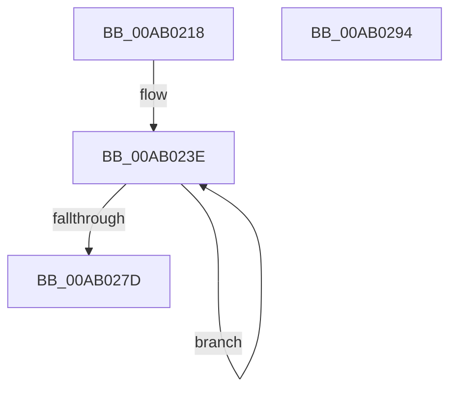

# CmDeleteDeviceMappedPropertyForAllDriverKeyRegValues

- RVA: `0x00AB0218`–`0x00AB0295` (길이 `125` bytes)
- VA: `0x0000000140AB0218`
- 실행 섹션: `PAGE`
- PDB 이름 있음: `예`; PDB Function 태그: `아니요`
- unwind 정보 RVA: `0x0006F874`
- 디코드: `32`개 명령, `125/125` bytes 표시
- 미해석 바이트: `0` (있으면 어셈블리에 `.byte`로 보존)

> 이 문서는 커널 이미지의 기계어와 PDB 기호를 분석해 생성했습니다. 4번과 5번은 함수 원형과 자료형을 바이너리 사용 방식에서 추정한 C 해석이며 원본 소스 복구 결과는 아닙니다.

## 1. Dependencies

- 직접 호출 지점: **1**; 고유 호출 대상: **1**
- 직접 호출자로 확인된 함수: **1**
- RIP 상대 이미지 참조: **1**

### Outgoing calls
- `0x00AB026E` → [PnpSetObjectProperty](../8F/PnpSetObjectProperty_function_008F66E8.md) (function, `0x008F66E8`)

### Direct callers
- [sub_00B47098](../B4/Unknown_function_00B47098.md) at `0x00B4714B`

### Static image references
- `0x00AB022F` → RVA `0x00B4E6D0` (`PAGE`; read)

## 2. Other-region calls and transfers

- 다른 실행 섹션으로 향하는 call: **0**
- 별도 외부 분기/꼬리 이동을 확인하지 못했습니다.

## 3. Assembly (complete function range)

```asm
00AB0218  48 89 5C 24 08                  mov qword ptr [rsp + 8], rbx
00AB021D  48 89 6C 24 10                  mov qword ptr [rsp + 0x10], rbp
00AB0222  48 89 74 24 18                  mov qword ptr [rsp + 0x18], rsi
00AB0227  57                              push rdi
00AB0228  48 83 EC 50                     sub rsp, 0x50
00AB022C  48 8B F2                        mov rsi, rdx
00AB022F  48 8D 1D 9A E4 09 00            lea rbx, [rip + 0x9e49a]
00AB0236  48 8B E9                        mov rbp, rcx
00AB0239  BF 0D 00 00 00                  mov edi, 0xd
00AB023E  83 64 24 48 00                  and dword ptr [rsp + 0x48], 0
00AB0243  45 33 C9                        xor r9d, r9d
00AB0246  83 64 24 40 00                  and dword ptr [rsp + 0x40], 0
00AB024B  48 8B D6                        mov rdx, rsi
00AB024E  48 83 64 24 38 00               and qword ptr [rsp + 0x38], 0
00AB0254  48 8B CD                        mov rcx, rbp
00AB0257  48 8B 03                        mov rax, qword ptr [rbx]
00AB025A  83 64 24 30 00                  and dword ptr [rsp + 0x30], 0
00AB025F  45 8D 41 01                     lea r8d, [r9 + 1]
00AB0263  48 89 44 24 28                  mov qword ptr [rsp + 0x28], rax
00AB0268  48 83 64 24 20 00               and qword ptr [rsp + 0x20], 0
00AB026E  E8 75 64 E4 FF                  call 0x1408f66e8
00AB0273  48 8D 5B 20                     lea rbx, [rbx + 0x20]
00AB0277  48 83 EF 01                     sub rdi, 1
00AB027B  75 C1                           jne 0x140ab023e
00AB027D  48 8B 5C 24 60                  mov rbx, qword ptr [rsp + 0x60]
00AB0282  33 C0                           xor eax, eax
00AB0284  48 8B 6C 24 68                  mov rbp, qword ptr [rsp + 0x68]
00AB0289  48 8B 74 24 70                  mov rsi, qword ptr [rsp + 0x70]
00AB028E  48 83 C4 50                     add rsp, 0x50
00AB0292  5F                              pop rdi
00AB0293  C3                              ret
00AB0294  CC                              int3
```

## 4. C-style interpretation (structured pseudocode)

```c
__int64 __fastcall CmDeleteDeviceMappedPropertyForAllDriverKeyRegValues(__int64 a1, __int64 a2, __int64 a3, int a4)
{
    __int64 result;
    __int64 v_rdi;
    __int64 v_rsp;
    unsigned int v_stack_m10;
    unsigned int v_stack_m18;
    unsigned __int64 v_stack_m20;
    unsigned int v_stack_m28;
    unsigned __int64 v_stack_m30;
    unsigned __int64 v_stack_m38;
    unsigned __int64 v_stack_p10;
    unsigned __int64 v_stack_p18;
    unsigned __int64 v_stack_p8;

    v_stack_p8 = v_rbx;
    v_stack_p10 = v_rbp;
    v_stack_p18 = v_rsi;
    v_rsp = (v_rsp) - (80);
loc_00AB023E:
    a4 = 0;
    v_stack_m30 = *(unsigned __int64 *)(v_rip + 648346);
    result = PnpSetObjectProperty(a1, a2, a4 + 1, a4);
    v_rdi = (13) - (1);
    if (condition_is_not_equal) goto loc_00AB023E;
    result = 0;
    v_rsp = (v_rsp) + (80);
    return result;
}
```

## 5. (Beta) C Style

```c
int64_t CmDeleteDeviceMappedPropertyForAllDriverKeyRegValues(int64_t Arg1, int64_t Arg2, int64_t Arg3, int32_t Arg4)
{
    int64_t result;
    int64_t local_rdi;
    int64_t local_rsp;
    uint32_t v_stack_m10;
    uint32_t v_stack_m18;
    uint64_t v_stack_m20;
    uint32_t v_stack_m28;
    uint64_t v_stack_m30;
    uint64_t v_stack_m38;
    uint64_t v_stack_p10;
    uint64_t v_stack_p18;
    uint64_t v_stack_p8;

    v_stack_p8 = local_rbx;
    v_stack_p10 = local_rbp;
    v_stack_p18 = local_rsi;
    local_rsp = (local_rsp) - (80);
loc_00AB023E:
    Arg4 = 0;
    v_stack_m30 = *(uint64_t *)(v_rip + 0x9E49A);
    result = PnpSetObjectProperty(Arg1, Arg2, Arg4 + 1, Arg4);
    local_rdi = (13) - (1);
    if (condition_is_not_equal) goto loc_00AB023E;
    result = 0;
    local_rsp = (local_rsp) + (80);
    return result;
}
```

## 6. Execution-region graph

[열기: 2D/3D 그래프와 함수 탐색 컨트롤 패널](../../../control-panel.html?section=page&rva=0x00AB0218&view=graph)

- 2D 그래프는 위에서 아래로 흐르고, 3D 그래프는 빈 공간을 드래그해 회전합니다. Shift+드래그는 이동, 휠은 확대·축소, 함수 노드 선택은 대상 보고서 이동입니다.

### Static fallback


