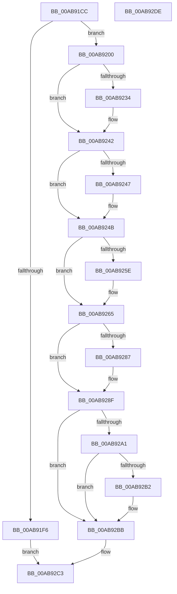

# CmFcManagerRegisterFeatureConfigurationChangeNotification

- RVA: `0x00AB91CC`–`0x00AB92DF` (길이 `275` bytes)
- VA: `0x0000000140AB91CC`
- 실행 섹션: `PAGE`
- PDB 이름 있음: `예`; PDB Function 태그: `아니요`
- unwind 정보 RVA: `0x00060300`
- 디코드: `73`개 명령, `275/275` bytes 표시
- 미해석 바이트: `0` (있으면 어셈블리에 `.byte`로 보존)

> 이 문서는 커널 이미지의 기계어와 PDB 기호를 분석해 생성했습니다. 4번과 5번은 함수 원형과 자료형을 바이너리 사용 방식에서 추정한 C 해석이며 원본 소스 복구 결과는 아닙니다.

## 1. Dependencies

- 직접 호출 지점: **8**; 고유 호출 대상: **8**
- 직접 호출자로 확인된 함수: **1**
- RIP 상대 이미지 참조: **6**

### Outgoing calls
- `0x00AB91E7` → [CmFcpManagerAllocateChangeSubscription](CmFcpManagerAllocateChangeSubscription_function_00AB92E8.md) (function, `0x00AB92E8`)
- `0x00AB9224` → [KeAbPreAcquire](../../text/21/KeAbPreAcquire_function_00210230.md) (function, `0x00210230`)
- `0x00AB923D` → [ExfAcquirePushLockExclusiveEx](../../text/20/ExfAcquirePushLockExclusiveEx_function_0020FC90.md) (function, `0x0020FC90`)
- `0x00AB928A` → [ExfTryToWakePushLock](../../text/26/ExfTryToWakePushLock_function_00265DD0.md) (function, `0x00265DD0`)
- `0x00AB9292` → [KeAbPostRelease](../../text/2E/KeAbPostRelease_function_002E1600.md) (function, `0x002E1600`)
- `0x00AB9297` → [KeLeaveCriticalRegion](../../text/25/KeLeaveCriticalRegion_function_0025D8B0.md) (function, `0x0025D8B0`)
- `0x00AB92A8` → [CsanRead64NoCheck](../../text/4C/CsanRead64NoCheck_function_004C82C0.md) (function, `0x004C82C0`)
- `0x00AB92B6` → [CmpWorkItemQueueWork](../../text/37/CmpWorkItemQueueWork_function_00378D4C.md) (function, `0x00378D4C`)

### Direct callers
- [CmFcRegisterFeatureConfigurationChangeNotification](../70/CmFcRegisterFeatureConfigurationChangeNotification_function_007045C4.md) at `0x007045D6`

### Static image references
- `0x00AB9209` → RVA `0x00EF7558` (`.data`; read)
- `0x00AB924B` → RVA `0x00EF7568` (`.data`; read)
- `0x00AB9252` → RVA `0x00EF7560` (`.data`; read)
- `0x00AB926F` → RVA `0x00EF7568` (`.data`; write)
- `0x00AB9276` → RVA `0x00EF7558` (`.data`; read/write)
- `0x00AB92A1` → RVA `0x00EF72F8` (`.data`; read)

## 2. Other-region calls and transfers

- 다른 실행 섹션으로 향하는 call: **7**
  - `0x00AB9224` → [KeAbPreAcquire](../../text/21/KeAbPreAcquire_function_00210230.md) (`PAGE` → `.text`)
  - `0x00AB923D` → [ExfAcquirePushLockExclusiveEx](../../text/20/ExfAcquirePushLockExclusiveEx_function_0020FC90.md) (`PAGE` → `.text`)
  - `0x00AB928A` → [ExfTryToWakePushLock](../../text/26/ExfTryToWakePushLock_function_00265DD0.md) (`PAGE` → `.text`)
  - `0x00AB9292` → [KeAbPostRelease](../../text/2E/KeAbPostRelease_function_002E1600.md) (`PAGE` → `.text`)
  - `0x00AB9297` → [KeLeaveCriticalRegion](../../text/25/KeLeaveCriticalRegion_function_0025D8B0.md) (`PAGE` → `.text`)
  - `0x00AB92A8` → [CsanRead64NoCheck](../../text/4C/CsanRead64NoCheck_function_004C82C0.md) (`PAGE` → `.text`)
  - `0x00AB92B6` → [CmpWorkItemQueueWork](../../text/37/CmpWorkItemQueueWork_function_00378D4C.md) (`PAGE` → `.text`)
- 별도 외부 분기/꼬리 이동을 확인하지 못했습니다.

## 3. Assembly (complete function range)

```asm
00AB91CC  48 89 5C 24 08                  mov qword ptr [rsp + 8], rbx
00AB91D1  48 89 6C 24 10                  mov qword ptr [rsp + 0x10], rbp
00AB91D6  48 89 74 24 18                  mov qword ptr [rsp + 0x18], rsi
00AB91DB  57                              push rdi
00AB91DC  41 56                           push r14
00AB91DE  41 57                           push r15
00AB91E0  48 83 EC 20                     sub rsp, 0x20
00AB91E4  4D 8B F1                        mov r14, r9
00AB91E7  E8 FC 00 00 00                  call 0x140ab92e8
00AB91EC  33 F6                           xor esi, esi
00AB91EE  48 8B F8                        mov rdi, rax
00AB91F1  48 85 C0                        test rax, rax
00AB91F4  75 0A                           jne 0x140ab9200
00AB91F6  BE 9A 00 00 C0                  mov esi, 0xc000009a
00AB91FB  E9 C3 00 00 00                  jmp 0x140ab92c3
00AB9200  65 48 8B 04 25 88 01 00 00      mov rax, qword ptr gs:[0x188]
00AB9209  4C 8D 3D 48 E3 43 00            lea r15, [rip + 0x43e348]
00AB9210  48 83 CB FF                     or rbx, 0xffffffffffffffff
00AB9214  45 33 C0                        xor r8d, r8d
00AB9217  33 D2                           xor edx, edx
00AB9219  49 8B CF                        mov rcx, r15
00AB921C  66 01 98 E4 01 00 00            add word ptr [rax + 0x1e4], bx
00AB9223  90                              nop
00AB9224  E8 07 70 75 FF                  call 0x140210230
00AB9229  F0 49 0F BA 2F 00               lock bts qword ptr [r15], 0
00AB922F  48 8B E8                        mov rbp, rax
00AB9232  73 0E                           jae 0x140ab9242
00AB9234  4D 8B C7                        mov r8, r15
00AB9237  48 8B D0                        mov rdx, rax
00AB923A  49 8B CF                        mov rcx, r15
00AB923D  E8 4E 6A 75 FF                  call 0x14020fc90
00AB9242  48 85 ED                        test rbp, rbp
00AB9245  74 04                           je 0x140ab924b
00AB9247  C6 45 0A 01                     mov byte ptr [rbp + 0xa], 1
00AB924B  48 8B 05 16 E3 43 00            mov rax, qword ptr [rip + 0x43e316]
00AB9252  48 8D 0D 07 E3 43 00            lea rcx, [rip + 0x43e307]
00AB9259  48 39 08                        cmp qword ptr [rax], rcx
00AB925C  74 07                           je 0x140ab9265
00AB925E  B9 03 00 00 00                  mov ecx, 3
00AB9263  CD 29                           int 0x29
00AB9265  48 89 0F                        mov qword ptr [rdi], rcx
00AB9268  48 89 47 08                     mov qword ptr [rdi + 8], rax
00AB926C  48 89 38                        mov qword ptr [rax], rdi
00AB926F  48 89 3D F2 E2 43 00            mov qword ptr [rip + 0x43e2f2], rdi
00AB9276  F0 48 0F C1 1D D9 E2 43 00      lock xadd qword ptr [rip + 0x43e2d9], rbx
00AB927F  80 E3 06                        and bl, 6
00AB9282  80 FB 02                        cmp bl, 2
00AB9285  75 08                           jne 0x140ab928f
00AB9287  49 8B CF                        mov rcx, r15
00AB928A  E8 41 CB 7A FF                  call 0x140265dd0
00AB928F  49 8B CF                        mov rcx, r15
00AB9292  E8 69 83 82 FF                  call 0x1402e1600
00AB9297  E8 14 46 7A FF                  call 0x14025d8b0
00AB929C  4D 85 F6                        test r14, r14
00AB929F  74 1A                           je 0x140ab92bb
00AB92A1  48 8D 0D 50 E0 43 00            lea rcx, [rip + 0x43e050]
00AB92A8  E8 13 F0 A0 FF                  call 0x1404c82c0
00AB92AD  49 3B 06                        cmp rax, qword ptr [r14]
00AB92B0  74 09                           je 0x140ab92bb
00AB92B2  48 8D 4F 10                     lea rcx, [rdi + 0x10]
00AB92B6  E8 91 FA 8B FF                  call 0x140378d4c
00AB92BB  48 8B 4C 24 60                  mov rcx, qword ptr [rsp + 0x60]
00AB92C0  48 89 39                        mov qword ptr [rcx], rdi
00AB92C3  48 8B 5C 24 40                  mov rbx, qword ptr [rsp + 0x40]
00AB92C8  8B C6                           mov eax, esi
00AB92CA  48 8B 74 24 50                  mov rsi, qword ptr [rsp + 0x50]
00AB92CF  48 8B 6C 24 48                  mov rbp, qword ptr [rsp + 0x48]
00AB92D4  48 83 C4 20                     add rsp, 0x20
00AB92D8  41 5F                           pop r15
00AB92DA  41 5E                           pop r14
00AB92DC  5F                              pop rdi
00AB92DD  C3                              ret
00AB92DE  CC                              int3
```

## 4. C-style interpretation (structured pseudocode)

```c
__int64 __fastcall CmFcManagerRegisterFeatureConfigurationChangeNotification(__int64 a1, int a2, int a3, __int64 a4, __int64 a5)
{
    __int64 result;
    __int64 v_rbx;
    __int64 v_rsi;
    __int64 v_rsp;
    unsigned __int64 v_stack_p10;
    unsigned __int64 v_stack_p18;
    unsigned __int64 v_stack_p8;

    v_stack_p8 = v_rbx;
    v_stack_p10 = v_rbp;
    v_stack_p18 = v_rsi;
    v_rsp = (v_rsp) - (32);
    result = CmFcpManagerAllocateChangeSubscription(a1, a2, a3, a4);
    v_rsi = 0;
    if (result != 0) goto loc_00AB9200;
    goto loc_00AB92C3;
loc_00AB9200:
    v_rbx = (v_rbx) | (-1);
    a3 = 0;
    a2 = 0;
    result = KeAbPreAcquire(v_rip + 4449096, a2, a3, a4);
    if (!(condition_is_above_or_equal)) {
        a3 = v_rip + 4449096;
        a2 = result;
        a1 = v_rip + 4449096;
        result = ExfAcquirePushLockExclusiveEx(a1, a2, a3, a4);
    }
    if (result != 0) {
        *(unsigned __int8 *)(result + 10) = 1;
    }
    if ((*(unsigned __int64 *)(*(unsigned __int64 *)(v_rip + 4449046))) != (v_rip + 4449031)) {
        a1 = 3;
    }
    *(unsigned __int64 *)(result) = a1;
    *(unsigned __int64 *)(result + 8) = *(unsigned __int64 *)(v_rip + 4449046);
    *(unsigned __int64 *)(*(unsigned __int64 *)(v_rip + 4449046)) = result;
    *(unsigned __int64 *)(v_rip + 4449010) = result;
    v_rbx = (unsigned __int8)((v_rbx) & (6));
    result = *(unsigned __int64 *)(v_rip + 4449046);
    if (((unsigned __int8)(v_rbx)) == 2) {
        a1 = v_rip + 4449096;
        result = ExfTryToWakePushLock(a1, a2, a3, a4);
    }
    result = KeAbPostRelease(v_rip + 4449096, a2, a3, a4);
    result = KeLeaveCriticalRegion(v_rip + 4449096, a2, a3, a4);
    if (a4 == 0) goto loc_00AB92BB;
    result = CsanRead64NoCheck(v_rip + 4448336, a2, a3, a4);
    if (result != (*(unsigned __int64 *)(a4))) {
        a1 = result + 16;
        result = CmpWorkItemQueueWork(a1, a2, a3, a4);
    }
    *(unsigned __int64 *)(a5) = result;
loc_00AB92C3:
    v_rsp = (v_rsp) + (32);
    return (unsigned int)((unsigned int)((unsigned int)(0xC000009AULL)));
}
```

## 5. (Beta) C Style

```c
int64_t CmFcManagerRegisterFeatureConfigurationChangeNotification(int64_t Arg1, int32_t Arg2, int32_t Arg3, int64_t Arg4, void *Arg5)
{
    uint8_t *arg5 = (uint8_t *)Arg5;

    int64_t result;
    int64_t local_rbx;
    int64_t local_rsi;
    int64_t local_rsp;
    uint64_t v_stack_p10;
    uint64_t v_stack_p18;
    uint64_t v_stack_p8;

    v_stack_p8 = local_rbx;
    v_stack_p10 = local_rbp;
    v_stack_p18 = local_rsi;
    local_rsp = (local_rsp) - (32);
    result = CmFcpManagerAllocateChangeSubscription(Arg1, Arg2, Arg3, Arg4);
    local_rsi = 0;
    if (result != 0) goto loc_00AB9200;
    goto loc_00AB92C3;
loc_00AB9200:
    local_rbx = (local_rbx) | (-1);
    Arg3 = 0;
    Arg2 = 0;
    result = KeAbPreAcquire(v_rip + 4449096, Arg2, Arg3, Arg4);
    if (!(condition_is_above_or_equal)) {
        Arg3 = v_rip + 4449096;
        Arg2 = result;
        Arg1 = v_rip + 4449096;
        result = ExfAcquirePushLockExclusiveEx(Arg1, Arg2, Arg3, Arg4);
    }
    if (result != 0) {
        *(uint8_t *)(result + 0xA) = 1;
    }
    if ((*(uint64_t *)(*(uint64_t *)(v_rip + 0x43E316))) != (v_rip + 4449031)) {
        Arg1 = 3;
    }
    *(uint64_t *)(result) = Arg1;
    *(uint64_t *)(result + 0x8) = *(uint64_t *)(v_rip + 0x43E316);
    *(uint64_t *)(*(uint64_t *)(v_rip + 0x43E316)) = result;
    *(uint64_t *)(v_rip + 0x43E2F2) = result;
    local_rbx = (uint8_t)((local_rbx) & (6));
    result = *(uint64_t *)(v_rip + 0x43E316);
    if (((uint8_t)(local_rbx)) == 2) {
        Arg1 = v_rip + 4449096;
        result = ExfTryToWakePushLock(Arg1, Arg2, Arg3, Arg4);
    }
    result = KeAbPostRelease(v_rip + 4449096, Arg2, Arg3, Arg4);
    result = KeLeaveCriticalRegion(v_rip + 4449096, Arg2, Arg3, Arg4);
    if (Arg4 == 0) goto loc_00AB92BB;
    result = CsanRead64NoCheck(v_rip + 4448336, Arg2, Arg3, Arg4);
    if (result != (*(uint64_t *)(Arg4))) {
        Arg1 = result + 16;
        result = CmpWorkItemQueueWork(Arg1, Arg2, Arg3, Arg4);
    }
    *(uint64_t *)(arg5) = result;
loc_00AB92C3:
    local_rsp = (local_rsp) + (32);
    return (uint32_t)((uint32_t)((uint32_t)(0xC000009AULL)));
}
```

### 관측된 메모리 오프셋

구조체 형식이 확인되지 않은 접근은 인자 기준의 오프셋으로만 기록했습니다.

| 기준 인자 | 오프셋 표현 | 폭 (bit) | 접근 |
|---|---:|---:|---|
| `Arg5` | `+ 0x0` | `64` | `W` |

## 6. Execution-region graph

[열기: 2D/3D 그래프와 함수 탐색 컨트롤 패널](../../../control-panel.html?section=page&rva=0x00AB91CC&view=graph)

- 2D 그래프는 위에서 아래로 흐르고, 3D 그래프는 빈 공간을 드래그해 회전합니다. Shift+드래그는 이동, 휠은 확대·축소, 함수 노드 선택은 대상 보고서 이동입니다.

### Static fallback


