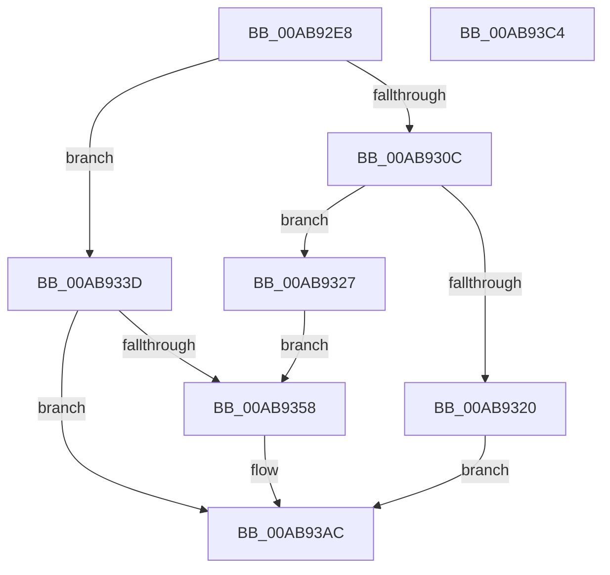

# CmFcpManagerAllocateChangeSubscription

- RVA: `0x00AB92E8`–`0x00AB93C5` (길이 `221` bytes)
- VA: `0x0000000140AB92E8`
- 실행 섹션: `PAGE`
- PDB 이름 있음: `예`; PDB Function 태그: `아니요`
- unwind 정보 RVA: `0x0005C954`
- 디코드: `58`개 명령, `221/221` bytes 표시
- 미해석 바이트: `0` (있으면 어셈블리에 `.byte`로 보존)

> 이 문서는 커널 이미지의 기계어와 PDB 기호를 분석해 생성했습니다. 4번과 5번은 함수 원형과 자료형을 바이너리 사용 방식에서 추정한 C 해석이며 원본 소스 복구 결과는 아닙니다.

## 1. Dependencies

- 직접 호출 지점: **2**; 고유 호출 대상: **2**
- 직접 호출자로 확인된 함수: **1**
- RIP 상대 이미지 참조: **5**

### Outgoing calls
- `0x00AB934B` → [ExAllocatePool2](../../poolcode/B8/ExAllocatePool2_function_00B820F0.md) (function, `0x00B820F0`)
- `0x00AB9371` → [memset](../../text/6C/memset_function_006C6C40.md) (function, `0x006C6C40`)

### Direct callers
- [CmFcManagerRegisterFeatureConfigurationChangeNotification](CmFcManagerRegisterFeatureConfigurationChangeNotification_function_00AB91CC.md) at `0x00AB91E7`

### Static image references
- `0x00AB92FC` → RVA `0x00EF747A` (`.data`; read)
- `0x00AB9311` → RVA `0x00EF747C` (`.data`; read/write)
- `0x00AB9331` → RVA `0x00EF7570` (`.data`; read)
- `0x00AB937A` → RVA `0x0049F4E0` (`CmpWorkItemWrapper`; read)
- `0x00AB9385` → RVA `0x007F52F0` (`CmFcpChangeSubscriptionWrapper`; read)

## 2. Other-region calls and transfers

- 다른 실행 섹션으로 향하는 call: **2**
  - `0x00AB934B` → [ExAllocatePool2](../../poolcode/B8/ExAllocatePool2_function_00B820F0.md) (`PAGE` → `POOLCODE`)
  - `0x00AB9371` → [memset](../../text/6C/memset_function_006C6C40.md) (`PAGE` → `.text`)
- 별도 외부 분기/꼬리 이동을 확인하지 못했습니다.

## 3. Assembly (complete function range)

```asm
00AB92E8  48 89 5C 24 08                  mov qword ptr [rsp + 8], rbx
00AB92ED  48 89 6C 24 10                  mov qword ptr [rsp + 0x10], rbp
00AB92F2  48 89 74 24 18                  mov qword ptr [rsp + 0x18], rsi
00AB92F7  57                              push rdi
00AB92F8  48 83 EC 20                     sub rsp, 0x20
00AB92FC  8A 05 78 E1 43 00               mov al, byte ptr [rip + 0x43e178]
00AB9302  49 8B F0                        mov rsi, r8
00AB9305  48 8B EA                        mov rbp, rdx
00AB9308  84 C0                           test al, al
00AB930A  75 31                           jne 0x140ab933d
00AB930C  B8 01 00 00 00                  mov eax, 1
00AB9311  F0 0F C1 05 63 E1 43 00         lock xadd dword ptr [rip + 0x43e163], eax
00AB9319  FF C0                           inc eax
00AB931B  83 F8 03                        cmp eax, 3
00AB931E  76 07                           jbe 0x140ab9327
00AB9320  33 FF                           xor edi, edi
00AB9322  E9 85 00 00 00                  jmp 0x140ab93ac
00AB9327  FF C8                           dec eax
00AB9329  48 8D 3C 40                     lea rdi, [rax + rax*2]
00AB932D  48 C1 E7 05                     shl rdi, 5
00AB9331  48 8D 05 38 E2 43 00            lea rax, [rip + 0x43e238]
00AB9338  48 03 F8                        add rdi, rax
00AB933B  EB 1B                           jmp 0x140ab9358
00AB933D  BA 60 00 00 00                  mov edx, 0x60
00AB9342  41 B8 43 6D 46 63               mov r8d, 0x63466d43
00AB9348  8D 4A E0                        lea ecx, [rdx - 0x20]
00AB934B  E8 A0 8D 0C 00                  call 0x140b820f0
00AB9350  48 8B F8                        mov rdi, rax
00AB9353  48 85 C0                        test rax, rax
00AB9356  74 54                           je 0x140ab93ac
00AB9358  33 C0                           xor eax, eax
00AB935A  48 8D 5F 10                     lea rbx, [rdi + 0x10]
00AB935E  0F 57 C0                        xorps xmm0, xmm0
00AB9361  33 D2                           xor edx, edx
00AB9363  0F 11 07                        movups xmmword ptr [rdi], xmm0
00AB9366  48 8B CB                        mov rcx, rbx
00AB9369  48 89 47 58                     mov qword ptr [rdi + 0x58], rax
00AB936D  44 8D 40 40                     lea r8d, [rax + 0x40]
00AB9371  E8 CA D8 C0 FF                  call 0x1406c6c40
00AB9376  48 83 23 00                     and qword ptr [rbx], 0
00AB937A  48 8D 05 5F 61 9E FF            lea rax, [rip - 0x619ea1]
00AB9381  48 89 43 10                     mov qword ptr [rbx + 0x10], rax
00AB9385  48 8D 05 64 BF D3 FF            lea rax, [rip - 0x2c409c]
00AB938C  48 89 5B 18                     mov qword ptr [rbx + 0x18], rbx
00AB9390  83 63 28 00                     and dword ptr [rbx + 0x28], 0
00AB9394  48 83 63 20 00                  and qword ptr [rbx + 0x20], 0
00AB9399  48 89 43 30                     mov qword ptr [rbx + 0x30], rax
00AB939D  C7 43 2C 04 00 00 00            mov dword ptr [rbx + 0x2c], 4
00AB93A4  48 89 73 38                     mov qword ptr [rbx + 0x38], rsi
00AB93A8  48 89 6F 50                     mov qword ptr [rdi + 0x50], rbp
00AB93AC  48 8B 5C 24 30                  mov rbx, qword ptr [rsp + 0x30]
00AB93B1  48 8B C7                        mov rax, rdi
00AB93B4  48 8B 6C 24 38                  mov rbp, qword ptr [rsp + 0x38]
00AB93B9  48 8B 74 24 40                  mov rsi, qword ptr [rsp + 0x40]
00AB93BE  48 83 C4 20                     add rsp, 0x20
00AB93C2  5F                              pop rdi
00AB93C3  C3                              ret
00AB93C4  CC                              int3
```

## 4. C-style interpretation (structured pseudocode)

```c
__int64 __fastcall CmFcpManagerAllocateChangeSubscription(__int64 a1, __int64 a2, __int64 a3)
{
    __int64 result;
    __int64 v_rbx;
    __int64 v_rdi;
    __int64 v_rsp;
    unsigned __int64 v_stack_p10;
    unsigned __int64 v_stack_p18;
    unsigned __int64 v_stack_p8;

    v_stack_p8 = v_rbx;
    v_stack_p10 = v_rbp;
    v_stack_p18 = v_rsi;
    v_rsp = (v_rsp) - (32);
    if ((unsigned __int8)(*(unsigned __int8 *)(v_rip + 4448632)) != 0) goto loc_00AB933D;
    result = (unsigned int)((1) + 1);
    if (((unsigned int)(result)) <= 3) goto loc_00AB9327;
    v_rdi = 0;
    goto loc_00AB93AC;
loc_00AB9327:
    result = (unsigned int)((result) - 1);
    v_rdi = (result + result * 2) << (5);
    v_rdi = (v_rdi) + (v_rip + 4448824);
    goto loc_00AB9358;
loc_00AB933D:
    result = ExAllocatePool2(96 - 32, 96, (unsigned int)(0x63466D43ULL), a4);
    if (result != 0) {
        result = 0;
        v_rbx = result + 16;
        a2 = 0;
        *(unsigned __int64 *)(result) = v_xmm0;
        a1 = v_rbx;
        *(unsigned __int64 *)(result + 88) = 0;
        a3 = result + 64;
        result = memset(a1, a2, a3, a4);
        result = v_rip - 6397601;
        *(unsigned __int64 *)(v_rbx + 16) = result;
        result = v_rip - 2900124;
        *(unsigned __int64 *)(v_rbx + 24) = v_rbx;
        *(unsigned __int64 *)(v_rbx + 48) = result;
        *(unsigned int *)(v_rbx + 44) = 4;
        *(unsigned __int64 *)(v_rbx + 56) = a3;
        *(unsigned __int64 *)(result + 80) = 0;
    }
    v_rsp = (v_rsp) + (32);
    return result;
}
```

## 5. (Beta) C Style

```c
int64_t CmFcpManagerAllocateChangeSubscription(int64_t Arg1, int64_t Arg2, int64_t Arg3)
{
    int64_t result;
    int64_t local_rbx;
    int64_t local_rdi;
    int64_t local_rsp;
    uint64_t v_stack_p10;
    uint64_t v_stack_p18;
    uint64_t v_stack_p8;

    v_stack_p8 = local_rbx;
    v_stack_p10 = local_rbp;
    v_stack_p18 = local_rsi;
    local_rsp = (local_rsp) - (32);
    if ((uint8_t)(*(uint8_t *)(v_rip + 0x43E178)) != 0) goto loc_00AB933D;
    result = (uint32_t)((1) + 1);
    if (((uint32_t)(result)) <= 3) goto loc_00AB9327;
    local_rdi = 0;
    goto loc_00AB93AC;
loc_00AB9327:
    result = (uint32_t)((result) - 1);
    local_rdi = (result + result * 2) << (5);
    local_rdi = (local_rdi) + (v_rip + 4448824);
    goto loc_00AB9358;
loc_00AB933D:
    result = ExAllocatePool2(96 - 32, 96, (uint32_t)(0x63466D43ULL), a4);
    if (result != 0) {
        result = 0;
        local_rbx = result + 16;
        Arg2 = 0;
        *(uint64_t *)(result) = v_xmm0;
        Arg1 = local_rbx;
        *(uint64_t *)(result + 0x58) = 0;
        Arg3 = result + 64;
        result = memset(Arg1, Arg2, Arg3, a4);
        result = v_rip - 6397601;
        *(uint64_t *)(local_rbx + 0x10) = result;
        result = v_rip - 2900124;
        *(uint64_t *)(local_rbx + 0x18) = local_rbx;
        *(uint64_t *)(local_rbx + 0x30) = result;
        *(uint32_t *)(local_rbx + 0x2C) = 4;
        *(uint64_t *)(local_rbx + 0x38) = Arg3;
        *(uint64_t *)(result + 0x50) = 0;
    }
    local_rsp = (local_rsp) + (32);
    return result;
}
```

## 6. Execution-region graph

[열기: 2D/3D 그래프와 함수 탐색 컨트롤 패널](../../../control-panel.html?section=page&rva=0x00AB92E8&view=graph)

- 2D 그래프는 위에서 아래로 흐르고, 3D 그래프는 빈 공간을 드래그해 회전합니다. Shift+드래그는 이동, 휠은 확대·축소, 함수 노드 선택은 대상 보고서 이동입니다.

### Static fallback


