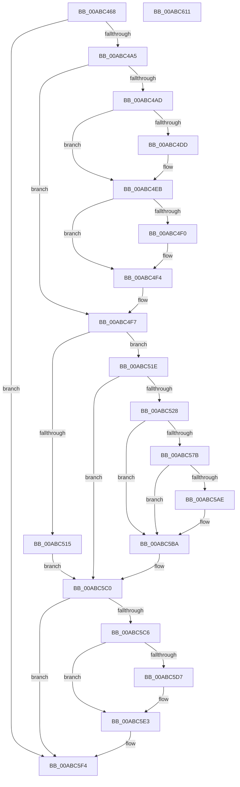

# CmFcpManagerPublishFeatureUsageData

- RVA: `0x00ABC468`–`0x00ABC612` (길이 `426` bytes)
- VA: `0x0000000140ABC468`
- 실행 섹션: `PAGE`
- PDB 이름 있음: `예`; PDB Function 태그: `아니요`
- unwind 정보 RVA: `0x0005D79C`
- 디코드: `106`개 명령, `426/426` bytes 표시
- 미해석 바이트: `0` (있으면 어셈블리에 `.byte`로 보존)

> 이 문서는 커널 이미지의 기계어와 PDB 기호를 분석해 생성했습니다. 4번과 5번은 함수 원형과 자료형을 바이너리 사용 방식에서 추정한 C 해석이며 원본 소스 복구 결과는 아닙니다.

## 1. Dependencies

- 직접 호출 지점: **11**; 고유 호출 대상: **11**
- 직접 호출자로 확인된 함수: **4**
- RIP 상대 이미지 참조: **0**

### Outgoing calls
- `0x00ABC4CD` → [KeAbPreAcquire](../../text/21/KeAbPreAcquire_function_00210230.md) (function, `0x00210230`)
- `0x00ABC4E6` → [ExfAcquirePushLockExclusiveEx](../../text/20/ExfAcquirePushLockExclusiveEx_function_0020FC90.md) (function, `0x0020FC90`)
- `0x00ABC556` → [RtlpFcSizeOfFeatureUsageDataBuffer](../../text/5F/RtlpFcSizeOfFeatureUsageDataBuffer_function_005F0E04.md) (function, `0x005F0E04`)
- `0x00ABC56E` → [ExAllocatePool2](../../poolcode/B8/ExAllocatePool2_function_00B820F0.md) (function, `0x00B820F0`)
- `0x00ABC583` → [RtlZeroMemory](../../text/4B/RtlZeroMemory_function_004BE6F0.md) (function, `0x004BE6F0`)
- `0x00ABC59A` → [RtlUpdateSwapReference](../A4/RtlUpdateSwapReference_function_00A45260.md) (function, `0x00A45260`)
- `0x00ABC5A5` → [CmFcpManagerAddBufferIntoPublishListAndSetPublishState](../7F/CmFcpManagerAddBufferIntoPublishListAndSetPublishState_function_007F53F0.md) (function, `0x007F53F0`)
- `0x00ABC5B5` → [CmpWorkItemQueueWork](../../text/37/CmpWorkItemQueueWork_function_00378D4C.md) (function, `0x00378D4C`)
- `0x00ABC5DE` → [ExfTryToWakePushLock](../../text/26/ExfTryToWakePushLock_function_00265DD0.md) (function, `0x00265DD0`)
- `0x00ABC5EA` → [KeAbPostRelease](../../text/2E/KeAbPostRelease_function_002E1600.md) (function, `0x002E1600`)
- `0x00ABC5EF` → [KeLeaveCriticalRegion](../../text/25/KeLeaveCriticalRegion_function_0025D8B0.md) (function, `0x0025D8B0`)

### Direct callers
- [CmFcShutdownSystem](../7E/CmFcShutdownSystem_function_007E5BC4.md) at `0x007E5BE4`
- [CmFcpManagerPublishFeatureUsageDataIfNearCapacity](../7F/CmFcpManagerPublishFeatureUsageDataIfNearCapacity_function_007F5548.md) at `0x007F5649`
- [CmFcpManagerProcessUsageDataProviders](../AF/CmFcpManagerProcessUsageDataProviders_function_00AF7B6C.md) at `0x00AF7D22`
- [CmFcManagerStartRuntimePhase](../../init/C5/CmFcManagerStartRuntimePhase_function_00C5DC70.md) at `0x00C5E19E`

### Static image references
- 디코드된 RIP-relative 메모리 참조가 없습니다.

## 2. Other-region calls and transfers

- 다른 실행 섹션으로 향하는 call: **9**
  - `0x00ABC4CD` → [KeAbPreAcquire](../../text/21/KeAbPreAcquire_function_00210230.md) (`PAGE` → `.text`)
  - `0x00ABC4E6` → [ExfAcquirePushLockExclusiveEx](../../text/20/ExfAcquirePushLockExclusiveEx_function_0020FC90.md) (`PAGE` → `.text`)
  - `0x00ABC556` → [RtlpFcSizeOfFeatureUsageDataBuffer](../../text/5F/RtlpFcSizeOfFeatureUsageDataBuffer_function_005F0E04.md) (`PAGE` → `.text`)
  - `0x00ABC56E` → [ExAllocatePool2](../../poolcode/B8/ExAllocatePool2_function_00B820F0.md) (`PAGE` → `POOLCODE`)
  - `0x00ABC583` → [RtlZeroMemory](../../text/4B/RtlZeroMemory_function_004BE6F0.md) (`PAGE` → `.text`)
  - `0x00ABC5B5` → [CmpWorkItemQueueWork](../../text/37/CmpWorkItemQueueWork_function_00378D4C.md) (`PAGE` → `.text`)
  - `0x00ABC5DE` → [ExfTryToWakePushLock](../../text/26/ExfTryToWakePushLock_function_00265DD0.md) (`PAGE` → `.text`)
  - `0x00ABC5EA` → [KeAbPostRelease](../../text/2E/KeAbPostRelease_function_002E1600.md) (`PAGE` → `.text`)
  - `0x00ABC5EF` → [KeLeaveCriticalRegion](../../text/25/KeLeaveCriticalRegion_function_0025D8B0.md) (`PAGE` → `.text`)
- 별도 외부 분기/꼬리 이동을 확인하지 못했습니다.

## 3. Assembly (complete function range)

```asm
00ABC468  48 89 5C 24 10                  mov qword ptr [rsp + 0x10], rbx
00ABC46D  48 89 6C 24 18                  mov qword ptr [rsp + 0x18], rbp
00ABC472  48 89 74 24 20                  mov qword ptr [rsp + 0x20], rsi
00ABC477  57                              push rdi
00ABC478  41 54                           push r12
00ABC47A  41 55                           push r13
00ABC47C  41 56                           push r14
00ABC47E  41 57                           push r15
00ABC480  48 83 EC 20                     sub rsp, 0x20
00ABC484  45 33 FF                        xor r15d, r15d
00ABC487  48 8B F9                        mov rdi, rcx
00ABC48A  41 8A EF                        mov bpl, r15b
00ABC48D  33 C0                           xor eax, eax
00ABC48F  45 8D 67 02                     lea r12d, [r15 + 2]
00ABC493  F0 44 0F B1 A1 60 07 00 00      lock cmpxchg dword ptr [rcx + 0x760], r12d
00ABC49C  83 F8 01                        cmp eax, 1
00ABC49F  0F 85 4F 01 00 00               jne 0x140abc5f4
00ABC4A5  48 83 CB FF                     or rbx, 0xffffffffffffffff
00ABC4A9  84 D2                           test dl, dl
00ABC4AB  75 4A                           jne 0x140abc4f7
00ABC4AD  65 48 8B 04 25 88 01 00 00      mov rax, qword ptr gs:[0x188]
00ABC4B6  48 8D B1 D8 05 00 00            lea rsi, [rcx + 0x5d8]
00ABC4BD  45 33 C0                        xor r8d, r8d
00ABC4C0  33 D2                           xor edx, edx
00ABC4C2  48 8B CE                        mov rcx, rsi
00ABC4C5  66 01 98 E4 01 00 00            add word ptr [rax + 0x1e4], bx
00ABC4CC  90                              nop
00ABC4CD  E8 5E 3D 75 FF                  call 0x140210230
00ABC4D2  F0 48 0F BA 2E 00               lock bts qword ptr [rsi], 0
00ABC4D8  48 8B E8                        mov rbp, rax
00ABC4DB  73 0E                           jae 0x140abc4eb
00ABC4DD  4C 8B C6                        mov r8, rsi
00ABC4E0  48 8B D0                        mov rdx, rax
00ABC4E3  48 8B CE                        mov rcx, rsi
00ABC4E6  E8 A5 37 75 FF                  call 0x14020fc90
00ABC4EB  48 85 ED                        test rbp, rbp
00ABC4EE  74 04                           je 0x140abc4f4
00ABC4F0  C6 45 0A 01                     mov byte ptr [rbp + 0xa], 1
00ABC4F4  40 B5 01                        mov bpl, 1
00ABC4F7  4C 8D B7 B0 03 00 00            lea r14, [rdi + 0x3b0]
00ABC4FE  49 8B 06                        mov rax, qword ptr [r14]
00ABC501  83 E0 01                        and eax, 1
00ABC504  48 8B B4 C7 88 05 00 00         mov rsi, qword ptr [rdi + rax*8 + 0x588]
00ABC50C  44 38 BF 58 07 00 00            cmp byte ptr [rdi + 0x758], r15b
00ABC513  75 09                           jne 0x140abc51e
00ABC515  44 89 7E 10                     mov dword ptr [rsi + 0x10], r15d
00ABC519  E9 A2 00 00 00                  jmp 0x140abc5c0
00ABC51E  44 39 7E 10                     cmp dword ptr [rsi + 0x10], r15d
00ABC522  0F 86 98 00 00 00               jbe 0x140abc5c0
00ABC528  8B 56 14                        mov edx, dword ptr [rsi + 0x14]
00ABC52B  44 8D 60 FF                     lea r12d, [rax - 1]
00ABC52F  8B 87 98 05 00 00               mov eax, dword ptr [rdi + 0x598]
00ABC535  41 83 E4 01                     and r12d, 1
00ABC539  05 FF 01 00 00                  add eax, 0x1ff
00ABC53E  03 D0                           add edx, eax
00ABC540  81 E2 00 FE FF FF               and edx, 0xfffffe00
00ABC546  89 97 98 05 00 00               mov dword ptr [rdi + 0x598], edx
00ABC54C  44 8D AA FC 01 00 00            lea r13d, [rdx + 0x1fc]
00ABC553  41 8B CD                        mov ecx, r13d
00ABC556  E8 A9 48 B3 FF                  call 0x1405f0e04
00ABC55B  48 8B D0                        mov rdx, rax
00ABC55E  48 89 44 24 50                  mov qword ptr [rsp + 0x50], rax
00ABC563  41 B8 43 6D 46 63               mov r8d, 0x63466d43
00ABC569  B9 40 00 00 00                  mov ecx, 0x40
00ABC56E  E8 7D 5B 0C 00                  call 0x140b820f0
00ABC573  4C 8B F8                        mov r15, rax
00ABC576  48 85 C0                        test rax, rax
00ABC579  74 3F                           je 0x140abc5ba
00ABC57B  48 8B 54 24 50                  mov rdx, qword ptr [rsp + 0x50]
00ABC580  48 8B C8                        mov rcx, rax
00ABC583  E8 68 21 A0 FF                  call 0x1404be6f0
00ABC588  45 89 6F 1C                     mov dword ptr [r15 + 0x1c], r13d
00ABC58C  41 8B D4                        mov edx, r12d
00ABC58F  49 8B CE                        mov rcx, r14
00ABC592  4E 89 BC E7 88 05 00 00         mov qword ptr [rdi + r12*8 + 0x588], r15
00ABC59A  E8 C1 8C F8 FF                  call 0x140a45260
00ABC59F  48 8B D6                        mov rdx, rsi
00ABC5A2  48 8B CF                        mov rcx, rdi
00ABC5A5  E8 46 8E D3 FF                  call 0x1407f53f0
00ABC5AA  3C 01                           cmp al, 1
00ABC5AC  75 0C                           jne 0x140abc5ba
00ABC5AE  48 8D 8F B0 06 00 00            lea rcx, [rdi + 0x6b0]
00ABC5B5  E8 92 C7 8B FF                  call 0x140378d4c
00ABC5BA  41 BC 02 00 00 00               mov r12d, 2
00ABC5C0  40 80 FD 01                     cmp bpl, 1
00ABC5C4  75 2E                           jne 0x140abc5f4
00ABC5C6  F0 48 0F C1 9F D8 05 00 00      lock xadd qword ptr [rdi + 0x5d8], rbx
00ABC5CF  80 E3 06                        and bl, 6
00ABC5D2  41 3A DC                        cmp bl, r12b
00ABC5D5  75 0C                           jne 0x140abc5e3
00ABC5D7  48 8D 8F D8 05 00 00            lea rcx, [rdi + 0x5d8]
00ABC5DE  E8 ED 97 7A FF                  call 0x140265dd0
00ABC5E3  48 8D 8F D8 05 00 00            lea rcx, [rdi + 0x5d8]
00ABC5EA  E8 11 50 82 FF                  call 0x1402e1600
00ABC5EF  E8 BC 12 7A FF                  call 0x14025d8b0
00ABC5F4  48 8B 5C 24 58                  mov rbx, qword ptr [rsp + 0x58]
00ABC5F9  48 8B 6C 24 60                  mov rbp, qword ptr [rsp + 0x60]
00ABC5FE  48 8B 74 24 68                  mov rsi, qword ptr [rsp + 0x68]
00ABC603  48 83 C4 20                     add rsp, 0x20
00ABC607  41 5F                           pop r15
00ABC609  41 5E                           pop r14
00ABC60B  41 5D                           pop r13
00ABC60D  41 5C                           pop r12
00ABC60F  5F                              pop rdi
00ABC610  C3                              ret
00ABC611  CC                              int3
```

## 4. C-style interpretation (structured pseudocode)

```c
__int64 __fastcall CmFcpManagerPublishFeatureUsageData(__int64 a1, int a2, int a3)
{
    __int64 result;
    __int64 v_r12;
    __int64 v_r15;
    __int64 v_rbx;
    __int64 v_rsp;
    unsigned __int64 v_stack_p10;
    unsigned __int64 v_stack_p18;
    unsigned __int64 v_stack_p20;
    unsigned __int64 v_stack_p8;

    v_stack_p10 = v_rbx;
    v_stack_p18 = v_rbp;
    v_stack_p20 = v_rsi;
    v_rsp = (v_rsp) - (32);
    v_r15 = 0;
    result = 0;
    if (0 != 1) goto loc_00ABC5F4;
    v_rbx = (v_rbx) | (-1);
    if ((unsigned __int8)(a2) != 0) goto loc_00ABC4F7;
    a3 = 0;
    a2 = 0;
    result = KeAbPreAcquire(a1 + 1496, a2, a3, a4);
    if (!(condition_is_above_or_equal)) {
        a3 = a1 + 1496;
        a2 = result;
        a1 = a1 + 1496;
        result = ExfAcquirePushLockExclusiveEx(a1, a2, a3, a4);
    }
    if (result != 0) {
        *(unsigned __int8 *)(result + 10) = 1;
    }
loc_00ABC4F7:
    result = (unsigned int)((*(unsigned __int64 *)(a1 + 944)) & (1));
    if ((*(unsigned __int8 *)(a1 + 1880)) != 0) goto loc_00ABC51E;
    *(unsigned int *)(*(unsigned __int64 *)(a1 + result * 8 + 1416) + 16) = 0;
    goto loc_00ABC5C0;
loc_00ABC51E:
    if ((*(unsigned int *)(*(unsigned __int64 *)(a1 + result * 8 + 1416) + 16)) <= 0) goto loc_00ABC5C0;
    v_r12 = (unsigned int)((result - 1) & (1));
    result = (unsigned int)(((unsigned int)(*(unsigned int *)(a1 + 1432))) + (511));
    a2 = (unsigned int)(((unsigned int)(*(unsigned int *)(*(unsigned __int64 *)(a1 + result * 8 + 1416) + 20))) + ((unsigned int)(result)));
    a2 = (unsigned int)((a2) & (0xFFFFFE00ULL));
    *(unsigned int *)(a1 + 1432) = a2;
    result = RtlpFcSizeOfFeatureUsageDataBuffer((unsigned int)((unsigned int)(a2 + 508)), a2, a3, a4);
    v_stack_p8 = result;
    result = ExAllocatePool2(64, result, (unsigned int)(0x63466D43ULL), a4);
    if (result == 0) goto loc_00ABC5BA;
    result = RtlZeroMemory(result, v_stack_p8, (unsigned int)(0x63466D43ULL), a4);
    *(unsigned int *)(result + 28) = (unsigned int)(a2 + 508);
    *(unsigned __int64 *)(a1 + v_r12 * 8 + 1416) = result;
    result = RtlUpdateSwapReference(a1 + 944, (unsigned int)((unsigned int)(v_r12)), (unsigned int)(0x63466D43ULL), a4);
    result = CmFcpManagerAddBufferIntoPublishListAndSetPublishState(a1, *(unsigned __int64 *)(a1 + result * 8 + 1416), (unsigned int)(0x63466D43ULL), a4);
    if (((unsigned __int8)(result)) == 1) {
        a1 = a1 + 1712;
        result = CmpWorkItemQueueWork(a1, *(unsigned __int64 *)(a1 + result * 8 + 1416), (unsigned int)(0x63466D43ULL), a4);
    }
loc_00ABC5C0:
    if (1 != 1) goto loc_00ABC5F4;
    v_rbx = (unsigned __int8)((v_rbx) & (6));
    if (((unsigned __int8)(v_rbx)) == 2) {
        a1 = a1 + 1496;
        result = ExfTryToWakePushLock(a1, *(unsigned __int64 *)(a1 + result * 8 + 1416), (unsigned int)(0x63466D43ULL), a4);
    }
    result = KeAbPostRelease(a1 + 1496, *(unsigned __int64 *)(a1 + result * 8 + 1416), (unsigned int)(0x63466D43ULL), a4);
    result = KeLeaveCriticalRegion(a1 + 1496, *(unsigned __int64 *)(a1 + result * 8 + 1416), (unsigned int)(0x63466D43ULL), a4);
loc_00ABC5F4:
    v_rsp = (v_rsp) + (32);
    return result;
}
```

## 5. (Beta) C Style

```c
int64_t CmFcpManagerPublishFeatureUsageData(void *Arg1, int32_t Arg2, int32_t Arg3)
{
    uint8_t *arg1 = (uint8_t *)Arg1;

    int64_t result;
    int64_t local_r12;
    int64_t local_r15;
    int64_t local_rbx;
    int64_t local_rsp;
    uint64_t v_stack_p10;
    uint64_t v_stack_p18;
    uint64_t v_stack_p20;
    uint64_t v_stack_p8;

    v_stack_p10 = local_rbx;
    v_stack_p18 = local_rbp;
    v_stack_p20 = local_rsi;
    local_rsp = (local_rsp) - (32);
    local_r15 = 0;
    result = 0;
    if (0 != 1) goto loc_00ABC5F4;
    local_rbx = (local_rbx) | (-1);
    if ((uint8_t)(Arg2) != 0) goto loc_00ABC4F7;
    Arg3 = 0;
    Arg2 = 0;
    result = KeAbPreAcquire(Arg1 + 1496, Arg2, Arg3, a4);
    if (!(condition_is_above_or_equal)) {
        Arg3 = Arg1 + 1496;
        Arg2 = result;
        Arg1 = Arg1 + 1496;
        result = ExfAcquirePushLockExclusiveEx(Arg1, Arg2, Arg3, a4);
    }
    if (result != 0) {
        *(uint8_t *)(result + 0xA) = 1;
    }
loc_00ABC4F7:
    result = (uint32_t)((*(uint64_t *)(arg1 + 0x3B0)) & (1));
    if ((*(uint8_t *)(arg1 + 0x758)) != 0) goto loc_00ABC51E;
    *(uint32_t *)(*(uint64_t *)(arg1 + result * 8 + 0x588) + 0x10) = 0;
    goto loc_00ABC5C0;
loc_00ABC51E:
    if ((*(uint32_t *)(*(uint64_t *)(arg1 + result * 8 + 0x588) + 0x10)) <= 0) goto loc_00ABC5C0;
    local_r12 = (uint32_t)((result - 1) & (1));
    result = (uint32_t)(((uint32_t)(*(uint32_t *)(arg1 + 0x598))) + (511));
    Arg2 = (uint32_t)(((uint32_t)(*(uint32_t *)(*(uint64_t *)(arg1 + result * 8 + 0x588) + 0x14))) + ((uint32_t)(result)));
    Arg2 = (uint32_t)((Arg2) & (0xFFFFFE00ULL));
    *(uint32_t *)(arg1 + 0x598) = Arg2;
    result = RtlpFcSizeOfFeatureUsageDataBuffer((uint32_t)((uint32_t)(Arg2 + 508)), Arg2, Arg3, a4);
    v_stack_p8 = result;
    result = ExAllocatePool2(64, result, (uint32_t)(0x63466D43ULL), a4);
    if (result == 0) goto loc_00ABC5BA;
    result = RtlZeroMemory(result, v_stack_p8, (uint32_t)(0x63466D43ULL), a4);
    *(uint32_t *)(result + 0x1C) = (uint32_t)(Arg2 + 508);
    *(uint64_t *)(arg1 + local_r12 * 8 + 0x588) = result;
    result = RtlUpdateSwapReference(Arg1 + 944, (uint32_t)((uint32_t)(local_r12)), (uint32_t)(0x63466D43ULL), a4);
    result = CmFcpManagerAddBufferIntoPublishListAndSetPublishState(Arg1, *(uint64_t *)(arg1 + result * 8 + 0x588), (uint32_t)(0x63466D43ULL), a4);
    if (((uint8_t)(result)) == 1) {
        Arg1 = Arg1 + 1712;
        result = CmpWorkItemQueueWork(Arg1, *(uint64_t *)(arg1 + result * 8 + 0x588), (uint32_t)(0x63466D43ULL), a4);
    }
loc_00ABC5C0:
    if (1 != 1) goto loc_00ABC5F4;
    local_rbx = (uint8_t)((local_rbx) & (6));
    if (((uint8_t)(local_rbx)) == 2) {
        Arg1 = Arg1 + 1496;
        result = ExfTryToWakePushLock(Arg1, *(uint64_t *)(arg1 + result * 8 + 0x588), (uint32_t)(0x63466D43ULL), a4);
    }
    result = KeAbPostRelease(Arg1 + 1496, *(uint64_t *)(arg1 + result * 8 + 0x588), (uint32_t)(0x63466D43ULL), a4);
    result = KeLeaveCriticalRegion(Arg1 + 1496, *(uint64_t *)(arg1 + result * 8 + 0x588), (uint32_t)(0x63466D43ULL), a4);
loc_00ABC5F4:
    local_rsp = (local_rsp) + (32);
    return result;
}
```

### 관측된 메모리 오프셋

구조체 형식이 확인되지 않은 접근은 인자 기준의 오프셋으로만 기록했습니다.

| 기준 인자 | 오프셋 표현 | 폭 (bit) | 접근 |
|---|---:|---:|---|
| `Arg1` | `+ 0x0` | `64` | `R` |
| `Arg1` | `+ 0x0` | `64` | `R/W` |
| `Arg1` | `+ 0x3B0` | `64` | `R` |
| `Arg1` | `+ 0x588 + r12*8` | `64` | `W` |
| `Arg1` | `+ 0x588 + rax*8` | `64` | `R` |
| `Arg1` | `+ 0x598` | `32` | `R` |
| `Arg1` | `+ 0x598` | `32` | `W` |
| `Arg1` | `+ 0x5D8` | `64` | `R` |
| `Arg1` | `+ 0x5D8` | `64` | `R/W` |
| `Arg1` | `+ 0x6B0` | `64` | `R` |
| `Arg1` | `+ 0x758` | `8` | `R` |
| `Arg1` | `+ 0x760` | `32` | `R` |

## 6. Execution-region graph

[열기: 2D/3D 그래프와 함수 탐색 컨트롤 패널](../../../control-panel.html?section=page&rva=0x00ABC468&view=graph)

- 2D 그래프는 위에서 아래로 흐르고, 3D 그래프는 빈 공간을 드래그해 회전합니다. Shift+드래그는 이동, 휠은 확대·축소, 함수 노드 선택은 대상 보고서 이동입니다.

### Static fallback


