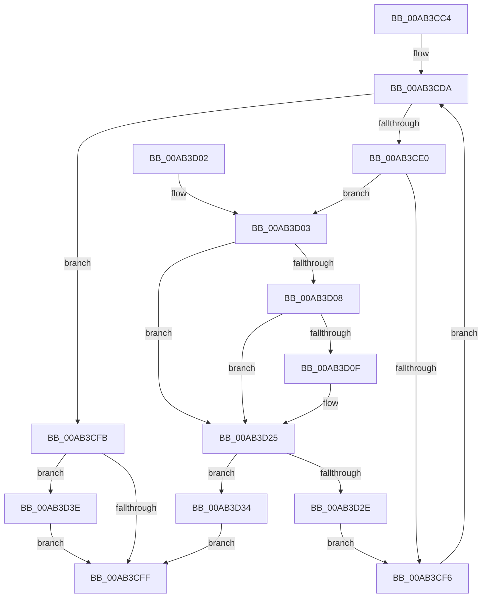

# CmGetDeviceContainerMappedPropertyKeys

- RVA: `0x00AB3CC4`–`0x00AB3D4B` (길이 `135` bytes)
- VA: `0x0000000140AB3CC4`
- 실행 섹션: `PAGE`
- PDB 이름 있음: `예`; PDB Function 태그: `아니요`
- unwind 정보 RVA: `0x000DB714`
- 디코드: `45`개 명령, `135/135` bytes 표시
- 미해석 바이트: `0` (있으면 어셈블리에 `.byte`로 보존)

> 이 문서는 커널 이미지의 기계어와 PDB 기호를 분석해 생성했습니다. 4번과 5번은 함수 원형과 자료형을 바이너리 사용 방식에서 추정한 C 해석이며 원본 소스 복구 결과는 아닙니다.

## 1. Dependencies

- 직접 호출 지점: **0**; 고유 호출 대상: **0**
- 직접 호출자로 확인된 함수: **2**
- RIP 상대 이미지 참조: **1**

### Outgoing calls
- 직접 디코드된 call 명령이 없습니다.

### Direct callers
- [CmDeleteDeviceContainerWorker](../82/CmDeleteDeviceContainerWorker_function_0082B37C.md) at `0x0082B419`
- [_PnpDispatchDeviceContainer](../8F/_PnpDispatchDeviceContainer_function_008F6880.md) at `0x008F698F`

### Static image references
- `0x00AB3CE3` → RVA `0x000055D0` (`.rdata`; read)

## 2. Other-region calls and transfers

- 다른 실행 섹션으로 향하는 call: **0**
- 별도 외부 분기/꼬리 이동을 확인하지 못했습니다.

## 3. Assembly (complete function range)

```asm
00AB3CC4  48 8B 54 24 38                  mov rdx, qword ptr [rsp + 0x38]
00AB3CC9  33 C9                           xor ecx, ecx
00AB3CCB  44 8B 54 24 30                  mov r10d, dword ptr [rsp + 0x30]
00AB3CD0  4C 8B 5C 24 28                  mov r11, qword ptr [rsp + 0x28]
00AB3CD5  21 0A                           and dword ptr [rdx], ecx
00AB3CD7  45 33 C0                        xor r8d, r8d
00AB3CDA  41 83 F8 04                     cmp r8d, 4
00AB3CDE  73 1B                           jae 0x140ab3cfb
00AB3CE0  41 8B C0                        mov eax, r8d
00AB3CE3  4C 8D 0D E6 18 55 FF            lea r9, [rip - 0xaae71a]
00AB3CEA  48 03 C0                        add rax, rax
00AB3CED  4D 8B 0C C1                     mov r9, qword ptr [r9 + rax*8]
00AB3CF1  4D 85 C9                        test r9, r9
00AB3CF4  75 0D                           jne 0x140ab3d03
00AB3CF6  41 FF C0                        inc r8d
00AB3CF9  EB DF                           jmp 0x140ab3cda
00AB3CFB  85 C9                           test ecx, ecx
00AB3CFD  79 3F                           jns 0x140ab3d3e
00AB3CFF  8B C1                           mov eax, ecx
00AB3D01  C3                              ret
00AB3D02  CC                              int3
00AB3D03  4D 85 DB                        test r11, r11
00AB3D06  74 1D                           je 0x140ab3d25
00AB3D08  8B 02                           mov eax, dword ptr [rdx]
00AB3D0A  41 3B C2                        cmp eax, r10d
00AB3D0D  73 16                           jae 0x140ab3d25
00AB3D0F  41 0F 10 01                     movups xmm0, xmmword ptr [r9]
00AB3D13  48 8D 0C 80                     lea rcx, [rax + rax*4]
00AB3D17  41 0F 11 04 8B                  movups xmmword ptr [r11 + rcx*4], xmm0
00AB3D1C  41 8B 41 10                     mov eax, dword ptr [r9 + 0x10]
00AB3D20  41 89 44 8B 10                  mov dword ptr [r11 + rcx*4 + 0x10], eax
00AB3D25  8B 02                           mov eax, dword ptr [rdx]
00AB3D27  8D 48 01                        lea ecx, [rax + 1]
00AB3D2A  3B C8                           cmp ecx, eax
00AB3D2C  72 06                           jb 0x140ab3d34
00AB3D2E  89 0A                           mov dword ptr [rdx], ecx
00AB3D30  33 C9                           xor ecx, ecx
00AB3D32  EB C2                           jmp 0x140ab3cf6
00AB3D34  83 22 00                        and dword ptr [rdx], 0
00AB3D37  B9 95 00 00 C0                  mov ecx, 0xc0000095
00AB3D3C  EB C1                           jmp 0x140ab3cff
00AB3D3E  44 3B 12                        cmp r10d, dword ptr [rdx]
00AB3D41  1B C9                           sbb ecx, ecx
00AB3D43  81 E1 23 00 00 C0               and ecx, 0xc0000023
00AB3D49  EB B4                           jmp 0x140ab3cff
```

## 4. C-style interpretation (structured pseudocode)

```c
__int64 __fastcall CmGetDeviceContainerMappedPropertyKeys(int a1, __int64 a2, int a3, __int64 a4, __int64 a5, unsigned int a6, __int64 a7)
{
    __int64 result;

    a1 = 0;
    a3 = 0;
loc_00AB3CDA:
    if (0 >= 4) goto loc_00AB3CFB;
    result = (0) + (0);
    if (*(unsigned __int64 *)(v_rip - 11200282 + result * 8) != 0) goto loc_00AB3D03;
loc_00AB3CF6:
    a3 = (unsigned int)((a3) + 1);
    goto loc_00AB3CDA;
loc_00AB3CFB:
    if (!sign_flag) goto loc_00AB3D3E;
loc_00AB3CFF:
    return 0;
loc_00AB3D03:
    if (a5 == 0) goto loc_00AB3D25;
    result = (unsigned int)(*(unsigned int *)(a7));
    if (((unsigned int)((unsigned int)(*(unsigned int *)(a7)))) < ((unsigned int)((unsigned int)(a6)))) {
        a1 = (unsigned int)(*(unsigned int *)(a7)) + (unsigned int)(*(unsigned int *)(a7)) * 4;
        *(unsigned __int64 *)(a5 + a1 * 4) = v_xmm0;
        result = *(unsigned int *)(*(unsigned __int64 *)(v_rip - 11200282 + result * 8) + 16);
        *(unsigned int *)(a5 + a1 * 4 + 16) = (unsigned int)(result);
    }
    if (((unsigned int)((unsigned int)(*(unsigned int *)(a7)) + 1)) < ((unsigned int)((unsigned int)(*(unsigned int *)(a7))))) goto loc_00AB3D34;
    *(unsigned int *)(a7) = (unsigned int)((unsigned int)(*(unsigned int *)(a7)) + 1);
    a1 = 0;
    goto loc_00AB3CF6;
loc_00AB3D34:
    goto loc_00AB3CFF;
loc_00AB3D3E:
    a1 = (unsigned int)(((unsigned int)(0xC0000095ULL)) & (0xC0000023ULL));
    goto loc_00AB3CFF;
}
```

## 5. (Beta) C Style

```c
int64_t CmGetDeviceContainerMappedPropertyKeys(int32_t Arg1, int64_t Arg2, int32_t Arg3, int64_t Arg4, int64_t Arg5, uint32_t Arg6, void *Arg7)
{
    uint8_t *arg7 = (uint8_t *)Arg7;

    int64_t result;

    Arg1 = 0;
    Arg3 = 0;
loc_00AB3CDA:
    if (0 >= 4) goto loc_00AB3CFB;
    result = (0) + (0);
    if (*(uint64_t *)(v_rip - 0xAAE71A + result * 8) != 0) goto loc_00AB3D03;
loc_00AB3CF6:
    Arg3 = (uint32_t)((Arg3) + 1);
    goto loc_00AB3CDA;
loc_00AB3CFB:
    if (!sign_flag) goto loc_00AB3D3E;
loc_00AB3CFF:
    return 0;
loc_00AB3D03:
    if (Arg5 == 0) goto loc_00AB3D25;
    result = (uint32_t)(*(uint32_t *)(arg7));
    if (((uint32_t)((uint32_t)(*(uint32_t *)(arg7)))) < ((uint32_t)((uint32_t)(Arg6)))) {
        Arg1 = (uint32_t)(*(uint32_t *)(arg7)) + (uint32_t)(*(uint32_t *)(arg7)) * 4;
        *(uint64_t *)(Arg5 + Arg1 * 4) = v_xmm0;
        result = *(uint32_t *)(*(uint64_t *)(v_rip - 0xAAE71A + result * 8) + 0x10);
        *(uint32_t *)(Arg5 + Arg1 * 4 + 0x10) = (uint32_t)(result);
    }
    if (((uint32_t)((uint32_t)(*(uint32_t *)(arg7)) + 1)) < ((uint32_t)((uint32_t)(*(uint32_t *)(arg7))))) goto loc_00AB3D34;
    *(uint32_t *)(arg7) = (uint32_t)((uint32_t)(*(uint32_t *)(arg7)) + 1);
    Arg1 = 0;
    goto loc_00AB3CF6;
loc_00AB3D34:
    goto loc_00AB3CFF;
loc_00AB3D3E:
    Arg1 = (uint32_t)(((uint32_t)(0xC0000095ULL)) & (0xC0000023ULL));
    goto loc_00AB3CFF;
}
```

### 관측된 메모리 오프셋

구조체 형식이 확인되지 않은 접근은 인자 기준의 오프셋으로만 기록했습니다.

| 기준 인자 | 오프셋 표현 | 폭 (bit) | 접근 |
|---|---:|---:|---|
| `Arg7` | `+ 0x0` | `32` | `R` |
| `Arg7` | `+ 0x0` | `32` | `R/W` |
| `Arg7` | `+ 0x0` | `32` | `W` |

## 6. Execution-region graph

[열기: 2D/3D 그래프와 함수 탐색 컨트롤 패널](../../../control-panel.html?section=page&rva=0x00AB3CC4&view=graph)

- 2D 그래프는 위에서 아래로 흐르고, 3D 그래프는 빈 공간을 드래그해 회전합니다. Shift+드래그는 이동, 휠은 확대·축소, 함수 노드 선택은 대상 보고서 이동입니다.

### Static fallback


