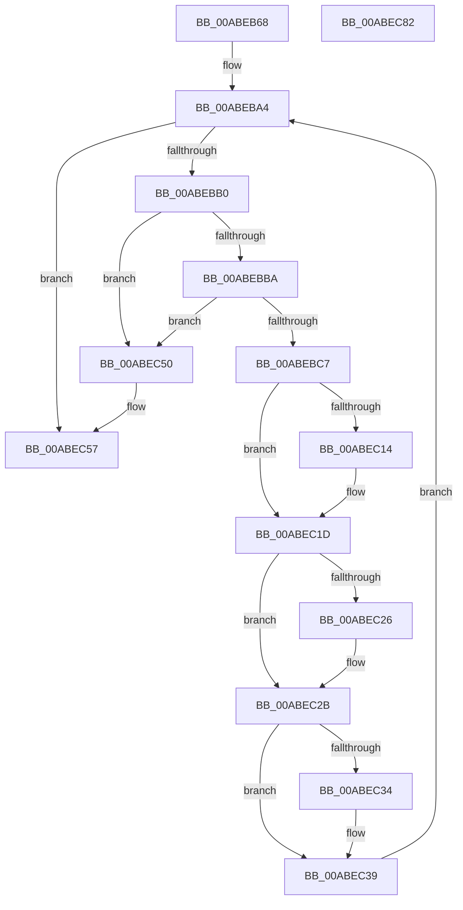

# CmRmFinalizeRecovery

- RVA: `0x00ABEB68`–`0x00ABEC83` (길이 `283` bytes)
- VA: `0x0000000140ABEB68`
- 실행 섹션: `PAGE`
- PDB 이름 있음: `예`; PDB Function 태그: `아니요`
- unwind 정보 RVA: `0x000BD714`
- 디코드: `68`개 명령, `283/283` bytes 표시
- 미해석 바이트: `0` (있으면 어셈블리에 `.byte`로 보존)

> 이 문서는 커널 이미지의 기계어와 PDB 기호를 분석해 생성했습니다. 4번과 5번은 함수 원형과 자료형을 바이너리 사용 방식에서 추정한 C 해석이며 원본 소스 복구 결과는 아닙니다.

## 1. Dependencies

- 직접 호출 지점: **15**; 고유 호출 대상: **12**
- 직접 호출자로 확인된 함수: **3**
- RIP 상대 이미지 참조: **2**

### Outgoing calls
- `0x00ABEB9B` → [LOCK_TRANSACTION_LIST](../87/LOCK_TRANSACTION_LIST_function_00874AD4.md) (function, `0x00874AD4`)
- `0x00ABEBD5` → [ExReleaseFastMutexUnsafe](../../text/25/ExReleaseFastMutexUnsafe_function_002503A0.md) (function, `0x002503A0`)
- `0x00ABEBDA` → [KeLeaveCriticalRegion](../../text/25/KeLeaveCriticalRegion_function_0025D8B0.md) (function, `0x0025D8B0`)
- `0x00ABEBE7` → [CmpTransMgrRollback](../9B/CmpTransMgrRollback_function_009B1400.md) (function, `0x009B1400`)
- `0x00ABEBF1` → [CmpAttachToRegistryProcess](../../pagecmrc/BC/CmpAttachToRegistryProcess_function_00BC98E0.md) (function, `0x00BC98E0`)
- `0x00ABEBFE` → [CmpTransMgrFreeVolatileData](../87/CmpTransMgrFreeVolatileData_function_00874BDC.md) (function, `0x00874BDC`)
- `0x00ABEC08` → [CmpDetachFromRegistryProcess](../../pagecmrc/BC/CmpDetachFromRegistryProcess_function_00BC9920.md) (function, `0x00BC9920`)
- `0x00ABEC18` → [CmpTransDereferenceTransaction](../87/CmpTransDereferenceTransaction_function_00873608.md) (function, `0x00873608`)
- `0x00ABEC26` → [ObfDereferenceObject](../../text/2F/ObfDereferenceObject_function_002F9350.md) (function, `0x002F9350`)
- `0x00ABEC34` → [ZwClose](../../text/6A/ZwClose_function_006AD2B0.md) (function, `0x006AD2B0`)
- `0x00ABEC41` → [ExFreePoolWithTag](../../poolcode/B8/ExFreePoolWithTag_function_00B82870.md) (function, `0x00B82870`)
- `0x00ABEC46` → [LOCK_TRANSACTION_LIST](../87/LOCK_TRANSACTION_LIST_function_00874AD4.md) (function, `0x00874AD4`)
- `0x00ABEC5E` → [ExReleaseFastMutexUnsafe](../../text/25/ExReleaseFastMutexUnsafe_function_002503A0.md) (function, `0x002503A0`)
- `0x00ABEC63` → [KeLeaveCriticalRegion](../../text/25/KeLeaveCriticalRegion_function_0025D8B0.md) (function, `0x0025D8B0`)
- `0x00ABEC72` → [_security_check_cookie](../../text/6A/_security_check_cookie_function_006AC640.md) (function, `0x006AC640`)

### Direct callers
- [CmpLoadKeyCommon](../../text/46/CmpLoadKeyCommon_function_0046E9F8.md) at `0x0046ED91`
- [CmpFinishSystemHivesLoad](../7D/CmpFinishSystemHivesLoad_function_007DA210.md) at `0x007DA408`
- [CmpFinishSystemHivesLoad](../7D/CmpFinishSystemHivesLoad_function_007DA210.md) at `0x007DAACE`
- [CmpMountPreloadedHives](../7D/CmpMountPreloadedHives_function_007DBE18.md) at `0x007DC48D`

### Static image references
- `0x00ABEB72` → RVA `0x00E0A740` (`.data`; read)
- `0x00ABEBCA` → RVA `0x00EF5820` (`.data`; read)

## 2. Other-region calls and transfers

- 다른 실행 섹션으로 향하는 call: **10**
  - `0x00ABEBD5` → [ExReleaseFastMutexUnsafe](../../text/25/ExReleaseFastMutexUnsafe_function_002503A0.md) (`PAGE` → `.text`)
  - `0x00ABEBDA` → [KeLeaveCriticalRegion](../../text/25/KeLeaveCriticalRegion_function_0025D8B0.md) (`PAGE` → `.text`)
  - `0x00ABEBF1` → [CmpAttachToRegistryProcess](../../pagecmrc/BC/CmpAttachToRegistryProcess_function_00BC98E0.md) (`PAGE` → `PAGECMRC`)
  - `0x00ABEC08` → [CmpDetachFromRegistryProcess](../../pagecmrc/BC/CmpDetachFromRegistryProcess_function_00BC9920.md) (`PAGE` → `PAGECMRC`)
  - `0x00ABEC26` → [ObfDereferenceObject](../../text/2F/ObfDereferenceObject_function_002F9350.md) (`PAGE` → `.text`)
  - `0x00ABEC34` → [ZwClose](../../text/6A/ZwClose_function_006AD2B0.md) (`PAGE` → `.text`)
  - `0x00ABEC41` → [ExFreePoolWithTag](../../poolcode/B8/ExFreePoolWithTag_function_00B82870.md) (`PAGE` → `POOLCODE`)
  - `0x00ABEC5E` → [ExReleaseFastMutexUnsafe](../../text/25/ExReleaseFastMutexUnsafe_function_002503A0.md) (`PAGE` → `.text`)
  - `0x00ABEC63` → [KeLeaveCriticalRegion](../../text/25/KeLeaveCriticalRegion_function_0025D8B0.md) (`PAGE` → `.text`)
  - `0x00ABEC72` → [_security_check_cookie](../../text/6A/_security_check_cookie_function_006AC640.md) (`PAGE` → `.text`)
- 별도 외부 분기/꼬리 이동을 확인하지 못했습니다.

## 3. Assembly (complete function range)

```asm
00ABEB68  48 89 5C 24 10                  mov qword ptr [rsp + 0x10], rbx
00ABEB6D  57                              push rdi
00ABEB6E  48 83 EC 60                     sub rsp, 0x60
00ABEB72  48 8B 05 C7 BB 34 00            mov rax, qword ptr [rip + 0x34bbc7]
00ABEB79  48 33 C4                        xor rax, rsp
00ABEB7C  48 89 44 24 58                  mov qword ptr [rsp + 0x58], rax
00ABEB81  83 64 24 20 00                  and dword ptr [rsp + 0x20], 0
00ABEB86  0F 57 C0                        xorps xmm0, xmm0
00ABEB89  0F 11 44 24 28                  movups xmmword ptr [rsp + 0x28], xmm0
00ABEB8E  48 8B F9                        mov rdi, rcx
00ABEB91  0F 11 44 24 38                  movups xmmword ptr [rsp + 0x38], xmm0
00ABEB96  0F 11 44 24 48                  movups xmmword ptr [rsp + 0x48], xmm0
00ABEB9B  E8 34 5F DB FF                  call 0x140874ad4
00ABEBA0  48 83 C7 10                     add rdi, 0x10
00ABEBA4  48 8B 1F                        mov rbx, qword ptr [rdi]
00ABEBA7  48 3B DF                        cmp rbx, rdi
00ABEBAA  0F 84 A7 00 00 00               je 0x140abec57
00ABEBB0  48 39 7B 08                     cmp qword ptr [rbx + 8], rdi
00ABEBB4  0F 85 96 00 00 00               jne 0x140abec50
00ABEBBA  48 8B 03                        mov rax, qword ptr [rbx]
00ABEBBD  48 39 58 08                     cmp qword ptr [rax + 8], rbx
00ABEBC1  0F 85 89 00 00 00               jne 0x140abec50
00ABEBC7  48 89 07                        mov qword ptr [rdi], rax
00ABEBCA  48 8D 0D 4F 6C 43 00            lea rcx, [rip + 0x436c4f]
00ABEBD1  48 89 78 08                     mov qword ptr [rax + 8], rdi
00ABEBD5  E8 C6 17 79 FF                  call 0x1402503a0
00ABEBDA  E8 D1 EC 79 FF                  call 0x14025d8b0
00ABEBDF  48 8D 54 24 20                  lea rdx, [rsp + 0x20]
00ABEBE4  48 8B CB                        mov rcx, rbx
00ABEBE7  E8 14 28 EF FF                  call 0x1409b1400
00ABEBEC  48 8D 4C 24 28                  lea rcx, [rsp + 0x28]
00ABEBF1  E8 EA AC 10 00                  call 0x140bc98e0
00ABEBF6  BA 08 00 00 00                  mov edx, 8
00ABEBFB  48 8B CB                        mov rcx, rbx
00ABEBFE  E8 D9 5F DB FF                  call 0x140874bdc
00ABEC03  48 8D 4C 24 28                  lea rcx, [rsp + 0x28]
00ABEC08  E8 13 AD 10 00                  call 0x140bc9920
00ABEC0D  48 83 7B 38 00                  cmp qword ptr [rbx + 0x38], 0
00ABEC12  74 09                           je 0x140abec1d
00ABEC14  48 8B 4B 38                     mov rcx, qword ptr [rbx + 0x38]
00ABEC18  E8 EB 49 DB FF                  call 0x140873608
00ABEC1D  48 8B 4B 48                     mov rcx, qword ptr [rbx + 0x48]
00ABEC21  48 85 C9                        test rcx, rcx
00ABEC24  74 05                           je 0x140abec2b
00ABEC26  E8 25 A7 83 FF                  call 0x1402f9350
00ABEC2B  48 8B 4B 50                     mov rcx, qword ptr [rbx + 0x50]
00ABEC2F  48 85 C9                        test rcx, rcx
00ABEC32  74 05                           je 0x140abec39
00ABEC34  E8 77 E6 BE FF                  call 0x1406ad2b0
00ABEC39  BA 43 4D 54 72                  mov edx, 0x72544d43
00ABEC3E  48 8B CB                        mov rcx, rbx
00ABEC41  E8 2A 3C 0C 00                  call 0x140b82870
00ABEC46  E8 89 5E DB FF                  call 0x140874ad4
00ABEC4B  E9 54 FF FF FF                  jmp 0x140abeba4
00ABEC50  B9 03 00 00 00                  mov ecx, 3
00ABEC55  CD 29                           int 0x29
00ABEC57  48 8D 0D C2 6B 43 00            lea rcx, [rip + 0x436bc2]
00ABEC5E  E8 3D 17 79 FF                  call 0x1402503a0
00ABEC63  E8 48 EC 79 FF                  call 0x14025d8b0
00ABEC68  33 C0                           xor eax, eax
00ABEC6A  48 8B 4C 24 58                  mov rcx, qword ptr [rsp + 0x58]
00ABEC6F  48 33 CC                        xor rcx, rsp
00ABEC72  E8 C9 D9 BE FF                  call 0x1406ac640
00ABEC77  48 8B 5C 24 78                  mov rbx, qword ptr [rsp + 0x78]
00ABEC7C  48 83 C4 60                     add rsp, 0x60
00ABEC80  5F                              pop rdi
00ABEC81  C3                              ret
00ABEC82  CC                              int3
```

## 4. C-style interpretation (structured pseudocode)

```c
__int64 __fastcall CmRmFinalizeRecovery(__int64 a1)
{
    __int64 result;
    __int64 v_rdi;
    __int64 v_rsp;
    unsigned __int64 v_stack_m10;
    unsigned __int64 v_stack_m20;
    unsigned __int64 v_stack_m30;
    unsigned __int64 v_stack_m40;
    unsigned int v_stack_m48;
    unsigned __int64 v_stack_p10;

    v_stack_p10 = v_rbx;
    v_rsp = (v_rsp) - (96);
    result = (*(unsigned __int64 *)(v_rip + 3455943)) ^ (v_rsp);
    v_stack_m10 = result;
    v_stack_m40 = v_xmm0;
    v_stack_m30 = v_xmm0;
    v_stack_m20 = v_xmm0;
    result = LOCK_TRANSACTION_LIST(a1, a2, a3, a4);
    v_rdi = (a1) + (16);
loc_00ABEBA4:
    if ((*(unsigned __int64 *)(v_rdi)) == v_rdi) goto loc_00ABEC57;
    if ((*(unsigned __int64 *)(*(unsigned __int64 *)(v_rdi) + 8)) != v_rdi) goto loc_00ABEC50;
    if ((*(unsigned __int64 *)(*(unsigned __int64 *)(*(unsigned __int64 *)(v_rdi)) + 8)) != (*(unsigned __int64 *)(v_rdi))) goto loc_00ABEC50;
    *(unsigned __int64 *)(v_rdi) = *(unsigned __int64 *)(*(unsigned __int64 *)(v_rdi));
    *(unsigned __int64 *)(*(unsigned __int64 *)(*(unsigned __int64 *)(v_rdi)) + 8) = v_rdi;
    result = ExReleaseFastMutexUnsafe(v_rip + 4418639, a2, a3, a4);
    result = KeLeaveCriticalRegion(v_rip + 4418639, a2, a3, a4);
    result = CmpTransMgrRollback(*(unsigned __int64 *)(v_rdi), v_stack_m48, a3, a4);
    result = CmpAttachToRegistryProcess(v_stack_m40, v_stack_m48, a3, a4);
    result = CmpTransMgrFreeVolatileData(*(unsigned __int64 *)(v_rdi), 8, a3, a4);
    result = CmpDetachFromRegistryProcess(v_stack_m40, 8, a3, a4);
    if ((*(unsigned __int64 *)(*(unsigned __int64 *)(v_rdi) + 56)) != 0) {
        a1 = *(unsigned __int64 *)(*(unsigned __int64 *)(v_rdi) + 56);
        result = CmpTransDereferenceTransaction(a1, 8, a3, a4);
    }
    if (*(unsigned __int64 *)(*(unsigned __int64 *)(v_rdi) + 72) != 0) {
        result = ObfDereferenceObject(*(unsigned __int64 *)(*(unsigned __int64 *)(v_rdi) + 72), 8, a3, a4);
    }
    if (*(unsigned __int64 *)(*(unsigned __int64 *)(v_rdi) + 80) != 0) {
        result = ZwClose(*(unsigned __int64 *)(*(unsigned __int64 *)(v_rdi) + 80), 8, a3, a4);
    }
    result = ExFreePoolWithTag(*(unsigned __int64 *)(v_rdi), (unsigned int)(0x72544D43ULL), a3, a4);
    result = LOCK_TRANSACTION_LIST(*(unsigned __int64 *)(v_rdi), (unsigned int)(0x72544D43ULL), a3, a4);
    goto loc_00ABEBA4;
loc_00ABEC50:
loc_00ABEC57:
    result = ExReleaseFastMutexUnsafe(v_rip + 4418498, (unsigned int)(0x72544D43ULL), a3, a4);
    result = KeLeaveCriticalRegion(v_rip + 4418498, (unsigned int)(0x72544D43ULL), a3, a4);
    result = 0;
    a1 = (v_stack_m10) ^ (v_rsp);
    result = _security_check_cookie(a1, (unsigned int)(0x72544D43ULL), a3, a4);
    v_rsp = (v_rsp) + (96);
    return result;
}
```

## 5. (Beta) C Style

```c
int64_t CmRmFinalizeRecovery(void *Arg1)
{
    uint8_t *arg1 = (uint8_t *)Arg1;

    int64_t result;
    int64_t local_rdi;
    int64_t local_rsp;
    uint64_t v_stack_m10;
    uint64_t v_stack_m20;
    uint64_t v_stack_m30;
    uint64_t v_stack_m40;
    uint32_t v_stack_m48;
    uint64_t v_stack_p10;

    v_stack_p10 = local_rbx;
    local_rsp = (local_rsp) - (96);
    result = (*(uint64_t *)(v_rip + 0x34BBC7)) ^ (local_rsp);
    v_stack_m10 = result;
    v_stack_m40 = v_xmm0;
    v_stack_m30 = v_xmm0;
    v_stack_m20 = v_xmm0;
    result = LOCK_TRANSACTION_LIST(Arg1, a2, a3, a4);
    local_rdi = (Arg1) + (16);
loc_00ABEBA4:
    if ((*(uint64_t *)(local_rdi)) == local_rdi) goto loc_00ABEC57;
    if ((*(uint64_t *)(*(uint64_t *)(local_rdi) + 0x8)) != local_rdi) goto loc_00ABEC50;
    if ((*(uint64_t *)(*(uint64_t *)(*(uint64_t *)(local_rdi)) + 0x8)) != (*(uint64_t *)(local_rdi))) goto loc_00ABEC50;
    *(uint64_t *)(local_rdi) = *(uint64_t *)(*(uint64_t *)(local_rdi));
    *(uint64_t *)(*(uint64_t *)(*(uint64_t *)(local_rdi)) + 0x8) = local_rdi;
    result = ExReleaseFastMutexUnsafe(v_rip + 4418639, a2, a3, a4);
    result = KeLeaveCriticalRegion(v_rip + 4418639, a2, a3, a4);
    result = CmpTransMgrRollback(*(uint64_t *)(local_rdi), v_stack_m48, a3, a4);
    result = CmpAttachToRegistryProcess(v_stack_m40, v_stack_m48, a3, a4);
    result = CmpTransMgrFreeVolatileData(*(uint64_t *)(local_rdi), 8, a3, a4);
    result = CmpDetachFromRegistryProcess(v_stack_m40, 8, a3, a4);
    if ((*(uint64_t *)(*(uint64_t *)(local_rdi) + 0x38)) != 0) {
        Arg1 = *(uint64_t *)(*(uint64_t *)(local_rdi) + 0x38);
        result = CmpTransDereferenceTransaction(Arg1, 8, a3, a4);
    }
    if (*(uint64_t *)(*(uint64_t *)(local_rdi) + 0x48) != 0) {
        result = ObfDereferenceObject(*(uint64_t *)(*(uint64_t *)(local_rdi) + 0x48), 8, a3, a4);
    }
    if (*(uint64_t *)(*(uint64_t *)(local_rdi) + 0x50) != 0) {
        result = ZwClose(*(uint64_t *)(*(uint64_t *)(local_rdi) + 0x50), 8, a3, a4);
    }
    result = ExFreePoolWithTag(*(uint64_t *)(local_rdi), (uint32_t)(0x72544D43ULL), a3, a4);
    result = LOCK_TRANSACTION_LIST(*(uint64_t *)(local_rdi), (uint32_t)(0x72544D43ULL), a3, a4);
    goto loc_00ABEBA4;
loc_00ABEC50:
loc_00ABEC57:
    result = ExReleaseFastMutexUnsafe(v_rip + 4418498, (uint32_t)(0x72544D43ULL), a3, a4);
    result = KeLeaveCriticalRegion(v_rip + 4418498, (uint32_t)(0x72544D43ULL), a3, a4);
    result = 0;
    Arg1 = (v_stack_m10) ^ (local_rsp);
    result = _security_check_cookie(Arg1, (uint32_t)(0x72544D43ULL), a3, a4);
    local_rsp = (local_rsp) + (96);
    return result;
}
```

### 관측된 메모리 오프셋

구조체 형식이 확인되지 않은 접근은 인자 기준의 오프셋으로만 기록했습니다.

| 기준 인자 | 오프셋 표현 | 폭 (bit) | 접근 |
|---|---:|---:|---|
| `Arg1` | `+ 0x0` | `64` | `R` |
| `Arg1` | `+ 0x0` | `64` | `W` |

## 6. Execution-region graph

[열기: 2D/3D 그래프와 함수 탐색 컨트롤 패널](../../../control-panel.html?section=page&rva=0x00ABEB68&view=graph)

- 2D 그래프는 위에서 아래로 흐르고, 3D 그래프는 빈 공간을 드래그해 회전합니다. Shift+드래그는 이동, 휠은 확대·축소, 함수 노드 선택은 대상 보고서 이동입니다.

### Static fallback


