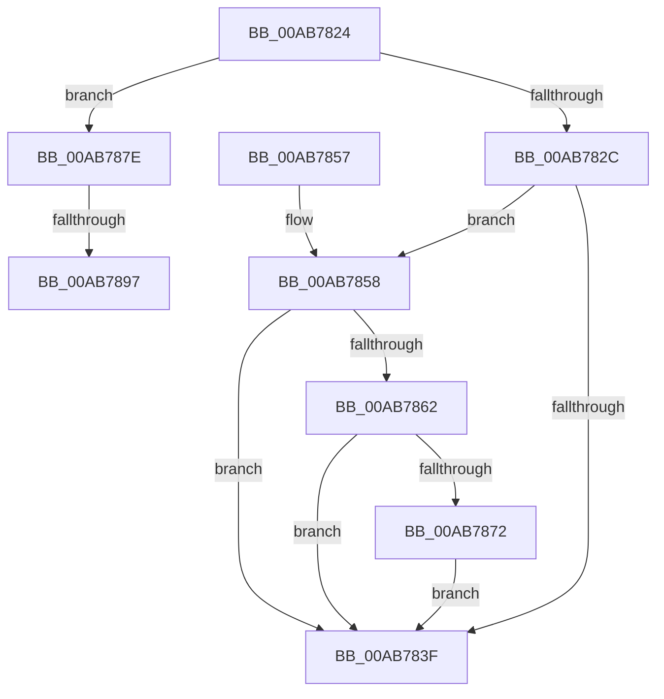

# CmSetLazyFlushState

- RVA: `0x00AB7824`–`0x00AB78CC` (길이 `168` bytes)
- VA: `0x0000000140AB7824`
- 실행 섹션: `PAGE`
- PDB 이름 있음: `예`; PDB Function 태그: `예`
- unwind 정보 RVA: `0x000BD05C`
- 디코드: `38`개 명령, `168/168` bytes 표시
- 미해석 바이트: `0` (있으면 어셈블리에 `.byte`로 보존)

> 이 문서는 커널 이미지의 기계어와 PDB 기호를 분석해 생성했습니다. 4번과 5번은 함수 원형과 자료형을 바이너리 사용 방식에서 추정한 C 해석이며 원본 소스 복구 결과는 아닙니다.

## 1. Dependencies

- 직접 호출 지점: **5**; 고유 호출 대상: **4**
- 직접 호출자로 확인된 함수: **2**
- RIP 상대 이미지 참조: **9**

### Outgoing calls
- `0x00AB7831` → [CmpDisableLazyFlush](../../text/4F/CmpDisableLazyFlush_function_004FC648.md) (function, `0x004FC648`)
- `0x00AB7869` → [KeCancelTimer](../../text/23/KeCancelTimer_function_002327E0.md) (function, `0x002327E0`)
- `0x00AB7877` → [CmpEnableLazyFlush](../../text/4B/CmpEnableLazyFlush_function_004B7874.md) (function, `0x004B7874`)
- `0x00AB789C` → [CmpDisableLazyFlush](../../text/4F/CmpDisableLazyFlush_function_004FC648.md) (function, `0x004FC648`)
- `0x00AB78C1` → [KiSetTimerEx](../../text/23/KiSetTimerEx_function_00232CB0.md) (function, `0x00232CB0`)

### Direct callers
- [PopUnlockAfterSleepWorker](../../pagelk/B7/PopUnlockAfterSleepWorker_function_00B782A0.md) at `0x00B7830A`
- [PopTransitionSystemPowerStateEx](../../pagelk/B7/PopTransitionSystemPowerStateEx_function_00B7E8C0.md) at `0x00B7EA09`

### Static image references
- `0x00AB7836` → RVA `0x00EEFBD8` (`.data`; read)
- `0x00AB783F` → RVA `0x00EEFC20` (`.data`; read)
- `0x00AB7845` → RVA `0x00EEFC20` (`.data`; read/write)
- `0x00AB784C` → RVA `0x00EF7A54` (`.data`; write)
- `0x00AB7858` → RVA `0x00E0ECC0` (`.data`; read)
- `0x00AB7862` → RVA `0x00EF7AE0` (`.data`; read)
- `0x00AB7885` → RVA `0x00EF7A54` (`.data`; read)
- `0x00AB788B` → RVA `0x00EEFC20` (`.data`; write)
- `0x00AB78A1` → RVA `0x00EF7A60` (`.data`; read)

## 2. Other-region calls and transfers

- 다른 실행 섹션으로 향하는 call: **5**
  - `0x00AB7831` → [CmpDisableLazyFlush](../../text/4F/CmpDisableLazyFlush_function_004FC648.md) (`PAGE` → `.text`)
  - `0x00AB7869` → [KeCancelTimer](../../text/23/KeCancelTimer_function_002327E0.md) (`PAGE` → `.text`)
  - `0x00AB7877` → [CmpEnableLazyFlush](../../text/4B/CmpEnableLazyFlush_function_004B7874.md) (`PAGE` → `.text`)
  - `0x00AB789C` → [CmpDisableLazyFlush](../../text/4F/CmpDisableLazyFlush_function_004FC648.md) (`PAGE` → `.text`)
  - `0x00AB78C1` → [KiSetTimerEx](../../text/23/KiSetTimerEx_function_00232CB0.md) (`PAGE` → `.text`)
- call이 아닌 외부 분기/꼬리 이동: **2**
  - `0x00AB7891` → [sub_00B4AA92](../B4/Unknown_function_00B4AA92.md) (`tail-transfer`)
  - `0x00AB78C7` → [sub_00B4AA92](../B4/Unknown_function_00B4AA92.md) (`tail-transfer`)

## 3. Assembly (complete function range)

```asm
00AB7824  48 83 EC 38                     sub rsp, 0x38
00AB7828  84 C9                           test cl, cl
00AB782A  75 52                           jne 0x140ab787e
00AB782C  B9 04 00 00 00                  mov ecx, 4
00AB7831  E8 12 4E A4 FF                  call 0x1404fc648
00AB7836  83 3D 9B 83 43 00 00            cmp dword ptr [rip + 0x43839b], 0
00AB783D  75 19                           jne 0x140ab7858
00AB783F  8B 05 DB 83 43 00               mov eax, dword ptr [rip + 0x4383db]
00AB7845  83 25 D4 83 43 00 00            and dword ptr [rip + 0x4383d4], 0
00AB784C  89 05 02 02 44 00               mov dword ptr [rip + 0x440202], eax
00AB7852  48 83 C4 38                     add rsp, 0x38
00AB7856  C3                              ret
00AB7857  CC                              int3
00AB7858  8B 05 62 74 35 00               mov eax, dword ptr [rip + 0x357462]
00AB785E  A8 01                           test al, 1
00AB7860  74 DD                           je 0x140ab783f
00AB7862  48 8D 0D 77 02 44 00            lea rcx, [rip + 0x440277]
00AB7869  E8 72 AF 77 FF                  call 0x1402327e0
00AB786E  84 C0                           test al, al
00AB7870  74 CD                           je 0x140ab783f
00AB7872  B9 01 00 00 00                  mov ecx, 1
00AB7877  E8 F8 FF 9F FF                  call 0x1404b7874
00AB787C  EB C1                           jmp 0x140ab783f
00AB787E  83 3D 53 83 43 00 00            cmp dword ptr [rip + 0x438353], 0
00AB7885  8B 05 C9 01 44 00               mov eax, dword ptr [rip + 0x4401c9]
00AB788B  89 05 8F 83 43 00               mov dword ptr [rip + 0x43838f], eax
00AB7891  0F 84 FB 31 09 00               je 0x140b4aa92
00AB7897  B9 01 00 00 00                  mov ecx, 1
00AB789C  E8 A7 4D A4 FF                  call 0x1404fc648
00AB78A1  48 8D 05 B8 01 44 00            lea rax, [rip + 0x4401b8]
00AB78A8  45 33 C9                        xor r9d, r9d
00AB78AB  45 33 C0                        xor r8d, r8d
00AB78AE  48 89 44 24 20                  mov qword ptr [rsp + 0x20], rax
00AB78B3  48 C7 C2 00 17 5B CA            mov rdx, 0xffffffffca5b1700
00AB78BA  48 8D 0D 1F 02 44 00            lea rcx, [rip + 0x44021f]
00AB78C1  E8 EA B3 77 FF                  call 0x140232cb0
00AB78C6  90                              nop
00AB78C7  E9 C6 31 09 00                  jmp 0x140b4aa92
```

## 4. C-style interpretation (structured pseudocode)

```c
__int64 __fastcall CmSetLazyFlushState(unsigned __int8 a1, __int64 a2, int a3, int a4)
{
    __int64 result;
    __int64 v_rsp;
    unsigned __int64 v_stack_p20;

    v_rsp = (v_rsp) - (56);
    if (a1 != 0) goto loc_00AB787E;
    result = CmpDisableLazyFlush(4, a2, a3, a4);
    if ((*(unsigned int *)(v_rip + 4424603)) != 0) goto loc_00AB7858;
loc_00AB783F:
    *(unsigned int *)(v_rip + 4456962) = (unsigned int)((unsigned int)(*(unsigned int *)(v_rip + 4424667)));
    v_rsp = (v_rsp) + (56);
    return (unsigned int)(*(unsigned int *)(v_rip + 4424667));
loc_00AB7858:
    if ((((unsigned __int8)((unsigned int)(*(unsigned int *)(v_rip + 3503202)))) & (1)) == 0) goto loc_00AB783F;
    result = KeCancelTimer(v_rip + 4457079, a2, a3, a4);
    if ((unsigned __int8)(result) == 0) goto loc_00AB783F;
    result = CmpEnableLazyFlush(1, a2, a3, a4);
    goto loc_00AB783F;
loc_00AB787E:
    *(unsigned int *)(v_rip + 4424591) = (unsigned int)((unsigned int)(*(unsigned int *)(v_rip + 4456905)));
    result = CmpDisableLazyFlush(1, a2, a3, a4);
    a4 = 0;
    a3 = 0;
    v_stack_p20 = v_rip + 4456888;
    result = KiSetTimerEx(v_rip + 4456991, 0xFFFFFFFFCA5B1700ULL, a3, a4);
}
```

## 5. (Beta) C Style

```c
int64_t CmSetLazyFlushState(uint8_t Arg1, int64_t Arg2, int32_t Arg3, int32_t Arg4)
{
    int64_t result;
    int64_t local_rsp;
    uint64_t v_stack_p20;

    local_rsp = (local_rsp) - (56);
    if (Arg1 != 0) goto loc_00AB787E;
    result = CmpDisableLazyFlush(4, Arg2, Arg3, Arg4);
    if ((*(uint32_t *)(v_rip + 0x43839B)) != 0) goto loc_00AB7858;
loc_00AB783F:
    *(uint32_t *)(v_rip + 0x440202) = (uint32_t)((uint32_t)(*(uint32_t *)(v_rip + 0x4383DB)));
    local_rsp = (local_rsp) + (56);
    return (uint32_t)(*(uint32_t *)(v_rip + 0x4383DB));
loc_00AB7858:
    if ((((uint8_t)((uint32_t)(*(uint32_t *)(v_rip + 0x357462)))) & (1)) == 0) goto loc_00AB783F;
    result = KeCancelTimer(v_rip + 4457079, Arg2, Arg3, Arg4);
    if ((uint8_t)(result) == 0) goto loc_00AB783F;
    result = CmpEnableLazyFlush(1, Arg2, Arg3, Arg4);
    goto loc_00AB783F;
loc_00AB787E:
    *(uint32_t *)(v_rip + 0x43838F) = (uint32_t)((uint32_t)(*(uint32_t *)(v_rip + 0x4401C9)));
    result = CmpDisableLazyFlush(1, Arg2, Arg3, Arg4);
    Arg4 = 0;
    Arg3 = 0;
    v_stack_p20 = v_rip + 4456888;
    result = KiSetTimerEx(v_rip + 4456991, 0xFFFFFFFFCA5B1700ULL, Arg3, Arg4);
}
```

## 6. Execution-region graph

[열기: 2D/3D 그래프와 함수 탐색 컨트롤 패널](../../../control-panel.html?section=page&rva=0x00AB7824&view=graph)

- 2D 그래프는 위에서 아래로 흐르고, 3D 그래프는 빈 공간을 드래그해 회전합니다. Shift+드래그는 이동, 휠은 확대·축소, 함수 노드 선택은 대상 보고서 이동입니다.

### Static fallback


