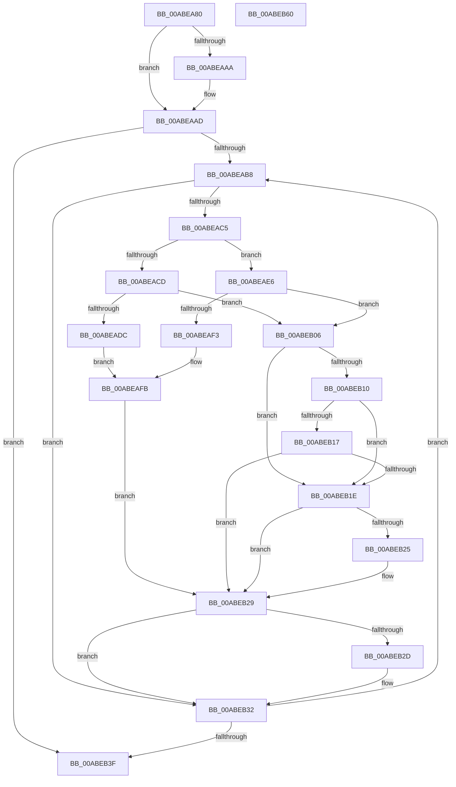

# CmpAbortRollbackPacket

- RVA: `0x00ABEA80`–`0x00ABEB61` (길이 `225` bytes)
- VA: `0x0000000140ABEA80`
- 실행 섹션: `PAGE`
- PDB 이름 있음: `예`; PDB Function 태그: `아니요`
- unwind 정보 RVA: `0x0005FEF8`
- 디코드: `72`개 명령, `225/225` bytes 표시
- 미해석 바이트: `0` (있으면 어셈블리에 `.byte`로 보존)

> 이 문서는 커널 이미지의 기계어와 PDB 기호를 분석해 생성했습니다. 4번과 5번은 함수 원형과 자료형을 바이너리 사용 방식에서 추정한 C 해석이며 원본 소스 복구 결과는 아닙니다.

## 1. Dependencies

- 직접 호출 지점: **4**; 고유 호출 대상: **4**
- 직접 호출자로 확인된 함수: **6**
- RIP 상대 이미지 참조: **0**

### Outgoing calls
- `0x00ABEAD1` → [CmpRollbackLightWeightTransaction](../9B/CmpRollbackLightWeightTransaction_function_009B1158.md) (function, `0x009B1158`)
- `0x00ABEADF` → [CmpTransDereferenceTransaction](../87/CmpTransDereferenceTransaction_function_00873608.md) (function, `0x00873608`)
- `0x00ABEAE8` → [TmRollbackEnlistment](../../text/4F/TmRollbackEnlistment_function_004FE380.md) (function, `0x004FE380`)
- `0x00ABEAF6` → [ObfDereferenceObject](../../text/2F/ObfDereferenceObject_function_002F9350.md) (function, `0x002F9350`)

### Direct callers
- [CmpTryToRundownHive](../../text/2A/CmpTryToRundownHive_function_002A4A60.md) at `0x002A4C19`
- [CmpSaveBootControlSet](../7D/CmpSaveBootControlSet_function_007DC744.md) at `0x007DCA63`
- [CmRestoreKey](../7D/CmRestoreKey_function_007DCF04.md) at `0x007DD3B9`
- [CmRestoreKey](../7D/CmRestoreKey_function_007DCF04.md) at `0x007DD491`
- [CmRenameKey](../7E/CmRenameKey_function_007E8F48.md) at `0x007E9627`
- [CmRenameKey](../7E/CmRenameKey_function_007E8F48.md) at `0x007E968F`
- [CmSetLastWriteTimeKey](../84/CmSetLastWriteTimeKey_function_00843368.md) at `0x00843501`
- [sub_00B2D804](../B2/Unknown_function_00B2D804.md) at `0x00B2D82D`

### Static image references
- 디코드된 RIP-relative 메모리 참조가 없습니다.

## 2. Other-region calls and transfers

- 다른 실행 섹션으로 향하는 call: **2**
  - `0x00ABEAE8` → [TmRollbackEnlistment](../../text/4F/TmRollbackEnlistment_function_004FE380.md) (`PAGE` → `.text`)
  - `0x00ABEAF6` → [ObfDereferenceObject](../../text/2F/ObfDereferenceObject_function_002F9350.md) (`PAGE` → `.text`)
- 별도 외부 분기/꼬리 이동을 확인하지 못했습니다.

## 3. Assembly (complete function range)

```asm
00ABEA80  48 8B C4                        mov rax, rsp
00ABEA83  48 89 58 08                     mov qword ptr [rax + 8], rbx
00ABEA87  48 89 68 10                     mov qword ptr [rax + 0x10], rbp
00ABEA8B  48 89 70 18                     mov qword ptr [rax + 0x18], rsi
00ABEA8F  48 89 78 20                     mov qword ptr [rax + 0x20], rdi
00ABEA93  41 54                           push r12
00ABEA95  41 56                           push r14
00ABEA97  41 57                           push r15
00ABEA99  48 83 EC 20                     sub rsp, 0x20
00ABEA9D  33 F6                           xor esi, esi
00ABEA9F  4C 8B F2                        mov r14, rdx
00ABEAA2  48 8B E9                        mov rbp, rcx
00ABEAA5  48 85 D2                        test rdx, rdx
00ABEAA8  74 03                           je 0x140abeaad
00ABEAAA  40 88 32                        mov byte ptr [rdx], sil
00ABEAAD  45 33 FF                        xor r15d, r15d
00ABEAB0  39 31                           cmp dword ptr [rcx], esi
00ABEAB2  0F 86 87 00 00 00               jbe 0x140abeb3f
00ABEAB8  48 8B 5D 08                     mov rbx, qword ptr [rbp + 8]
00ABEABC  4A 8B 1C FB                     mov rbx, qword ptr [rbx + r15*8]
00ABEAC0  48 85 DB                        test rbx, rbx
00ABEAC3  74 6D                           je 0x140abeb32
00ABEAC5  48 8B CB                        mov rcx, rbx
00ABEAC8  F6 C3 01                        test bl, 1
00ABEACB  74 19                           je 0x140abeae6
00ABEACD  48 83 E1 FE                     and rcx, 0xfffffffffffffffe
00ABEAD1  E8 82 26 EF FF                  call 0x1409b1158
00ABEAD6  8B F8                           mov edi, eax
00ABEAD8  85 C0                           test eax, eax
00ABEADA  78 2A                           js 0x140abeb06
00ABEADC  48 8B CB                        mov rcx, rbx
00ABEADF  E8 24 4B DB FF                  call 0x140873608
00ABEAE4  EB 15                           jmp 0x140abeafb
00ABEAE6  33 D2                           xor edx, edx
00ABEAE8  E8 93 F8 A3 FF                  call 0x1404fe380
00ABEAED  8B F8                           mov edi, eax
00ABEAEF  85 C0                           test eax, eax
00ABEAF1  78 13                           js 0x140abeb06
00ABEAF3  48 8B CB                        mov rcx, rbx
00ABEAF6  E8 55 A8 83 FF                  call 0x1402f9350
00ABEAFB  48 8B 45 08                     mov rax, qword ptr [rbp + 8]
00ABEAFF  4A 83 24 F8 00                  and qword ptr [rax + r15*8], 0
00ABEB04  EB 23                           jmp 0x140abeb29
00ABEB06  8B C7                           mov eax, edi
00ABEB08  81 FF 15 00 19 C0               cmp edi, 0xc0190015
00ABEB0E  74 0E                           je 0x140abeb1e
00ABEB10  3D 13 00 19 C0                  cmp eax, 0xc0190013
00ABEB15  74 07                           je 0x140abeb1e
00ABEB17  3D 16 00 19 C0                  cmp eax, 0xc0190016
00ABEB1C  75 0B                           jne 0x140abeb29
00ABEB1E  33 FF                           xor edi, edi
00ABEB20  4D 85 F6                        test r14, r14
00ABEB23  74 04                           je 0x140abeb29
00ABEB25  41 C6 06 01                     mov byte ptr [r14], 1
00ABEB29  85 F6                           test esi, esi
00ABEB2B  78 05                           js 0x140abeb32
00ABEB2D  85 FF                           test edi, edi
00ABEB2F  0F 48 F7                        cmovs esi, edi
00ABEB32  41 FF C7                        inc r15d
00ABEB35  44 3B 7D 00                     cmp r15d, dword ptr [rbp]
00ABEB39  0F 82 79 FF FF FF               jb 0x140abeab8
00ABEB3F  48 8B 5C 24 40                  mov rbx, qword ptr [rsp + 0x40]
00ABEB44  8B C6                           mov eax, esi
00ABEB46  48 8B 74 24 50                  mov rsi, qword ptr [rsp + 0x50]
00ABEB4B  48 8B 6C 24 48                  mov rbp, qword ptr [rsp + 0x48]
00ABEB50  48 8B 7C 24 58                  mov rdi, qword ptr [rsp + 0x58]
00ABEB55  48 83 C4 20                     add rsp, 0x20
00ABEB59  41 5F                           pop r15
00ABEB5B  41 5E                           pop r14
00ABEB5D  41 5C                           pop r12
00ABEB5F  C3                              ret
00ABEB60  CC                              int3
```

## 4. C-style interpretation (structured pseudocode)

```c
__int64 __fastcall CmpAbortRollbackPacket(__int64 a1, __int64 a2)
{
    __int64 result;
    __int64 v_r15;
    __int64 v_rdi;
    __int64 v_rsi;
    __int64 v_rsp;
    unsigned __int64 v_stack_p10;
    unsigned __int64 v_stack_p18;
    unsigned __int64 v_stack_p20;
    unsigned __int64 v_stack_p8;

    *(unsigned __int64 *)(v_rsp + 8) = v_rbx;
    *(unsigned __int64 *)(v_rsp + 16) = v_rbp;
    *(unsigned __int64 *)(v_rsp + 24) = v_rsi;
    *(unsigned __int64 *)(v_rsp + 32) = v_rdi;
    v_rsp = (v_rsp) - (32);
    v_rsi = 0;
    if (a2 != 0) {
        *(unsigned __int8 *)(a2) = 0;
    }
    v_r15 = 0;
    if ((*(unsigned int *)(a1)) <= 0) goto loc_00ABEB3F;
loc_00ABEAB8:
    if (*(unsigned __int64 *)(*(unsigned __int64 *)(a1 + 8) + v_r15 * 8) == 0) goto loc_00ABEB32;
    if ((((unsigned __int8)(*(unsigned __int64 *)(*(unsigned __int64 *)(a1 + 8) + v_r15 * 8))) & (1)) == 0) goto loc_00ABEAE6;
    a1 = (*(unsigned __int64 *)(*(unsigned __int64 *)(a1 + 8) + v_r15 * 8)) & (-2);
    result = CmpRollbackLightWeightTransaction(a1, a2, a3, a4);
    if (sign_flag) goto loc_00ABEB06;
    result = CmpTransDereferenceTransaction(*(unsigned __int64 *)(*(unsigned __int64 *)(a1 + 8) + v_r15 * 8), a2, a3, a4);
    goto loc_00ABEAFB;
loc_00ABEAE6:
    a2 = 0;
    result = TmRollbackEnlistment(*(unsigned __int64 *)(*(unsigned __int64 *)(a1 + 8) + v_r15 * 8), a2, a3, a4);
    if (sign_flag) goto loc_00ABEB06;
    result = ObfDereferenceObject(*(unsigned __int64 *)(*(unsigned __int64 *)(a1 + 8) + v_r15 * 8), a2, a3, a4);
loc_00ABEAFB:
    goto loc_00ABEB29;
loc_00ABEB06:
    if (((unsigned int)((unsigned int)((unsigned int)(result)))) == 0xC0190015ULL) goto loc_00ABEB1E;
    if (((unsigned int)((unsigned int)((unsigned int)((unsigned int)((unsigned int)(result)))))) == 0xC0190013ULL) goto loc_00ABEB1E;
    if (((unsigned int)((unsigned int)((unsigned int)((unsigned int)((unsigned int)(result)))))) != 0xC0190016ULL) goto loc_00ABEB29;
loc_00ABEB1E:
    v_rdi = 0;
    if (0 != 0) {
        *(unsigned __int8 *)(a2) = 1;
    }
    if (!(sign_flag)) {
        if (sign_flag) { v_rsi = 0; }
    }
    v_r15 = (unsigned int)((v_r15) + 1);
    if (((unsigned int)(v_r15)) < (*(unsigned int *)(a1))) goto loc_00ABEAB8;
loc_00ABEB3F:
    v_rsp = (v_rsp) + (32);
    return (unsigned int)((unsigned int)(v_rsi));
}
```

## 5. (Beta) C Style

```c
int64_t CmpAbortRollbackPacket(void *Arg1, int64_t Arg2)
{
    uint8_t *arg1 = (uint8_t *)Arg1;

    int64_t result;
    int64_t local_r15;
    int64_t local_rdi;
    int64_t local_rsi;
    int64_t local_rsp;
    uint64_t v_stack_p10;
    uint64_t v_stack_p18;
    uint64_t v_stack_p20;
    uint64_t v_stack_p8;

    *(uint64_t *)(local_rsp + 0x8) = local_rbx;
    *(uint64_t *)(local_rsp + 0x10) = local_rbp;
    *(uint64_t *)(local_rsp + 0x18) = local_rsi;
    *(uint64_t *)(local_rsp + 0x20) = local_rdi;
    local_rsp = (local_rsp) - (32);
    local_rsi = 0;
    if (Arg2 != 0) {
        *(uint8_t *)(Arg2) = 0;
    }
    local_r15 = 0;
    if ((*(uint32_t *)(arg1)) <= 0) goto loc_00ABEB3F;
loc_00ABEAB8:
    if (*(uint64_t *)(*(uint64_t *)(arg1 + 0x8) + local_r15 * 8) == 0) goto loc_00ABEB32;
    if ((((uint8_t)(*(uint64_t *)(*(uint64_t *)(arg1 + 0x8) + local_r15 * 8))) & (1)) == 0) goto loc_00ABEAE6;
    Arg1 = (*(uint64_t *)(*(uint64_t *)(arg1 + 0x8) + local_r15 * 8)) & (-2);
    result = CmpRollbackLightWeightTransaction(Arg1, Arg2, a3, a4);
    if (sign_flag) goto loc_00ABEB06;
    result = CmpTransDereferenceTransaction(*(uint64_t *)(*(uint64_t *)(arg1 + 0x8) + local_r15 * 8), Arg2, a3, a4);
    goto loc_00ABEAFB;
loc_00ABEAE6:
    Arg2 = 0;
    result = TmRollbackEnlistment(*(uint64_t *)(*(uint64_t *)(arg1 + 0x8) + local_r15 * 8), Arg2, a3, a4);
    if (sign_flag) goto loc_00ABEB06;
    result = ObfDereferenceObject(*(uint64_t *)(*(uint64_t *)(arg1 + 0x8) + local_r15 * 8), Arg2, a3, a4);
loc_00ABEAFB:
    goto loc_00ABEB29;
loc_00ABEB06:
    if (((uint32_t)((uint32_t)((uint32_t)(result)))) == 0xC0190015ULL) goto loc_00ABEB1E;
    if (((uint32_t)((uint32_t)((uint32_t)((uint32_t)((uint32_t)(result)))))) == 0xC0190013ULL) goto loc_00ABEB1E;
    if (((uint32_t)((uint32_t)((uint32_t)((uint32_t)((uint32_t)(result)))))) != 0xC0190016ULL) goto loc_00ABEB29;
loc_00ABEB1E:
    local_rdi = 0;
    if (0 != 0) {
        *(uint8_t *)(Arg2) = 1;
    }
    if (!(sign_flag)) {
        if (sign_flag) { local_rsi = 0; }
    }
    local_r15 = (uint32_t)((local_r15) + 1);
    if (((uint32_t)(local_r15)) < (*(uint32_t *)(arg1))) goto loc_00ABEAB8;
loc_00ABEB3F:
    local_rsp = (local_rsp) + (32);
    return (uint32_t)((uint32_t)(local_rsi));
}
```

### 관측된 메모리 오프셋

구조체 형식이 확인되지 않은 접근은 인자 기준의 오프셋으로만 기록했습니다.

| 기준 인자 | 오프셋 표현 | 폭 (bit) | 접근 |
|---|---:|---:|---|
| `Arg1` | `+ 0x0` | `32` | `R` |
| `Arg1` | `+ 0x8` | `64` | `R` |

## 6. Execution-region graph

[열기: 2D/3D 그래프와 함수 탐색 컨트롤 패널](../../../control-panel.html?section=page&rva=0x00ABEA80&view=graph)

- 2D 그래프는 위에서 아래로 흐르고, 3D 그래프는 빈 공간을 드래그해 회전합니다. Shift+드래그는 이동, 휠은 확대·축소, 함수 노드 선택은 대상 보고서 이동입니다.

### Static fallback


