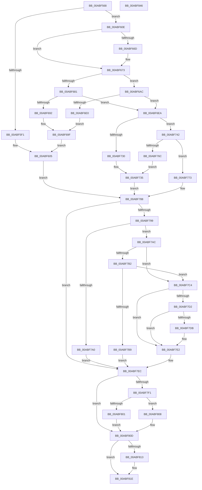

# CmpCreateHiveRootCell

- RVA: `0x00ABF568`–`0x00ABF847` (길이 `735` bytes)
- VA: `0x0000000140ABF568`
- 실행 섹션: `PAGE`
- PDB 이름 있음: `예`; PDB Function 태그: `아니요`
- unwind 정보 RVA: `0x000BD7D8`
- 디코드: `205`개 명령, `735/735` bytes 표시
- 미해석 바이트: `0` (있으면 어셈블리에 `.byte`로 보존)

> 이 문서는 커널 이미지의 기계어와 PDB 기호를 분석해 생성했습니다. 4번과 5번은 함수 원형과 자료형을 바이너리 사용 방식에서 추정한 C 해석이며 원본 소스 복구 결과는 아닙니다.

## 1. Dependencies

- 직접 호출 지점: **25**; 고유 호출 대상: **22**
- 직접 호출자로 확인된 함수: **1**
- RIP 상대 이미지 참조: **1**

### Outgoing calls
- `0x00ABF5A6` → [HvpGetCellContextInitialize](../85/HvpGetCellContextInitialize_function_00855F10.md) (function, `0x00855F10`)
- `0x00ABF5B2` → [HvLockHiveFlusherShared](../84/HvLockHiveFlusherShared_function_0084F95C.md) (function, `0x0084F95C`)
- `0x00ABF5BA` → [CmpNameSize](../85/CmpNameSize_function_0085ABC4.md) (function, `0x0085ABC4`)
- `0x00ABF5E6` → [HvAllocateCell](../85/HvAllocateCell_function_00859C94.md) (function, `0x00859C94`)
- `0x00ABF5FC` → [CmpRecordParseFailure](../85/CmpRecordParseFailure_function_00851280.md) (function, `0x00851280`)
- `0x00ABF61A` → [memset](../../text/6C/memset_function_006C6C40.md) (function, `0x006C6C40`)
- `0x00ABF65C` → [CmpCopyName](../85/CmpCopyName_function_0085AF98.md) (function, `0x0085AF98`)
- `0x00ABF684` → [CmpGenerateAppHiveSecurityDescriptor](../7E/CmpGenerateAppHiveSecurityDescriptor_function_007ECEAC.md) (function, `0x007ECEAC`)
- `0x00ABF6A2` → [CmpRecordParseFailure](../85/CmpRecordParseFailure_function_00851280.md) (function, `0x00851280`)
- `0x00ABF6D5` → [SeAssignSecurity](../94/SeAssignSecurity_function_00949590.md) (function, `0x00949590`)
- `0x00ABF6ED` → [CmLockHiveSecurityExclusive](../84/CmLockHiveSecurityExclusive_function_0084B1A8.md) (function, `0x0084B1A8`)
- `0x00ABF71D` → [CmpGetSecurityDescriptorNodeEx](../94/CmpGetSecurityDescriptorNodeEx_function_00949268.md) (function, `0x00949268`)
- `0x00ABF727` → [CmUnlockHiveSecurity](../../pagecmrc/BC/CmUnlockHiveSecurity_function_00BC99C8.md) (function, `0x00BC99C8`)
- `0x00ABF73B` → [CmpRecordParseFailure](../85/CmpRecordParseFailure_function_00851280.md) (function, `0x00851280`)
- `0x00ABF746` → [HvLockHiveWriter](../85/HvLockHiveWriter_function_00859894.md) (function, `0x00859894`)
- `0x00ABF74F` → [HvMarkBaseBlockDirty](../87/HvMarkBaseBlockDirty_function_0087BD04.md) (function, `0x0087BD04`)
- `0x00ABF758` → [HvCheckAndUpdateHiveBackupTimeStamp](../87/HvCheckAndUpdateHiveBackupTimeStamp_function_0087BE90.md) (function, `0x0087BE90`)
- `0x00ABF763` → [HvUnlockHiveWriter](../85/HvUnlockHiveWriter_function_008598E4.md) (function, `0x008598E4`)
- `0x00ABF7A5` → [ExFreePoolWithTag](../../poolcode/B8/ExFreePoolWithTag_function_00B82870.md) (function, `0x00B82870`)
- `0x00ABF7BD` → [SeDeassignSecurity](../A3/SeDeassignSecurity_function_00A305A0.md) (function, `0x00A305A0`)
- `0x00ABF7DD` → [ExFreePoolWithTag](../../poolcode/B8/ExFreePoolWithTag_function_00B82870.md) (function, `0x00B82870`)
- `0x00ABF801` → [HvpReleaseCellFlat](../85/HvpReleaseCellFlat_function_0085CC20.md) (function, `0x0085CC20`)
- `0x00ABF808` → [HvpReleaseCellPaged](../85/HvpReleaseCellPaged_function_00855F40.md) (function, `0x00855F40`)
- `0x00ABF819` → [HvFreeCell](../85/HvFreeCell_function_0085A72C.md) (function, `0x0085A72C`)
- `0x00ABF821` → [HvUnlockHiveFlusherShared](../84/HvUnlockHiveFlusherShared_function_00848738.md) (function, `0x00848738`)

### Direct callers
- [CmpDoParseKey](../85/CmpDoParseKey_function_0085F750.md) at `0x00861565`

### Static image references
- `0x00ABF6AC` → RVA `0x00FC6AC0` (`ALMOSTRO`; read)

## 2. Other-region calls and transfers

- 다른 실행 섹션으로 향하는 call: **4**
  - `0x00ABF61A` → [memset](../../text/6C/memset_function_006C6C40.md) (`PAGE` → `.text`)
  - `0x00ABF727` → [CmUnlockHiveSecurity](../../pagecmrc/BC/CmUnlockHiveSecurity_function_00BC99C8.md) (`PAGE` → `PAGECMRC`)
  - `0x00ABF7A5` → [ExFreePoolWithTag](../../poolcode/B8/ExFreePoolWithTag_function_00B82870.md) (`PAGE` → `POOLCODE`)
  - `0x00ABF7DD` → [ExFreePoolWithTag](../../poolcode/B8/ExFreePoolWithTag_function_00B82870.md) (`PAGE` → `POOLCODE`)
- 별도 외부 분기/꼬리 이동을 확인하지 못했습니다.

## 3. Assembly (complete function range)

```asm
00ABF568  48 89 5C 24 10                  mov qword ptr [rsp + 0x10], rbx
00ABF56D  48 89 74 24 18                  mov qword ptr [rsp + 0x18], rsi
00ABF572  48 89 7C 24 20                  mov qword ptr [rsp + 0x20], rdi
00ABF577  55                              push rbp
00ABF578  41 54                           push r12
00ABF57A  41 55                           push r13
00ABF57C  41 56                           push r14
00ABF57E  41 57                           push r15
00ABF580  48 8B EC                        mov rbp, rsp
00ABF583  48 83 EC 60                     sub rsp, 0x60
00ABF587  83 4D 30 FF                     or dword ptr [rbp + 0x30], 0xffffffff
00ABF58B  48 8B F9                        mov rdi, rcx
00ABF58E  45 33 FF                        xor r15d, r15d
00ABF591  48 8D 4D F0                     lea rcx, [rbp - 0x10]
00ABF595  4C 89 7D F0                     mov qword ptr [rbp - 0x10], r15
00ABF599  49 8B F1                        mov rsi, r9
00ABF59C  4C 89 7D E8                     mov qword ptr [rbp - 0x18], r15
00ABF5A0  4D 8B E0                        mov r12, r8
00ABF5A3  4C 8B EA                        mov r13, rdx
00ABF5A6  E8 65 69 D9 FF                  call 0x140855f10
00ABF5AB  48 8B CF                        mov rcx, rdi
00ABF5AE  4C 89 7D E0                     mov qword ptr [rbp - 0x20], r15
00ABF5B2  E8 A5 03 D9 FF                  call 0x14084f95c
00ABF5B7  49 8B CC                        mov rcx, r12
00ABF5BA  E8 05 B6 D9 FF                  call 0x14085abc4
00ABF5BF  44 0F B7 F0                     movzx r14d, ax
00ABF5C3  4C 8D 4D 30                     lea r9, [rbp + 0x30]
00ABF5C7  48 8D 45 F0                     lea rax, [rbp - 0x10]
00ABF5CB  41 83 C6 4C                     add r14d, 0x4c
00ABF5CF  48 89 44 24 28                  mov qword ptr [rsp + 0x28], rax
00ABF5D4  45 33 C0                        xor r8d, r8d
00ABF5D7  48 8D 45 E8                     lea rax, [rbp - 0x18]
00ABF5DB  41 8B D6                        mov edx, r14d
00ABF5DE  48 8B CF                        mov rcx, rdi
00ABF5E1  48 89 44 24 20                  mov qword ptr [rsp + 0x20], rax
00ABF5E6  E8 A9 A6 D9 FF                  call 0x140859c94
00ABF5EB  8B D8                           mov ebx, eax
00ABF5ED  85 C0                           test eax, eax
00ABF5EF  79 1D                           jns 0x140abf60e
00ABF5F1  44 8B C0                        mov r8d, eax
00ABF5F4  BA 00 01 03 00                  mov edx, 0x30100
00ABF5F9  48 8B CE                        mov rcx, rsi
00ABF5FC  E8 7F 1C D9 FF                  call 0x140851280
00ABF601  4C 8B 7D E8                     mov r15, qword ptr [rbp - 0x18]
00ABF605  44 8B 75 30                     mov r14d, dword ptr [rbp + 0x30]
00ABF609  E9 7A 01 00 00                  jmp 0x140abf788
00ABF60E  48 8B 5D E8                     mov rbx, qword ptr [rbp - 0x18]
00ABF612  33 D2                           xor edx, edx
00ABF614  48 8B CB                        mov rcx, rbx
00ABF617  45 8B C6                        mov r8d, r14d
00ABF61A  E8 21 76 C0 FF                  call 0x1406c6c40
00ABF61F  C7 03 6E 6B 0C 00               mov dword ptr [rbx], 0xc6b6e
00ABF625  83 C9 FF                        or ecx, 0xffffffff
00ABF628  48 B8 14 00 00 00 80 F7 FF FF   movabs rax, 0xfffff78000000014
00ABF632  49 8B D4                        mov rdx, r12
00ABF635  48 8B 00                        mov rax, qword ptr [rax]
00ABF638  4C 8B 7D E8                     mov r15, qword ptr [rbp - 0x18]
00ABF63C  49 89 47 04                     mov qword ptr [r15 + 4], rax
00ABF640  41 89 4F 10                     mov dword ptr [r15 + 0x10], ecx
00ABF644  41 89 4F 1C                     mov dword ptr [r15 + 0x1c], ecx
00ABF648  41 89 4F 20                     mov dword ptr [r15 + 0x20], ecx
00ABF64C  41 89 4F 28                     mov dword ptr [r15 + 0x28], ecx
00ABF650  41 89 4F 2C                     mov dword ptr [r15 + 0x2c], ecx
00ABF654  41 89 4F 30                     mov dword ptr [r15 + 0x30], ecx
00ABF658  49 8D 4F 4C                     lea rcx, [r15 + 0x4c]
00ABF65C  E8 37 B9 D9 FF                  call 0x14085af98
00ABF661  66 41 89 47 48                  mov word ptr [r15 + 0x48], ax
00ABF666  66 41 3B 04 24                  cmp ax, word ptr [r12]
00ABF66B  73 06                           jae 0x140abf673
00ABF66D  66 41 83 4F 02 20               or word ptr [r15 + 2], 0x20
00ABF673  8B 87 10 10 00 00               mov eax, dword ptr [rdi + 0x1010]
00ABF679  49 8D 55 20                     lea rdx, [r13 + 0x20]
00ABF67D  A8 20                           test al, 0x20
00ABF67F  74 2B                           je 0x140abf6ac
00ABF681  48 8B CA                        mov rcx, rdx
00ABF684  E8 23 D8 D2 FF                  call 0x1407eceac
00ABF689  48 89 45 E0                     mov qword ptr [rbp - 0x20], rax
00ABF68D  48 85 C0                        test rax, rax
00ABF690  75 58                           jne 0x140abf6ea
00ABF692  BB 9A 00 00 C0                  mov ebx, 0xc000009a
00ABF697  BA 00 02 03 00                  mov edx, 0x30200
00ABF69C  44 8B C3                        mov r8d, ebx
00ABF69F  48 8B CE                        mov rcx, rsi
00ABF6A2  E8 D9 1B D9 FF                  call 0x140851280
00ABF6A7  E9 59 FF FF FF                  jmp 0x140abf605
00ABF6AC  48 8B 05 0D 74 50 00            mov rax, qword ptr [rip + 0x50740d]
00ABF6B3  4C 8D 45 E0                     lea r8, [rbp - 0x20]
00ABF6B7  41 B1 01                        mov r9b, 1
00ABF6BA  48 8D 48 4C                     lea rcx, [rax + 0x4c]
00ABF6BE  8B 40 64                        mov eax, dword ptr [rax + 0x64]
00ABF6C1  89 44 24 30                     mov dword ptr [rsp + 0x30], eax
00ABF6C5  48 89 4C 24 28                  mov qword ptr [rsp + 0x28], rcx
00ABF6CA  33 C9                           xor ecx, ecx
00ABF6CC  48 89 54 24 20                  mov qword ptr [rsp + 0x20], rdx
00ABF6D1  49 8B 55 40                     mov rdx, qword ptr [r13 + 0x40]
00ABF6D5  E8 B6 9E E8 FF                  call 0x140949590
00ABF6DA  8B D8                           mov ebx, eax
00ABF6DC  85 C0                           test eax, eax
00ABF6DE  79 0A                           jns 0x140abf6ea
00ABF6E0  44 8B C0                        mov r8d, eax
00ABF6E3  BA 00 03 03 00                  mov edx, 0x30300
00ABF6E8  EB B5                           jmp 0x140abf69f
00ABF6EA  48 8B CF                        mov rcx, rdi
00ABF6ED  E8 B6 BA D8 FF                  call 0x14084b1a8
00ABF6F2  44 8B 75 30                     mov r14d, dword ptr [rbp + 0x30]
00ABF6F6  49 8D 47 2C                     lea rax, [r15 + 0x2c]
00ABF6FA  48 89 44 24 30                  mov qword ptr [rsp + 0x30], rax
00ABF6FF  45 8B CE                        mov r9d, r14d
00ABF702  48 8B 45 E0                     mov rax, qword ptr [rbp - 0x20]
00ABF706  4D 8B C7                        mov r8, r15
00ABF709  41 C1 E9 1F                     shr r9d, 0x1f
00ABF70D  41 8B D6                        mov edx, r14d
00ABF710  C6 44 24 28 00                  mov byte ptr [rsp + 0x28], 0
00ABF715  48 8B CF                        mov rcx, rdi
00ABF718  48 89 44 24 20                  mov qword ptr [rsp + 0x20], rax
00ABF71D  E8 46 9B E8 FF                  call 0x140949268
00ABF722  48 8B CF                        mov rcx, rdi
00ABF725  8B D8                           mov ebx, eax
00ABF727  E8 9C A2 10 00                  call 0x140bc99c8
00ABF72C  85 DB                           test ebx, ebx
00ABF72E  79 12                           jns 0x140abf742
00ABF730  BA 00 04 03 00                  mov edx, 0x30400
00ABF735  44 8B C3                        mov r8d, ebx
00ABF738  48 8B CE                        mov rcx, rsi
00ABF73B  E8 40 1B D9 FF                  call 0x140851280
00ABF740  EB 46                           jmp 0x140abf788
00ABF742  48 8B 4E 30                     mov rcx, qword ptr [rsi + 0x30]
00ABF746  E8 49 A1 D9 FF                  call 0x140859894
00ABF74B  48 8B 4E 30                     mov rcx, qword ptr [rsi + 0x30]
00ABF74F  E8 B0 C5 DB FF                  call 0x14087bd04
00ABF754  48 8B 4E 30                     mov rcx, qword ptr [rsi + 0x30]
00ABF758  E8 33 C7 DB FF                  call 0x14087be90
00ABF75D  48 8B 4E 30                     mov rcx, qword ptr [rsi + 0x30]
00ABF761  8B D8                           mov ebx, eax
00ABF763  E8 7C A1 D9 FF                  call 0x1408598e4
00ABF768  85 DB                           test ebx, ebx
00ABF76A  79 07                           jns 0x140abf773
00ABF76C  BA 00 05 03 00                  mov edx, 0x30500
00ABF771  EB C2                           jmp 0x140abf735
00ABF773  48 8B 47 40                     mov rax, qword ptr [rdi + 0x40]
00ABF777  44 89 70 24                     mov dword ptr [rax + 0x24], r14d
00ABF77B  48 8B 45 50                     mov rax, qword ptr [rbp + 0x50]
00ABF77F  44 89 30                        mov dword ptr [rax], r14d
00ABF782  41 83 CE FF                     or r14d, 0xffffffff
00ABF786  33 DB                           xor ebx, ebx
00ABF788  B8 10 10 00 00                  mov eax, 0x1010
00ABF78D  48 8B CF                        mov rcx, rdi
00ABF790  4C 8B 65 E0                     mov r12, qword ptr [rbp - 0x20]
00ABF794  4D 85 E4                        test r12, r12
00ABF797  74 53                           je 0x140abf7ec
00ABF799  8B 04 08                        mov eax, dword ptr [rax + rcx]
00ABF79C  A8 20                           test al, 0x20
00ABF79E  74 0C                           je 0x140abf7ac
00ABF7A0  33 D2                           xor edx, edx
00ABF7A2  49 8B CC                        mov rcx, r12
00ABF7A5  E8 C6 30 0C 00                  call 0x140b82870
00ABF7AA  EB 40                           jmp 0x140abf7ec
00ABF7AC  8B 06                           mov eax, dword ptr [rsi]
00ABF7AE  A8 01                           test al, 1
00ABF7B0  74 12                           je 0x140abf7c4
00ABF7B2  8B 46 18                        mov eax, dword ptr [rsi + 0x18]
00ABF7B5  A8 04                           test al, 4
00ABF7B7  74 0B                           je 0x140abf7c4
00ABF7B9  48 8D 4D E0                     lea rcx, [rbp - 0x20]
00ABF7BD  E8 DE 0D F7 FF                  call 0x140a305a0
00ABF7C2  EB 28                           jmp 0x140abf7ec
00ABF7C4  41 F7 45 0C 00 00 00 04         test dword ptr [r13 + 0xc], 0x4000000
00ABF7CC  49 8B 75 48                     mov rsi, qword ptr [r13 + 0x48]
00ABF7D0  75 10                           jne 0x140abf7e2
00ABF7D2  48 8B 4E 30                     mov rcx, qword ptr [rsi + 0x30]
00ABF7D6  48 85 C9                        test rcx, rcx
00ABF7D9  74 07                           je 0x140abf7e2
00ABF7DB  33 D2                           xor edx, edx
00ABF7DD  E8 8E 30 0C 00                  call 0x140b82870
00ABF7E2  41 0F BA 75 0C 1A               btr dword ptr [r13 + 0xc], 0x1a
00ABF7E8  4C 89 66 30                     mov qword ptr [rsi + 0x30], r12
00ABF7EC  4D 85 FF                        test r15, r15
00ABF7EF  74 1C                           je 0x140abf80d
00ABF7F1  F6 87 8C 00 00 00 01            test byte ptr [rdi + 0x8c], 1
00ABF7F8  48 8D 55 F0                     lea rdx, [rbp - 0x10]
00ABF7FC  48 8B CF                        mov rcx, rdi
00ABF7FF  74 07                           je 0x140abf808
00ABF801  E8 1A D4 D9 FF                  call 0x14085cc20
00ABF806  EB 05                           jmp 0x140abf80d
00ABF808  E8 33 67 D9 FF                  call 0x140855f40
00ABF80D  41 83 FE FF                     cmp r14d, -1
00ABF811  74 0B                           je 0x140abf81e
00ABF813  41 8B D6                        mov edx, r14d
00ABF816  48 8B CF                        mov rcx, rdi
00ABF819  E8 0E AF D9 FF                  call 0x14085a72c
00ABF81E  48 8B CF                        mov rcx, rdi
00ABF821  E8 12 8F D8 FF                  call 0x140848738
00ABF826  4C 8D 5C 24 60                  lea r11, [rsp + 0x60]
00ABF82B  8B C3                           mov eax, ebx
00ABF82D  49 8B 5B 38                     mov rbx, qword ptr [r11 + 0x38]
00ABF831  49 8B 73 40                     mov rsi, qword ptr [r11 + 0x40]
00ABF835  49 8B 7B 48                     mov rdi, qword ptr [r11 + 0x48]
00ABF839  49 8B E3                        mov rsp, r11
00ABF83C  41 5F                           pop r15
00ABF83E  41 5E                           pop r14
00ABF840  41 5D                           pop r13
00ABF842  41 5C                           pop r12
00ABF844  5D                              pop rbp
00ABF845  C3                              ret
00ABF846  CC                              int3
```

## 4. C-style interpretation (structured pseudocode)

```c
__int64 __fastcall CmpCreateHiveRootCell(__int64 a1, __int64 a2, __int64 a3, __int64 a4, __int64 a5)
{
    __int64 result;
    __int64 v_r14;
    __int64 v_r15;
    __int64 v_rbx;
    __int64 v_rsp;
    unsigned __int64 v_stack_m28;
    unsigned __int64 v_stack_m38;
    unsigned __int64 v_stack_m40;
    unsigned __int64 v_stack_m48;
    unsigned int v_stack_m58;
    unsigned __int64 v_stack_m60;
    unsigned __int64 v_stack_m68;
    unsigned __int64 v_stack_p10;
    unsigned __int64 v_stack_p18;
    unsigned __int64 v_stack_p20;
    unsigned int v_stack_p8;

    v_stack_p10 = v_rbx;
    v_stack_p18 = v_rsi;
    v_stack_p20 = v_rdi;
    v_rsp = (v_rsp) - (96);
    v_r15 = 0;
    v_stack_m38 = 0;
    v_stack_m40 = 0;
    result = HvpGetCellContextInitialize(v_stack_m38, a2, a3, a4);
    v_stack_m48 = 0;
    result = HvLockHiveFlusherShared(a1, a2, a3, a4);
    result = CmpNameSize(a3, a2, a3, a4);
    v_r14 = (unsigned int)(((unsigned __int16)(result)) + (76));
    v_stack_m60 = v_stack_m38;
    a3 = 0;
    v_stack_m68 = v_stack_m40;
    result = HvAllocateCell(a1, (unsigned int)((unsigned int)(v_r14)), a3, v_stack_p8);
    if (!sign_flag) goto loc_00ABF60E;
    result = CmpRecordParseFailure(a4, (unsigned int)(0x30100ULL), (unsigned int)((unsigned int)(result)), v_stack_p8);
loc_00ABF605:
    goto loc_00ABF788;
loc_00ABF60E:
    a2 = 0;
    result = memset(v_stack_m40, a2, (unsigned int)((unsigned int)((unsigned int)(v_stack_p8))), v_stack_p8);
    *(unsigned int *)(v_stack_m40) = 0xC6B6EULL;
    a1 = (unsigned int)((v_stack_m40) | (0xFFFFFFFFULL));
    *(unsigned __int64 *)(v_stack_m40 + 4) = *(unsigned __int64 *)(result);
    *(unsigned int *)(v_stack_m40 + 16) = (unsigned int)(a1);
    *(unsigned int *)(v_stack_m40 + 28) = (unsigned int)(a1);
    *(unsigned int *)(v_stack_m40 + 32) = (unsigned int)(a1);
    *(unsigned int *)(v_stack_m40 + 40) = (unsigned int)(a1);
    *(unsigned int *)(v_stack_m40 + 44) = (unsigned int)(a1);
    *(unsigned int *)(v_stack_m40 + 48) = (unsigned int)(a1);
    result = CmpCopyName(v_stack_m40 + 76, 0, (unsigned int)((unsigned int)((unsigned int)(v_stack_p8))), v_stack_p8);
    *(unsigned __int16 *)(v_stack_m40 + 72) = (unsigned __int16)(result);
    if (((unsigned __int16)(result)) < (*(unsigned __int16 *)(a3))) {
    }
    if ((((unsigned __int8)((unsigned int)(*(unsigned int *)(a1 + 4112)))) & (32)) == 0) goto loc_00ABF6AC;
    result = CmpGenerateAppHiveSecurityDescriptor(a2 + 32, a2 + 32, (unsigned int)((unsigned int)((unsigned int)(v_stack_p8))), v_stack_p8);
    v_stack_m48 = result;
    if (result != 0) goto loc_00ABF6EA;
loc_00ABF69F:
    result = CmpRecordParseFailure(a4, (unsigned int)(0x30200ULL), (unsigned int)((unsigned int)((unsigned int)(0xC000009AULL))), v_stack_p8);
    goto loc_00ABF605;
loc_00ABF6AC:
    v_stack_m58 = (unsigned int)((unsigned int)(*(unsigned int *)(*(unsigned __int64 *)(v_rip + 5272589) + 100)));
    v_stack_m60 = *(unsigned __int64 *)(v_rip + 5272589) + 76;
    a1 = 0;
    v_stack_m68 = (unsigned int)(0x30200ULL);
    result = SeAssignSecurity(a1, *(unsigned __int64 *)(a2 + 64), v_stack_m48, 1);
    if (!sign_flag) goto loc_00ABF6EA;
    goto loc_00ABF69F;
loc_00ABF6EA:
    result = CmLockHiveSecurityExclusive(0, (unsigned int)(0x30300ULL), (unsigned int)((unsigned int)(result)), 1);
    v_stack_m58 = v_stack_m40 + 44;
    a4 = (unsigned int)(((unsigned int)((unsigned int)((unsigned int)(v_stack_p8)))) >> (31));
    v_stack_m60 = 0;
    v_stack_m68 = v_stack_m48;
    result = CmpGetSecurityDescriptorNodeEx(0, (unsigned int)((unsigned int)((unsigned int)(v_stack_p8))), v_stack_m40, a4);
    result = CmUnlockHiveSecurity(0, (unsigned int)((unsigned int)((unsigned int)(v_stack_p8))), v_stack_m40, a4);
    if (!sign_flag) goto loc_00ABF742;
loc_00ABF735:
    result = CmpRecordParseFailure(a4, (unsigned int)(0x30400ULL), (unsigned int)((unsigned int)((unsigned int)((unsigned int)(result)))), a4);
    goto loc_00ABF788;
loc_00ABF742:
    result = HvLockHiveWriter(*(unsigned __int64 *)(a4 + 48), (unsigned int)(0x30400ULL), (unsigned int)((unsigned int)((unsigned int)((unsigned int)(result)))), a4);
    result = HvMarkBaseBlockDirty(*(unsigned __int64 *)(a4 + 48), (unsigned int)(0x30400ULL), (unsigned int)((unsigned int)((unsigned int)((unsigned int)(result)))), a4);
    result = HvCheckAndUpdateHiveBackupTimeStamp(*(unsigned __int64 *)(a4 + 48), (unsigned int)(0x30400ULL), (unsigned int)((unsigned int)((unsigned int)((unsigned int)(result)))), a4);
    result = HvUnlockHiveWriter(*(unsigned __int64 *)(a4 + 48), (unsigned int)(0x30400ULL), (unsigned int)((unsigned int)((unsigned int)((unsigned int)(result)))), a4);
    if (!sign_flag) goto loc_00ABF773;
    goto loc_00ABF735;
loc_00ABF773:
    *(unsigned int *)(*(unsigned __int64 *)(a1 + 64) + 36) = (unsigned int)((unsigned int)(v_stack_p8));
    *(unsigned int *)(a5) = (unsigned int)((unsigned int)(v_stack_p8));
    v_r14 = (unsigned int)(((unsigned int)(v_stack_p8)) | (0xFFFFFFFFULL));
    v_rbx = 0;
loc_00ABF788:
    if (v_stack_m48 == 0) goto loc_00ABF7EC;
    if ((((unsigned __int8)((unsigned int)(*(unsigned int *)((unsigned int)(0x1010ULL) + 0 * 1)))) & (32)) == 0) goto loc_00ABF7AC;
    a2 = 0;
    result = ExFreePoolWithTag(v_stack_m48, a2, (unsigned int)((unsigned int)((unsigned int)((unsigned int)(result)))), a4);
    goto loc_00ABF7EC;
loc_00ABF7AC:
    if ((((unsigned __int8)((unsigned int)(*(unsigned int *)(a4)))) & (1)) == 0) goto loc_00ABF7C4;
    if ((((unsigned __int8)((unsigned int)(*(unsigned int *)(a4 + 24)))) & (4)) == 0) goto loc_00ABF7C4;
    result = SeDeassignSecurity(v_stack_m48, a2, (unsigned int)((unsigned int)((unsigned int)((unsigned int)(result)))), a4);
    goto loc_00ABF7EC;
loc_00ABF7C4:
    if (((*(unsigned int *)(a2 + 12)) & (0x4000000ULL)) != 0) goto loc_00ABF7E2;
    if (*(unsigned __int64 *)(*(unsigned __int64 *)(a2 + 72) + 48) != 0) {
        a2 = 0;
        result = ExFreePoolWithTag(*(unsigned __int64 *)(*(unsigned __int64 *)(a2 + 72) + 48), a2, (unsigned int)((unsigned int)((unsigned int)((unsigned int)(result)))), a4);
    }
    *(unsigned __int64 *)(*(unsigned __int64 *)(a2 + 72) + 48) = v_stack_m48;
loc_00ABF7EC:
    if (v_stack_m40 == 0) goto loc_00ABF80D;
    if (((*(unsigned __int8 *)(a1 + 140)) & (1)) == 0) goto loc_00ABF808;
    result = HvpReleaseCellFlat(0, v_stack_m38, (unsigned int)((unsigned int)((unsigned int)((unsigned int)(result)))), a4);
    goto loc_00ABF80D;
loc_00ABF808:
    result = HvpReleaseCellPaged(0, v_stack_m38, (unsigned int)((unsigned int)((unsigned int)((unsigned int)(result)))), a4);
loc_00ABF80D:
    if (((unsigned int)(v_r14)) != -1) {
        a2 = (unsigned int)(v_r14);
        a1 = 0;
        result = HvFreeCell(a1, a2, (unsigned int)((unsigned int)((unsigned int)((unsigned int)(result)))), a4);
    }
    result = HvUnlockHiveFlusherShared(a1, a2, (unsigned int)((unsigned int)((unsigned int)((unsigned int)(result)))), a4);
    return 0;
}
```

## 5. (Beta) C Style

```c
int64_t CmpCreateHiveRootCell(void *Arg1, void *Arg2, void *Arg3, void *Arg4, void *Arg5)
{
    uint8_t *arg1 = (uint8_t *)Arg1;
    uint8_t *arg2 = (uint8_t *)Arg2;
    uint8_t *arg3 = (uint8_t *)Arg3;
    uint8_t *arg4 = (uint8_t *)Arg4;
    uint8_t *arg5 = (uint8_t *)Arg5;

    int64_t result;
    int64_t local_r14;
    int64_t local_r15;
    int64_t local_rbx;
    int64_t local_rsp;
    uint64_t v_stack_m28;
    uint64_t v_stack_m38;
    uint64_t v_stack_m40;
    uint64_t v_stack_m48;
    uint32_t v_stack_m58;
    uint64_t v_stack_m60;
    uint64_t v_stack_m68;
    uint64_t v_stack_p10;
    uint64_t v_stack_p18;
    uint64_t v_stack_p20;
    uint32_t v_stack_p8;

    v_stack_p10 = local_rbx;
    v_stack_p18 = local_rsi;
    v_stack_p20 = local_rdi;
    local_rsp = (local_rsp) - (96);
    local_r15 = 0;
    v_stack_m38 = 0;
    v_stack_m40 = 0;
    result = HvpGetCellContextInitialize(v_stack_m38, Arg2, Arg3, Arg4);
    v_stack_m48 = 0;
    result = HvLockHiveFlusherShared(Arg1, Arg2, Arg3, Arg4);
    result = CmpNameSize(Arg3, Arg2, Arg3, Arg4);
    local_r14 = (uint32_t)(((uint16_t)(result)) + (76));
    v_stack_m60 = v_stack_m38;
    Arg3 = 0;
    v_stack_m68 = v_stack_m40;
    result = HvAllocateCell(Arg1, (uint32_t)((uint32_t)(local_r14)), Arg3, v_stack_p8);
    if (!sign_flag) goto loc_00ABF60E;
    result = CmpRecordParseFailure(Arg4, (uint32_t)(0x30100ULL), (uint32_t)((uint32_t)(result)), v_stack_p8);
loc_00ABF605:
    goto loc_00ABF788;
loc_00ABF60E:
    Arg2 = 0;
    result = memset(v_stack_m40, Arg2, (uint32_t)((uint32_t)((uint32_t)(v_stack_p8))), v_stack_p8);
    *(uint32_t *)(v_stack_m40) = 0xC6B6EULL;
    Arg1 = (uint32_t)((v_stack_m40) | (0xFFFFFFFFULL));
    *(uint64_t *)(v_stack_m40 + 0x4) = *(uint64_t *)(result);
    *(uint32_t *)(v_stack_m40 + 0x10) = (uint32_t)(Arg1);
    *(uint32_t *)(v_stack_m40 + 0x1C) = (uint32_t)(Arg1);
    *(uint32_t *)(v_stack_m40 + 0x20) = (uint32_t)(Arg1);
    *(uint32_t *)(v_stack_m40 + 0x28) = (uint32_t)(Arg1);
    *(uint32_t *)(v_stack_m40 + 0x2C) = (uint32_t)(Arg1);
    *(uint32_t *)(v_stack_m40 + 0x30) = (uint32_t)(Arg1);
    result = CmpCopyName(v_stack_m40 + 76, 0, (uint32_t)((uint32_t)((uint32_t)(v_stack_p8))), v_stack_p8);
    *(uint16_t *)(v_stack_m40 + 0x48) = (uint16_t)(result);
    if (((uint16_t)(result)) < (*(uint16_t *)(arg3))) {
    }
    if ((((uint8_t)((uint32_t)(*(uint32_t *)(arg1 + 0x1010)))) & (32)) == 0) goto loc_00ABF6AC;
    result = CmpGenerateAppHiveSecurityDescriptor(Arg2 + 32, Arg2 + 32, (uint32_t)((uint32_t)((uint32_t)(v_stack_p8))), v_stack_p8);
    v_stack_m48 = result;
    if (result != 0) goto loc_00ABF6EA;
loc_00ABF69F:
    result = CmpRecordParseFailure(Arg4, (uint32_t)(0x30200ULL), (uint32_t)((uint32_t)((uint32_t)(0xC000009AULL))), v_stack_p8);
    goto loc_00ABF605;
loc_00ABF6AC:
    v_stack_m58 = (uint32_t)((uint32_t)(*(uint32_t *)(*(uint64_t *)(v_rip + 0x50740D) + 0x64)));
    v_stack_m60 = *(uint64_t *)(v_rip + 0x50740D) + 76;
    Arg1 = 0;
    v_stack_m68 = (uint32_t)(0x30200ULL);
    result = SeAssignSecurity(Arg1, *(uint64_t *)(arg2 + 0x40), v_stack_m48, 1);
    if (!sign_flag) goto loc_00ABF6EA;
    goto loc_00ABF69F;
loc_00ABF6EA:
    result = CmLockHiveSecurityExclusive(0, (uint32_t)(0x30300ULL), (uint32_t)((uint32_t)(result)), 1);
    v_stack_m58 = v_stack_m40 + 44;
    Arg4 = (uint32_t)(((uint32_t)((uint32_t)((uint32_t)(v_stack_p8)))) >> (31));
    v_stack_m60 = 0;
    v_stack_m68 = v_stack_m48;
    result = CmpGetSecurityDescriptorNodeEx(0, (uint32_t)((uint32_t)((uint32_t)(v_stack_p8))), v_stack_m40, Arg4);
    result = CmUnlockHiveSecurity(0, (uint32_t)((uint32_t)((uint32_t)(v_stack_p8))), v_stack_m40, Arg4);
    if (!sign_flag) goto loc_00ABF742;
loc_00ABF735:
    result = CmpRecordParseFailure(Arg4, (uint32_t)(0x30400ULL), (uint32_t)((uint32_t)((uint32_t)((uint32_t)(result)))), Arg4);
    goto loc_00ABF788;
loc_00ABF742:
    result = HvLockHiveWriter(*(uint64_t *)(arg4 + 0x30), (uint32_t)(0x30400ULL), (uint32_t)((uint32_t)((uint32_t)((uint32_t)(result)))), Arg4);
    result = HvMarkBaseBlockDirty(*(uint64_t *)(arg4 + 0x30), (uint32_t)(0x30400ULL), (uint32_t)((uint32_t)((uint32_t)((uint32_t)(result)))), Arg4);
    result = HvCheckAndUpdateHiveBackupTimeStamp(*(uint64_t *)(arg4 + 0x30), (uint32_t)(0x30400ULL), (uint32_t)((uint32_t)((uint32_t)((uint32_t)(result)))), Arg4);
    result = HvUnlockHiveWriter(*(uint64_t *)(arg4 + 0x30), (uint32_t)(0x30400ULL), (uint32_t)((uint32_t)((uint32_t)((uint32_t)(result)))), Arg4);
    if (!sign_flag) goto loc_00ABF773;
    goto loc_00ABF735;
loc_00ABF773:
    *(uint32_t *)(*(uint64_t *)(arg1 + 0x40) + 0x24) = (uint32_t)((uint32_t)(v_stack_p8));
    *(uint32_t *)(arg5) = (uint32_t)((uint32_t)(v_stack_p8));
    local_r14 = (uint32_t)(((uint32_t)(v_stack_p8)) | (0xFFFFFFFFULL));
    local_rbx = 0;
loc_00ABF788:
    if (v_stack_m48 == 0) goto loc_00ABF7EC;
    if ((((uint8_t)((uint32_t)(*(uint32_t *)((uint32_t)(0x1010ULL) + 0x0 * 1)))) & (32)) == 0) goto loc_00ABF7AC;
    Arg2 = 0;
    result = ExFreePoolWithTag(v_stack_m48, Arg2, (uint32_t)((uint32_t)((uint32_t)((uint32_t)(result)))), Arg4);
    goto loc_00ABF7EC;
loc_00ABF7AC:
    if ((((uint8_t)((uint32_t)(*(uint32_t *)(arg4)))) & (1)) == 0) goto loc_00ABF7C4;
    if ((((uint8_t)((uint32_t)(*(uint32_t *)(arg4 + 0x18)))) & (4)) == 0) goto loc_00ABF7C4;
    result = SeDeassignSecurity(v_stack_m48, Arg2, (uint32_t)((uint32_t)((uint32_t)((uint32_t)(result)))), Arg4);
    goto loc_00ABF7EC;
loc_00ABF7C4:
    if (((*(uint32_t *)(arg2 + 0xC)) & (0x4000000ULL)) != 0) goto loc_00ABF7E2;
    if (*(uint64_t *)(*(uint64_t *)(arg2 + 0x48) + 0x30) != 0) {
        Arg2 = 0;
        result = ExFreePoolWithTag(*(uint64_t *)(*(uint64_t *)(arg2 + 0x48) + 0x30), Arg2, (uint32_t)((uint32_t)((uint32_t)((uint32_t)(result)))), Arg4);
    }
    *(uint64_t *)(*(uint64_t *)(arg2 + 0x48) + 0x30) = v_stack_m48;
loc_00ABF7EC:
    if (v_stack_m40 == 0) goto loc_00ABF80D;
    if (((*(uint8_t *)(arg1 + 0x8C)) & (1)) == 0) goto loc_00ABF808;
    result = HvpReleaseCellFlat(0, v_stack_m38, (uint32_t)((uint32_t)((uint32_t)((uint32_t)(result)))), Arg4);
    goto loc_00ABF80D;
loc_00ABF808:
    result = HvpReleaseCellPaged(0, v_stack_m38, (uint32_t)((uint32_t)((uint32_t)((uint32_t)(result)))), Arg4);
loc_00ABF80D:
    if (((uint32_t)(local_r14)) != -1) {
        Arg2 = (uint32_t)(local_r14);
        Arg1 = 0;
        result = HvFreeCell(Arg1, Arg2, (uint32_t)((uint32_t)((uint32_t)((uint32_t)(result)))), Arg4);
    }
    result = HvUnlockHiveFlusherShared(Arg1, Arg2, (uint32_t)((uint32_t)((uint32_t)((uint32_t)(result)))), Arg4);
    return 0;
}
```

### 관측된 메모리 오프셋

구조체 형식이 확인되지 않은 접근은 인자 기준의 오프셋으로만 기록했습니다.

| 기준 인자 | 오프셋 표현 | 폭 (bit) | 접근 |
|---|---:|---:|---|
| `Arg1` | `+ 0x40` | `64` | `R` |
| `Arg1` | `+ 0x8C` | `8` | `R` |
| `Arg1` | `+ 0x1010` | `32` | `R` |
| `Arg2` | `+ 0xC` | `32` | `R` |
| `Arg2` | `+ 0xC` | `32` | `R/W` |
| `Arg2` | `+ 0x20` | `64` | `R` |
| `Arg2` | `+ 0x40` | `64` | `R` |
| `Arg2` | `+ 0x48` | `64` | `R` |
| `Arg3` | `+ 0x0` | `16` | `R` |
| `Arg4` | `+ 0x0` | `32` | `R` |
| `Arg4` | `+ 0x18` | `32` | `R` |
| `Arg4` | `+ 0x30` | `64` | `R` |
| `Arg5` | `+ 0x0` | `32` | `W` |

## 6. Execution-region graph

[열기: 2D/3D 그래프와 함수 탐색 컨트롤 패널](../../../control-panel.html?section=page&rva=0x00ABF568&view=graph)

- 2D 그래프는 위에서 아래로 흐르고, 3D 그래프는 빈 공간을 드래그해 회전합니다. Shift+드래그는 이동, 휠은 확대·축소, 함수 노드 선택은 대상 보고서 이동입니다.

### Static fallback


