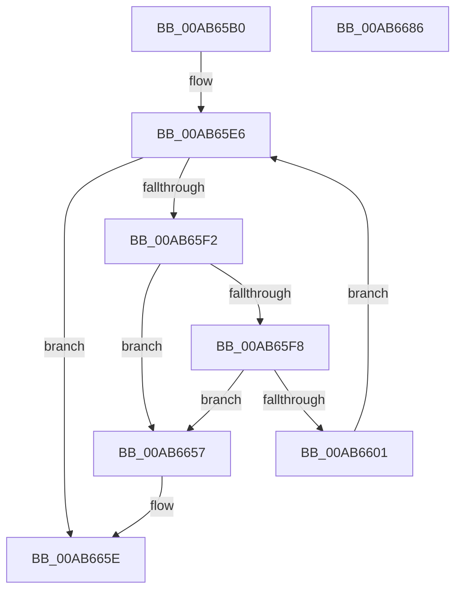

# CmpDelayFreeRMWorker

- RVA: `0x00AB65B0`–`0x00AB6687` (길이 `215` bytes)
- VA: `0x0000000140AB65B0`
- 실행 섹션: `PAGE`
- PDB 이름 있음: `예`; PDB Function 태그: `아니요`
- unwind 정보 RVA: `0x000BCEBC`
- 디코드: `49`개 명령, `215/215` bytes 표시
- 미해석 바이트: `0` (있으면 어셈블리에 `.byte`로 보존)

> 이 문서는 커널 이미지의 기계어와 PDB 기호를 분석해 생성했습니다. 4번과 5번은 함수 원형과 자료형을 바이너리 사용 방식에서 추정한 C 해석이며 원본 소스 복구 결과는 아닙니다.

## 1. Dependencies

- 직접 호출 지점: **11**; 고유 호출 대상: **8**
- 직접 호출자로 확인된 함수: **0**
- RIP 상대 이미지 참조: **4**

### Outgoing calls
- `0x00AB65CE` → [CmpInitializeThreadInfo](../../text/3F/CmpInitializeThreadInfo_function_003FBE70.md) (function, `0x003FBE70`)
- `0x00AB65DA` → [ExAcquireFastMutex](../../text/20/ExAcquireFastMutex_function_0020E5A0.md) (function, `0x0020E5A0`)
- `0x00AB6613` → [ExReleaseFastMutex](../../text/25/ExReleaseFastMutex_function_002519C0.md) (function, `0x002519C0`)
- `0x00AB6618` → [CmpLockRegistryExclusive](../84/CmpLockRegistryExclusive_function_0084F9B4.md) (function, `0x0084F9B4`)
- `0x00AB6624` → [ExDeleteResourceLite](../../text/38/ExDeleteResourceLite_function_0038BA60.md) (function, `0x0038BA60`)
- `0x00AB6632` → [ExFreePoolWithTag](../../poolcode/B8/ExFreePoolWithTag_function_00B82870.md) (function, `0x00B82870`)
- `0x00AB663F` → [ExFreePoolWithTag](../../poolcode/B8/ExFreePoolWithTag_function_00B82870.md) (function, `0x00B82870`)
- `0x00AB6644` → [CmpUnlockRegistry](../../pagecmrc/BC/CmpUnlockRegistry_function_00BC9A84.md) (function, `0x00BC9A84`)
- `0x00AB6650` → [ExAcquireFastMutex](../../text/20/ExAcquireFastMutex_function_0020E5A0.md) (function, `0x0020E5A0`)
- `0x00AB666C` → [ExReleaseFastMutex](../../text/25/ExReleaseFastMutex_function_002519C0.md) (function, `0x002519C0`)
- `0x00AB6676` → [CmCleanupThreadInfo](../../text/41/CmCleanupThreadInfo_function_0041FD50.md) (function, `0x0041FD50`)

### Direct callers
- 이 함수 시작 RVA로 연결되는 직접 call은 확인되지 않았습니다. 간접 호출은 완전히 역산할 수 없습니다.

### Static image references
- `0x00AB65D3` → RVA `0x00EF56E0` (`.data`; read)
- `0x00AB65DF` → RVA `0x00EF56A0` (`.data`; read)
- `0x00AB6601` → RVA `0x00EF56A0` (`.data`; write)
- `0x00AB6665` → RVA `0x00EEFC68` (`.data`; write)

## 2. Other-region calls and transfers

- 다른 실행 섹션으로 향하는 call: **10**
  - `0x00AB65CE` → [CmpInitializeThreadInfo](../../text/3F/CmpInitializeThreadInfo_function_003FBE70.md) (`PAGE` → `.text`)
  - `0x00AB65DA` → [ExAcquireFastMutex](../../text/20/ExAcquireFastMutex_function_0020E5A0.md) (`PAGE` → `.text`)
  - `0x00AB6613` → [ExReleaseFastMutex](../../text/25/ExReleaseFastMutex_function_002519C0.md) (`PAGE` → `.text`)
  - `0x00AB6624` → [ExDeleteResourceLite](../../text/38/ExDeleteResourceLite_function_0038BA60.md) (`PAGE` → `.text`)
  - `0x00AB6632` → [ExFreePoolWithTag](../../poolcode/B8/ExFreePoolWithTag_function_00B82870.md) (`PAGE` → `POOLCODE`)
  - `0x00AB663F` → [ExFreePoolWithTag](../../poolcode/B8/ExFreePoolWithTag_function_00B82870.md) (`PAGE` → `POOLCODE`)
  - `0x00AB6644` → [CmpUnlockRegistry](../../pagecmrc/BC/CmpUnlockRegistry_function_00BC9A84.md) (`PAGE` → `PAGECMRC`)
  - `0x00AB6650` → [ExAcquireFastMutex](../../text/20/ExAcquireFastMutex_function_0020E5A0.md) (`PAGE` → `.text`)
  - `0x00AB666C` → [ExReleaseFastMutex](../../text/25/ExReleaseFastMutex_function_002519C0.md) (`PAGE` → `.text`)
  - `0x00AB6676` → [CmCleanupThreadInfo](../../text/41/CmCleanupThreadInfo_function_0041FD50.md) (`PAGE` → `.text`)
- 별도 외부 분기/꼬리 이동을 확인하지 못했습니다.

## 3. Assembly (complete function range)

```asm
00AB65B0  48 89 5C 24 08                  mov qword ptr [rsp + 8], rbx
00AB65B5  56                              push rsi
00AB65B6  48 83 EC 40                     sub rsp, 0x40
00AB65BA  0F 57 C0                        xorps xmm0, xmm0
00AB65BD  48 8D 4C 24 20                  lea rcx, [rsp + 0x20]
00AB65C2  33 C0                           xor eax, eax
00AB65C4  0F 11 44 24 20                  movups xmmword ptr [rsp + 0x20], xmm0
00AB65C9  48 89 44 24 30                  mov qword ptr [rsp + 0x30], rax
00AB65CE  E8 9D 58 94 FF                  call 0x1403fbe70
00AB65D3  48 8D 0D 06 F1 43 00            lea rcx, [rip + 0x43f106]
00AB65DA  E8 C1 7F 75 FF                  call 0x14020e5a0
00AB65DF  48 8D 35 BA F0 43 00            lea rsi, [rip + 0x43f0ba]
00AB65E6  48 8B 1D B3 F0 43 00            mov rbx, qword ptr [rip + 0x43f0b3]
00AB65ED  48 3B DE                        cmp rbx, rsi
00AB65F0  74 6C                           je 0x140ab665e
00AB65F2  48 39 73 08                     cmp qword ptr [rbx + 8], rsi
00AB65F6  75 5F                           jne 0x140ab6657
00AB65F8  48 8B 03                        mov rax, qword ptr [rbx]
00AB65FB  48 39 58 08                     cmp qword ptr [rax + 8], rbx
00AB65FF  75 56                           jne 0x140ab6657
00AB6601  48 89 05 98 F0 43 00            mov qword ptr [rip + 0x43f098], rax
00AB6608  48 8D 0D D1 F0 43 00            lea rcx, [rip + 0x43f0d1]
00AB660F  48 89 70 08                     mov qword ptr [rax + 8], rsi
00AB6613  E8 A8 B3 79 FF                  call 0x1402519c0
00AB6618  E8 97 93 D9 FF                  call 0x14084f9b4
00AB661D  48 8B 8B 80 00 00 00            mov rcx, qword ptr [rbx + 0x80]
00AB6624  E8 37 54 8D FF                  call 0x14038ba60
00AB6629  48 8B 8B 80 00 00 00            mov rcx, qword ptr [rbx + 0x80]
00AB6630  33 D2                           xor edx, edx
00AB6632  E8 39 C2 0C 00                  call 0x140b82870
00AB6637  BA 43 4D 52 6D                  mov edx, 0x6d524d43
00AB663C  48 8B CB                        mov rcx, rbx
00AB663F  E8 2C C2 0C 00                  call 0x140b82870
00AB6644  E8 3B 34 11 00                  call 0x140bc9a84
00AB6649  48 8D 0D 90 F0 43 00            lea rcx, [rip + 0x43f090]
00AB6650  E8 4B 7F 75 FF                  call 0x14020e5a0
00AB6655  EB 8F                           jmp 0x140ab65e6
00AB6657  B9 03 00 00 00                  mov ecx, 3
00AB665C  CD 29                           int 0x29
00AB665E  48 8D 0D 7B F0 43 00            lea rcx, [rip + 0x43f07b]
00AB6665  C6 05 FC 95 43 00 00            mov byte ptr [rip + 0x4395fc], 0
00AB666C  E8 4F B3 79 FF                  call 0x1402519c0
00AB6671  48 8D 4C 24 20                  lea rcx, [rsp + 0x20]
00AB6676  E8 D5 96 96 FF                  call 0x14041fd50
00AB667B  48 8B 5C 24 50                  mov rbx, qword ptr [rsp + 0x50]
00AB6680  48 83 C4 40                     add rsp, 0x40
00AB6684  5E                              pop rsi
00AB6685  C3                              ret
00AB6686  CC                              int3
```

## 4. C-style interpretation (structured pseudocode)

```c
__int64 __fastcall CmpDelayFreeRMWorker(__int64 a1, int a2)
{
    __int64 result;
    __int64 v_rsp;
    unsigned __int64 v_stack_m18;
    unsigned __int64 v_stack_m28;
    unsigned __int64 v_stack_p8;

    v_stack_p8 = v_rbx;
    v_rsp = (v_rsp) - (64);
    result = 0;
    v_stack_m28 = v_xmm0;
    v_stack_m18 = 0;
    result = CmpInitializeThreadInfo(v_stack_m28, a2, a3, a4);
    result = ExAcquireFastMutex(v_rip + 4452614, a2, a3, a4);
loc_00AB65E6:
    if ((*(unsigned __int64 *)(v_rip + 4452531)) == (v_rip + 4452538)) goto loc_00AB665E;
    if ((*(unsigned __int64 *)(*(unsigned __int64 *)(v_rip + 4452531) + 8)) != (v_rip + 4452538)) goto loc_00AB6657;
    if ((*(unsigned __int64 *)(*(unsigned __int64 *)(*(unsigned __int64 *)(v_rip + 4452531)) + 8)) != (*(unsigned __int64 *)(v_rip + 4452531))) goto loc_00AB6657;
    *(unsigned __int64 *)(v_rip + 4452504) = *(unsigned __int64 *)(*(unsigned __int64 *)(v_rip + 4452531));
    *(unsigned __int64 *)(*(unsigned __int64 *)(*(unsigned __int64 *)(v_rip + 4452531)) + 8) = v_rip + 4452538;
    result = ExReleaseFastMutex(v_rip + 4452561, a2, a3, a4);
    result = CmpLockRegistryExclusive(v_rip + 4452561, a2, a3, a4);
    result = ExDeleteResourceLite(*(unsigned __int64 *)(*(unsigned __int64 *)(v_rip + 4452531) + 128), a2, a3, a4);
    a2 = 0;
    result = ExFreePoolWithTag(*(unsigned __int64 *)(*(unsigned __int64 *)(v_rip + 4452531) + 128), a2, a3, a4);
    result = ExFreePoolWithTag(*(unsigned __int64 *)(v_rip + 4452531), (unsigned int)(0x6D524D43ULL), a3, a4);
    result = CmpUnlockRegistry(*(unsigned __int64 *)(v_rip + 4452531), (unsigned int)(0x6D524D43ULL), a3, a4);
    result = ExAcquireFastMutex(v_rip + 4452496, (unsigned int)(0x6D524D43ULL), a3, a4);
    goto loc_00AB65E6;
loc_00AB6657:
loc_00AB665E:
    *(unsigned __int8 *)(v_rip + 4429308) = 0;
    result = ExReleaseFastMutex(v_rip + 4452475, (unsigned int)(0x6D524D43ULL), a3, a4);
    result = CmCleanupThreadInfo(v_stack_m28, (unsigned int)(0x6D524D43ULL), a3, a4);
    v_rsp = (v_rsp) + (64);
    return result;
}
```

## 5. (Beta) C Style

```c
int64_t CmpDelayFreeRMWorker(int64_t Arg1, int32_t Arg2)
{
    int64_t result;
    int64_t local_rsp;
    uint64_t v_stack_m18;
    uint64_t v_stack_m28;
    uint64_t v_stack_p8;

    v_stack_p8 = local_rbx;
    local_rsp = (local_rsp) - (64);
    result = 0;
    v_stack_m28 = v_xmm0;
    v_stack_m18 = 0;
    result = CmpInitializeThreadInfo(v_stack_m28, Arg2, a3, a4);
    result = ExAcquireFastMutex(v_rip + 4452614, Arg2, a3, a4);
loc_00AB65E6:
    if ((*(uint64_t *)(v_rip + 0x43F0B3)) == (v_rip + 4452538)) goto loc_00AB665E;
    if ((*(uint64_t *)(*(uint64_t *)(v_rip + 0x43F0B3) + 0x8)) != (v_rip + 4452538)) goto loc_00AB6657;
    if ((*(uint64_t *)(*(uint64_t *)(*(uint64_t *)(v_rip + 0x43F0B3)) + 0x8)) != (*(uint64_t *)(v_rip + 0x43F0B3))) goto loc_00AB6657;
    *(uint64_t *)(v_rip + 0x43F098) = *(uint64_t *)(*(uint64_t *)(v_rip + 0x43F0B3));
    *(uint64_t *)(*(uint64_t *)(*(uint64_t *)(v_rip + 0x43F0B3)) + 0x8) = v_rip + 4452538;
    result = ExReleaseFastMutex(v_rip + 4452561, Arg2, a3, a4);
    result = CmpLockRegistryExclusive(v_rip + 4452561, Arg2, a3, a4);
    result = ExDeleteResourceLite(*(uint64_t *)(*(uint64_t *)(v_rip + 0x43F0B3) + 0x80), Arg2, a3, a4);
    Arg2 = 0;
    result = ExFreePoolWithTag(*(uint64_t *)(*(uint64_t *)(v_rip + 0x43F0B3) + 0x80), Arg2, a3, a4);
    result = ExFreePoolWithTag(*(uint64_t *)(v_rip + 0x43F0B3), (uint32_t)(0x6D524D43ULL), a3, a4);
    result = CmpUnlockRegistry(*(uint64_t *)(v_rip + 0x43F0B3), (uint32_t)(0x6D524D43ULL), a3, a4);
    result = ExAcquireFastMutex(v_rip + 4452496, (uint32_t)(0x6D524D43ULL), a3, a4);
    goto loc_00AB65E6;
loc_00AB6657:
loc_00AB665E:
    *(uint8_t *)(v_rip + 0x4395FC) = 0;
    result = ExReleaseFastMutex(v_rip + 4452475, (uint32_t)(0x6D524D43ULL), a3, a4);
    result = CmCleanupThreadInfo(v_stack_m28, (uint32_t)(0x6D524D43ULL), a3, a4);
    local_rsp = (local_rsp) + (64);
    return result;
}
```

## 6. Execution-region graph

[열기: 2D/3D 그래프와 함수 탐색 컨트롤 패널](../../../control-panel.html?section=page&rva=0x00AB65B0&view=graph)

- 2D 그래프는 위에서 아래로 흐르고, 3D 그래프는 빈 공간을 드래그해 회전합니다. Shift+드래그는 이동, 휠은 확대·축소, 함수 노드 선택은 대상 보고서 이동입니다.

### Static fallback


