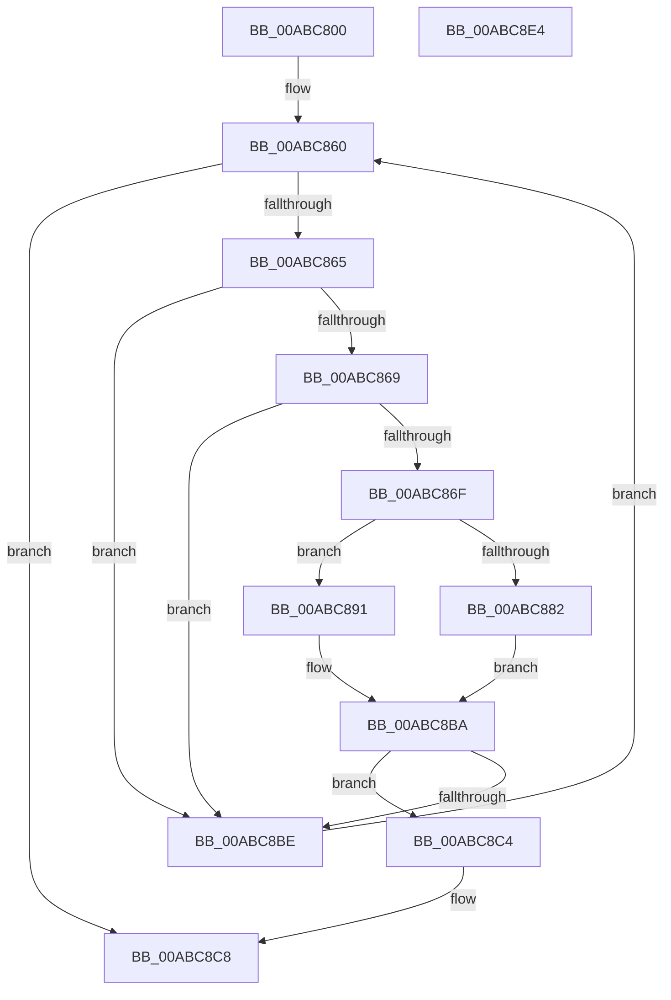

# CmpFindKcbInHashEntryByCompressedName

- RVA: `0x00ABC800`–`0x00ABC8E5` (길이 `229` bytes)
- VA: `0x0000000140ABC800`
- 실행 섹션: `PAGE`
- PDB 이름 있음: `예`; PDB Function 태그: `아니요`
- unwind 정보 RVA: `0x00084C9C`
- 디코드: `69`개 명령, `229/229` bytes 표시
- 미해석 바이트: `0` (있으면 어셈블리에 `.byte`로 보존)

> 이 문서는 커널 이미지의 기계어와 PDB 기호를 분석해 생성했습니다. 4번과 5번은 함수 원형과 자료형을 바이너리 사용 방식에서 추정한 C 해석이며 원본 소스 복구 결과는 아닙니다.

## 1. Dependencies

- 직접 호출 지점: **2**; 고유 호출 대상: **2**
- 직접 호출자로 확인된 함수: **2**
- RIP 상대 이미지 참조: **0**

### Outgoing calls
- `0x00ABC88A` → [CmpCompareTwoCompressedNames](../84/CmpCompareTwoCompressedNames_function_00847610.md) (function, `0x00847610`)
- `0x00ABC8B5` → [CmpCompareCompressedName](../95/CmpCompareCompressedName_function_00958030.md) (function, `0x00958030`)

### Direct callers
- [CmpPartialPromoteSubkeys](../7F/CmpPartialPromoteSubkeys_function_007F4070.md) at `0x007F41A7`
- [sub_00B255E8](../B2/Unknown_function_00B255E8.md) at `0x00B25645`

### Static image references
- 디코드된 RIP-relative 메모리 참조가 없습니다.

## 2. Other-region calls and transfers

- 다른 실행 섹션으로 향하는 call: **0**
- 별도 외부 분기/꼬리 이동을 확인하지 못했습니다.

## 3. Assembly (complete function range)

```asm
00ABC800  48 8B C4                        mov rax, rsp
00ABC803  48 89 58 08                     mov qword ptr [rax + 8], rbx
00ABC807  48 89 68 10                     mov qword ptr [rax + 0x10], rbp
00ABC80B  48 89 70 18                     mov qword ptr [rax + 0x18], rsi
00ABC80F  57                              push rdi
00ABC810  41 56                           push r14
00ABC812  41 57                           push r15
00ABC814  48 83 EC 30                     sub rsp, 0x30
00ABC818  4D 8B F1                        mov r14, r9
00ABC81B  4C 8B D1                        mov r10, rcx
00ABC81E  0F 57 C0                        xorps xmm0, xmm0
00ABC821  8B DA                           mov ebx, edx
00ABC823  0F 11 40 D8                     movups xmmword ptr [rax - 0x28], xmm0
00ABC827  8B C2                           mov eax, edx
00ABC829  33 F6                           xor esi, esi
00ABC82B  C1 E8 09                        shr eax, 9
00ABC82E  4D 8B F8                        mov r15, r8
00ABC831  33 C2                           xor eax, edx
00ABC833  69 C0 A3 8A 01 00               imul eax, eax, 0x18aa3
00ABC839  44 8B C8                        mov r9d, eax
00ABC83C  8B D0                           mov edx, eax
00ABC83E  8B 81 78 06 00 00               mov eax, dword ptr [rcx + 0x678]
00ABC844  49 C1 E9 09                     shr r9, 9
00ABC848  FF C8                           dec eax
00ABC84A  4C 33 CA                        xor r9, rdx
00ABC84D  4C 23 C8                        and r9, rax
00ABC850  49 8B 82 70 06 00 00            mov rax, qword ptr [r10 + 0x670]
00ABC857  4B 8D 0C 49                     lea rcx, [r9 + r9*2]
00ABC85B  48 8B 7C C8 10                  mov rdi, qword ptr [rax + rcx*8 + 0x10]
00ABC860  48 85 FF                        test rdi, rdi
00ABC863  74 63                           je 0x140abc8c8
00ABC865  39 1F                           cmp dword ptr [rdi], ebx
00ABC867  75 55                           jne 0x140abc8be
00ABC869  4C 39 7F 38                     cmp qword ptr [rdi + 0x38], r15
00ABC86D  75 4F                           jne 0x140abc8be
00ABC86F  48 8B 4F 40                     mov rcx, qword ptr [rdi + 0x40]
00ABC873  0F B7 54 24 70                  movzx edx, word ptr [rsp + 0x70]
00ABC878  8B 01                           mov eax, dword ptr [rcx]
00ABC87A  4C 8D 41 1A                     lea r8, [rcx + 0x1a]
00ABC87E  A8 01                           test al, 1
00ABC880  74 0F                           je 0x140abc891
00ABC882  44 0F B7 49 18                  movzx r9d, word ptr [rcx + 0x18]
00ABC887  49 8B CE                        mov rcx, r14
00ABC88A  E8 81 AD D8 FF                  call 0x140847610
00ABC88F  EB 29                           jmp 0x140abc8ba
00ABC891  0F B7 41 18                     movzx eax, word ptr [rcx + 0x18]
00ABC895  41 B9 01 00 00 00               mov r9d, 1
00ABC89B  4C 89 44 24 28                  mov qword ptr [rsp + 0x28], r8
00ABC8A0  48 8D 4C 24 20                  lea rcx, [rsp + 0x20]
00ABC8A5  44 8B C2                        mov r8d, edx
00ABC8A8  66 89 44 24 20                  mov word ptr [rsp + 0x20], ax
00ABC8AD  49 8B D6                        mov rdx, r14
00ABC8B0  66 89 44 24 22                  mov word ptr [rsp + 0x22], ax
00ABC8B5  E8 76 B7 E9 FF                  call 0x140958030
00ABC8BA  85 C0                           test eax, eax
00ABC8BC  74 06                           je 0x140abc8c4
00ABC8BE  48 8B 7F 08                     mov rdi, qword ptr [rdi + 8]
00ABC8C2  EB 9C                           jmp 0x140abc860
00ABC8C4  48 8D 77 F0                     lea rsi, [rdi - 0x10]
00ABC8C8  48 8B 5C 24 50                  mov rbx, qword ptr [rsp + 0x50]
00ABC8CD  48 8B C6                        mov rax, rsi
00ABC8D0  48 8B 74 24 60                  mov rsi, qword ptr [rsp + 0x60]
00ABC8D5  48 8B 6C 24 58                  mov rbp, qword ptr [rsp + 0x58]
00ABC8DA  48 83 C4 30                     add rsp, 0x30
00ABC8DE  41 5F                           pop r15
00ABC8E0  41 5E                           pop r14
00ABC8E2  5F                              pop rdi
00ABC8E3  C3                              ret
00ABC8E4  CC                              int3
```

## 4. C-style interpretation (structured pseudocode)

```c
__int64 __fastcall CmpFindKcbInHashEntryByCompressedName(__int64 a1, int a2, __int64 a3, __int64 a4, unsigned __int16 a5)
{
    __int64 result;
    __int64 v_rsi;
    __int64 v_rsp;
    unsigned __int64 v_stack_m20;
    unsigned __int16 v_stack_m26;
    unsigned __int64 v_stack_m28;
    unsigned __int64 v_stack_p10;
    unsigned __int64 v_stack_p18;
    unsigned __int64 v_stack_p8;

    *(unsigned __int64 *)(v_rsp + 8) = v_rbx;
    *(unsigned __int64 *)(v_rsp + 16) = v_rbp;
    *(unsigned __int64 *)(v_rsp + 24) = v_rsi;
    v_rsp = (v_rsp) - (48);
    *(unsigned __int64 *)(v_rsp - 40) = v_xmm0;
    v_rsi = 0;
    result = (unsigned int)(((unsigned int)(a2)) >> (9));
    result = (unsigned int)((result) ^ (a2));
    result = (unsigned int)((result) * ((unsigned int)(result)));
    a4 = ((unsigned int)((unsigned int)(result))) >> (9);
    result = (unsigned int)(((unsigned int)(*(unsigned int *)(a1 + 1656))) - 1);
    a4 = (a4) ^ ((unsigned int)((unsigned int)(result)));
    a4 = (a4) & (result);
loc_00ABC860:
    if (*(unsigned __int64 *)(*(unsigned __int64 *)(a1 + 1648) + a4 + a4 * 2 * 8 + 16) == 0) goto loc_00ABC8C8;
    if ((*(unsigned int *)(*(unsigned __int64 *)(*(unsigned __int64 *)(a1 + 1648) + a4 + a4 * 2 * 8 + 16))) != ((unsigned int)((unsigned int)(a2)))) goto loc_00ABC8BE;
    if ((*(unsigned __int64 *)(*(unsigned __int64 *)(*(unsigned __int64 *)(a1 + 1648) + a4 + a4 * 2 * 8 + 16) + 56)) != a3) goto loc_00ABC8BE;
    if ((((unsigned __int8)((unsigned int)(*(unsigned int *)(*(unsigned __int64 *)(*(unsigned __int64 *)(*(unsigned __int64 *)(a1 + 1648) + a4 + a4 * 2 * 8 + 16) + 64))))) & (1)) == 0) goto loc_00ABC891;
    result = CmpCompareTwoCompressedNames(a4, a5, *(unsigned __int64 *)(*(unsigned __int64 *)(*(unsigned __int64 *)(a1 + 1648) + a4 + a4 * 2 * 8 + 16) + 64) + 26, *(unsigned __int16 *)(*(unsigned __int64 *)(*(unsigned __int64 *)(*(unsigned __int64 *)(a1 + 1648) + a4 + a4 * 2 * 8 + 16) + 64) + 24));
    goto loc_00ABC8BA;
loc_00ABC891:
    v_stack_m20 = *(unsigned __int64 *)(*(unsigned __int64 *)(*(unsigned __int64 *)(a1 + 1648) + a4 + a4 * 2 * 8 + 16) + 64) + 26;
    v_stack_m28 = (unsigned __int16)(*(unsigned __int16 *)(a4 + 24));
    v_stack_m26 = (unsigned __int16)(*(unsigned __int16 *)(a4 + 24));
    result = CmpCompareCompressedName(v_stack_m28, a4, (unsigned int)(a5), 1);
loc_00ABC8BA:
    if ((unsigned int)(result) == 0) goto loc_00ABC8C4;
loc_00ABC8BE:
    goto loc_00ABC860;
loc_00ABC8C4:
loc_00ABC8C8:
    v_rsp = (v_rsp) + (48);
    return *(unsigned __int64 *)(*(unsigned __int64 *)(*(unsigned __int64 *)(a1 + 1648) + a4 + a4 * 2 * 8 + 16) + 8) - 16;
}
```

## 5. (Beta) C Style

```c
int64_t CmpFindKcbInHashEntryByCompressedName(void *Arg1, int32_t Arg2, int64_t Arg3, int64_t Arg4, uint16_t Arg5)
{
    uint8_t *arg1 = (uint8_t *)Arg1;

    int64_t result;
    int64_t local_rsi;
    int64_t local_rsp;
    uint64_t v_stack_m20;
    uint16_t v_stack_m26;
    uint64_t v_stack_m28;
    uint64_t v_stack_p10;
    uint64_t v_stack_p18;
    uint64_t v_stack_p8;

    *(uint64_t *)(local_rsp + 0x8) = local_rbx;
    *(uint64_t *)(local_rsp + 0x10) = local_rbp;
    *(uint64_t *)(local_rsp + 0x18) = local_rsi;
    local_rsp = (local_rsp) - (48);
    *(uint64_t *)(local_rsp - 0x28) = v_xmm0;
    local_rsi = 0;
    result = (uint32_t)(((uint32_t)(Arg2)) >> (9));
    result = (uint32_t)((result) ^ (Arg2));
    result = (uint32_t)((result) * ((uint32_t)(result)));
    Arg4 = ((uint32_t)((uint32_t)(result))) >> (9);
    result = (uint32_t)(((uint32_t)(*(uint32_t *)(arg1 + 0x678))) - 1);
    Arg4 = (Arg4) ^ ((uint32_t)((uint32_t)(result)));
    Arg4 = (Arg4) & (result);
loc_00ABC860:
    if (*(uint64_t *)(*(uint64_t *)(arg1 + 0x670) + Arg4 + Arg4 * 2 * 8 + 0x10) == 0) goto loc_00ABC8C8;
    if ((*(uint32_t *)(*(uint64_t *)(*(uint64_t *)(arg1 + 0x670) + Arg4 + Arg4 * 2 * 8 + 0x10))) != ((uint32_t)((uint32_t)(Arg2)))) goto loc_00ABC8BE;
    if ((*(uint64_t *)(*(uint64_t *)(*(uint64_t *)(arg1 + 0x670) + Arg4 + Arg4 * 2 * 8 + 0x10) + 0x38)) != Arg3) goto loc_00ABC8BE;
    if ((((uint8_t)((uint32_t)(*(uint32_t *)(*(uint64_t *)(*(uint64_t *)(*(uint64_t *)(arg1 + 0x670) + Arg4 + Arg4 * 2 * 8 + 0x10) + 0x40))))) & (1)) == 0) goto loc_00ABC891;
    result = CmpCompareTwoCompressedNames(Arg4, Arg5, *(uint64_t *)(*(uint64_t *)(*(uint64_t *)(arg1 + 0x670) + Arg4 + Arg4 * 2 * 8 + 0x10) + 0x40) + 26, *(uint16_t *)(*(uint64_t *)(*(uint64_t *)(*(uint64_t *)(arg1 + 0x670) + Arg4 + Arg4 * 2 * 8 + 0x10) + 0x40) + 0x18));
    goto loc_00ABC8BA;
loc_00ABC891:
    v_stack_m20 = *(uint64_t *)(*(uint64_t *)(*(uint64_t *)(arg1 + 0x670) + Arg4 + Arg4 * 2 * 8 + 0x10) + 0x40) + 26;
    v_stack_m28 = (uint16_t)(*(uint16_t *)(Arg4 + 0x18));
    v_stack_m26 = (uint16_t)(*(uint16_t *)(Arg4 + 0x18));
    result = CmpCompareCompressedName(v_stack_m28, Arg4, (uint32_t)(Arg5), 1);
loc_00ABC8BA:
    if ((uint32_t)(result) == 0) goto loc_00ABC8C4;
loc_00ABC8BE:
    goto loc_00ABC860;
loc_00ABC8C4:
loc_00ABC8C8:
    local_rsp = (local_rsp) + (48);
    return *(uint64_t *)(*(uint64_t *)(*(uint64_t *)(arg1 + 0x670) + Arg4 + Arg4 * 2 * 8 + 0x10) + 0x8) - 16;
}
```

### 관측된 메모리 오프셋

구조체 형식이 확인되지 않은 접근은 인자 기준의 오프셋으로만 기록했습니다.

| 기준 인자 | 오프셋 표현 | 폭 (bit) | 접근 |
|---|---:|---:|---|
| `Arg1` | `+ 0x670` | `64` | `R` |
| `Arg1` | `+ 0x678` | `32` | `R` |

## 6. Execution-region graph

[열기: 2D/3D 그래프와 함수 탐색 컨트롤 패널](../../../control-panel.html?section=page&rva=0x00ABC800&view=graph)

- 2D 그래프는 위에서 아래로 흐르고, 3D 그래프는 빈 공간을 드래그해 회전합니다. Shift+드래그는 이동, 휠은 확대·축소, 함수 노드 선택은 대상 보고서 이동입니다.

### Static fallback


