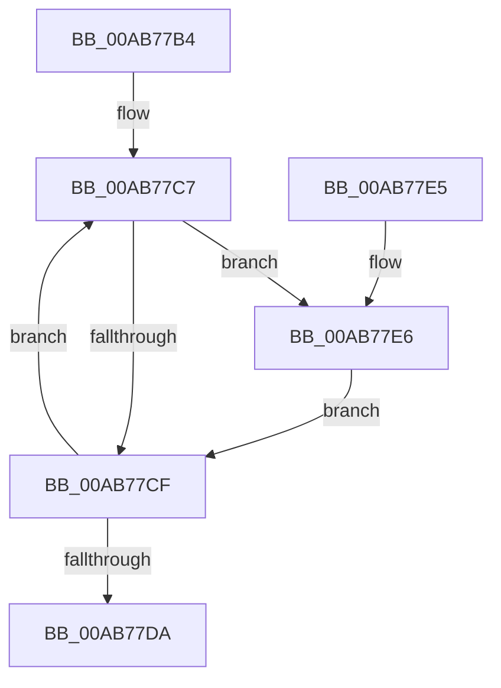

# CmpFlushUnsupportedOperationTelemetry

- RVA: `0x00AB77B4`–`0x00AB77EF` (길이 `59` bytes)
- VA: `0x0000000140AB77B4`
- 실행 섹션: `PAGE`
- PDB 이름 있음: `예`; PDB Function 태그: `아니요`
- unwind 정보 RVA: `0x00060BE4`
- 디코드: `21`개 명령, `59/59` bytes 표시
- 미해석 바이트: `0` (있으면 어셈블리에 `.byte`로 보존)

> 이 문서는 커널 이미지의 기계어와 PDB 기호를 분석해 생성했습니다. 4번과 5번은 함수 원형과 자료형을 바이너리 사용 방식에서 추정한 C 해석이며 원본 소스 복구 결과는 아닙니다.

## 1. Dependencies

- 직접 호출 지점: **1**; 고유 호출 대상: **1**
- 직접 호출자로 확인된 함수: **2**
- RIP 상대 이미지 참조: **1**

### Outgoing calls
- `0x00AB77E8` → [CmpSendUnsupportedOperationTelemetryEvent](../7F/CmpSendUnsupportedOperationTelemetryEvent_function_007F180C.md) (function, `0x007F180C`)

### Direct callers
- [CmpFlushTraceLoggingProvider](../7E/CmpFlushTraceLoggingProvider_function_007E6138.md) at `0x007E613C`
- [CmpDoReconcileNextHive](../9B/CmpDoReconcileNextHive_function_009B6BE0.md) at `0x009B6C95`

### Static image references
- `0x00AB77C0` → RVA `0x00EF5560` (`.data`; read)

## 2. Other-region calls and transfers

- 다른 실행 섹션으로 향하는 call: **0**
- 별도 외부 분기/꼬리 이동을 확인하지 못했습니다.

## 3. Assembly (complete function range)

```asm
00AB77B4  48 89 5C 24 08                  mov qword ptr [rsp + 8], rbx
00AB77B9  57                              push rdi
00AB77BA  48 83 EC 20                     sub rsp, 0x20
00AB77BE  33 DB                           xor ebx, ebx
00AB77C0  48 8D 3D 99 DD 43 00            lea rdi, [rip + 0x43dd99]
00AB77C7  33 D2                           xor edx, edx
00AB77C9  87 17                           xchg dword ptr [rdi], edx
00AB77CB  85 D2                           test edx, edx
00AB77CD  75 17                           jne 0x140ab77e6
00AB77CF  FF C3                           inc ebx
00AB77D1  48 83 C7 04                     add rdi, 4
00AB77D5  83 FB 1B                        cmp ebx, 0x1b
00AB77D8  7C ED                           jl 0x140ab77c7
00AB77DA  48 8B 5C 24 30                  mov rbx, qword ptr [rsp + 0x30]
00AB77DF  48 83 C4 20                     add rsp, 0x20
00AB77E3  5F                              pop rdi
00AB77E4  C3                              ret
00AB77E5  CC                              int3
00AB77E6  8B CB                           mov ecx, ebx
00AB77E8  E8 1F A0 D3 FF                  call 0x1407f180c
00AB77ED  EB E0                           jmp 0x140ab77cf
```

## 4. C-style interpretation (structured pseudocode)

```c
__int64 __fastcall CmpFlushUnsupportedOperationTelemetry(__int64 a1, int a2)
{
    __int64 result;
    __int64 v_rbx;
    __int64 v_rdi;
    __int64 v_rsp;
    unsigned __int64 v_stack_p8;

    v_stack_p8 = v_rbx;
    v_rsp = (v_rsp) - (32);
    v_rbx = 0;
loc_00AB77C7:
    a2 = 0;
    if (0 != 0) goto loc_00AB77E6;
loc_00AB77CF:
    v_rbx = (unsigned int)((v_rbx) + 1);
    v_rdi = (v_rip + 4447641) + (4);
    if (((unsigned int)(v_rbx)) < 27) goto loc_00AB77C7;
    v_rsp = (v_rsp) + (32);
    return result;
loc_00AB77E6:
    result = CmpSendUnsupportedOperationTelemetryEvent((unsigned int)((unsigned int)(v_stack_p8)), a2, a3, a4);
    goto loc_00AB77CF;
}
```

## 5. (Beta) C Style

```c
int64_t CmpFlushUnsupportedOperationTelemetry(int64_t Arg1, int32_t Arg2)
{
    int64_t result;
    int64_t local_rbx;
    int64_t local_rdi;
    int64_t local_rsp;
    uint64_t v_stack_p8;

    v_stack_p8 = local_rbx;
    local_rsp = (local_rsp) - (32);
    local_rbx = 0;
loc_00AB77C7:
    Arg2 = 0;
    if (0 != 0) goto loc_00AB77E6;
loc_00AB77CF:
    local_rbx = (uint32_t)((local_rbx) + 1);
    local_rdi = (v_rip + 4447641) + (4);
    if (((uint32_t)(local_rbx)) < 27) goto loc_00AB77C7;
    local_rsp = (local_rsp) + (32);
    return result;
loc_00AB77E6:
    result = CmpSendUnsupportedOperationTelemetryEvent((uint32_t)((uint32_t)(v_stack_p8)), Arg2, a3, a4);
    goto loc_00AB77CF;
}
```

## 6. Execution-region graph

[열기: 2D/3D 그래프와 함수 탐색 컨트롤 패널](../../../control-panel.html?section=page&rva=0x00AB77B4&view=graph)

- 2D 그래프는 위에서 아래로 흐르고, 3D 그래프는 빈 공간을 드래그해 회전합니다. Shift+드래그는 이동, 휠은 확대·축소, 함수 노드 선택은 대상 보고서 이동입니다.

### Static fallback


