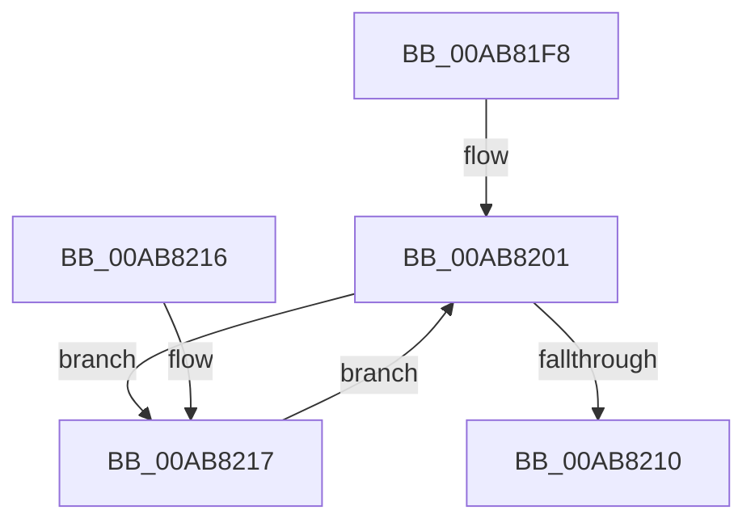

# CmpUuidCreate

- RVA: `0x00AB81F8`–`0x00AB8230` (길이 `56` bytes)
- VA: `0x0000000140AB81F8`
- 실행 섹션: `PAGE`
- PDB 이름 있음: `예`; PDB Function 태그: `아니요`
- unwind 정보 RVA: `0x00064C68`
- 디코드: `17`개 명령, `56/56` bytes 표시
- 미해석 바이트: `0` (있으면 어셈블리에 `.byte`로 보존)

> 이 문서는 커널 이미지의 기계어와 PDB 기호를 분석해 생성했습니다. 4번과 5번은 함수 원형과 자료형을 바이너리 사용 방식에서 추정한 C 해석이며 원본 소스 복구 결과는 아닙니다.

## 1. Dependencies

- 직접 호출 지점: **2**; 고유 호출 대상: **2**
- 직접 호출자로 확인된 함수: **5**
- RIP 상대 이미지 참조: **0**

### Outgoing calls
- `0x00AB8204` → [ExUuidCreate](../91/ExUuidCreate_function_00917500.md) (function, `0x00917500`)
- `0x00AB8229` → [KeDelayExecutionThread](../../text/20/KeDelayExecutionThread_function_00209550.md) (function, `0x00209550`)

### Direct callers
- [CmSaveKey](../7D/CmSaveKey_function_007DDBDC.md) at `0x007DDC77`
- [CmSaveKey](../7D/CmSaveKey_function_007DDBDC.md) at `0x007DDC8A`
- [CmSaveMergedKeys](../7D/CmSaveMergedKeys_function_007DE040.md) at `0x007DE0C6`
- [CmSaveMergedKeys](../7D/CmSaveMergedKeys_function_007DE040.md) at `0x007DE0D9`
- [CmpLoadHiveVolatile](../7D/CmpLoadHiveVolatile_function_007DE5F0.md) at `0x007DE6A1`
- [CmpLoadHiveVolatile](../7D/CmpLoadHiveVolatile_function_007DE5F0.md) at `0x007DE6B4`
- [CmpVolumeContextStart](../7E/CmpVolumeContextStart_function_007E88A4.md) at `0x007E8910`
- [sub_00B15E66](../B1/Unknown_function_00B15E66.md) at `0x00B15E6B`

### Static image references
- 디코드된 RIP-relative 메모리 참조가 없습니다.

## 2. Other-region calls and transfers

- 다른 실행 섹션으로 향하는 call: **1**
  - `0x00AB8229` → [KeDelayExecutionThread](../../text/20/KeDelayExecutionThread_function_00209550.md) (`PAGE` → `.text`)
- 별도 외부 분기/꼬리 이동을 확인하지 못했습니다.

## 3. Assembly (complete function range)

```asm
00AB81F8  40 53                           push rbx
00AB81FA  48 83 EC 20                     sub rsp, 0x20
00AB81FE  48 8B D9                        mov rbx, rcx
00AB8201  48 8B CB                        mov rcx, rbx
00AB8204  E8 F7 F2 E5 FF                  call 0x140917500
00AB8209  3D 2D 02 00 C0                  cmp eax, 0xc000022d
00AB820E  74 07                           je 0x140ab8217
00AB8210  48 83 C4 20                     add rsp, 0x20
00AB8214  5B                              pop rbx
00AB8215  C3                              ret
00AB8216  CC                              int3
00AB8217  4C 8D 44 24 38                  lea r8, [rsp + 0x38]
00AB821C  48 C7 44 24 38 80 69 67 FF      mov qword ptr [rsp + 0x38], 0xffffffffff676980
00AB8225  33 D2                           xor edx, edx
00AB8227  33 C9                           xor ecx, ecx
00AB8229  E8 22 13 75 FF                  call 0x140209550
00AB822E  EB D1                           jmp 0x140ab8201
```

## 4. C-style interpretation (structured pseudocode)

```c
__int64 __fastcall CmpUuidCreate(__int64 a1, int a2)
{
    __int64 result;
    __int64 v_rsp;
    unsigned __int64 v_stack_p38;

    v_rsp = (v_rsp) - (32);
loc_00AB8201:
    result = ExUuidCreate(a1, a2, a3, a4);
    if (((unsigned int)(result)) == 0xC000022DULL) goto loc_00AB8217;
    v_rsp = (v_rsp) + (32);
    return result;
loc_00AB8217:
    v_stack_p38 = 0xFFFFFFFFFF676980ULL;
    a2 = 0;
    a1 = 0;
    result = KeDelayExecutionThread(a1, a2, v_stack_p38, a4);
    goto loc_00AB8201;
}
```

## 5. (Beta) C Style

```c
int64_t CmpUuidCreate(int64_t Arg1, int32_t Arg2)
{
    int64_t result;
    int64_t local_rsp;
    uint64_t v_stack_p38;

    local_rsp = (local_rsp) - (32);
loc_00AB8201:
    result = ExUuidCreate(Arg1, Arg2, a3, a4);
    if (((uint32_t)(result)) == 0xC000022DULL) goto loc_00AB8217;
    local_rsp = (local_rsp) + (32);
    return result;
loc_00AB8217:
    v_stack_p38 = 0xFFFFFFFFFF676980ULL;
    Arg2 = 0;
    Arg1 = 0;
    result = KeDelayExecutionThread(Arg1, Arg2, v_stack_p38, a4);
    goto loc_00AB8201;
}
```

## 6. Execution-region graph

[열기: 2D/3D 그래프와 함수 탐색 컨트롤 패널](../../../control-panel.html?section=page&rva=0x00AB81F8&view=graph)

- 2D 그래프는 위에서 아래로 흐르고, 3D 그래프는 빈 공간을 드래그해 회전합니다. Shift+드래그는 이동, 휠은 확대·축소, 함수 노드 선택은 대상 보고서 이동입니다.

### Static fallback


