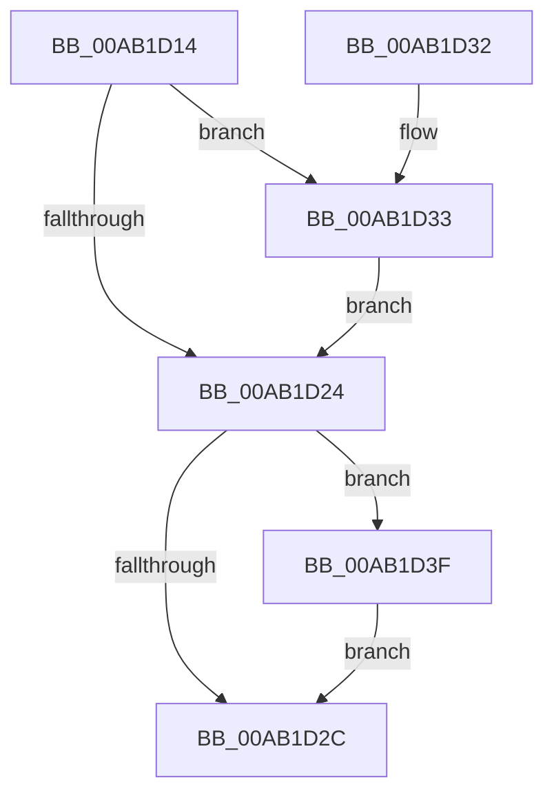

# CmpVolumeContextCleanup

- RVA: `0x00AB1D14`–`0x00AB1D46` (길이 `50` bytes)
- VA: `0x0000000140AB1D14`
- 실행 섹션: `PAGE`
- PDB 이름 있음: `예`; PDB Function 태그: `아니요`
- unwind 정보 RVA: `0x0006EDB4`
- 디코드: `18`개 명령, `50/50` bytes 표시
- 미해석 바이트: `0` (있으면 어셈블리에 `.byte`로 보존)

> 이 문서는 커널 이미지의 기계어와 PDB 기호를 분석해 생성했습니다. 4번과 5번은 함수 원형과 자료형을 바이너리 사용 방식에서 추정한 C 해석이며 원본 소스 복구 결과는 아닙니다.

## 1. Dependencies

- 직접 호출 지점: **2**; 고유 호출 대상: **2**
- 직접 호출자로 확인된 함수: **2**
- RIP 상대 이미지 참조: **0**

### Outgoing calls
- `0x00AB1D38` → [PiPagePathSetState](../72/PiPagePathSetState_function_0072BDE0.md) (function, `0x0072BDE0`)
- `0x00AB1D3F` → [ObfDereferenceObject](../../text/2F/ObfDereferenceObject_function_002F9350.md) (function, `0x002F9350`)

### Direct callers
- [CmpVolumeContextCreate](../7E/CmpVolumeContextCreate_function_007E86F4.md) at `0x007E875E`
- [CmpVolumeContextFree](CmpVolumeContextFree_function_00AB1CF0.md) at `0x00AB1CF9`

### Static image references
- 디코드된 RIP-relative 메모리 참조가 없습니다.

## 2. Other-region calls and transfers

- 다른 실행 섹션으로 향하는 call: **1**
  - `0x00AB1D3F` → [ObfDereferenceObject](../../text/2F/ObfDereferenceObject_function_002F9350.md) (`PAGE` → `.text`)
- 별도 외부 분기/꼬리 이동을 확인하지 못했습니다.

## 3. Assembly (complete function range)

```asm
00AB1D14  40 53                           push rbx
00AB1D16  48 83 EC 20                     sub rsp, 0x20
00AB1D1A  83 79 40 01                     cmp dword ptr [rcx + 0x40], 1
00AB1D1E  48 8D 59 30                     lea rbx, [rcx + 0x30]
00AB1D22  74 0F                           je 0x140ab1d33
00AB1D24  48 8B 0B                        mov rcx, qword ptr [rbx]
00AB1D27  48 85 C9                        test rcx, rcx
00AB1D2A  75 13                           jne 0x140ab1d3f
00AB1D2C  48 83 C4 20                     add rsp, 0x20
00AB1D30  5B                              pop rbx
00AB1D31  C3                              ret
00AB1D32  CC                              int3
00AB1D33  48 8B 0B                        mov rcx, qword ptr [rbx]
00AB1D36  33 D2                           xor edx, edx
00AB1D38  E8 A3 A0 C7 FF                  call 0x14072bde0
00AB1D3D  EB E5                           jmp 0x140ab1d24
00AB1D3F  E8 0C 76 84 FF                  call 0x1402f9350
00AB1D44  EB E6                           jmp 0x140ab1d2c
```

## 4. C-style interpretation (structured pseudocode)

```c
__int64 __fastcall CmpVolumeContextCleanup(__int64 a1, int a2)
{
    __int64 result;
    __int64 v_rsp;

    v_rsp = (v_rsp) - (32);
    if ((*(unsigned int *)(a1 + 64)) == 1) goto loc_00AB1D33;
loc_00AB1D24:
    if (*(unsigned __int64 *)(a1 + 48) != 0) goto loc_00AB1D3F;
loc_00AB1D2C:
    v_rsp = (v_rsp) + (32);
    return result;
loc_00AB1D33:
    a2 = 0;
    result = PiPagePathSetState(*(unsigned __int64 *)(a1 + 48), a2, a3, a4);
    goto loc_00AB1D24;
loc_00AB1D3F:
    result = ObfDereferenceObject(*(unsigned __int64 *)(a1 + 48), a2, a3, a4);
    goto loc_00AB1D2C;
}
```

## 5. (Beta) C Style

```c
int64_t CmpVolumeContextCleanup(void *Arg1, int32_t Arg2)
{
    uint8_t *arg1 = (uint8_t *)Arg1;

    int64_t result;
    int64_t local_rsp;

    local_rsp = (local_rsp) - (32);
    if ((*(uint32_t *)(arg1 + 0x40)) == 1) goto loc_00AB1D33;
loc_00AB1D24:
    if (*(uint64_t *)(arg1 + 0x30) != 0) goto loc_00AB1D3F;
loc_00AB1D2C:
    local_rsp = (local_rsp) + (32);
    return result;
loc_00AB1D33:
    Arg2 = 0;
    result = PiPagePathSetState(*(uint64_t *)(arg1 + 0x30), Arg2, a3, a4);
    goto loc_00AB1D24;
loc_00AB1D3F:
    result = ObfDereferenceObject(*(uint64_t *)(arg1 + 0x30), Arg2, a3, a4);
    goto loc_00AB1D2C;
}
```

### 관측된 메모리 오프셋

구조체 형식이 확인되지 않은 접근은 인자 기준의 오프셋으로만 기록했습니다.

| 기준 인자 | 오프셋 표현 | 폭 (bit) | 접근 |
|---|---:|---:|---|
| `Arg1` | `+ 0x0` | `64` | `R` |
| `Arg1` | `+ 0x30` | `64` | `R` |
| `Arg1` | `+ 0x40` | `32` | `R` |

## 6. Execution-region graph

[열기: 2D/3D 그래프와 함수 탐색 컨트롤 패널](../../../control-panel.html?section=page&rva=0x00AB1D14&view=graph)

- 2D 그래프는 위에서 아래로 흐르고, 3D 그래프는 빈 공간을 드래그해 회전합니다. Shift+드래그는 이동, 휠은 확대·축소, 함수 노드 선택은 대상 보고서 이동입니다.

### Static fallback


