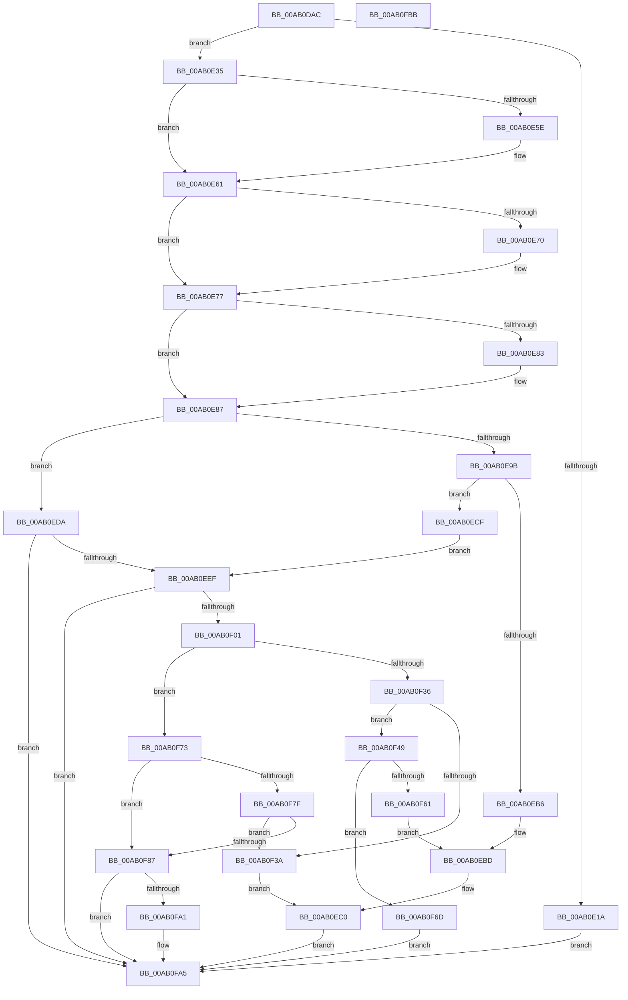

# DbgkpWerCaptureLiveFullDump

- RVA: `0x00AB0DAC`–`0x00AB0FBC` (길이 `528` bytes)
- VA: `0x0000000140AB0DAC`
- 실행 섹션: `PAGE`
- PDB 이름 있음: `예`; PDB Function 태그: `아니요`
- unwind 정보 RVA: `0x000BC708`
- 디코드: `145`개 명령, `528/528` bytes 표시
- 미해석 바이트: `0` (있으면 어셈블리에 `.byte`로 보존)

> 이 문서는 커널 이미지의 기계어와 PDB 기호를 분석해 생성했습니다. 4번과 5번은 함수 원형과 자료형을 바이너리 사용 방식에서 추정한 C 해석이며 원본 소스 복구 결과는 아닙니다.

## 1. Dependencies

- 직접 호출 지점: **10**; 고유 호출 대상: **8**
- 직접 호출자로 확인된 함수: **1**
- RIP 상대 이미지 참조: **7**

### Outgoing calls
- `0x00AB0DF7` → [DbgPrintEx](../../text/35/DbgPrintEx_function_00359290.md) (function, `0x00359290`)
- `0x00AB0E0D` → [ExAllocatePool2](../../poolcode/B8/ExAllocatePool2_function_00B820F0.md) (function, `0x00B820F0`)
- `0x00AB0E26` → [DbgPrintEx](../../text/35/DbgPrintEx_function_00359290.md) (function, `0x00359290`)
- `0x00AB0EA4` → `ext-ms-win-ntos-werkernel-l1-1-1.dll!WerLiveKernelOpenDumpFile` (import, 간접 대상; import `ext-ms-win-ntos-werkernel-l1-1-1.dll!WerLiveKernelOpenDumpFile`)
- `0x00AB0EC5` → [DbgPrintEx](../../text/35/DbgPrintEx_function_00359290.md) (function, `0x00359290`)
- `0x00AB0EE0` → [DbgkpWerInitializeDeferredLiveDump](DbgkpWerInitializeDeferredLiveDump_function_00AB1088.md) (function, `0x00AB1088`)
- `0x00AB0EF2` → [DbgkpWerInvokeCallbacks](DbgkpWerInvokeCallbacks_function_00AB0FC4.md) (function, `0x00AB0FC4`)
- `0x00AB0F28` → [IoCaptureLiveDump](../../text/4E/IoCaptureLiveDump_function_004E085C.md) (function, `0x004E085C`)
- `0x00AB0F4F` → `ext-ms-win-ntos-werkernel-l1-1-1.dll!WerLiveKernelSubmitReport` (import, 간접 대상; import `ext-ms-win-ntos-werkernel-l1-1-1.dll!WerLiveKernelSubmitReport`)
- `0x00AB0F96` → [DbgkpWerStartDeferredLiveDump](../71/DbgkpWerStartDeferredLiveDump_function_007125D0.md) (function, `0x007125D0`)

### Direct callers
- [DbgkpWerProcessPolicyResult](../71/DbgkpWerProcessPolicyResult_function_00712578.md) at `0x007125A3`

### Static image references
- `0x00AB0DC2` → RVA `0x00AFB3A0` (` ?? ::NNGAKEGL::`string'`; read)
- `0x00AB0E1A` → RVA `0x00AFB510` (` ?? ::NNGAKEGL::`string'`; read)
- `0x00AB0EA4` → RVA `0x00151620` (`ext-ms-win-ntos-werkernel-l1-1-1.dll!WerLiveKernelOpenDumpFile (IAT)`; read)
- `0x00AB0EB6` → RVA `0x00AFB540` (` ?? ::NNGAKEGL::`string'`; read)
- `0x00AB0F3D` → RVA `0x00AFB460` (` ?? ::NNGAKEGL::`string'`; read)
- `0x00AB0F4F` → RVA `0x00151640` (`ext-ms-win-ntos-werkernel-l1-1-1.dll!WerLiveKernelSubmitReport (IAT)`; read)
- `0x00AB0F61` → RVA `0x00AFB4B0` (` ?? ::NNGAKEGL::`string'`; read)

## 2. Other-region calls and transfers

- 다른 실행 섹션으로 향하는 call: **5**
  - `0x00AB0DF7` → [DbgPrintEx](../../text/35/DbgPrintEx_function_00359290.md) (`PAGE` → `.text`)
  - `0x00AB0E0D` → [ExAllocatePool2](../../poolcode/B8/ExAllocatePool2_function_00B820F0.md) (`PAGE` → `POOLCODE`)
  - `0x00AB0E26` → [DbgPrintEx](../../text/35/DbgPrintEx_function_00359290.md) (`PAGE` → `.text`)
  - `0x00AB0EC5` → [DbgPrintEx](../../text/35/DbgPrintEx_function_00359290.md) (`PAGE` → `.text`)
  - `0x00AB0F28` → [IoCaptureLiveDump](../../text/4E/IoCaptureLiveDump_function_004E085C.md) (`PAGE` → `.text`)
- 별도 외부 분기/꼬리 이동을 확인하지 못했습니다.

## 3. Assembly (complete function range)

```asm
00AB0DAC  48 89 5C 24 18                  mov qword ptr [rsp + 0x18], rbx
00AB0DB1  48 89 74 24 20                  mov qword ptr [rsp + 0x20], rsi
00AB0DB6  57                              push rdi
00AB0DB7  41 56                           push r14
00AB0DB9  41 57                           push r15
00AB0DBB  48 83 EC 40                     sub rsp, 0x40
00AB0DBF  8B 41 68                        mov eax, dword ptr [rcx + 0x68]
00AB0DC2  4C 8D 05 D7 A5 04 00            lea r8, [rip + 0x4a5d7]
00AB0DC9  48 83 64 24 68 00               and qword ptr [rsp + 0x68], 0
00AB0DCF  4C 8B F2                        mov r14, rdx
00AB0DD2  C6 02 01                        mov byte ptr [rdx], 1
00AB0DD5  48 8B F9                        mov rdi, rcx
00AB0DD8  BA 03 00 00 00                  mov edx, 3
00AB0DDD  D1 E8                           shr eax, 1
00AB0DDF  C7 41 50 00 00 00 10            mov dword ptr [rcx + 0x50], 0x10000000
00AB0DE6  83 E0 01                        and eax, 1
00AB0DE9  4C 8B C9                        mov r9, rcx
00AB0DEC  89 44 24 20                     mov dword ptr [rsp + 0x20], eax
00AB0DF0  44 8D 7A 02                     lea r15d, [rdx + 2]
00AB0DF4  41 8B CF                        mov ecx, r15d
00AB0DF7  E8 94 84 8A FF                  call 0x140359290
00AB0DFC  41 8D 5F 33                     lea ebx, [r15 + 0x33]
00AB0E00  41 B8 44 62 67 57               mov r8d, 0x57676244
00AB0E06  8B D3                           mov edx, ebx
00AB0E08  B9 00 01 00 00                  mov ecx, 0x100
00AB0E0D  E8 DE 12 0D 00                  call 0x140b820f0
00AB0E12  48 8B F0                        mov rsi, rax
00AB0E15  48 85 C0                        test rax, rax
00AB0E18  75 1B                           jne 0x140ab0e35
00AB0E1A  4C 8D 05 EF A6 04 00            lea r8, [rip + 0x4a6ef]
00AB0E21  33 D2                           xor edx, edx
00AB0E23  41 8B CF                        mov ecx, r15d
00AB0E26  E8 65 84 8A FF                  call 0x140359290
00AB0E2B  BB 17 00 00 C0                  mov ebx, 0xc0000017
00AB0E30  E9 70 01 00 00                  jmp 0x140ab0fa5
00AB0E35  48 89 77 78                     mov qword ptr [rdi + 0x78], rsi
00AB0E39  48 8D 56 18                     lea rdx, [rsi + 0x18]
00AB0E3D  C7 00 02 00 00 00               mov dword ptr [rax], 2
00AB0E43  89 58 04                        mov dword ptr [rax + 4], ebx
00AB0E46  48 8B 47 48                     mov rax, qword ptr [rdi + 0x48]
00AB0E4A  48 8B 48 20                     mov rcx, qword ptr [rax + 0x20]
00AB0E4E  48 89 4E 30                     mov qword ptr [rsi + 0x30], rcx
00AB0E52  48 8B 47 48                     mov rax, qword ptr [rdi + 0x48]
00AB0E56  8B 48 18                        mov ecx, dword ptr [rax + 0x18]
00AB0E59  F6 C1 01                        test cl, 1
00AB0E5C  74 03                           je 0x140ab0e61
00AB0E5E  83 0A 04                        or dword ptr [rdx], 4
00AB0E61  48 8B 47 48                     mov rax, qword ptr [rdi + 0x48]
00AB0E65  44 8B 02                        mov r8d, dword ptr [rdx]
00AB0E68  8B 48 18                        mov ecx, dword ptr [rax + 0x18]
00AB0E6B  F6 C1 10                        test cl, 0x10
00AB0E6E  74 07                           je 0x140ab0e77
00AB0E70  41 83 C8 20                     or r8d, 0x20
00AB0E74  44 89 02                        mov dword ptr [rdx], r8d
00AB0E77  48 8B 47 48                     mov rax, qword ptr [rdi + 0x48]
00AB0E7B  8B 48 18                        mov ecx, dword ptr [rax + 0x18]
00AB0E7E  F6 C1 04                        test cl, 4
00AB0E81  74 04                           je 0x140ab0e87
00AB0E83  83 4E 1C 01                     or dword ptr [rsi + 0x1c], 1
00AB0E87  41 83 C8 10                     or r8d, 0x10
00AB0E8B  44 89 02                        mov dword ptr [rdx], r8d
00AB0E8E  48 83 64 24 60 00               and qword ptr [rsp + 0x60], 0
00AB0E94  8B 47 68                        mov eax, dword ptr [rdi + 0x68]
00AB0E97  A8 02                           test al, 2
00AB0E99  75 3F                           jne 0x140ab0eda
00AB0E9B  48 8B 4F 60                     mov rcx, qword ptr [rdi + 0x60]
00AB0E9F  48 8D 54 24 60                  lea rdx, [rsp + 0x60]
00AB0EA4  48 FF 15 75 07 6A FF            call qword ptr [rip - 0x95f88b]
00AB0EAB  0F 1F 44 00 00                  nop dword ptr [rax + rax]
00AB0EB0  8B D8                           mov ebx, eax
00AB0EB2  85 C0                           test eax, eax
00AB0EB4  79 19                           jns 0x140ab0ecf
00AB0EB6  4C 8D 05 83 A6 04 00            lea r8, [rip + 0x4a683]
00AB0EBD  44 8B C8                        mov r9d, eax
00AB0EC0  33 D2                           xor edx, edx
00AB0EC2  41 8B CF                        mov ecx, r15d
00AB0EC5  E8 C6 83 8A FF                  call 0x140359290
00AB0ECA  E9 D6 00 00 00                  jmp 0x140ab0fa5
00AB0ECF  48 8B 44 24 60                  mov rax, qword ptr [rsp + 0x60]
00AB0ED4  48 89 46 08                     mov qword ptr [rsi + 8], rax
00AB0ED8  EB 15                           jmp 0x140ab0eef
00AB0EDA  83 0A 08                        or dword ptr [rdx], 8
00AB0EDD  48 8B CF                        mov rcx, rdi
00AB0EE0  E8 A3 01 00 00                  call 0x140ab1088
00AB0EE5  8B D8                           mov ebx, eax
00AB0EE7  85 C0                           test eax, eax
00AB0EE9  0F 88 B6 00 00 00               js 0x140ab0fa5
00AB0EEF  48 8B CF                        mov rcx, rdi
00AB0EF2  E8 CD 00 00 00                  call 0x140ab0fc4
00AB0EF7  8B D8                           mov ebx, eax
00AB0EF9  85 C0                           test eax, eax
00AB0EFB  0F 88 A4 00 00 00               js 0x140ab0fa5
00AB0F01  4C 8B 4F 38                     mov r9, qword ptr [rdi + 0x38]
00AB0F05  48 8D 44 24 68                  lea rax, [rsp + 0x68]
00AB0F0A  4C 8B 47 30                     mov r8, qword ptr [rdi + 0x30]
00AB0F0E  48 8B 57 28                     mov rdx, qword ptr [rdi + 0x28]
00AB0F12  8B 4F 20                        mov ecx, dword ptr [rdi + 0x20]
00AB0F15  48 89 44 24 30                  mov qword ptr [rsp + 0x30], rax
00AB0F1A  48 8B 47 40                     mov rax, qword ptr [rdi + 0x40]
00AB0F1E  48 89 74 24 28                  mov qword ptr [rsp + 0x28], rsi
00AB0F23  48 89 44 24 20                  mov qword ptr [rsp + 0x20], rax
00AB0F28  E8 2F F9 A2 FF                  call 0x1404e085c
00AB0F2D  8B D8                           mov ebx, eax
00AB0F2F  8B 47 68                        mov eax, dword ptr [rdi + 0x68]
00AB0F32  A8 02                           test al, 2
00AB0F34  75 3D                           jne 0x140ab0f73
00AB0F36  85 DB                           test ebx, ebx
00AB0F38  79 0F                           jns 0x140ab0f49
00AB0F3A  44 8B CB                        mov r9d, ebx
00AB0F3D  4C 8D 05 1C A5 04 00            lea r8, [rip + 0x4a51c]
00AB0F44  E9 77 FF FF FF                  jmp 0x140ab0ec0
00AB0F49  48 8B 4F 60                     mov rcx, qword ptr [rdi + 0x60]
00AB0F4D  33 D2                           xor edx, edx
00AB0F4F  48 FF 15 EA 06 6A FF            call qword ptr [rip - 0x95f916]
00AB0F56  0F 1F 44 00 00                  nop dword ptr [rax + rax]
00AB0F5B  8B D8                           mov ebx, eax
00AB0F5D  85 C0                           test eax, eax
00AB0F5F  79 0C                           jns 0x140ab0f6d
00AB0F61  4C 8D 05 48 A5 04 00            lea r8, [rip + 0x4a548]
00AB0F68  E9 50 FF FF FF                  jmp 0x140ab0ebd
00AB0F6D  83 4F 68 01                     or dword ptr [rdi + 0x68], 1
00AB0F71  EB 32                           jmp 0x140ab0fa5
00AB0F73  B9 00 00 00 80                  mov ecx, 0x80000000
00AB0F78  8D 04 0B                        lea eax, [rbx + rcx]
00AB0F7B  85 C1                           test ecx, eax
00AB0F7D  75 08                           jne 0x140ab0f87
00AB0F7F  81 FB 16 00 00 C0               cmp ebx, 0xc0000016
00AB0F85  75 B3                           jne 0x140ab0f3a
00AB0F87  48 8B 44 24 68                  mov rax, qword ptr [rsp + 0x68]
00AB0F8C  48 8B CF                        mov rcx, rdi
00AB0F8F  48 89 87 80 00 00 00            mov qword ptr [rdi + 0x80], rax
00AB0F96  E8 35 16 C6 FF                  call 0x1407125d0
00AB0F9B  8B D8                           mov ebx, eax
00AB0F9D  85 C0                           test eax, eax
00AB0F9F  78 04                           js 0x140ab0fa5
00AB0FA1  41 C6 06 00                     mov byte ptr [r14], 0
00AB0FA5  48 8B 74 24 78                  mov rsi, qword ptr [rsp + 0x78]
00AB0FAA  8B C3                           mov eax, ebx
00AB0FAC  48 8B 5C 24 70                  mov rbx, qword ptr [rsp + 0x70]
00AB0FB1  48 83 C4 40                     add rsp, 0x40
00AB0FB5  41 5F                           pop r15
00AB0FB7  41 5E                           pop r14
00AB0FB9  5F                              pop rdi
00AB0FBA  C3                              ret
00AB0FBB  CC                              int3
```

## 4. C-style interpretation (structured pseudocode)

```c
__int64 __fastcall DbgkpWerCaptureLiveFullDump(__int64 a1, __int64 a2)
{
    __int64 result;
    __int64 v_rsp;
    unsigned __int64 v_stack_m28;
    unsigned __int64 v_stack_m30;
    unsigned int v_stack_m38;
    unsigned __int64 v_stack_p10;
    unsigned __int64 v_stack_p18;
    unsigned __int64 v_stack_p20;
    unsigned __int64 v_stack_p8;

    v_stack_p18 = v_rbx;
    v_stack_p20 = v_rsi;
    v_rsp = (v_rsp) - (64);
    *(unsigned __int8 *)(a2) = 1;
    result = (unsigned int)(((unsigned int)(*(unsigned int *)(a1 + 104))) >> (1));
    *(unsigned int *)(a1 + 80) = 0x10000000ULL;
    result = (unsigned int)((result) & (1));
    v_stack_m38 = (unsigned int)(result);
    result = DbgPrintEx((unsigned int)((unsigned int)(3 + 2)), 3, v_rip + 304599, a1);
    result = ExAllocatePool2(256, (unsigned int)((unsigned int)(3 + 2 + 51)), (unsigned int)(0x57676244ULL), a1);
    if (result != 0) goto loc_00AB0E35;
    a2 = 0;
    result = DbgPrintEx((unsigned int)((unsigned int)(3 + 2)), a2, v_rip + 304879, a1);
    goto loc_00AB0FA5;
loc_00AB0E35:
    *(unsigned __int64 *)(a1 + 120) = result;
    *(unsigned int *)(result) = 2;
    *(unsigned int *)(result + 4) = (unsigned int)((unsigned int)(0xC0000017ULL));
    *(unsigned __int64 *)(result + 48) = *(unsigned __int64 *)(*(unsigned __int64 *)(a1 + 72) + 32);
    if ((((unsigned __int8)((unsigned int)(*(unsigned int *)(*(unsigned __int64 *)(a1 + 72) + 24)))) & (1)) != 0) {
    }
    if ((((unsigned __int8)((unsigned int)(*(unsigned int *)(*(unsigned __int64 *)(a1 + 72) + 24)))) & (16)) != 0) {
        a3 = (unsigned int)(((unsigned int)(*(unsigned int *)(result + 24))) | (32));
        *(unsigned int *)(result + 24) = (unsigned int)(a3);
    }
    if ((((unsigned __int8)((unsigned int)(*(unsigned int *)(*(unsigned __int64 *)(a1 + 72) + 24)))) & (4)) != 0) {
    }
    a3 = (unsigned int)((a3) | (16));
    *(unsigned int *)(result + 24) = (unsigned int)(a3);
    if ((((unsigned __int8)((unsigned int)(*(unsigned int *)(a1 + 104)))) & (2)) != 0) goto loc_00AB0EDA;
    result = ext_ms_win_ntos_werkernel_l1_1_1_dll_WerLiveKernelOpenDumpFile(*(unsigned __int64 *)(a1 + 96), v_stack_p8, a3, a1);
    if (!sign_flag) goto loc_00AB0ECF;
loc_00AB0EBD:
loc_00AB0EC0:
    a2 = 0;
    result = DbgPrintEx((unsigned int)((unsigned int)(3 + 2)), a2, v_rip + 304771, (unsigned int)((unsigned int)(result)));
    goto loc_00AB0FA5;
loc_00AB0ECF:
    *(unsigned __int64 *)(result + 8) = v_stack_p8;
    goto loc_00AB0EEF;
loc_00AB0EDA:
    result = DbgkpWerInitializeDeferredLiveDump(a1, a2, v_rip + 304771, (unsigned int)((unsigned int)(result)));
    if (sign_flag) goto loc_00AB0FA5;
loc_00AB0EEF:
    result = DbgkpWerInvokeCallbacks(a1, a2, v_rip + 304771, (unsigned int)((unsigned int)(result)));
    if (sign_flag) goto loc_00AB0FA5;
    v_stack_m28 = v_stack_p10;
    v_stack_m30 = result;
    v_stack_m38 = *(unsigned __int64 *)(a1 + 64);
    result = IoCaptureLiveDump((unsigned int)(*(unsigned int *)(a1 + 32)), *(unsigned __int64 *)(a1 + 40), *(unsigned __int64 *)(a1 + 48), *(unsigned __int64 *)(a1 + 56));
    if ((((unsigned __int8)((unsigned int)(*(unsigned int *)(a1 + 104)))) & (2)) != 0) goto loc_00AB0F73;
    if (!sign_flag) goto loc_00AB0F49;
loc_00AB0F3A:
    goto loc_00AB0EC0;
loc_00AB0F49:
    a2 = 0;
    result = ext_ms_win_ntos_werkernel_l1_1_1_dll_WerLiveKernelSubmitReport(*(unsigned __int64 *)(a1 + 96), a2, v_rip + 304412, (unsigned int)((unsigned int)((unsigned int)((unsigned int)(result)))));
    if (!sign_flag) goto loc_00AB0F6D;
    goto loc_00AB0EBD;
loc_00AB0F6D:
    goto loc_00AB0FA5;
loc_00AB0F73:
    if ((((unsigned int)((unsigned int)(0x80000000ULL))) & ((unsigned int)((unsigned int)((unsigned int)(result)) + (unsigned int)(0x80000000ULL) * 1))) != 0) goto loc_00AB0F87;
    if (((unsigned int)((unsigned int)((unsigned int)(result)))) != 0xC0000016ULL) goto loc_00AB0F3A;
loc_00AB0F87:
    *(unsigned __int64 *)(a1 + 128) = v_stack_p10;
    result = DbgkpWerStartDeferredLiveDump(a1, a2, v_rip + 304456, (unsigned int)((unsigned int)((unsigned int)((unsigned int)(result)))));
    if (!(sign_flag)) {
        *(unsigned __int8 *)(a2) = 0;
    }
    v_rsp = (v_rsp) + (64);
    return (unsigned int)((unsigned int)((unsigned int)((unsigned int)(result))));
}
```

## 5. (Beta) C Style

```c
int64_t DbgkpWerCaptureLiveFullDump(void *Arg1, void *Arg2)
{
    uint8_t *arg1 = (uint8_t *)Arg1;
    uint8_t *arg2 = (uint8_t *)Arg2;

    int64_t result;
    int64_t local_rsp;
    uint64_t v_stack_m28;
    uint64_t v_stack_m30;
    uint32_t v_stack_m38;
    uint64_t v_stack_p10;
    uint64_t v_stack_p18;
    uint64_t v_stack_p20;
    uint64_t v_stack_p8;

    v_stack_p18 = local_rbx;
    v_stack_p20 = local_rsi;
    local_rsp = (local_rsp) - (64);
    *(uint8_t *)(arg2) = 1;
    result = (uint32_t)(((uint32_t)(*(uint32_t *)(arg1 + 0x68))) >> (1));
    *(uint32_t *)(arg1 + 0x50) = 0x10000000ULL;
    result = (uint32_t)((result) & (1));
    v_stack_m38 = (uint32_t)(result);
    result = DbgPrintEx((uint32_t)((uint32_t)(3 + 2)), 3, v_rip + 304599, Arg1);
    result = ExAllocatePool2(256, (uint32_t)((uint32_t)(3 + 2 + 51)), (uint32_t)(0x57676244ULL), Arg1);
    if (result != 0) goto loc_00AB0E35;
    Arg2 = 0;
    result = DbgPrintEx((uint32_t)((uint32_t)(3 + 2)), Arg2, v_rip + 304879, Arg1);
    goto loc_00AB0FA5;
loc_00AB0E35:
    *(uint64_t *)(arg1 + 0x78) = result;
    *(uint32_t *)(result) = 2;
    *(uint32_t *)(result + 0x4) = (uint32_t)((uint32_t)(0xC0000017ULL));
    *(uint64_t *)(result + 0x30) = *(uint64_t *)(*(uint64_t *)(arg1 + 0x48) + 0x20);
    if ((((uint8_t)((uint32_t)(*(uint32_t *)(*(uint64_t *)(arg1 + 0x48) + 0x18)))) & (1)) != 0) {
    }
    if ((((uint8_t)((uint32_t)(*(uint32_t *)(*(uint64_t *)(arg1 + 0x48) + 0x18)))) & (16)) != 0) {
        a3 = (uint32_t)(((uint32_t)(*(uint32_t *)(result + 0x18))) | (32));
        *(uint32_t *)(result + 0x18) = (uint32_t)(a3);
    }
    if ((((uint8_t)((uint32_t)(*(uint32_t *)(*(uint64_t *)(arg1 + 0x48) + 0x18)))) & (4)) != 0) {
    }
    a3 = (uint32_t)((a3) | (16));
    *(uint32_t *)(result + 0x18) = (uint32_t)(a3);
    if ((((uint8_t)((uint32_t)(*(uint32_t *)(arg1 + 0x68)))) & (2)) != 0) goto loc_00AB0EDA;
    result = kernel_indirect_call(*(uint64_t *)(arg1 + 0x60), v_stack_p8, a3, Arg1);
    if (!sign_flag) goto loc_00AB0ECF;
loc_00AB0EBD:
loc_00AB0EC0:
    Arg2 = 0;
    result = DbgPrintEx((uint32_t)((uint32_t)(3 + 2)), Arg2, v_rip + 304771, (uint32_t)((uint32_t)(result)));
    goto loc_00AB0FA5;
loc_00AB0ECF:
    *(uint64_t *)(result + 0x8) = v_stack_p8;
    goto loc_00AB0EEF;
loc_00AB0EDA:
    result = DbgkpWerInitializeDeferredLiveDump(Arg1, Arg2, v_rip + 304771, (uint32_t)((uint32_t)(result)));
    if (sign_flag) goto loc_00AB0FA5;
loc_00AB0EEF:
    result = DbgkpWerInvokeCallbacks(Arg1, Arg2, v_rip + 304771, (uint32_t)((uint32_t)(result)));
    if (sign_flag) goto loc_00AB0FA5;
    v_stack_m28 = v_stack_p10;
    v_stack_m30 = result;
    v_stack_m38 = *(uint64_t *)(arg1 + 0x40);
    result = IoCaptureLiveDump((uint32_t)(*(uint32_t *)(arg1 + 0x20)), *(uint64_t *)(arg1 + 0x28), *(uint64_t *)(arg1 + 0x30), *(uint64_t *)(arg1 + 0x38));
    if ((((uint8_t)((uint32_t)(*(uint32_t *)(arg1 + 0x68)))) & (2)) != 0) goto loc_00AB0F73;
    if (!sign_flag) goto loc_00AB0F49;
loc_00AB0F3A:
    goto loc_00AB0EC0;
loc_00AB0F49:
    Arg2 = 0;
    result = kernel_indirect_call(*(uint64_t *)(arg1 + 0x60), Arg2, v_rip + 304412, (uint32_t)((uint32_t)((uint32_t)((uint32_t)(result)))));
    if (!sign_flag) goto loc_00AB0F6D;
    goto loc_00AB0EBD;
loc_00AB0F6D:
    goto loc_00AB0FA5;
loc_00AB0F73:
    if ((((uint32_t)((uint32_t)(0x80000000ULL))) & ((uint32_t)((uint32_t)((uint32_t)(result)) + (uint32_t)(0x80000000ULL) * 1))) != 0) goto loc_00AB0F87;
    if (((uint32_t)((uint32_t)((uint32_t)(result)))) != 0xC0000016ULL) goto loc_00AB0F3A;
loc_00AB0F87:
    *(uint64_t *)(arg1 + 0x80) = v_stack_p10;
    result = DbgkpWerStartDeferredLiveDump(Arg1, Arg2, v_rip + 304456, (uint32_t)((uint32_t)((uint32_t)((uint32_t)(result)))));
    if (!(sign_flag)) {
        *(uint8_t *)(arg2) = 0;
    }
    local_rsp = (local_rsp) + (64);
    return (uint32_t)((uint32_t)((uint32_t)((uint32_t)(result))));
}
```

### 관측된 메모리 오프셋

구조체 형식이 확인되지 않은 접근은 인자 기준의 오프셋으로만 기록했습니다.

| 기준 인자 | 오프셋 표현 | 폭 (bit) | 접근 |
|---|---:|---:|---|
| `Arg1` | `+ 0x20` | `32` | `R` |
| `Arg1` | `+ 0x28` | `64` | `R` |
| `Arg1` | `+ 0x30` | `64` | `R` |
| `Arg1` | `+ 0x38` | `64` | `R` |
| `Arg1` | `+ 0x40` | `64` | `R` |
| `Arg1` | `+ 0x48` | `64` | `R` |
| `Arg1` | `+ 0x50` | `32` | `W` |
| `Arg1` | `+ 0x60` | `64` | `R` |
| `Arg1` | `+ 0x68` | `32` | `R` |
| `Arg1` | `+ 0x68` | `32` | `R/W` |
| `Arg1` | `+ 0x78` | `64` | `W` |
| `Arg1` | `+ 0x80` | `64` | `W` |
| `Arg2` | `+ 0x0` | `8` | `W` |

## 6. Execution-region graph

[열기: 2D/3D 그래프와 함수 탐색 컨트롤 패널](../../../control-panel.html?section=page&rva=0x00AB0DAC&view=graph)

- 2D 그래프는 위에서 아래로 흐르고, 3D 그래프는 빈 공간을 드래그해 회전합니다. Shift+드래그는 이동, 휠은 확대·축소, 함수 노드 선택은 대상 보고서 이동입니다.

### Static fallback


