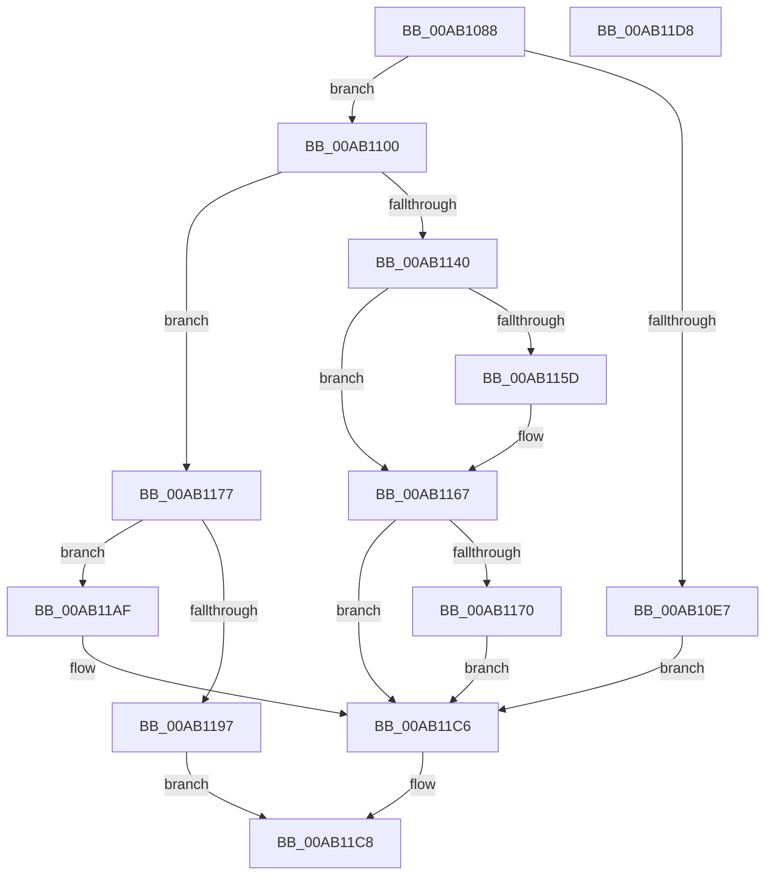

# DbgkpWerInitializeDeferredLiveDump

- RVA: `0x00AB1088`–`0x00AB11D9` (길이 `337` bytes)
- VA: `0x0000000140AB1088`
- 실행 섹션: `PAGE`
- PDB 이름 있음: `예`; PDB Function 태그: `아니요`
- unwind 정보 RVA: `0x000BC720`
- 디코드: `87`개 명령, `337/337` bytes 표시
- 미해석 바이트: `0` (있으면 어셈블리에 `.byte`로 보존)

> 이 문서는 커널 이미지의 기계어와 PDB 기호를 분석해 생성했습니다. 4번과 5번은 함수 원형과 자료형을 바이너리 사용 방식에서 추정한 C 해석이며 원본 소스 복구 결과는 아닙니다.

## 1. Dependencies

- 직접 호출 지점: **9**; 고유 호출 대상: **6**
- 직접 호출자로 확인된 함수: **1**
- RIP 상대 이미지 참조: **5**

### Outgoing calls
- `0x00AB10DC` → [ZwCreateTimer](../../text/6A/ZwCreateTimer_function_006AEA30.md) (function, `0x006AEA30`)
- `0x00AB10F6` → [DbgPrintEx](../../text/35/DbgPrintEx_function_00359290.md) (function, `0x00359290`)
- `0x00AB1135` → [ObpReferenceObjectByHandleWithTag](../86/ObpReferenceObjectByHandleWithTag_function_00869650.md) (function, `0x00869650`)
- `0x00AB114F` → [DbgPrintEx](../../text/35/DbgPrintEx_function_00359290.md) (function, `0x00359290`)
- `0x00AB115D` → [ObfDereferenceObject](../../text/2F/ObfDereferenceObject_function_002F9350.md) (function, `0x002F9350`)
- `0x00AB1170` → [ZwClose](../../text/6A/ZwClose_function_006AD2B0.md) (function, `0x006AD2B0`)
- `0x00AB117B` → [ZwClose](../../text/6A/ZwClose_function_006AD2B0.md) (function, `0x006AD2B0`)
- `0x00AB118D` → [DbgkpWerAllocateNonpagedPool](../../text/58/DbgkpWerAllocateNonpagedPool_function_0058063C.md) (function, `0x0058063C`)
- `0x00AB11A3` → [DbgPrintEx](../../text/35/DbgPrintEx_function_00359290.md) (function, `0x00359290`)

### Direct callers
- [DbgkpWerCaptureLiveFullDump](DbgkpWerCaptureLiveFullDump_function_00AB0DAC.md) at `0x00AB0EE0`

### Static image references
- `0x00AB10E9` → RVA `0x00AFB5E0` (` ?? ::NNGAKEGL::`string'`; read)
- `0x00AB1113` → RVA `0x00FC6D98` (`ALMOSTRO`; read)
- `0x00AB1142` → RVA `0x00AFB710` (` ?? ::NNGAKEGL::`string'`; read)
- `0x00AB1197` → RVA `0x00AFB740` (` ?? ::NNGAKEGL::`string'`; read)
- `0x00AB11B3` → RVA `0x00712340` (`DbgkpWerDeferredWriteRoutine`; read)

## 2. Other-region calls and transfers

- 다른 실행 섹션으로 향하는 call: **8**
  - `0x00AB10DC` → [ZwCreateTimer](../../text/6A/ZwCreateTimer_function_006AEA30.md) (`PAGE` → `.text`)
  - `0x00AB10F6` → [DbgPrintEx](../../text/35/DbgPrintEx_function_00359290.md) (`PAGE` → `.text`)
  - `0x00AB114F` → [DbgPrintEx](../../text/35/DbgPrintEx_function_00359290.md) (`PAGE` → `.text`)
  - `0x00AB115D` → [ObfDereferenceObject](../../text/2F/ObfDereferenceObject_function_002F9350.md) (`PAGE` → `.text`)
  - `0x00AB1170` → [ZwClose](../../text/6A/ZwClose_function_006AD2B0.md) (`PAGE` → `.text`)
  - `0x00AB117B` → [ZwClose](../../text/6A/ZwClose_function_006AD2B0.md) (`PAGE` → `.text`)
  - `0x00AB118D` → [DbgkpWerAllocateNonpagedPool](../../text/58/DbgkpWerAllocateNonpagedPool_function_0058063C.md) (`PAGE` → `.text`)
  - `0x00AB11A3` → [DbgPrintEx](../../text/35/DbgPrintEx_function_00359290.md) (`PAGE` → `.text`)
- 별도 외부 분기/꼬리 이동을 확인하지 못했습니다.

## 3. Assembly (complete function range)

```asm
00AB1088  48 89 5C 24 18                  mov qword ptr [rsp + 0x18], rbx
00AB108D  55                              push rbp
00AB108E  56                              push rsi
00AB108F  57                              push rdi
00AB1090  48 8B EC                        mov rbp, rsp
00AB1093  48 83 EC 70                     sub rsp, 0x70
00AB1097  48 8B 71 78                     mov rsi, qword ptr [rcx + 0x78]
00AB109B  4C 8D 45 D0                     lea r8, [rbp - 0x30]
00AB109F  83 65 EC 00                     and dword ptr [rbp - 0x14], 0
00AB10A3  48 8B F9                        mov rdi, rcx
00AB10A6  48 83 65 20 00                  and qword ptr [rbp + 0x20], 0
00AB10AB  48 8D 4D 20                     lea rcx, [rbp + 0x20]
00AB10AF  48 83 65 D8 00                  and qword ptr [rbp - 0x28], 0
00AB10B4  0F 57 C0                        xorps xmm0, xmm0
00AB10B7  48 83 65 E0 00                  and qword ptr [rbp - 0x20], 0
00AB10BC  45 33 C9                        xor r9d, r9d
00AB10BF  48 C7 45 D0 30 00 00 00         mov qword ptr [rbp - 0x30], 0x30
00AB10C7  BA 03 00 1F 00                  mov edx, 0x1f0003
00AB10CC  83 65 D4 00                     and dword ptr [rbp - 0x2c], 0
00AB10D0  F3 0F 7F 45 F0                  movdqu xmmword ptr [rbp - 0x10], xmm0
00AB10D5  C7 45 E8 00 02 00 00            mov dword ptr [rbp - 0x18], 0x200
00AB10DC  E8 4F D9 BF FF                  call 0x1406aea30
00AB10E1  8B D8                           mov ebx, eax
00AB10E3  85 C0                           test eax, eax
00AB10E5  79 19                           jns 0x140ab1100
00AB10E7  33 D2                           xor edx, edx
00AB10E9  4C 8D 05 F0 A4 04 00            lea r8, [rip + 0x4a4f0]
00AB10F0  44 8B C8                        mov r9d, eax
00AB10F3  8D 4A 05                        lea ecx, [rdx + 5]
00AB10F6  E8 95 81 8A FF                  call 0x140359290
00AB10FB  E9 C6 00 00 00                  jmp 0x140ab11c6
00AB1100  48 83 64 24 38 00               and qword ptr [rsp + 0x38], 0
00AB1106  48 8D 45 28                     lea rax, [rbp + 0x28]
00AB110A  48 83 64 24 30 00               and qword ptr [rsp + 0x30], 0
00AB1110  45 33 C9                        xor r9d, r9d
00AB1113  4C 8B 05 7E 5C 51 00            mov r8, qword ptr [rip + 0x515c7e]
00AB111A  BA 03 00 1F 00                  mov edx, 0x1f0003
00AB111F  48 8B 4D 20                     mov rcx, qword ptr [rbp + 0x20]
00AB1123  48 83 65 28 00                  and qword ptr [rbp + 0x28], 0
00AB1128  48 89 44 24 28                  mov qword ptr [rsp + 0x28], rax
00AB112D  C7 44 24 20 44 62 67 57         mov dword ptr [rsp + 0x20], 0x57676244
00AB1135  E8 16 85 DB FF                  call 0x140869650
00AB113A  8B D8                           mov ebx, eax
00AB113C  85 C0                           test eax, eax
00AB113E  79 37                           jns 0x140ab1177
00AB1140  33 D2                           xor edx, edx
00AB1142  4C 8D 05 C7 A5 04 00            lea r8, [rip + 0x4a5c7]
00AB1149  44 8B C8                        mov r9d, eax
00AB114C  8D 4A 05                        lea ecx, [rdx + 5]
00AB114F  E8 3C 81 8A FF                  call 0x140359290
00AB1154  48 8B 4D 28                     mov rcx, qword ptr [rbp + 0x28]
00AB1158  48 85 C9                        test rcx, rcx
00AB115B  74 0A                           je 0x140ab1167
00AB115D  E8 EE 81 84 FF                  call 0x1402f9350
00AB1162  48 83 66 10 00                  and qword ptr [rsi + 0x10], 0
00AB1167  48 8B 4D 20                     mov rcx, qword ptr [rbp + 0x20]
00AB116B  48 85 C9                        test rcx, rcx
00AB116E  74 56                           je 0x140ab11c6
00AB1170  E8 3B C1 BF FF                  call 0x1406ad2b0
00AB1175  EB 4F                           jmp 0x140ab11c6
00AB1177  48 8B 4D 20                     mov rcx, qword ptr [rbp + 0x20]
00AB117B  E8 30 C1 BF FF                  call 0x1406ad2b0
00AB1180  48 8B 45 28                     mov rax, qword ptr [rbp + 0x28]
00AB1184  48 83 65 20 00                  and qword ptr [rbp + 0x20], 0
00AB1189  48 89 46 10                     mov qword ptr [rsi + 0x10], rax
00AB118D  E8 AA F4 AC FF                  call 0x14058063c
00AB1192  48 85 C0                        test rax, rax
00AB1195  75 18                           jne 0x140ab11af
00AB1197  4C 8D 05 A2 A5 04 00            lea r8, [rip + 0x4a5a2]
00AB119E  33 D2                           xor edx, edx
00AB11A0  8D 48 05                        lea ecx, [rax + 5]
00AB11A3  E8 E8 80 8A FF                  call 0x140359290
00AB11A8  B8 17 00 00 C0                  mov eax, 0xc0000017
00AB11AD  EB 19                           jmp 0x140ab11c8
00AB11AF  48 89 47 70                     mov qword ptr [rdi + 0x70], rax
00AB11B3  48 8D 0D 86 11 C6 FF            lea rcx, [rip - 0x39ee7a]
00AB11BA  48 83 20 00                     and qword ptr [rax], 0
00AB11BE  48 89 48 10                     mov qword ptr [rax + 0x10], rcx
00AB11C2  48 89 78 18                     mov qword ptr [rax + 0x18], rdi
00AB11C6  8B C3                           mov eax, ebx
00AB11C8  48 8B 9C 24 A0 00 00 00         mov rbx, qword ptr [rsp + 0xa0]
00AB11D0  48 83 C4 70                     add rsp, 0x70
00AB11D4  5F                              pop rdi
00AB11D5  5E                              pop rsi
00AB11D6  5D                              pop rbp
00AB11D7  C3                              ret
00AB11D8  CC                              int3
```

## 4. C-style interpretation (structured pseudocode)

```c
__int64 __fastcall DbgkpWerInitializeDeferredLiveDump(__int64 a1, __int64 a2, __int64 a3, int a4)
{
    __int64 result;
    __int64 v_rsp;
    unsigned __int64 v_stack_m28;
    unsigned int v_stack_m2C;
    unsigned int v_stack_m30;
    unsigned __int64 v_stack_m38;
    unsigned __int64 v_stack_m40;
    unsigned int v_stack_m44;
    unsigned __int64 v_stack_m48;
    unsigned __int64 v_stack_m50;
    unsigned __int64 v_stack_m58;
    unsigned __int64 v_stack_m60;
    unsigned int v_stack_m68;
    unsigned __int64 v_stack_p10;
    unsigned __int64 v_stack_p18;
    unsigned __int64 v_stack_p8;

    v_stack_p18 = v_rbx;
    v_rsp = (v_rsp) - (112);
    a4 = 0;
    v_stack_m48 = 48;
    v_stack_m28 = v_xmm0;
    v_stack_m30 = 512;
    result = ZwCreateTimer(v_stack_p8, (unsigned int)(0x1F0003ULL), v_stack_m48, a4);
    if (!sign_flag) goto loc_00AB1100;
    a2 = 0;
    result = DbgPrintEx(a2 + 5, a2, v_rip + 304368, (unsigned int)((unsigned int)(result)));
    goto loc_00AB11C6;
loc_00AB1100:
    a4 = 0;
    v_stack_m60 = v_stack_p10;
    v_stack_m68 = 0x57676244ULL;
    result = ObpReferenceObjectByHandleWithTag(v_stack_p8, (unsigned int)(0x1F0003ULL), *(unsigned __int64 *)(v_rip + 5332094), a4);
    if (!sign_flag) goto loc_00AB1177;
    a2 = 0;
    result = DbgPrintEx(a2 + 5, a2, v_rip + 304583, (unsigned int)((unsigned int)(result)));
    if (v_stack_p10 != 0) {
        result = ObfDereferenceObject(v_stack_p10, a2, v_rip + 304583, (unsigned int)((unsigned int)(result)));
    }
    if (v_stack_p8 == 0) goto loc_00AB11C6;
    result = ZwClose(v_stack_p8, a2, v_rip + 304583, (unsigned int)((unsigned int)(result)));
    goto loc_00AB11C6;
loc_00AB1177:
    result = ZwClose(v_stack_p8, a2, v_rip + 304583, (unsigned int)((unsigned int)(result)));
    *(unsigned __int64 *)(*(unsigned __int64 *)(a1 + 120) + 16) = v_stack_p10;
    result = DbgkpWerAllocateNonpagedPool(v_stack_p8, a2, v_rip + 304583, (unsigned int)((unsigned int)(result)));
    if (result != 0) goto loc_00AB11AF;
    a2 = 0;
    result = DbgPrintEx(result + 5, a2, v_rip + 304546, (unsigned int)((unsigned int)(result)));
    goto loc_00AB11C8;
loc_00AB11AF:
    *(unsigned __int64 *)(a1 + 112) = (unsigned int)(0xC0000017ULL);
    *(unsigned __int64 *)((unsigned int)(0xC0000017ULL) + 16) = v_rip - 3796602;
    *(unsigned __int64 *)((unsigned int)(0xC0000017ULL) + 24) = a1;
loc_00AB11C6:
loc_00AB11C8:
    v_rsp = (v_rsp) + (112);
    return (unsigned int)((unsigned int)((unsigned int)((unsigned int)(result))));
}
```

## 5. (Beta) C Style

```c
int64_t DbgkpWerInitializeDeferredLiveDump(void *Arg1, int64_t Arg2, int64_t Arg3, int32_t Arg4)
{
    uint8_t *arg1 = (uint8_t *)Arg1;

    int64_t result;
    int64_t local_rsp;
    uint64_t v_stack_m28;
    uint32_t v_stack_m2C;
    uint32_t v_stack_m30;
    uint64_t v_stack_m38;
    uint64_t v_stack_m40;
    uint32_t v_stack_m44;
    uint64_t v_stack_m48;
    uint64_t v_stack_m50;
    uint64_t v_stack_m58;
    uint64_t v_stack_m60;
    uint32_t v_stack_m68;
    uint64_t v_stack_p10;
    uint64_t v_stack_p18;
    uint64_t v_stack_p8;

    v_stack_p18 = local_rbx;
    local_rsp = (local_rsp) - (112);
    Arg4 = 0;
    v_stack_m48 = 48;
    v_stack_m28 = v_xmm0;
    v_stack_m30 = 512;
    result = ZwCreateTimer(v_stack_p8, (uint32_t)(0x1F0003ULL), v_stack_m48, Arg4);
    if (!sign_flag) goto loc_00AB1100;
    Arg2 = 0;
    result = DbgPrintEx(Arg2 + 5, Arg2, v_rip + 304368, (uint32_t)((uint32_t)(result)));
    goto loc_00AB11C6;
loc_00AB1100:
    Arg4 = 0;
    v_stack_m60 = v_stack_p10;
    v_stack_m68 = 0x57676244ULL;
    result = ObpReferenceObjectByHandleWithTag(v_stack_p8, (uint32_t)(0x1F0003ULL), *(uint64_t *)(v_rip + 0x515C7E), Arg4);
    if (!sign_flag) goto loc_00AB1177;
    Arg2 = 0;
    result = DbgPrintEx(Arg2 + 5, Arg2, v_rip + 304583, (uint32_t)((uint32_t)(result)));
    if (v_stack_p10 != 0) {
        result = ObfDereferenceObject(v_stack_p10, Arg2, v_rip + 304583, (uint32_t)((uint32_t)(result)));
    }
    if (v_stack_p8 == 0) goto loc_00AB11C6;
    result = ZwClose(v_stack_p8, Arg2, v_rip + 304583, (uint32_t)((uint32_t)(result)));
    goto loc_00AB11C6;
loc_00AB1177:
    result = ZwClose(v_stack_p8, Arg2, v_rip + 304583, (uint32_t)((uint32_t)(result)));
    *(uint64_t *)(*(uint64_t *)(arg1 + 0x78) + 0x10) = v_stack_p10;
    result = DbgkpWerAllocateNonpagedPool(v_stack_p8, Arg2, v_rip + 304583, (uint32_t)((uint32_t)(result)));
    if (result != 0) goto loc_00AB11AF;
    Arg2 = 0;
    result = DbgPrintEx(result + 5, Arg2, v_rip + 304546, (uint32_t)((uint32_t)(result)));
    goto loc_00AB11C8;
loc_00AB11AF:
    *(uint64_t *)(arg1 + 0x70) = (uint32_t)(0xC0000017ULL);
    *(uint64_t *)((uint32_t)(0xC0000017ULL) + 0x10) = v_rip - 3796602;
    *(void **)((uint32_t)(0xC0000017ULL) + 0x18) = Arg1;
loc_00AB11C6:
loc_00AB11C8:
    local_rsp = (local_rsp) + (112);
    return (uint32_t)((uint32_t)((uint32_t)((uint32_t)(result))));
}
```

### 관측된 메모리 오프셋

구조체 형식이 확인되지 않은 접근은 인자 기준의 오프셋으로만 기록했습니다.

| 기준 인자 | 오프셋 표현 | 폭 (bit) | 접근 |
|---|---:|---:|---|
| `Arg1` | `+ 0x70` | `64` | `W` |
| `Arg1` | `+ 0x78` | `64` | `R` |

## 6. Execution-region graph

[열기: 2D/3D 그래프와 함수 탐색 컨트롤 패널](../../../control-panel.html?section=page&rva=0x00AB1088&view=graph)

- 2D 그래프는 위에서 아래로 흐르고, 3D 그래프는 빈 공간을 드래그해 회전합니다. Shift+드래그는 이동, 휠은 확대·축소, 함수 노드 선택은 대상 보고서 이동입니다.

### Static fallback


