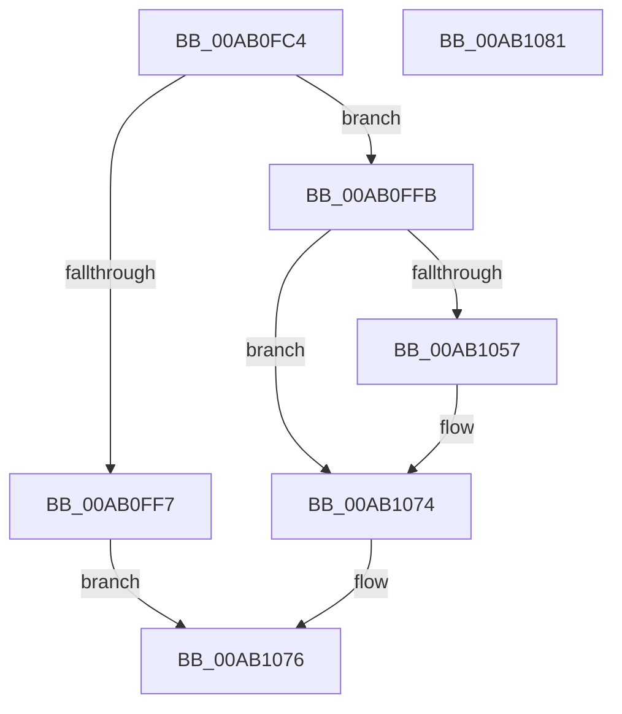

# DbgkpWerInvokeCallbacks

- RVA: `0x00AB0FC4`–`0x00AB1082` (길이 `190` bytes)
- VA: `0x0000000140AB0FC4`
- 실행 섹션: `PAGE`
- PDB 이름 있음: `예`; PDB Function 태그: `아니요`
- unwind 정보 RVA: `0x0008A2AC`
- 디코드: `51`개 명령, `190/190` bytes 표시
- 미해석 바이트: `0` (있으면 어셈블리에 `.byte`로 보존)

> 이 문서는 커널 이미지의 기계어와 PDB 기호를 분석해 생성했습니다. 4번과 5번은 함수 원형과 자료형을 바이너리 사용 방식에서 추정한 C 해석이며 원본 소스 복구 결과는 아닙니다.

## 1. Dependencies

- 직접 호출 지점: **4**; 고유 호출 대상: **2**
- 직접 호출자로 확인된 함수: **2**
- RIP 상대 이미지 참조: **4**

### Outgoing calls
- `0x00AB0FE5` → [DbgPrintEx](../../text/35/DbgPrintEx_function_00359290.md) (function, `0x00359290`)
- `0x00AB1009` → [DbgPrintEx](../../text/35/DbgPrintEx_function_00359290.md) (function, `0x00359290`)
- `0x00AB104C` → [guard_dispatch_icall](../../text/6B/guard_dispatch_icall_function_006BAAD0.md) (function, `0x006BAAD0`)
- `0x00AB106F` → [DbgPrintEx](../../text/35/DbgPrintEx_function_00359290.md) (function, `0x00359290`)

### Direct callers
- [DbgkpWerCaptureLiveTriageDump](../71/DbgkpWerCaptureLiveTriageDump_function_00712000.md) at `0x007120ED`
- [DbgkpWerCaptureLiveFullDump](DbgkpWerCaptureLiveFullDump_function_00AB0DAC.md) at `0x00AB0EF2`

### Static image references
- `0x00AB0FD3` → RVA `0x00AFB6A0` (` ?? ::NNGAKEGL::`string'`; read)
- `0x00AB0FFB` → RVA `0x00AFB6E0` (` ?? ::NNGAKEGL::`string'`; read)
- `0x00AB1012` → RVA `0x00711E80` (`DbgkWerAddSecondaryData`; read)
- `0x00AB105B` → RVA `0x00AFB7E0` (` ?? ::NNGAKEGL::`string'`; read)

## 2. Other-region calls and transfers

- 다른 실행 섹션으로 향하는 call: **4**
  - `0x00AB0FE5` → [DbgPrintEx](../../text/35/DbgPrintEx_function_00359290.md) (`PAGE` → `.text`)
  - `0x00AB1009` → [DbgPrintEx](../../text/35/DbgPrintEx_function_00359290.md) (`PAGE` → `.text`)
  - `0x00AB104C` → [guard_dispatch_icall](../../text/6B/guard_dispatch_icall_function_006BAAD0.md) (`PAGE` → `.text`)
  - `0x00AB106F` → [DbgPrintEx](../../text/35/DbgPrintEx_function_00359290.md) (`PAGE` → `.text`)
- 별도 외부 분기/꼬리 이동을 확인하지 못했습니다.

## 3. Assembly (complete function range)

```asm
00AB0FC4  48 89 5C 24 08                  mov qword ptr [rsp + 8], rbx
00AB0FC9  57                              push rdi
00AB0FCA  48 83 EC 50                     sub rsp, 0x50
00AB0FCE  BF 03 00 00 00                  mov edi, 3
00AB0FD3  4C 8D 05 C6 A6 04 00            lea r8, [rip + 0x4a6c6]
00AB0FDA  48 8B D9                        mov rbx, rcx
00AB0FDD  4C 8B C9                        mov r9, rcx
00AB0FE0  8B D7                           mov edx, edi
00AB0FE2  8D 4F 02                        lea ecx, [rdi + 2]
00AB0FE5  E8 A6 82 8A FF                  call 0x140359290
00AB0FEA  48 8B 43 48                     mov rax, qword ptr [rbx + 0x48]
00AB0FEE  4C 8B 48 08                     mov r9, qword ptr [rax + 8]
00AB0FF2  4D 85 C9                        test r9, r9
00AB0FF5  75 04                           jne 0x140ab0ffb
00AB0FF7  33 C0                           xor eax, eax
00AB0FF9  EB 7B                           jmp 0x140ab1076
00AB0FFB  4C 8D 05 DE A6 04 00            lea r8, [rip + 0x4a6de]
00AB1002  8B D7                           mov edx, edi
00AB1004  B9 05 00 00 00                  mov ecx, 5
00AB1009  E8 82 82 8A FF                  call 0x140359290
00AB100E  48 8B 4B 48                     mov rcx, qword ptr [rbx + 0x48]
00AB1012  48 8D 15 67 0E C6 FF            lea rdx, [rip - 0x39f199]
00AB1019  4C 8B 4B 28                     mov r9, qword ptr [rbx + 0x28]
00AB101D  44 8B 43 20                     mov r8d, dword ptr [rbx + 0x20]
00AB1021  48 8B 41 08                     mov rax, qword ptr [rcx + 8]
00AB1025  48 8B 49 10                     mov rcx, qword ptr [rcx + 0x10]
00AB1029  48 89 4C 24 38                  mov qword ptr [rsp + 0x38], rcx
00AB102E  48 8B 4B 40                     mov rcx, qword ptr [rbx + 0x40]
00AB1032  48 89 4C 24 30                  mov qword ptr [rsp + 0x30], rcx
00AB1037  48 8B 4B 38                     mov rcx, qword ptr [rbx + 0x38]
00AB103B  48 89 4C 24 28                  mov qword ptr [rsp + 0x28], rcx
00AB1040  48 8B 4B 30                     mov rcx, qword ptr [rbx + 0x30]
00AB1044  48 89 4C 24 20                  mov qword ptr [rsp + 0x20], rcx
00AB1049  48 8B CB                        mov rcx, rbx
00AB104C  E8 7F 9A C0 FF                  call 0x1406baad0
00AB1051  8B F8                           mov edi, eax
00AB1053  85 C0                           test eax, eax
00AB1055  79 1D                           jns 0x140ab1074
00AB1057  4C 8B 4B 48                     mov r9, qword ptr [rbx + 0x48]
00AB105B  4C 8D 05 7E A7 04 00            lea r8, [rip + 0x4a77e]
00AB1062  33 D2                           xor edx, edx
00AB1064  89 44 24 20                     mov dword ptr [rsp + 0x20], eax
00AB1068  4D 8B 49 08                     mov r9, qword ptr [r9 + 8]
00AB106C  8D 4A 05                        lea ecx, [rdx + 5]
00AB106F  E8 1C 82 8A FF                  call 0x140359290
00AB1074  8B C7                           mov eax, edi
00AB1076  48 8B 5C 24 60                  mov rbx, qword ptr [rsp + 0x60]
00AB107B  48 83 C4 50                     add rsp, 0x50
00AB107F  5F                              pop rdi
00AB1080  C3                              ret
00AB1081  CC                              int3
```

## 4. C-style interpretation (structured pseudocode)

```c
__int64 __fastcall DbgkpWerInvokeCallbacks(__int64 a1)
{
    __int64 result;
    __int64 v_rsp;
    unsigned __int64 v_stack_m20;
    unsigned __int64 v_stack_m28;
    unsigned __int64 v_stack_m30;
    unsigned __int64 v_stack_m38;
    unsigned __int64 v_stack_p8;

    v_stack_p8 = v_rbx;
    v_rsp = (v_rsp) - (80);
    result = DbgPrintEx(3 + 2, 3, v_rip + 304838, a1);
    if (*(unsigned __int64 *)(*(unsigned __int64 *)(a1 + 72) + 8) != 0) goto loc_00AB0FFB;
    result = 0;
    goto loc_00AB1076;
loc_00AB0FFB:
    result = DbgPrintEx(5, 3, v_rip + 304862, *(unsigned __int64 *)(*(unsigned __int64 *)(a1 + 72) + 8));
    v_stack_m20 = *(unsigned __int64 *)(*(unsigned __int64 *)(a1 + 72) + 16);
    v_stack_m28 = *(unsigned __int64 *)(a1 + 64);
    v_stack_m30 = *(unsigned __int64 *)(a1 + 56);
    v_stack_m38 = *(unsigned __int64 *)(a1 + 48);
    result = guard_dispatch_icall(a1, v_rip - 3797401, (unsigned int)(*(unsigned int *)(a1 + 32)), *(unsigned __int64 *)(a1 + 40));
    if (sign_flag) {
        a4 = *(unsigned __int64 *)(a1 + 72);
        a3 = v_rip + 305022;
        a2 = 0;
        v_stack_m38 = (unsigned int)(result);
        a4 = *(unsigned __int64 *)(a4 + 8);
        a1 = a2 + 5;
        result = DbgPrintEx(a1, a2, a3, a4);
    }
loc_00AB1076:
    v_rsp = (v_rsp) + (80);
    return (unsigned int)((unsigned int)((unsigned int)((unsigned int)(result))));
}
```

## 5. (Beta) C Style

```c
int64_t DbgkpWerInvokeCallbacks(void *Arg1)
{
    uint8_t *arg1 = (uint8_t *)Arg1;

    int64_t result;
    int64_t local_rsp;
    uint64_t v_stack_m20;
    uint64_t v_stack_m28;
    uint64_t v_stack_m30;
    uint64_t v_stack_m38;
    uint64_t v_stack_p8;

    v_stack_p8 = local_rbx;
    local_rsp = (local_rsp) - (80);
    result = DbgPrintEx(3 + 2, 3, v_rip + 304838, Arg1);
    if (*(uint64_t *)(*(uint64_t *)(arg1 + 0x48) + 0x8) != 0) goto loc_00AB0FFB;
    result = 0;
    goto loc_00AB1076;
loc_00AB0FFB:
    result = DbgPrintEx(5, 3, v_rip + 304862, *(uint64_t *)(*(uint64_t *)(arg1 + 0x48) + 0x8));
    v_stack_m20 = *(uint64_t *)(*(uint64_t *)(arg1 + 0x48) + 0x10);
    v_stack_m28 = *(uint64_t *)(arg1 + 0x40);
    v_stack_m30 = *(uint64_t *)(arg1 + 0x38);
    v_stack_m38 = *(uint64_t *)(arg1 + 0x30);
    result = guard_dispatch_icall(Arg1, v_rip - 3797401, (uint32_t)(*(uint32_t *)(arg1 + 0x20)), *(uint64_t *)(arg1 + 0x28));
    if (sign_flag) {
        a4 = *(uint64_t *)(arg1 + 0x48);
        a3 = v_rip + 305022;
        a2 = 0;
        v_stack_m38 = (uint32_t)(result);
        a4 = *(uint64_t *)(a4 + 0x8);
        Arg1 = a2 + 5;
        result = DbgPrintEx(Arg1, a2, a3, a4);
    }
loc_00AB1076:
    local_rsp = (local_rsp) + (80);
    return (uint32_t)((uint32_t)((uint32_t)((uint32_t)(result))));
}
```

### 관측된 메모리 오프셋

구조체 형식이 확인되지 않은 접근은 인자 기준의 오프셋으로만 기록했습니다.

| 기준 인자 | 오프셋 표현 | 폭 (bit) | 접근 |
|---|---:|---:|---|
| `Arg1` | `+ 0x20` | `32` | `R` |
| `Arg1` | `+ 0x28` | `64` | `R` |
| `Arg1` | `+ 0x30` | `64` | `R` |
| `Arg1` | `+ 0x38` | `64` | `R` |
| `Arg1` | `+ 0x40` | `64` | `R` |
| `Arg1` | `+ 0x48` | `64` | `R` |

## 6. Execution-region graph

[열기: 2D/3D 그래프와 함수 탐색 컨트롤 패널](../../../control-panel.html?section=page&rva=0x00AB0FC4&view=graph)

- 2D 그래프는 위에서 아래로 흐르고, 3D 그래프는 빈 공간을 드래그해 회전합니다. Shift+드래그는 이동, 휠은 확대·축소, 함수 노드 선택은 대상 보고서 이동입니다.

### Static fallback


