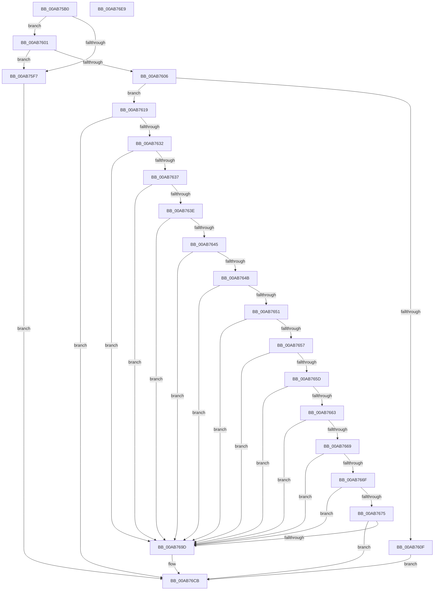

# EtwWriteStartScenario

- RVA: `0x00AB75B0`–`0x00AB76EA` (길이 `314` bytes)
- VA: `0x0000000140AB75B0`
- 실행 섹션: `PAGE`
- PDB 이름 있음: `예`; PDB Function 태그: `아니요`
- unwind 정보 RVA: `0x000BCFE0`
- 디코드: `97`개 명령, `314/314` bytes 표시
- 미해석 바이트: `0` (있으면 어셈블리에 `.byte`로 보존)

> 이 문서는 커널 이미지의 기계어와 PDB 기호를 분석해 생성했습니다. 4번과 5번은 함수 원형과 자료형을 바이너리 사용 방식에서 추정한 C 해석이며 원본 소스 복구 결과는 아닙니다.

## 1. Dependencies

- 직접 호출 지점: **6**; 고유 호출 대상: **6**
- 직접 호출자로 확인된 함수: **3**
- RIP 상대 이미지 참조: **1**

### Outgoing calls
- `0x00AB7606` → [EtwEventEnabled](../../text/39/EtwEventEnabled_function_00392450.md) (function, `0x00392450`)
- `0x00AB7623` → [EtwGetProviderIdFromHandle](../../text/4B/EtwGetProviderIdFromHandle_function_004B8850.md) (function, `0x004B8850`)
- `0x00AB7692` → [ZwTraceControl](../../text/6B/ZwTraceControl_function_006B0BB0.md) (function, `0x006B0BB0`)
- `0x00AB76AE` → [EtwWrite](../../text/41/EtwWrite_function_0041C720.md) (function, `0x0041C720`)
- `0x00AB76C6` → [WdipStartEndScenario](../A5/WdipStartEndScenario_function_00A5C378.md) (function, `0x00A5C378`)
- `0x00AB76D5` → [_security_check_cookie](../../text/6A/_security_check_cookie_function_006AC640.md) (function, `0x006AC640`)

### Direct callers
- [PopDiagTracePowerTransitionStart](PopDiagTracePowerTransitionStart_function_00AB74F8.md) at `0x00AB7585`
- [IoInitSystemPreDrivers](../../init/C2/IoInitSystemPreDrivers_function_00C2AC3C.md) at `0x00C2B982`
- [PerfDiagInitialize](../../init/C4/PerfDiagInitialize_function_00C4D150.md) at `0x00C4D23C`

### Static image references
- `0x00AB75BF` → RVA `0x00E0A740` (`.data`; read)

## 2. Other-region calls and transfers

- 다른 실행 섹션으로 향하는 call: **5**
  - `0x00AB7606` → [EtwEventEnabled](../../text/39/EtwEventEnabled_function_00392450.md) (`PAGE` → `.text`)
  - `0x00AB7623` → [EtwGetProviderIdFromHandle](../../text/4B/EtwGetProviderIdFromHandle_function_004B8850.md) (`PAGE` → `.text`)
  - `0x00AB7692` → [ZwTraceControl](../../text/6B/ZwTraceControl_function_006B0BB0.md) (`PAGE` → `.text`)
  - `0x00AB76AE` → [EtwWrite](../../text/41/EtwWrite_function_0041C720.md) (`PAGE` → `.text`)
  - `0x00AB76D5` → [_security_check_cookie](../../text/6A/_security_check_cookie_function_006AC640.md) (`PAGE` → `.text`)
- 별도 외부 분기/꼬리 이동을 확인하지 못했습니다.

## 3. Assembly (complete function range)

```asm
00AB75B0  40 53                           push rbx
00AB75B2  55                              push rbp
00AB75B3  56                              push rsi
00AB75B4  57                              push rdi
00AB75B5  41 54                           push r12
00AB75B7  41 56                           push r14
00AB75B9  41 57                           push r15
00AB75BB  48 83 EC 50                     sub rsp, 0x50
00AB75BF  48 8B 05 7A 31 35 00            mov rax, qword ptr [rip + 0x35317a]
00AB75C6  48 33 C4                        xor rax, rsp
00AB75C9  48 89 44 24 48                  mov qword ptr [rsp + 0x48], rax
00AB75CE  4C 8B BC 24 B0 00 00 00         mov r15, qword ptr [rsp + 0xb0]
00AB75D6  45 33 E4                        xor r12d, r12d
00AB75D9  44 89 64 24 30                  mov dword ptr [rsp + 0x30], r12d
00AB75DE  0F 57 C0                        xorps xmm0, xmm0
00AB75E1  45 8B F1                        mov r14d, r9d
00AB75E4  49 8B D8                        mov rbx, r8
00AB75E7  48 8B EA                        mov rbp, rdx
00AB75EA  48 8B F1                        mov rsi, rcx
00AB75ED  0F 11 44 24 38                  movups xmmword ptr [rsp + 0x38], xmm0
00AB75F2  48 85 D2                        test rdx, rdx
00AB75F5  75 0A                           jne 0x140ab7601
00AB75F7  BF 0D 00 00 C0                  mov edi, 0xc000000d
00AB75FC  E9 CA 00 00 00                  jmp 0x140ab76cb
00AB7601  48 85 DB                        test rbx, rbx
00AB7604  74 F1                           je 0x140ab75f7
00AB7606  E8 45 AE 8D FF                  call 0x140392450
00AB760B  84 C0                           test al, al
00AB760D  75 0A                           jne 0x140ab7619
00AB760F  BF 08 00 00 C0                  mov edi, 0xc0000008
00AB7614  E9 B2 00 00 00                  jmp 0x140ab76cb
00AB7619  4C 8D 44 24 38                  lea r8, [rsp + 0x38]
00AB761E  33 D2                           xor edx, edx
00AB7620  48 8B CE                        mov rcx, rsi
00AB7623  E8 28 12 A0 FF                  call 0x1404b8850
00AB7628  8B F8                           mov edi, eax
00AB762A  85 C0                           test eax, eax
00AB762C  0F 88 99 00 00 00               js 0x140ab76cb
00AB7632  44 39 23                        cmp dword ptr [rbx], r12d
00AB7635  75 66                           jne 0x140ab769d
00AB7637  66 44 39 63 04                  cmp word ptr [rbx + 4], r12w
00AB763C  75 5F                           jne 0x140ab769d
00AB763E  66 44 39 63 06                  cmp word ptr [rbx + 6], r12w
00AB7643  75 58                           jne 0x140ab769d
00AB7645  44 38 63 08                     cmp byte ptr [rbx + 8], r12b
00AB7649  75 52                           jne 0x140ab769d
00AB764B  44 38 63 09                     cmp byte ptr [rbx + 9], r12b
00AB764F  75 4C                           jne 0x140ab769d
00AB7651  44 38 63 0A                     cmp byte ptr [rbx + 0xa], r12b
00AB7655  75 46                           jne 0x140ab769d
00AB7657  44 38 63 0B                     cmp byte ptr [rbx + 0xb], r12b
00AB765B  75 40                           jne 0x140ab769d
00AB765D  44 38 63 0C                     cmp byte ptr [rbx + 0xc], r12b
00AB7661  75 3A                           jne 0x140ab769d
00AB7663  44 38 63 0D                     cmp byte ptr [rbx + 0xd], r12b
00AB7667  75 34                           jne 0x140ab769d
00AB7669  44 38 63 0E                     cmp byte ptr [rbx + 0xe], r12b
00AB766D  75 2E                           jne 0x140ab769d
00AB766F  44 38 63 0F                     cmp byte ptr [rbx + 0xf], r12b
00AB7673  75 28                           jne 0x140ab769d
00AB7675  33 D2                           xor edx, edx
00AB7677  48 8D 44 24 30                  lea rax, [rsp + 0x30]
00AB767C  48 89 44 24 28                  mov qword ptr [rsp + 0x28], rax
00AB7681  4C 8B CB                        mov r9, rbx
00AB7684  45 33 C0                        xor r8d, r8d
00AB7687  C7 44 24 20 10 00 00 00         mov dword ptr [rsp + 0x20], 0x10
00AB768F  8D 4A 0C                        lea ecx, [rdx + 0xc]
00AB7692  E8 19 95 BF FF                  call 0x1406b0bb0
00AB7697  8B F8                           mov edi, eax
00AB7699  85 C0                           test eax, eax
00AB769B  78 2E                           js 0x140ab76cb
00AB769D  45 8B CE                        mov r9d, r14d
00AB76A0  4C 89 7C 24 20                  mov qword ptr [rsp + 0x20], r15
00AB76A5  4C 8B C3                        mov r8, rbx
00AB76A8  48 8B D5                        mov rdx, rbp
00AB76AB  48 8B CE                        mov rcx, rsi
00AB76AE  E8 6D 50 96 FF                  call 0x14041c720
00AB76B3  41 B9 0A 00 00 00               mov r9d, 0xa
00AB76B9  48 8D 4C 24 38                  lea rcx, [rsp + 0x38]
00AB76BE  4C 8B C5                        mov r8, rbp
00AB76C1  48 8B D3                        mov rdx, rbx
00AB76C4  8B F8                           mov edi, eax
00AB76C6  E8 AD 4C FA FF                  call 0x140a5c378
00AB76CB  8B C7                           mov eax, edi
00AB76CD  48 8B 4C 24 48                  mov rcx, qword ptr [rsp + 0x48]
00AB76D2  48 33 CC                        xor rcx, rsp
00AB76D5  E8 66 4F BF FF                  call 0x1406ac640
00AB76DA  48 83 C4 50                     add rsp, 0x50
00AB76DE  41 5F                           pop r15
00AB76E0  41 5E                           pop r14
00AB76E2  41 5C                           pop r12
00AB76E4  5F                              pop rdi
00AB76E5  5E                              pop rsi
00AB76E6  5D                              pop rbp
00AB76E7  5B                              pop rbx
00AB76E8  C3                              ret
00AB76E9  CC                              int3
```

## 4. C-style interpretation (structured pseudocode)

```c
__int64 __fastcall EtwWriteStartScenario(__int64 a1, __int64 a2, __int64 a3, int a4, __int64 a5)
{
    __int64 result;
    __int64 v_r12;
    __int64 v_rdi;
    __int64 v_rsp;
    unsigned __int64 v_stack_m40;
    unsigned __int64 v_stack_m50;
    unsigned int v_stack_m58;
    unsigned __int64 v_stack_m60;
    unsigned int v_stack_m68;

    v_rsp = (v_rsp) - (80);
    result = (*(unsigned __int64 *)(v_rip + 3486074)) ^ (v_rsp);
    v_stack_m40 = result;
    v_r12 = 0;
    v_stack_m58 = 0;
    v_stack_m50 = v_xmm0;
    if (a2 != 0) goto loc_00AB7601;
loc_00AB75F7:
    goto loc_00AB76CB;
loc_00AB7601:
    if (a3 == 0) goto loc_00AB75F7;
    result = EtwEventEnabled(a1, a2, a3, a4);
    if ((unsigned __int8)(result) != 0) goto loc_00AB7619;
    goto loc_00AB76CB;
loc_00AB7619:
    a2 = 0;
    result = EtwGetProviderIdFromHandle(a1, a2, v_stack_m50, a4);
    if (sign_flag) goto loc_00AB76CB;
    if ((*(unsigned int *)(a3)) != 0) goto loc_00AB769D;
    if ((*(unsigned __int16 *)(a3 + 4)) != 0) goto loc_00AB769D;
    if ((*(unsigned __int16 *)(a3 + 6)) != 0) goto loc_00AB769D;
    if ((*(unsigned __int8 *)(a3 + 8)) != 0) goto loc_00AB769D;
    if ((*(unsigned __int8 *)(a3 + 9)) != 0) goto loc_00AB769D;
    if ((*(unsigned __int8 *)(a3 + 10)) != 0) goto loc_00AB769D;
    if ((*(unsigned __int8 *)(a3 + 11)) != 0) goto loc_00AB769D;
    if ((*(unsigned __int8 *)(a3 + 12)) != 0) goto loc_00AB769D;
    if ((*(unsigned __int8 *)(a3 + 13)) != 0) goto loc_00AB769D;
    if ((*(unsigned __int8 *)(a3 + 14)) != 0) goto loc_00AB769D;
    if ((*(unsigned __int8 *)(a3 + 15)) != 0) goto loc_00AB769D;
    a2 = 0;
    v_stack_m60 = v_stack_m58;
    a3 = 0;
    v_stack_m68 = 16;
    result = ZwTraceControl(a2 + 12, a2, a3, a3);
    v_rdi = (unsigned int)((unsigned int)(result));
    if (!(sign_flag)) {
        a4 = (unsigned int)((unsigned int)(a4));
        v_stack_m68 = a5;
        a3 = 0;
        a2 = 0;
        a1 = a1;
        result = EtwWrite(a1, a2, a3, a4);
        a4 = 10;
        a1 = v_stack_m50;
        a3 = a2;
        a2 = a3;
        v_rdi = (unsigned int)(result);
        result = WdipStartEndScenario(a1, a2, a3, a4);
    }
    a1 = (v_stack_m40) ^ (v_rsp);
    result = _security_check_cookie(a1, a2, a3, a4);
    v_rsp = (v_rsp) + (80);
    return result;
}
```

## 5. (Beta) C Style

```c
int64_t EtwWriteStartScenario(int64_t Arg1, int64_t Arg2, int64_t Arg3, int32_t Arg4, int64_t Arg5)
{
    int64_t result;
    int64_t local_r12;
    int64_t local_rdi;
    int64_t local_rsp;
    uint64_t v_stack_m40;
    uint64_t v_stack_m50;
    uint32_t v_stack_m58;
    uint64_t v_stack_m60;
    uint32_t v_stack_m68;

    local_rsp = (local_rsp) - (80);
    result = (*(uint64_t *)(v_rip + 0x35317A)) ^ (local_rsp);
    v_stack_m40 = result;
    local_r12 = 0;
    v_stack_m58 = 0;
    v_stack_m50 = v_xmm0;
    if (Arg2 != 0) goto loc_00AB7601;
loc_00AB75F7:
    goto loc_00AB76CB;
loc_00AB7601:
    if (Arg3 == 0) goto loc_00AB75F7;
    result = EtwEventEnabled(Arg1, Arg2, Arg3, Arg4);
    if ((uint8_t)(result) != 0) goto loc_00AB7619;
    goto loc_00AB76CB;
loc_00AB7619:
    Arg2 = 0;
    result = EtwGetProviderIdFromHandle(Arg1, Arg2, v_stack_m50, Arg4);
    if (sign_flag) goto loc_00AB76CB;
    if ((*(uint32_t *)(Arg3)) != 0) goto loc_00AB769D;
    if ((*(uint16_t *)(Arg3 + 0x4)) != 0) goto loc_00AB769D;
    if ((*(uint16_t *)(Arg3 + 0x6)) != 0) goto loc_00AB769D;
    if ((*(uint8_t *)(Arg3 + 0x8)) != 0) goto loc_00AB769D;
    if ((*(uint8_t *)(Arg3 + 0x9)) != 0) goto loc_00AB769D;
    if ((*(uint8_t *)(Arg3 + 0xA)) != 0) goto loc_00AB769D;
    if ((*(uint8_t *)(Arg3 + 0xB)) != 0) goto loc_00AB769D;
    if ((*(uint8_t *)(Arg3 + 0xC)) != 0) goto loc_00AB769D;
    if ((*(uint8_t *)(Arg3 + 0xD)) != 0) goto loc_00AB769D;
    if ((*(uint8_t *)(Arg3 + 0xE)) != 0) goto loc_00AB769D;
    if ((*(uint8_t *)(Arg3 + 0xF)) != 0) goto loc_00AB769D;
    Arg2 = 0;
    v_stack_m60 = v_stack_m58;
    Arg3 = 0;
    v_stack_m68 = 16;
    result = ZwTraceControl(Arg2 + 12, Arg2, Arg3, Arg3);
    local_rdi = (uint32_t)((uint32_t)(result));
    if (!(sign_flag)) {
        Arg4 = (uint32_t)((uint32_t)(Arg4));
        v_stack_m68 = Arg5;
        Arg3 = 0;
        Arg2 = 0;
        Arg1 = Arg1;
        result = EtwWrite(Arg1, Arg2, Arg3, Arg4);
        Arg4 = 10;
        Arg1 = v_stack_m50;
        Arg3 = Arg2;
        Arg2 = Arg3;
        local_rdi = (uint32_t)(result);
        result = WdipStartEndScenario(Arg1, Arg2, Arg3, Arg4);
    }
    Arg1 = (v_stack_m40) ^ (local_rsp);
    result = _security_check_cookie(Arg1, Arg2, Arg3, Arg4);
    local_rsp = (local_rsp) + (80);
    return result;
}
```

## 6. Execution-region graph

[열기: 2D/3D 그래프와 함수 탐색 컨트롤 패널](../../../control-panel.html?section=page&rva=0x00AB75B0&view=graph)

- 2D 그래프는 위에서 아래로 흐르고, 3D 그래프는 빈 공간을 드래그해 회전합니다. Shift+드래그는 이동, 휠은 확대·축소, 함수 노드 선택은 대상 보고서 이동입니다.

### Static fallback


