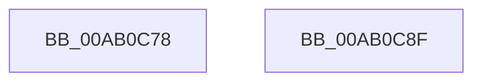

# EtwpCompleteBuffer

- RVA: `0x00AB0C78`–`0x00AB0C90` (길이 `24` bytes)
- VA: `0x0000000140AB0C78`
- 실행 섹션: `PAGE`
- PDB 이름 있음: `예`; PDB Function 태그: `아니요`
- unwind 정보 RVA: `0x0005C788`
- 디코드: `8`개 명령, `24/24` bytes 표시
- 미해석 바이트: `0` (있으면 어셈블리에 `.byte`로 보존)

> 이 문서는 커널 이미지의 기계어와 PDB 기호를 분석해 생성했습니다. 4번과 5번은 함수 원형과 자료형을 바이너리 사용 방식에서 추정한 C 해석이며 원본 소스 복구 결과는 아닙니다.

## 1. Dependencies

- 직접 호출 지점: **1**; 고유 호출 대상: **1**
- 직접 호출자로 확인된 함수: **1**
- RIP 상대 이미지 참조: **0**

### Outgoing calls
- `0x00AB0C85` → [EtwpEnqueueAvailableBuffer](../../text/2F/EtwpEnqueueAvailableBuffer_function_002FE7DC.md) (function, `0x002FE7DC`)

### Direct callers
- [EtwpCompressPendingBuffers](../../text/65/EtwpCompressPendingBuffers_function_00653140.md) at `0x006531DA`
- [EtwpCompressPendingBuffers](../../text/65/EtwpCompressPendingBuffers_function_00653140.md) at `0x006531FD`

### Static image references
- 디코드된 RIP-relative 메모리 참조가 없습니다.

## 2. Other-region calls and transfers

- 다른 실행 섹션으로 향하는 call: **1**
  - `0x00AB0C85` → [EtwpEnqueueAvailableBuffer](../../text/2F/EtwpEnqueueAvailableBuffer_function_002FE7DC.md) (`PAGE` → `.text`)
- 별도 외부 분기/꼬리 이동을 확인하지 못했습니다.

## 3. Assembly (complete function range)

```asm
00AB0C78  48 83 EC 28                     sub rsp, 0x28
00AB0C7C  33 C0                           xor eax, eax
00AB0C7E  45 33 C0                        xor r8d, r8d
00AB0C81  66 89 42 34                     mov word ptr [rdx + 0x34], ax
00AB0C85  E8 52 DB 84 FF                  call 0x1402fe7dc
00AB0C8A  48 83 C4 28                     add rsp, 0x28
00AB0C8E  C3                              ret
00AB0C8F  CC                              int3
```

## 4. C-style interpretation (structured pseudocode)

```c
__int64 __fastcall EtwpCompleteBuffer(__int64 a1, __int64 a2, int a3)
{
    __int64 result;
    __int64 v_rsp;

    v_rsp = (v_rsp) - (40);
    result = 0;
    a3 = 0;
    *(unsigned __int16 *)(a2 + 52) = 0;
    result = EtwpEnqueueAvailableBuffer(a1, a2, a3, a4);
    v_rsp = (v_rsp) + (40);
    return result;
}
```

## 5. (Beta) C Style

```c
int64_t EtwpCompleteBuffer(int64_t Arg1, void *Arg2, int32_t Arg3)
{
    uint8_t *arg2 = (uint8_t *)Arg2;

    int64_t result;
    int64_t local_rsp;

    local_rsp = (local_rsp) - (40);
    result = 0;
    Arg3 = 0;
    *(uint16_t *)(arg2 + 0x34) = 0;
    result = EtwpEnqueueAvailableBuffer(Arg1, Arg2, Arg3, a4);
    local_rsp = (local_rsp) + (40);
    return result;
}
```

### 관측된 메모리 오프셋

구조체 형식이 확인되지 않은 접근은 인자 기준의 오프셋으로만 기록했습니다.

| 기준 인자 | 오프셋 표현 | 폭 (bit) | 접근 |
|---|---:|---:|---|
| `Arg2` | `+ 0x34` | `16` | `W` |

## 6. Execution-region graph

[열기: 2D/3D 그래프와 함수 탐색 컨트롤 패널](../../../control-panel.html?section=page&rva=0x00AB0C78&view=graph)

- 2D 그래프는 위에서 아래로 흐르고, 3D 그래프는 빈 공간을 드래그해 회전합니다. Shift+드래그는 이동, 휠은 확대·축소, 함수 노드 선택은 대상 보고서 이동입니다.

### Static fallback


