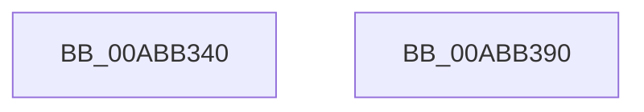

# EtwpCovSampEnumerateDriver

- RVA: `0x00ABB340`–`0x00ABB391` (길이 `81` bytes)
- VA: `0x0000000140ABB340`
- 실행 섹션: `PAGE`
- PDB 이름 있음: `예`; PDB Function 태그: `아니요`
- unwind 정보 RVA: `0x0007A034`
- 디코드: `22`개 명령, `81/81` bytes 표시
- 미해석 바이트: `0` (있으면 어셈블리에 `.byte`로 보존)

> 이 문서는 커널 이미지의 기계어와 PDB 기호를 분석해 생성했습니다. 4번과 5번은 함수 원형과 자료형을 바이너리 사용 방식에서 추정한 C 해석이며 원본 소스 복구 결과는 아닙니다.

## 1. Dependencies

- 직접 호출 지점: **1**; 고유 호출 대상: **1**
- 직접 호출자로 확인된 함수: **0**
- RIP 상대 이미지 참조: **0**

### Outgoing calls
- `0x00ABB384` → [EtwpCovSampImageNotify](../8D/EtwpCovSampImageNotify_function_008D70C0.md) (function, `0x008D70C0`)

### Direct callers
- 이 함수 시작 RVA로 연결되는 직접 call은 확인되지 않았습니다. 간접 호출은 완전히 역산할 수 없습니다.

### Static image references
- 디코드된 RIP-relative 메모리 참조가 없습니다.

## 2. Other-region calls and transfers

- 다른 실행 섹션으로 향하는 call: **0**
- 별도 외부 분기/꼬리 이동을 확인하지 못했습니다.

## 3. Assembly (complete function range)

```asm
00ABB340  4C 8B DC                        mov r11, rsp
00ABB343  48 83 EC 68                     sub rsp, 0x68
00ABB347  33 C0                           xor eax, eax
00ABB349  4D 8D 43 C0                     lea r8, [r11 - 0x40]
00ABB34D  49 89 43 C0                     mov qword ptr [r11 - 0x40], rax
00ABB351  0F 57 C0                        xorps xmm0, xmm0
00ABB354  49 89 43 D0                     mov qword ptr [r11 - 0x30], rax
00ABB358  33 D2                           xor edx, edx
00ABB35A  F3 0F 7F 44 24 48               movdqu xmmword ptr [rsp + 0x48], xmm0
00ABB360  0D 00 05 00 00                  or eax, 0x500
00ABB365  49 C7 43 B8 38 00 00 00         mov qword ptr [r11 - 0x48], 0x38
00ABB36D  89 44 24 28                     mov dword ptr [rsp + 0x28], eax
00ABB371  48 8B 41 30                     mov rax, qword ptr [rcx + 0x30]
00ABB375  49 89 43 C8                     mov qword ptr [r11 - 0x38], rax
00ABB379  8B 41 40                        mov eax, dword ptr [rcx + 0x40]
00ABB37C  48 83 C1 48                     add rcx, 0x48
00ABB380  49 89 43 D8                     mov qword ptr [r11 - 0x28], rax
00ABB384  E8 37 BD E1 FF                  call 0x1408d70c0
00ABB389  33 C0                           xor eax, eax
00ABB38B  48 83 C4 68                     add rsp, 0x68
00ABB38F  C3                              ret
00ABB390  CC                              int3
```

## 4. C-style interpretation (structured pseudocode)

```c
__int64 __fastcall EtwpCovSampEnumerateDriver(__int64 a1, int a2)
{
    __int64 result;
    __int64 v_rsp;
    unsigned __int64 v_stack_m20;
    unsigned int v_stack_m40;

    v_rsp = (v_rsp) - (104);
    result = 0;
    *(unsigned __int64 *)(v_rsp - 64) = 0;
    *(unsigned __int64 *)(v_rsp - 48) = 0;
    a2 = 0;
    v_stack_m20 = v_xmm0;
    result = (unsigned int)((result) | (0x500ULL));
    *(unsigned __int64 *)(v_rsp - 72) = 56;
    v_stack_m40 = (unsigned int)(result);
    *(unsigned __int64 *)(v_rsp - 56) = *(unsigned __int64 *)(a1 + 48);
    a1 = (a1) + (72);
    *(unsigned __int64 *)(v_rsp - 40) = (unsigned int)(*(unsigned int *)(a1 + 64));
    result = EtwpCovSampImageNotify(a1, a2, v_rsp - 64, a4);
    result = 0;
    v_rsp = (v_rsp) + (104);
    return result;
}
```

## 5. (Beta) C Style

```c
int64_t EtwpCovSampEnumerateDriver(void *Arg1, int32_t Arg2)
{
    uint8_t *arg1 = (uint8_t *)Arg1;

    int64_t result;
    int64_t local_rsp;
    uint64_t v_stack_m20;
    uint32_t v_stack_m40;

    local_rsp = (local_rsp) - (104);
    result = 0;
    *(uint64_t *)(local_rsp - 0x40) = 0;
    *(uint64_t *)(local_rsp - 0x30) = 0;
    Arg2 = 0;
    v_stack_m20 = v_xmm0;
    result = (uint32_t)((result) | (0x500ULL));
    *(uint64_t *)(local_rsp - 0x48) = 56;
    v_stack_m40 = (uint32_t)(result);
    *(uint64_t *)(local_rsp - 0x38) = *(uint64_t *)(arg1 + 0x30);
    Arg1 = (Arg1) + (72);
    *(uint64_t *)(local_rsp - 0x28) = (uint32_t)(*(uint32_t *)(arg1 + 0x40));
    result = EtwpCovSampImageNotify(Arg1, Arg2, local_rsp - 64, a4);
    result = 0;
    local_rsp = (local_rsp) + (104);
    return result;
}
```

### 관측된 메모리 오프셋

구조체 형식이 확인되지 않은 접근은 인자 기준의 오프셋으로만 기록했습니다.

| 기준 인자 | 오프셋 표현 | 폭 (bit) | 접근 |
|---|---:|---:|---|
| `Arg1` | `+ 0x30` | `64` | `R` |
| `Arg1` | `+ 0x40` | `32` | `R` |

## 6. Execution-region graph

[열기: 2D/3D 그래프와 함수 탐색 컨트롤 패널](../../../control-panel.html?section=page&rva=0x00ABB340&view=graph)

- 2D 그래프는 위에서 아래로 흐르고, 3D 그래프는 빈 공간을 드래그해 회전합니다. Shift+드래그는 이동, 휠은 확대·축소, 함수 노드 선택은 대상 보고서 이동입니다.

### Static fallback


