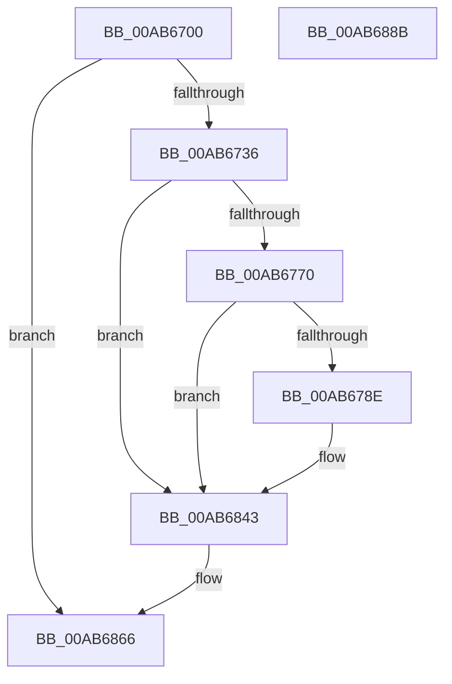

# EtwpCoverageFlushPending

- RVA: `0x00AB6700`–`0x00AB688C` (길이 `396` bytes)
- VA: `0x0000000140AB6700`
- 실행 섹션: `PAGE`
- PDB 이름 있음: `예`; PDB Function 태그: `아니요`
- unwind 정보 RVA: `0x000BCECC`
- 디코드: `96`개 명령, `396/396` bytes 표시
- 미해석 바이트: `0` (있으면 어셈블리에 `.byte`로 보존)

> 이 문서는 커널 이미지의 기계어와 PDB 기호를 분석해 생성했습니다. 4번과 5번은 함수 원형과 자료형을 바이너리 사용 방식에서 추정한 C 해석이며 원본 소스 복구 결과는 아닙니다.

## 1. Dependencies

- 직접 호출 지점: **4**; 고유 호출 대상: **4**
- 직접 호출자로 확인된 함수: **5**
- RIP 상대 이미지 참조: **3**

### Outgoing calls
- `0x00AB6781` → [tlgKeywordOn](../../text/42/tlgKeywordOn_function_0042EAA0.md) (function, `0x0042EAA0`)
- `0x00AB683E` → [tlgWriteTransfer_EtwWriteTransfer](../../text/42/tlgWriteTransfer_EtwWriteTransfer_function_004260E0.md) (function, `0x004260E0`)
- `0x00AB685B` → [KeCancelTimer2](../../text/3A/KeCancelTimer2_function_003A01E0.md) (function, `0x003A01E0`)
- `0x00AB686D` → [_security_check_cookie](../../text/6A/_security_check_cookie_function_006AC640.md) (function, `0x006AC640`)

### Direct callers
- [EtwpCoverageFlushWorkItemCallback](../7B/EtwpCoverageFlushWorkItemCallback_function_007B9D90.md) at `0x007B9E4E`
- [EtwpCoverageReset](../7B/EtwpCoverageReset_function_007B9F4C.md) at `0x007BA06B`
- [EtwpCoverageResetCP](../7B/EtwpCoverageResetCP_function_007BA154.md) at `0x007BA27E`
- [EtwpFlushCoverage](../7B/EtwpFlushCoverage_function_007BA478.md) at `0x007BA4EE`
- [EtwpCoverageRecord](../98/EtwpCoverageRecord_function_009821BC.md) at `0x009823A7`

### Static image references
- `0x00AB671B` → RVA `0x00E0A740` (`.data`; read)
- `0x00AB675F` → RVA `0x00E091D8` (`.data`; read)
- `0x00AB681C` → RVA `0x00054C7B` (`.rdata`; read)

## 2. Other-region calls and transfers

- 다른 실행 섹션으로 향하는 call: **4**
  - `0x00AB6781` → [tlgKeywordOn](../../text/42/tlgKeywordOn_function_0042EAA0.md) (`PAGE` → `.text`)
  - `0x00AB683E` → [tlgWriteTransfer_EtwWriteTransfer](../../text/42/tlgWriteTransfer_EtwWriteTransfer_function_004260E0.md) (`PAGE` → `.text`)
  - `0x00AB685B` → [KeCancelTimer2](../../text/3A/KeCancelTimer2_function_003A01E0.md) (`PAGE` → `.text`)
  - `0x00AB686D` → [_security_check_cookie](../../text/6A/_security_check_cookie_function_006AC640.md) (`PAGE` → `.text`)
- 별도 외부 분기/꼬리 이동을 확인하지 못했습니다.

## 3. Assembly (complete function range)

```asm
00AB6700  48 8B C4                        mov rax, rsp
00AB6703  48 89 58 10                     mov qword ptr [rax + 0x10], rbx
00AB6707  48 89 70 18                     mov qword ptr [rax + 0x18], rsi
00AB670B  48 89 78 20                     mov qword ptr [rax + 0x20], rdi
00AB670F  55                              push rbp
00AB6710  48 8D 68 A1                     lea rbp, [rax - 0x5f]
00AB6714  48 81 EC E0 00 00 00            sub rsp, 0xe0
00AB671B  48 8B 05 1E 40 35 00            mov rax, qword ptr [rip + 0x35401e]
00AB6722  48 33 C4                        xor rax, rsp
00AB6725  48 89 45 47                     mov qword ptr [rbp + 0x47], rax
00AB6729  83 79 40 00                     cmp dword ptr [rcx + 0x40], 0
00AB672D  48 8B D9                        mov rbx, rcx
00AB6730  0F 84 30 01 00 00               je 0x140ab6866
00AB6736  48 B8 20 03 00 00 80 F7 FF FF   movabs rax, 0xfffff78000000320
00AB6740  48 B9 04 00 00 00 80 F7 FF FF   movabs rcx, 0xfffff78000000004
00AB674A  48 8B 00                        mov rax, qword ptr [rax]
00AB674D  8B 39                           mov edi, dword ptr [rcx]
00AB674F  48 8B 73 28                     mov rsi, qword ptr [rbx + 0x28]
00AB6753  48 0F AF F8                     imul rdi, rax
00AB6757  0F B7 43 40                     movzx eax, word ptr [rbx + 0x40]
00AB675B  48 C1 EF 18                     shr rdi, 0x18
00AB675F  83 3D 72 2A 35 00 05            cmp dword ptr [rip + 0x352a72], 5
00AB6766  66 89 45 A7                     mov word ptr [rbp - 0x59], ax
00AB676A  0F 86 D3 00 00 00               jbe 0x140ab6843
00AB6770  48 BA 00 00 00 00 00 40 00 00   movabs rdx, 0x400000000000
00AB677A  48 8D 0D 57 2A 35 00            lea rcx, [rip + 0x352a57]
00AB6781  E8 1A 83 97 FF                  call 0x14042eaa0
00AB6786  84 C0                           test al, al
00AB6788  0F 84 B5 00 00 00               je 0x140ab6843
00AB678E  48 8B 0B                        mov rcx, qword ptr [rbx]
00AB6791  BA 04 00 00 00                  mov edx, 4
00AB6796  45 33 C9                        xor r9d, r9d
00AB6799  45 33 C0                        xor r8d, r8d
00AB679C  8B 01                           mov eax, dword ptr [rcx]
00AB679E  83 65 F3 00                     and dword ptr [rbp - 0xd], 0
00AB67A2  89 45 AB                        mov dword ptr [rbp - 0x55], eax
00AB67A5  48 8D 45 AB                     lea rax, [rbp - 0x55]
00AB67A9  48 89 45 E7                     mov qword ptr [rbp - 0x19], rax
00AB67AD  89 55 EF                        mov dword ptr [rbp - 0x11], edx
00AB67B0  8B 41 04                        mov eax, dword ptr [rcx + 4]
00AB67B3  83 65 03 00                     and dword ptr [rbp + 3], 0
00AB67B7  89 45 AF                        mov dword ptr [rbp - 0x51], eax
00AB67BA  48 8D 45 AF                     lea rax, [rbp - 0x51]
00AB67BE  48 89 45 F7                     mov qword ptr [rbp - 9], rax
00AB67C2  8B C7                           mov eax, edi
00AB67C4  89 55 FF                        mov dword ptr [rbp - 1], edx
00AB67C7  2B 41 10                        sub eax, dword ptr [rcx + 0x10]
00AB67CA  83 65 13 00                     and dword ptr [rbp + 0x13], 0
00AB67CE  89 45 B3                        mov dword ptr [rbp - 0x4d], eax
00AB67D1  48 8D 45 B3                     lea rax, [rbp - 0x4d]
00AB67D5  48 89 45 07                     mov qword ptr [rbp + 7], rax
00AB67D9  8B C7                           mov eax, edi
00AB67DB  89 55 0F                        mov dword ptr [rbp + 0xf], edx
00AB67DE  2B 41 14                        sub eax, dword ptr [rcx + 0x14]
00AB67E1  48 8D 0D F0 29 35 00            lea rcx, [rip + 0x3529f0]
00AB67E8  83 65 23 00                     and dword ptr [rbp + 0x23], 0
00AB67EC  83 65 33 00                     and dword ptr [rbp + 0x33], 0
00AB67F0  83 65 43 00                     and dword ptr [rbp + 0x43], 0
00AB67F4  89 45 B7                        mov dword ptr [rbp - 0x49], eax
00AB67F7  48 8D 45 B7                     lea rax, [rbp - 0x49]
00AB67FB  48 89 45 17                     mov qword ptr [rbp + 0x17], rax
00AB67FF  48 8D 45 A7                     lea rax, [rbp - 0x59]
00AB6803  48 89 45 27                     mov qword ptr [rbp + 0x27], rax
00AB6807  48 8B 46 20                     mov rax, qword ptr [rsi + 0x20]
00AB680B  89 55 1F                        mov dword ptr [rbp + 0x1f], edx
00AB680E  0F B7 56 18                     movzx edx, word ptr [rsi + 0x18]
00AB6812  66 2B D0                        sub dx, ax
00AB6815  48 89 45 37                     mov qword ptr [rbp + 0x37], rax
00AB6819  0F B7 C2                        movzx eax, dx
00AB681C  48 8D 15 58 E4 59 FF            lea rdx, [rip - 0xa61ba8]
00AB6823  89 45 3F                        mov dword ptr [rbp + 0x3f], eax
00AB6826  48 8D 45 C7                     lea rax, [rbp - 0x39]
00AB682A  48 89 44 24 28                  mov qword ptr [rsp + 0x28], rax
00AB682F  C7 44 24 20 08 00 00 00         mov dword ptr [rsp + 0x20], 8
00AB6837  C7 45 2F 02 00 00 00            mov dword ptr [rbp + 0x2f], 2
00AB683E  E8 9D F8 96 FF                  call 0x1404260e0
00AB6843  48 8B 46 18                     mov rax, qword ptr [rsi + 0x18]
00AB6847  33 D2                           xor edx, edx
00AB6849  48 89 46 20                     mov qword ptr [rsi + 0x20], rax
00AB684D  48 8B 0B                        mov rcx, qword ptr [rbx]
00AB6850  83 63 40 00                     and dword ptr [rbx + 0x40], 0
00AB6854  48 81 C1 F0 00 00 00            add rcx, 0xf0
00AB685B  E8 80 99 8E FF                  call 0x1403a01e0
00AB6860  48 8B 03                        mov rax, qword ptr [rbx]
00AB6863  89 78 10                        mov dword ptr [rax + 0x10], edi
00AB6866  48 8B 4D 47                     mov rcx, qword ptr [rbp + 0x47]
00AB686A  48 33 CC                        xor rcx, rsp
00AB686D  E8 CE 5D BF FF                  call 0x1406ac640
00AB6872  4C 8D 9C 24 E0 00 00 00         lea r11, [rsp + 0xe0]
00AB687A  49 8B 5B 18                     mov rbx, qword ptr [r11 + 0x18]
00AB687E  49 8B 73 20                     mov rsi, qword ptr [r11 + 0x20]
00AB6882  49 8B 7B 28                     mov rdi, qword ptr [r11 + 0x28]
00AB6886  49 8B E3                        mov rsp, r11
00AB6889  5D                              pop rbp
00AB688A  C3                              ret
00AB688B  CC                              int3
```

## 4. C-style interpretation (structured pseudocode)

```c
__int64 __fastcall EtwpCoverageFlushPending(__int64 a1, __int64 a2, int a3, int a4)
{
    __int64 result;
    __int64 v_rdi;
    __int64 v_rsp;
    unsigned __int64 v_stack_m8;
    unsigned __int64 v_stack_mC0;
    unsigned int v_stack_mC8;

    *(unsigned __int64 *)(v_rsp + 16) = v_rbx;
    *(unsigned __int64 *)(v_rsp + 24) = v_rsi;
    *(unsigned __int64 *)(v_rsp + 32) = v_rdi;
    v_rsp = (v_rsp) - (224);
    result = (*(unsigned __int64 *)(v_rip + 3489822)) ^ (v_rsp);
    *(unsigned __int64 *)(v_rsp - 95 + 71) = result;
    if ((*(unsigned int *)(a1 + 64)) == 0) goto loc_00AB6866;
    v_rdi = ((unsigned int)(*(unsigned int *)(a1))) * (*(unsigned __int64 *)(result));
    v_rdi = (v_rdi) >> (24);
    *(unsigned __int16 *)(v_rsp - 95 - 89) = (unsigned __int16)(*(unsigned __int16 *)(a1 + 64));
    if ((*(unsigned int *)(v_rip + 3484274)) <= 5) goto loc_00AB6843;
    result = tlgKeywordOn(v_rip + 3484247, a2, a3, a4);
    if ((unsigned __int8)(result) != 0) {
        a1 = *(unsigned __int64 *)(a1);
        a2 = 4;
        a4 = 0;
        a3 = 0;
        result = *(unsigned int *)(a1);
        *(unsigned int *)(v_rsp - 95 - 85) = (unsigned int)(result);
        result = v_rsp - 95 - 85;
        *(unsigned __int64 *)(v_rsp - 95 - 25) = result;
        *(unsigned int *)(v_rsp - 95 - 17) = (unsigned int)(a2);
        result = *(unsigned int *)(a1 + 4);
        *(unsigned int *)(v_rsp - 95 - 81) = (unsigned int)(result);
        result = v_rsp - 95 - 81;
        *(unsigned __int64 *)(v_rsp - 95 - 9) = result;
        result = (unsigned int)(v_rdi);
        *(unsigned int *)(v_rsp - 95 - 1) = (unsigned int)(a2);
        result = (unsigned int)((result) - (*(unsigned int *)(a1 + 16)));
        *(unsigned int *)(v_rsp - 95 - 77) = (unsigned int)(result);
        result = v_rsp - 95 - 77;
        *(unsigned __int64 *)(v_rsp - 95 + 7) = result;
        result = (unsigned int)(v_rdi);
        *(unsigned int *)(v_rsp - 95 + 15) = (unsigned int)(a2);
        result = (unsigned int)((result) - (*(unsigned int *)(a1 + 20)));
        a1 = v_rip + 3484144;
        *(unsigned int *)(v_rsp - 95 - 73) = (unsigned int)(result);
        result = v_rsp - 95 - 73;
        *(unsigned __int64 *)(v_rsp - 95 + 23) = result;
        result = v_rsp - 95 - 89;
        *(unsigned __int64 *)(v_rsp - 95 + 39) = result;
        result = *(unsigned __int64 *)(*(unsigned __int64 *)(a1 + 40) + 32);
        *(unsigned int *)(v_rsp - 95 + 31) = (unsigned int)(a2);
        a2 = *(unsigned __int16 *)(*(unsigned __int64 *)(a1 + 40) + 24);
        a2 = (unsigned __int16)((a2) - ((unsigned __int16)(result)));
        *(unsigned __int64 *)(v_rsp - 95 + 55) = result;
        result = (unsigned __int16)(a2);
        a2 = v_rip - 10886056;
        *(unsigned int *)(v_rsp - 95 + 63) = (unsigned int)(result);
        result = v_rsp - 95 - 57;
        v_stack_mC0 = result;
        v_stack_mC8 = 8;
        *(unsigned int *)(v_rsp - 95 + 47) = 2;
        result = tlgWriteTransfer_EtwWriteTransfer(a1, a2, a3, a4);
    }
    a2 = 0;
    *(unsigned __int64 *)(*(unsigned __int64 *)(a1 + 40) + 32) = *(unsigned __int64 *)(*(unsigned __int64 *)(a1 + 40) + 24);
    a1 = (*(unsigned __int64 *)(a1)) + (240);
    result = KeCancelTimer2(a1, a2, a3, a4);
    *(unsigned int *)(*(unsigned __int64 *)(a1) + 16) = (unsigned int)(v_rdi);
loc_00AB6866:
    a1 = (*(unsigned __int64 *)(v_rsp - 95 + 71)) ^ (v_rsp);
    result = _security_check_cookie(a1, a2, a3, a4);
    return result;
}
```

## 5. (Beta) C Style

```c
int64_t EtwpCoverageFlushPending(void *Arg1, int64_t Arg2, int32_t Arg3, int32_t Arg4)
{
    uint8_t *arg1 = (uint8_t *)Arg1;

    int64_t result;
    int64_t local_rdi;
    int64_t local_rsp;
    uint64_t v_stack_m8;
    uint64_t v_stack_mC0;
    uint32_t v_stack_mC8;

    *(uint64_t *)(local_rsp + 0x10) = local_rbx;
    *(uint64_t *)(local_rsp + 0x18) = local_rsi;
    *(uint64_t *)(local_rsp + 0x20) = local_rdi;
    local_rsp = (local_rsp) - (224);
    result = (*(uint64_t *)(v_rip + 0x35401E)) ^ (local_rsp);
    *(uint64_t *)(local_rsp - 0x5F + 0x47) = result;
    if ((*(uint32_t *)(arg1 + 0x40)) == 0) goto loc_00AB6866;
    local_rdi = ((uint32_t)(*(uint32_t *)(arg1))) * (*(uint64_t *)(result));
    local_rdi = (local_rdi) >> (24);
    *(uint16_t *)(local_rsp - 0x5F - 0x59) = (uint16_t)(*(uint16_t *)(arg1 + 0x40));
    if ((*(uint32_t *)(v_rip + 0x352A72)) <= 5) goto loc_00AB6843;
    result = tlgKeywordOn(v_rip + 3484247, Arg2, Arg3, Arg4);
    if ((uint8_t)(result) != 0) {
        Arg1 = *(uint64_t *)(arg1);
        Arg2 = 4;
        Arg4 = 0;
        Arg3 = 0;
        result = *(uint32_t *)(arg1);
        *(uint32_t *)(local_rsp - 0x5F - 0x55) = (uint32_t)(result);
        result = local_rsp - 95 - 85;
        *(uint64_t *)(local_rsp - 0x5F - 0x19) = result;
        *(uint32_t *)(local_rsp - 0x5F - 0x11) = (uint32_t)(Arg2);
        result = *(uint32_t *)(arg1 + 0x4);
        *(uint32_t *)(local_rsp - 0x5F - 0x51) = (uint32_t)(result);
        result = local_rsp - 95 - 81;
        *(uint64_t *)(local_rsp - 0x5F - 0x9) = result;
        result = (uint32_t)(local_rdi);
        *(uint32_t *)(local_rsp - 0x5F - 0x1) = (uint32_t)(Arg2);
        result = (uint32_t)((result) - (*(uint32_t *)(arg1 + 0x10)));
        *(uint32_t *)(local_rsp - 0x5F - 0x4D) = (uint32_t)(result);
        result = local_rsp - 95 - 77;
        *(uint64_t *)(local_rsp - 0x5F + 0x7) = result;
        result = (uint32_t)(local_rdi);
        *(uint32_t *)(local_rsp - 0x5F + 0xF) = (uint32_t)(Arg2);
        result = (uint32_t)((result) - (*(uint32_t *)(arg1 + 0x14)));
        Arg1 = v_rip + 3484144;
        *(uint32_t *)(local_rsp - 0x5F - 0x49) = (uint32_t)(result);
        result = local_rsp - 95 - 73;
        *(uint64_t *)(local_rsp - 0x5F + 0x17) = result;
        result = local_rsp - 95 - 89;
        *(uint64_t *)(local_rsp - 0x5F + 0x27) = result;
        result = *(uint64_t *)(*(uint64_t *)(arg1 + 0x28) + 0x20);
        *(uint32_t *)(local_rsp - 0x5F + 0x1F) = (uint32_t)(Arg2);
        Arg2 = *(uint16_t *)(*(uint64_t *)(arg1 + 0x28) + 0x18);
        Arg2 = (uint16_t)((Arg2) - ((uint16_t)(result)));
        *(uint64_t *)(local_rsp - 0x5F + 0x37) = result;
        result = (uint16_t)(Arg2);
        Arg2 = v_rip - 10886056;
        *(uint32_t *)(local_rsp - 0x5F + 0x3F) = (uint32_t)(result);
        result = local_rsp - 95 - 57;
        v_stack_mC0 = result;
        v_stack_mC8 = 8;
        *(uint32_t *)(local_rsp - 0x5F + 0x2F) = 2;
        result = tlgWriteTransfer_EtwWriteTransfer(Arg1, Arg2, Arg3, Arg4);
    }
    Arg2 = 0;
    *(uint64_t *)(*(uint64_t *)(arg1 + 0x28) + 0x20) = *(uint64_t *)(*(uint64_t *)(arg1 + 0x28) + 0x18);
    Arg1 = (*(uint64_t *)(arg1)) + (240);
    result = KeCancelTimer2(Arg1, Arg2, Arg3, Arg4);
    *(uint32_t *)(*(uint64_t *)(arg1) + 0x10) = (uint32_t)(local_rdi);
loc_00AB6866:
    Arg1 = (*(uint64_t *)(local_rsp - 0x5F + 0x47)) ^ (local_rsp);
    result = _security_check_cookie(Arg1, Arg2, Arg3, Arg4);
    return result;
}
```

### 관측된 메모리 오프셋

구조체 형식이 확인되지 않은 접근은 인자 기준의 오프셋으로만 기록했습니다.

| 기준 인자 | 오프셋 표현 | 폭 (bit) | 접근 |
|---|---:|---:|---|
| `Arg1` | `+ 0x0` | `64` | `R` |
| `Arg1` | `+ 0x28` | `64` | `R` |
| `Arg1` | `+ 0x40` | `16` | `R` |
| `Arg1` | `+ 0x40` | `32` | `R` |
| `Arg1` | `+ 0x40` | `32` | `R/W` |

## 6. Execution-region graph

[열기: 2D/3D 그래프와 함수 탐색 컨트롤 패널](../../../control-panel.html?section=page&rva=0x00AB6700&view=graph)

- 2D 그래프는 위에서 아래로 흐르고, 3D 그래프는 빈 공간을 드래그해 회전합니다. Shift+드래그는 이동, 휠은 확대·축소, 함수 노드 선택은 대상 보고서 이동입니다.

### Static fallback


