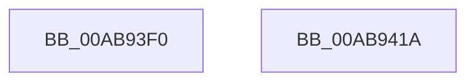

# EtwpDeleteRealTimeConnectionObject

- RVA: `0x00AB93F0`–`0x00AB941B` (길이 `43` bytes)
- VA: `0x0000000140AB93F0`
- 실행 섹션: `PAGE`
- PDB 이름 있음: `예`; PDB Function 태그: `아니요`
- unwind 정보 RVA: `0x0005CF00`
- 디코드: `13`개 명령, `43/43` bytes 표시
- 미해석 바이트: `0` (있으면 어셈블리에 `.byte`로 보존)

> 이 문서는 커널 이미지의 기계어와 PDB 기호를 분석해 생성했습니다. 4번과 5번은 함수 원형과 자료형을 바이너리 사용 방식에서 추정한 C 해석이며 원본 소스 복구 결과는 아닙니다.

## 1. Dependencies

- 직접 호출 지점: **3**; 고유 호출 대상: **2**
- 직접 호출자로 확인된 함수: **0**
- RIP 상대 이미지 참조: **0**

### Outgoing calls
- `0x00AB93FD` → [ZwClose](../../text/6A/ZwClose_function_006AD2B0.md) (function, `0x006AD2B0`)
- `0x00AB9406` → [ObfDereferenceObject](../../text/2F/ObfDereferenceObject_function_002F9350.md) (function, `0x002F9350`)
- `0x00AB940F` → [ObfDereferenceObject](../../text/2F/ObfDereferenceObject_function_002F9350.md) (function, `0x002F9350`)

### Direct callers
- 이 함수 시작 RVA로 연결되는 직접 call은 확인되지 않았습니다. 간접 호출은 완전히 역산할 수 없습니다.

### Static image references
- 디코드된 RIP-relative 메모리 참조가 없습니다.

## 2. Other-region calls and transfers

- 다른 실행 섹션으로 향하는 call: **3**
  - `0x00AB93FD` → [ZwClose](../../text/6A/ZwClose_function_006AD2B0.md) (`PAGE` → `.text`)
  - `0x00AB9406` → [ObfDereferenceObject](../../text/2F/ObfDereferenceObject_function_002F9350.md) (`PAGE` → `.text`)
  - `0x00AB940F` → [ObfDereferenceObject](../../text/2F/ObfDereferenceObject_function_002F9350.md) (`PAGE` → `.text`)
- 별도 외부 분기/꼬리 이동을 확인하지 못했습니다.

## 3. Assembly (complete function range)

```asm
00AB93F0  40 53                           push rbx
00AB93F2  48 83 EC 20                     sub rsp, 0x20
00AB93F6  48 8B D9                        mov rbx, rcx
00AB93F9  48 8B 49 10                     mov rcx, qword ptr [rcx + 0x10]
00AB93FD  E8 AE 3E BF FF                  call 0x1406ad2b0
00AB9402  48 8B 4B 30                     mov rcx, qword ptr [rbx + 0x30]
00AB9406  E8 45 FF 83 FF                  call 0x1402f9350
00AB940B  48 8B 4B 38                     mov rcx, qword ptr [rbx + 0x38]
00AB940F  E8 3C FF 83 FF                  call 0x1402f9350
00AB9414  48 83 C4 20                     add rsp, 0x20
00AB9418  5B                              pop rbx
00AB9419  C3                              ret
00AB941A  CC                              int3
```

## 4. C-style interpretation (structured pseudocode)

```c
__int64 __fastcall EtwpDeleteRealTimeConnectionObject(__int64 a1)
{
    __int64 result;
    __int64 v_rsp;

    v_rsp = (v_rsp) - (32);
    result = ZwClose(*(unsigned __int64 *)(a1 + 16), a2, a3, a4);
    result = ObfDereferenceObject(*(unsigned __int64 *)(a1 + 48), a2, a3, a4);
    result = ObfDereferenceObject(*(unsigned __int64 *)(a1 + 56), a2, a3, a4);
    v_rsp = (v_rsp) + (32);
    return result;
}
```

## 5. (Beta) C Style

```c
int64_t EtwpDeleteRealTimeConnectionObject(void *Arg1)
{
    uint8_t *arg1 = (uint8_t *)Arg1;

    int64_t result;
    int64_t local_rsp;

    local_rsp = (local_rsp) - (32);
    result = ZwClose(*(uint64_t *)(arg1 + 0x10), a2, a3, a4);
    result = ObfDereferenceObject(*(uint64_t *)(arg1 + 0x30), a2, a3, a4);
    result = ObfDereferenceObject(*(uint64_t *)(arg1 + 0x38), a2, a3, a4);
    local_rsp = (local_rsp) + (32);
    return result;
}
```

### 관측된 메모리 오프셋

구조체 형식이 확인되지 않은 접근은 인자 기준의 오프셋으로만 기록했습니다.

| 기준 인자 | 오프셋 표현 | 폭 (bit) | 접근 |
|---|---:|---:|---|
| `Arg1` | `+ 0x10` | `64` | `R` |
| `Arg1` | `+ 0x30` | `64` | `R` |
| `Arg1` | `+ 0x38` | `64` | `R` |

## 6. Execution-region graph

[열기: 2D/3D 그래프와 함수 탐색 컨트롤 패널](../../../control-panel.html?section=page&rva=0x00AB93F0&view=graph)

- 2D 그래프는 위에서 아래로 흐르고, 3D 그래프는 빈 공간을 드래그해 회전합니다. Shift+드래그는 이동, 휠은 확대·축소, 함수 노드 선택은 대상 보고서 이동입니다.

### Static fallback


