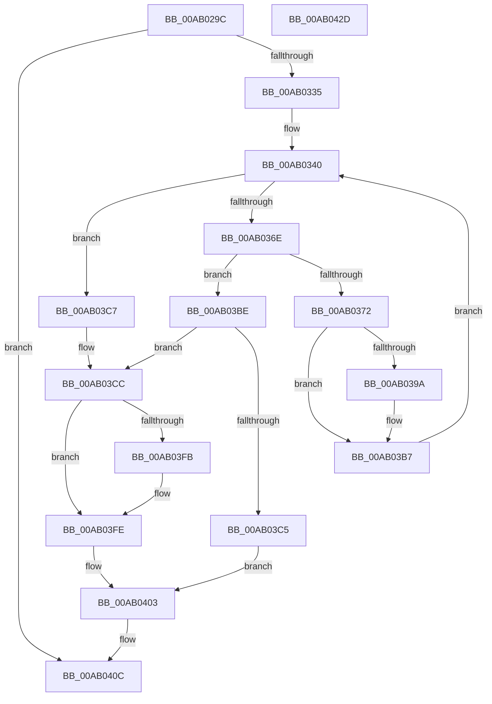

# EtwpEnumerateKeyProviders

- RVA: `0x00AB029C`–`0x00AB042E` (길이 `402` bytes)
- VA: `0x0000000140AB029C`
- 실행 섹션: `PAGE`
- PDB 이름 있음: `예`; PDB Function 태그: `아니요`
- unwind 정보 RVA: `0x000BC530`
- 디코드: `108`개 명령, `402/402` bytes 표시
- 미해석 바이트: `0` (있으면 어셈블리에 `.byte`로 보존)

> 이 문서는 커널 이미지의 기계어와 PDB 기호를 분석해 생성했습니다. 4번과 5번은 함수 원형과 자료형을 바이너리 사용 방식에서 추정한 C 해석이며 원본 소스 복구 결과는 아닙니다.

## 1. Dependencies

- 직접 호출 지점: **8**; 고유 호출 대상: **8**
- 직접 호출자로 확인된 함수: **1**
- RIP 상대 이미지 참조: **1**

### Outgoing calls
- `0x00AB02F4` → [RtlInitUnicodeString](../../text/42/RtlInitUnicodeString_function_0042A780.md) (function, `0x0042A780`)
- `0x00AB0328` → [ZwOpenKey](../../text/6A/ZwOpenKey_function_006AD310.md) (function, `0x006AD310`)
- `0x00AB035D` → [ZwEnumerateKey](../../text/6A/ZwEnumerateKey_function_006AD710.md) (function, `0x006AD710`)
- `0x00AB038F` → [RtlInsertElementGenericTableAvl](../../text/3E/RtlInsertElementGenericTableAvl_function_003EE510.md) (function, `0x003EE510`)
- `0x00AB03B2` → [EtwpEnableAutoLoggerProvider](../A9/EtwpEnableAutoLoggerProvider_function_00A92B00.md) (function, `0x00A92B00`)
- `0x00AB03CE` → [RtlNtStatusToDosError](../92/RtlNtStatusToDosError_function_00926C40.md) (function, `0x00926C40`)
- `0x00AB03FE` → [RtlWriteRegistryValue](../A6/RtlWriteRegistryValue_function_00A6C620.md) (function, `0x00A6C620`)
- `0x00AB0407` → [ZwClose](../../text/6A/ZwClose_function_006AD2B0.md) (function, `0x006AD2B0`)

### Direct callers
- [EtwpEnableKeyProviders](../7B/EtwpEnableKeyProviders_function_007BE28C.md) at `0x007BE330`
- [EtwpEnableKeyProviders](../7B/EtwpEnableKeyProviders_function_007BE28C.md) at `0x007BE361`

### Static image references
- `0x00AB03D6` → RVA `0x00B07E20` (` ?? ::NNGAKEGL::`string'`; read)

## 2. Other-region calls and transfers

- 다른 실행 섹션으로 향하는 call: **5**
  - `0x00AB02F4` → [RtlInitUnicodeString](../../text/42/RtlInitUnicodeString_function_0042A780.md) (`PAGE` → `.text`)
  - `0x00AB0328` → [ZwOpenKey](../../text/6A/ZwOpenKey_function_006AD310.md) (`PAGE` → `.text`)
  - `0x00AB035D` → [ZwEnumerateKey](../../text/6A/ZwEnumerateKey_function_006AD710.md) (`PAGE` → `.text`)
  - `0x00AB038F` → [RtlInsertElementGenericTableAvl](../../text/3E/RtlInsertElementGenericTableAvl_function_003EE510.md) (`PAGE` → `.text`)
  - `0x00AB0407` → [ZwClose](../../text/6A/ZwClose_function_006AD2B0.md) (`PAGE` → `.text`)
- 별도 외부 분기/꼬리 이동을 확인하지 못했습니다.

## 3. Assembly (complete function range)

```asm
00AB029C  48 8B C4                        mov rax, rsp
00AB029F  48 89 58 10                     mov qword ptr [rax + 0x10], rbx
00AB02A3  48 89 70 18                     mov qword ptr [rax + 0x18], rsi
00AB02A7  48 89 78 20                     mov qword ptr [rax + 0x20], rdi
00AB02AB  48 89 48 08                     mov qword ptr [rax + 8], rcx
00AB02AF  55                              push rbp
00AB02B0  41 54                           push r12
00AB02B2  41 55                           push r13
00AB02B4  41 56                           push r14
00AB02B6  41 57                           push r15
00AB02B8  48 8B EC                        mov rbp, rsp
00AB02BB  48 81 EC 80 00 00 00            sub rsp, 0x80
00AB02C2  45 33 FF                        xor r15d, r15d
00AB02C5  48 8D 4D C0                     lea rcx, [rbp - 0x40]
00AB02C9  44 8B EA                        mov r13d, edx
00AB02CC  44 89 7D B0                     mov dword ptr [rbp - 0x50], r15d
00AB02D0  0F 57 C0                        xorps xmm0, xmm0
00AB02D3  4C 89 7D B8                     mov qword ptr [rbp - 0x48], r15
00AB02D7  49 8B D0                        mov rdx, r8
00AB02DA  44 89 7D D4                     mov dword ptr [rbp - 0x2c], r15d
00AB02DE  44 89 7D EC                     mov dword ptr [rbp - 0x14], r15d
00AB02E2  49 8B F9                        mov rdi, r9
00AB02E5  0F 11 45 C0                     movups xmmword ptr [rbp - 0x40], xmm0
00AB02E9  44 89 7D B4                     mov dword ptr [rbp - 0x4c], r15d
00AB02ED  4D 8B F0                        mov r14, r8
00AB02F0  44 88 7D 58                     mov byte ptr [rbp + 0x58], r15b
00AB02F4  E8 87 A4 97 FF                  call 0x14042a780
00AB02F9  48 8D 45 C0                     lea rax, [rbp - 0x40]
00AB02FD  C7 45 D0 30 00 00 00            mov dword ptr [rbp - 0x30], 0x30
00AB0304  0F 57 C0                        xorps xmm0, xmm0
00AB0307  48 89 45 E0                     mov qword ptr [rbp - 0x20], rax
00AB030B  4C 8D 45 D0                     lea r8, [rbp - 0x30]
00AB030F  4C 89 7D D8                     mov qword ptr [rbp - 0x28], r15
00AB0313  BA 19 00 02 00                  mov edx, 0x20019
00AB0318  C7 45 E8 40 02 00 00            mov dword ptr [rbp - 0x18], 0x240
00AB031F  48 8D 4D B8                     lea rcx, [rbp - 0x48]
00AB0323  F3 0F 7F 45 F0                  movdqu xmmword ptr [rbp - 0x10], xmm0
00AB0328  E8 E3 CF BF FF                  call 0x1406ad310
00AB032D  85 C0                           test eax, eax
00AB032F  0F 88 D7 00 00 00               js 0x140ab040c
00AB0335  48 8B 75 50                     mov rsi, qword ptr [rbp + 0x50]
00AB0339  41 8B DF                        mov ebx, r15d
00AB033C  44 8B 65 68                     mov r12d, dword ptr [rbp + 0x68]
00AB0340  48 8B 4D B8                     mov rcx, qword ptr [rbp - 0x48]
00AB0344  48 8D 45 B4                     lea rax, [rbp - 0x4c]
00AB0348  48 89 44 24 28                  mov qword ptr [rsp + 0x28], rax
00AB034D  4C 8B CE                        mov r9, rsi
00AB0350  45 33 C0                        xor r8d, r8d
00AB0353  C7 44 24 20 1E 01 00 00         mov dword ptr [rsp + 0x20], 0x11e
00AB035B  8B D3                           mov edx, ebx
00AB035D  E8 AE D3 BF FF                  call 0x1406ad710
00AB0362  8B 4E 0C                        mov ecx, dword ptr [rsi + 0xc]
00AB0365  48 81 F9 08 01 00 00            cmp rcx, 0x108
00AB036C  73 59                           jae 0x140ab03c7
00AB036E  85 C0                           test eax, eax
00AB0370  78 4C                           js 0x140ab03be
00AB0372  48 D1 E9                        shr rcx, 1
00AB0375  4C 8D 4D 58                     lea r9, [rbp + 0x58]
00AB0379  48 8D 56 10                     lea rdx, [rsi + 0x10]
00AB037D  66 44 89 7C 4E 10               mov word ptr [rsi + rcx*2 + 0x10], r15w
00AB0383  44 8B 46 0C                     mov r8d, dword ptr [rsi + 0xc]
00AB0387  48 8B 4D 60                     mov rcx, qword ptr [rbp + 0x60]
00AB038B  41 83 C0 02                     add r8d, 2
00AB038F  E8 7C E1 93 FF                  call 0x1403ee510
00AB0394  80 7D 58 00                     cmp byte ptr [rbp + 0x58], 0
00AB0398  74 1D                           je 0x140ab03b7
00AB039A  48 8B 4D 30                     mov rcx, qword ptr [rbp + 0x30]
00AB039E  4C 8D 46 10                     lea r8, [rsi + 0x10]
00AB03A2  44 89 64 24 28                  mov dword ptr [rsp + 0x28], r12d
00AB03A7  4D 8B CE                        mov r9, r14
00AB03AA  41 8B D5                        mov edx, r13d
00AB03AD  48 89 7C 24 20                  mov qword ptr [rsp + 0x20], rdi
00AB03B2  E8 49 27 FE FF                  call 0x140a92b00
00AB03B7  FF C3                           inc ebx
00AB03B9  45 33 FF                        xor r15d, r15d
00AB03BC  EB 82                           jmp 0x140ab0340
00AB03BE  3D 1A 00 00 80                  cmp eax, 0x8000001a
00AB03C3  75 07                           jne 0x140ab03cc
00AB03C5  EB 3C                           jmp 0x140ab0403
00AB03C7  B8 05 00 00 80                  mov eax, 0x80000005
00AB03CC  8B C8                           mov ecx, eax
00AB03CE  E8 6D 68 E7 FF                  call 0x140926c40
00AB03D3  89 45 B0                        mov dword ptr [rbp - 0x50], eax
00AB03D6  4C 8D 05 43 7A 05 00            lea r8, [rip + 0x57a43]
00AB03DD  41 B9 04 00 00 00               mov r9d, 4
00AB03E3  48 8D 45 B0                     lea rax, [rbp - 0x50]
00AB03E7  33 C9                           xor ecx, ecx
00AB03E9  44 89 4C 24 28                  mov dword ptr [rsp + 0x28], r9d
00AB03EE  48 89 44 24 20                  mov qword ptr [rsp + 0x20], rax
00AB03F3  48 8B D7                        mov rdx, rdi
00AB03F6  48 85 FF                        test rdi, rdi
00AB03F9  75 03                           jne 0x140ab03fe
00AB03FB  49 8B D6                        mov rdx, r14
00AB03FE  E8 1D C2 FB FF                  call 0x140a6c620
00AB0403  48 8B 4D B8                     mov rcx, qword ptr [rbp - 0x48]
00AB0407  E8 A4 CE BF FF                  call 0x1406ad2b0
00AB040C  4C 8D 9C 24 80 00 00 00         lea r11, [rsp + 0x80]
00AB0414  49 8B 5B 38                     mov rbx, qword ptr [r11 + 0x38]
00AB0418  49 8B 73 40                     mov rsi, qword ptr [r11 + 0x40]
00AB041C  49 8B 7B 48                     mov rdi, qword ptr [r11 + 0x48]
00AB0420  49 8B E3                        mov rsp, r11
00AB0423  41 5F                           pop r15
00AB0425  41 5E                           pop r14
00AB0427  41 5D                           pop r13
00AB0429  41 5C                           pop r12
00AB042B  5D                              pop rbp
00AB042C  C3                              ret
00AB042D  CC                              int3
```

## 4. C-style interpretation (structured pseudocode)

```c
__int64 __fastcall EtwpEnumerateKeyProviders(__int64 a1, int a2, __int64 a3, __int64 a4, __int64 a5, unsigned __int8 a6, __int64 a7, unsigned int a8)
{
    __int64 result;
    __int64 v_r15;
    __int64 v_rbx;
    __int64 v_rsp;
    unsigned __int64 v_stack_m28;
    unsigned __int64 v_stack_m38;
    unsigned int v_stack_m3C;
    unsigned int v_stack_m40;
    unsigned __int64 v_stack_m48;
    unsigned __int64 v_stack_m50;
    unsigned int v_stack_m54;
    unsigned int v_stack_m58;
    unsigned __int64 v_stack_m68;
    unsigned __int64 v_stack_m70;
    unsigned int v_stack_m74;
    unsigned int v_stack_m78;
    unsigned __int64 v_stack_m80;
    unsigned int v_stack_m88;
    unsigned __int8 v_stack_p30;
    unsigned __int64 v_stack_p8;

    *(unsigned __int64 *)(v_rsp + 16) = v_rbx;
    *(unsigned __int64 *)(v_rsp + 24) = v_rsi;
    *(unsigned __int64 *)(v_rsp + 32) = v_rdi;
    *(unsigned __int64 *)(v_rsp + 8) = a1;
    v_rsp = (v_rsp) - (128);
    v_r15 = 0;
    v_stack_m78 = 0;
    v_stack_m70 = 0;
    v_stack_m54 = 0;
    v_stack_m3C = 0;
    v_stack_m68 = v_xmm0;
    v_stack_m74 = 0;
    v_stack_p30 = 0;
    result = RtlInitUnicodeString(v_stack_m68, a3, a3, a4);
    v_stack_m58 = 48;
    v_stack_m48 = v_stack_m68;
    v_stack_m50 = 0;
    v_stack_m40 = 576;
    v_stack_m38 = v_xmm0;
    result = ZwOpenKey(v_stack_m70, (unsigned int)(0x20019ULL), v_stack_m58, a4);
    if (sign_flag) goto loc_00AB040C;
loc_00AB0340:
    v_stack_m80 = v_stack_m74;
    a3 = 0;
    v_stack_m88 = 286;
    result = ZwEnumerateKey(v_stack_m70, 0, a3, a5);
    if (((unsigned int)(*(unsigned int *)(a5 + 12))) >= 264) goto loc_00AB03C7;
    if (sign_flag) goto loc_00AB03BE;
    a1 = ((unsigned int)(*(unsigned int *)(a5 + 12))) >> (1);
    *(unsigned __int16 *)(a5 + a1 * 2 + 16) = 0;
    a3 = (unsigned int)(((unsigned int)(*(unsigned int *)(a5 + 12))) + (2));
    result = RtlInsertElementGenericTableAvl(a7, a5 + 16, a3, a6);
    if (a6 != 0) {
        a1 = v_stack_p8;
        a3 = a5 + 16;
        v_stack_m80 = (unsigned int)((unsigned int)(a8));
        a4 = a3;
        a2 = (unsigned int)((unsigned int)(a2));
        v_stack_m88 = a4;
        result = EtwpEnableAutoLoggerProvider(a1, a2, a3, a4);
    }
    v_rbx = (unsigned int)((0) + 1);
    v_r15 = 0;
    goto loc_00AB0340;
loc_00AB03BE:
    if (((unsigned int)(result)) != 0x8000001AULL) goto loc_00AB03CC;
    goto loc_00AB0403;
loc_00AB03C7:
loc_00AB03CC:
    result = RtlNtStatusToDosError((unsigned int)((unsigned int)((unsigned int)(0x80000005ULL))), a2, a3, a4);
    v_stack_m78 = (unsigned int)(result);
    a1 = 0;
    v_stack_m80 = 4;
    v_stack_m88 = v_stack_m78;
    if (a4 == 0) {
        a2 = a3;
    }
    result = RtlWriteRegistryValue(a1, a2, v_rip + 358979, 4);
loc_00AB0403:
    result = ZwClose(v_stack_m70, a2, v_rip + 358979, 4);
loc_00AB040C:
    return result;
}
```

## 5. (Beta) C Style

```c
int64_t EtwpEnumerateKeyProviders(int64_t Arg1, int32_t Arg2, int64_t Arg3, int64_t Arg4, void *Arg5, uint8_t Arg6, int64_t Arg7, uint32_t Arg8)
{
    uint8_t *arg5 = (uint8_t *)Arg5;

    int64_t result;
    int64_t local_r15;
    int64_t local_rbx;
    int64_t local_rsp;
    uint64_t v_stack_m28;
    uint64_t v_stack_m38;
    uint32_t v_stack_m3C;
    uint32_t v_stack_m40;
    uint64_t v_stack_m48;
    uint64_t v_stack_m50;
    uint32_t v_stack_m54;
    uint32_t v_stack_m58;
    uint64_t v_stack_m68;
    uint64_t v_stack_m70;
    uint32_t v_stack_m74;
    uint32_t v_stack_m78;
    uint64_t v_stack_m80;
    uint32_t v_stack_m88;
    uint8_t v_stack_p30;
    uint64_t v_stack_p8;

    *(uint64_t *)(local_rsp + 0x10) = local_rbx;
    *(uint64_t *)(local_rsp + 0x18) = local_rsi;
    *(uint64_t *)(local_rsp + 0x20) = local_rdi;
    *(uint64_t *)(local_rsp + 0x8) = Arg1;
    local_rsp = (local_rsp) - (128);
    local_r15 = 0;
    v_stack_m78 = 0;
    v_stack_m70 = 0;
    v_stack_m54 = 0;
    v_stack_m3C = 0;
    v_stack_m68 = v_xmm0;
    v_stack_m74 = 0;
    v_stack_p30 = 0;
    result = RtlInitUnicodeString(v_stack_m68, Arg3, Arg3, Arg4);
    v_stack_m58 = 48;
    v_stack_m48 = v_stack_m68;
    v_stack_m50 = 0;
    v_stack_m40 = 576;
    v_stack_m38 = v_xmm0;
    result = ZwOpenKey(v_stack_m70, (uint32_t)(0x20019ULL), v_stack_m58, Arg4);
    if (sign_flag) goto loc_00AB040C;
loc_00AB0340:
    v_stack_m80 = v_stack_m74;
    Arg3 = 0;
    v_stack_m88 = 286;
    result = ZwEnumerateKey(v_stack_m70, 0, Arg3, Arg5);
    if (((uint32_t)(*(uint32_t *)(arg5 + 0xC))) >= 264) goto loc_00AB03C7;
    if (sign_flag) goto loc_00AB03BE;
    Arg1 = ((uint32_t)(*(uint32_t *)(arg5 + 0xC))) >> (1);
    *(uint16_t *)(arg5 + Arg1 * 2 + 0x10) = 0;
    Arg3 = (uint32_t)(((uint32_t)(*(uint32_t *)(arg5 + 0xC))) + (2));
    result = RtlInsertElementGenericTableAvl(Arg7, Arg5 + 16, Arg3, Arg6);
    if (Arg6 != 0) {
        Arg1 = v_stack_p8;
        Arg3 = Arg5 + 16;
        v_stack_m80 = (uint32_t)((uint32_t)(Arg8));
        Arg4 = Arg3;
        Arg2 = (uint32_t)((uint32_t)(Arg2));
        v_stack_m88 = Arg4;
        result = EtwpEnableAutoLoggerProvider(Arg1, Arg2, Arg3, Arg4);
    }
    local_rbx = (uint32_t)((0) + 1);
    local_r15 = 0;
    goto loc_00AB0340;
loc_00AB03BE:
    if (((uint32_t)(result)) != 0x8000001AULL) goto loc_00AB03CC;
    goto loc_00AB0403;
loc_00AB03C7:
loc_00AB03CC:
    result = RtlNtStatusToDosError((uint32_t)((uint32_t)((uint32_t)(0x80000005ULL))), Arg2, Arg3, Arg4);
    v_stack_m78 = (uint32_t)(result);
    Arg1 = 0;
    v_stack_m80 = 4;
    v_stack_m88 = v_stack_m78;
    if (Arg4 == 0) {
        Arg2 = Arg3;
    }
    result = RtlWriteRegistryValue(Arg1, Arg2, v_rip + 358979, 4);
loc_00AB0403:
    result = ZwClose(v_stack_m70, Arg2, v_rip + 358979, 4);
loc_00AB040C:
    return result;
}
```

### 관측된 메모리 오프셋

구조체 형식이 확인되지 않은 접근은 인자 기준의 오프셋으로만 기록했습니다.

| 기준 인자 | 오프셋 표현 | 폭 (bit) | 접근 |
|---|---:|---:|---|
| `Arg5` | `+ 0xC` | `32` | `R` |
| `Arg5` | `+ 0x10` | `64` | `R` |
| `Arg5` | `+ 0x10 + rcx*2` | `16` | `W` |

## 6. Execution-region graph

[열기: 2D/3D 그래프와 함수 탐색 컨트롤 패널](../../../control-panel.html?section=page&rva=0x00AB029C&view=graph)

- 2D 그래프는 위에서 아래로 흐르고, 3D 그래프는 빈 공간을 드래그해 회전합니다. Shift+드래그는 이동, 휠은 확대·축소, 함수 노드 선택은 대상 보고서 이동입니다.

### Static fallback


