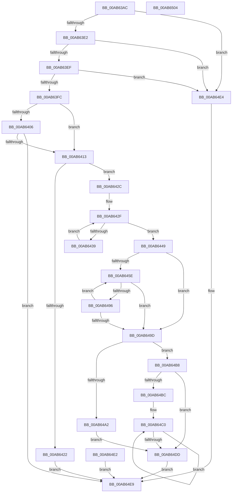

# EtwpUpdatePmcCounters

- RVA: `0x00AB63AC`–`0x00AB6505` (길이 `345` bytes)
- VA: `0x0000000140AB63AC`
- 실행 섹션: `PAGE`
- PDB 이름 있음: `예`; PDB Function 태그: `아니요`
- unwind 정보 RVA: `0x000BCE88`
- 디코드: `91`개 명령, `345/345` bytes 표시
- 미해석 바이트: `0` (있으면 어셈블리에 `.byte`로 보존)

> 이 문서는 커널 이미지의 기계어와 PDB 기호를 분석해 생성했습니다. 4번과 5번은 함수 원형과 자료형을 바이너리 사용 방식에서 추정한 C 해석이며 원본 소스 복구 결과는 아닙니다.

## 1. Dependencies

- 직접 호출 지점: **3**; 고유 호출 대상: **2**
- 직접 호출자로 확인된 함수: **1**
- RIP 상대 이미지 참조: **4**

### Outgoing calls
- `0x00AB6406` → [EtwpAllocatePmcData](../7B/EtwpAllocatePmcData_function_007B5944.md) (function, `0x007B5944`)
- `0x00AB648A` → [guard_dispatch_icall](../../text/6B/guard_dispatch_icall_function_006BAAD0.md) (function, `0x006BAAD0`)
- `0x00AB64CA` → [guard_dispatch_icall](../../text/6B/guard_dispatch_icall_function_006BAAD0.md) (function, `0x006BAAD0`)

### Direct callers
- [sub_00B3C988](../B3/Unknown_function_00B3C988.md) at `0x00B3D44B`

### Static image references
- `0x00AB63CE` → RVA `0x00FC6A80` (`ALMOSTRO`; read)
- `0x00AB63E2` → RVA `0x00E0EB1C` (`.data`; read)
- `0x00AB6468` → RVA `0x00E00CA0` (`.data`; read)
- `0x00AB64C0` → RVA `0x00E00A40` (`.data`; read)

## 2. Other-region calls and transfers

- 다른 실행 섹션으로 향하는 call: **2**
  - `0x00AB648A` → [guard_dispatch_icall](../../text/6B/guard_dispatch_icall_function_006BAAD0.md) (`PAGE` → `.text`)
  - `0x00AB64CA` → [guard_dispatch_icall](../../text/6B/guard_dispatch_icall_function_006BAAD0.md) (`PAGE` → `.text`)
- 별도 외부 분기/꼬리 이동을 확인하지 못했습니다.

## 3. Assembly (complete function range)

```asm
00AB63AC  48 8B C4                        mov rax, rsp
00AB63AF  48 89 58 08                     mov qword ptr [rax + 8], rbx
00AB63B3  48 89 70 10                     mov qword ptr [rax + 0x10], rsi
00AB63B7  48 89 78 20                     mov qword ptr [rax + 0x20], rdi
00AB63BB  41 54                           push r12
00AB63BD  41 56                           push r14
00AB63BF  41 57                           push r15
00AB63C1  48 83 EC 50                     sub rsp, 0x50
00AB63C5  41 8B F0                        mov esi, r8d
00AB63C8  48 8B DA                        mov rbx, rdx
00AB63CB  48 8B F9                        mov rdi, rcx
00AB63CE  44 8B 25 AB 06 51 00            mov r12d, dword ptr [rip + 0x5106ab]
00AB63D5  83 60 18 00                     and dword ptr [rax + 0x18], 0
00AB63D9  45 85 C0                        test r8d, r8d
00AB63DC  0F 84 02 01 00 00               je 0x140ab64e4
00AB63E2  44 3B 05 33 87 35 00            cmp r8d, dword ptr [rip + 0x358733]
00AB63E9  0F 87 F5 00 00 00               ja 0x140ab64e4
00AB63EF  83 B9 2C 01 00 00 01            cmp dword ptr [rcx + 0x12c], 1
00AB63F6  0F 84 E8 00 00 00               je 0x140ab64e4
00AB63FC  48 83 B9 28 04 00 00 00         cmp qword ptr [rcx + 0x428], 0
00AB6404  75 0D                           jne 0x140ab6413
00AB6406  E8 39 F5 CF FF                  call 0x1407b5944
00AB640B  85 C0                           test eax, eax
00AB640D  0F 85 D6 00 00 00               jne 0x140ab64e9
00AB6413  4C 8B B7 28 04 00 00            mov r14, qword ptr [rdi + 0x428]
00AB641A  41 8B 46 14                     mov eax, dword ptr [r14 + 0x14]
00AB641E  85 C0                           test eax, eax
00AB6420  74 0A                           je 0x140ab642c
00AB6422  B8 03 03 00 C0                  mov eax, 0xc0000303
00AB6427  E9 BD 00 00 00                  jmp 0x140ab64e9
00AB642C  45 33 C0                        xor r8d, r8d
00AB642F  44 89 44 24 40                  mov dword ptr [rsp + 0x40], r8d
00AB6434  44 3B C6                        cmp r8d, esi
00AB6437  73 10                           jae 0x140ab6449
00AB6439  42 8B 0C 83                     mov ecx, dword ptr [rbx + r8*4]
00AB643D  49 8B 06                        mov rax, qword ptr [r14]
00AB6440  42 89 0C 80                     mov dword ptr [rax + r8*4], ecx
00AB6444  41 FF C0                        inc r8d
00AB6447  EB E6                           jmp 0x140ab642f
00AB6449  45 33 FF                        xor r15d, r15d
00AB644C  C7 84 24 80 00 00 00 45 74 77 70  mov dword ptr [rsp + 0x80], 0x70777445
00AB6457  33 DB                           xor ebx, ebx
00AB6459  45 85 E4                        test r12d, r12d
00AB645C  74 3F                           je 0x140ab649d
00AB645E  8B C3                           mov eax, ebx
00AB6460  48 83 C0 03                     add rax, 3
00AB6464  49 8D 0C C6                     lea rcx, [r14 + rax*8]
00AB6468  48 8B 05 31 A8 34 00            mov rax, qword ptr [rip + 0x34a831]
00AB646F  48 83 64 24 28 00               and qword ptr [rsp + 0x28], 0
00AB6475  48 89 4C 24 20                  mov qword ptr [rsp + 0x20], rcx
00AB647A  4C 8D 8C 24 80 00 00 00         lea r9, [rsp + 0x80]
00AB6482  44 8B C6                        mov r8d, esi
00AB6485  49 8B 16                        mov rdx, qword ptr [r14]
00AB6488  8B CB                           mov ecx, ebx
00AB648A  E8 41 46 C0 FF                  call 0x1406baad0
00AB648F  44 8B F8                        mov r15d, eax
00AB6492  85 C0                           test eax, eax
00AB6494  75 07                           jne 0x140ab649d
00AB6496  FF C3                           inc ebx
00AB6498  41 3B DC                        cmp ebx, r12d
00AB649B  72 C1                           jb 0x140ab645e
00AB649D  45 85 FF                        test r15d, r15d
00AB64A0  75 16                           jne 0x140ab64b8
00AB64A2  41 89 76 14                     mov dword ptr [r14 + 0x14], esi
00AB64A6  F0 44 09 3C 24                  lock or dword ptr [rsp], r15d
00AB64AB  F0 81 8F 30 03 00 00 00 08 00 00  lock or dword ptr [rdi + 0x330], 0x800
00AB64B6  EB 25                           jmp 0x140ab64dd
00AB64B8  85 DB                           test ebx, ebx
00AB64BA  74 21                           je 0x140ab64dd
00AB64BC  49 8D 7E 18                     lea rdi, [r14 + 0x18]
00AB64C0  48 8B 05 79 A5 34 00            mov rax, qword ptr [rip + 0x34a579]
00AB64C7  48 8B 0F                        mov rcx, qword ptr [rdi]
00AB64CA  E8 01 46 C0 FF                  call 0x1406baad0
00AB64CF  48 83 27 00                     and qword ptr [rdi], 0
00AB64D3  48 8D 7F 08                     lea rdi, [rdi + 8]
00AB64D7  48 83 EB 01                     sub rbx, 1
00AB64DB  75 E3                           jne 0x140ab64c0
00AB64DD  41 8B C7                        mov eax, r15d
00AB64E0  EB 07                           jmp 0x140ab64e9
00AB64E2  EB 05                           jmp 0x140ab64e9
00AB64E4  B8 0D 00 00 C0                  mov eax, 0xc000000d
00AB64E9  4C 8D 5C 24 50                  lea r11, [rsp + 0x50]
00AB64EE  49 8B 5B 20                     mov rbx, qword ptr [r11 + 0x20]
00AB64F2  49 8B 73 28                     mov rsi, qword ptr [r11 + 0x28]
00AB64F6  49 8B 7B 38                     mov rdi, qword ptr [r11 + 0x38]
00AB64FA  49 8B E3                        mov rsp, r11
00AB64FD  41 5F                           pop r15
00AB64FF  41 5E                           pop r14
00AB6501  41 5C                           pop r12
00AB6503  C3                              ret
00AB6504  CC                              int3
```

## 4. C-style interpretation (structured pseudocode)

```c
__int64 __fastcall EtwpUpdatePmcCounters(__int64 a1, __int64 a2, int a3)
{
    __int64 result;
    __int64 v_r15;
    __int64 v_rbx;
    __int64 v_rsp;
    unsigned __int64 v_stack_m18;
    unsigned int v_stack_m28;
    unsigned __int64 v_stack_m40;
    unsigned __int64 v_stack_m48;
    unsigned int v_stack_m68;
    unsigned int v_stack_p18;

    *(unsigned __int64 *)(v_rsp + 8) = v_rbx;
    *(unsigned __int64 *)(v_rsp + 16) = v_rsi;
    *(unsigned __int64 *)(v_rsp + 32) = v_rdi;
    v_rsp = (v_rsp) - (80);
    if (a3 == 0) goto loc_00AB64E4;
    if (a3 > (*(unsigned int *)(v_rip + 3508019))) goto loc_00AB64E4;
    if ((*(unsigned int *)(a1 + 300)) == 1) goto loc_00AB64E4;
    if ((*(unsigned __int64 *)(a1 + 1064)) != 0) goto loc_00AB6413;
    result = EtwpAllocatePmcData(a1, a2, a3, a4);
    if ((unsigned int)(result) != 0) goto loc_00AB64E9;
loc_00AB6413:
    if ((unsigned int)((unsigned int)(*(unsigned int *)(*(unsigned __int64 *)(a1 + 1064) + 20))) == 0) goto loc_00AB642C;
    goto loc_00AB64E9;
loc_00AB642C:
    a3 = 0;
loc_00AB642F:
    v_stack_m28 = 0;
    if (0 >= ((unsigned int)((unsigned int)(a3)))) goto loc_00AB6449;
    *(unsigned int *)(*(unsigned __int64 *)(*(unsigned __int64 *)(a1 + 1064)) + a3 * 4) = (unsigned int)((unsigned int)(*(unsigned int *)(a2 + a3 * 4)));
    a3 = (unsigned int)((a3) + 1);
    goto loc_00AB642F;
loc_00AB6449:
    v_r15 = 0;
    v_stack_p18 = 0x70777445ULL;
    v_rbx = 0;
    if ((unsigned int)((unsigned int)(*(unsigned int *)(v_rip + 5310123))) == 0) goto loc_00AB649D;
loc_00AB645E:
    result = (0) + (3);
    v_stack_m48 = *(unsigned __int64 *)(a1 + 1064) + result * 8;
    result = guard_dispatch_icall(0, *(unsigned __int64 *)(*(unsigned __int64 *)(a1 + 1064)), (unsigned int)((unsigned int)((unsigned int)(a3))), v_stack_p18);
    if ((unsigned int)(result) != 0) goto loc_00AB649D;
    v_rbx = (unsigned int)((v_rbx) + 1);
    if (((unsigned int)(v_rbx)) < ((unsigned int)((unsigned int)(*(unsigned int *)(v_rip + 5310123))))) goto loc_00AB645E;
loc_00AB649D:
    if ((unsigned int)((unsigned int)((unsigned int)(result))) != 0) goto loc_00AB64B8;
    *(unsigned int *)(*(unsigned __int64 *)(a1 + 1064) + 20) = (unsigned int)((unsigned int)(a3));
    goto loc_00AB64DD;
loc_00AB64B8:
    if ((unsigned int)(v_rbx) == 0) goto loc_00AB64DD;
loc_00AB64C0:
    result = guard_dispatch_icall(*(unsigned __int64 *)(*(unsigned __int64 *)(a1 + 1064) + 24), *(unsigned __int64 *)(*(unsigned __int64 *)(a1 + 1064)), (unsigned int)((unsigned int)((unsigned int)(a3))), v_stack_p18);
    v_rbx = (v_rbx) - (1);
    if (condition_is_not_equal) goto loc_00AB64C0;
loc_00AB64DD:
    goto loc_00AB64E9;
loc_00AB64E4:
loc_00AB64E9:
    return (unsigned int)(0xC000000DULL);
}
```

## 5. (Beta) C Style

```c
int64_t EtwpUpdatePmcCounters(void *Arg1, void *Arg2, int32_t Arg3)
{
    uint8_t *arg1 = (uint8_t *)Arg1;
    uint8_t *arg2 = (uint8_t *)Arg2;

    int64_t result;
    int64_t local_r15;
    int64_t local_rbx;
    int64_t local_rsp;
    uint64_t v_stack_m18;
    uint32_t v_stack_m28;
    uint64_t v_stack_m40;
    uint64_t v_stack_m48;
    uint32_t v_stack_m68;
    uint32_t v_stack_p18;

    *(uint64_t *)(local_rsp + 0x8) = local_rbx;
    *(uint64_t *)(local_rsp + 0x10) = local_rsi;
    *(uint64_t *)(local_rsp + 0x20) = local_rdi;
    local_rsp = (local_rsp) - (80);
    if (Arg3 == 0) goto loc_00AB64E4;
    if (Arg3 > (*(uint32_t *)(v_rip + 0x358733))) goto loc_00AB64E4;
    if ((*(uint32_t *)(arg1 + 0x12C)) == 1) goto loc_00AB64E4;
    if ((*(uint64_t *)(arg1 + 0x428)) != 0) goto loc_00AB6413;
    result = EtwpAllocatePmcData(Arg1, Arg2, Arg3, a4);
    if ((uint32_t)(result) != 0) goto loc_00AB64E9;
loc_00AB6413:
    if ((uint32_t)((uint32_t)(*(uint32_t *)(*(uint64_t *)(arg1 + 0x428) + 0x14))) == 0) goto loc_00AB642C;
    goto loc_00AB64E9;
loc_00AB642C:
    Arg3 = 0;
loc_00AB642F:
    v_stack_m28 = 0;
    if (0 >= ((uint32_t)((uint32_t)(Arg3)))) goto loc_00AB6449;
    *(uint32_t *)(*(uint64_t *)(*(uint64_t *)(arg1 + 0x428)) + Arg3 * 4) = (uint32_t)((uint32_t)(*(uint32_t *)(arg2 + Arg3 * 4)));
    Arg3 = (uint32_t)((Arg3) + 1);
    goto loc_00AB642F;
loc_00AB6449:
    local_r15 = 0;
    v_stack_p18 = 0x70777445ULL;
    local_rbx = 0;
    if ((uint32_t)((uint32_t)(*(uint32_t *)(v_rip + 0x5106AB))) == 0) goto loc_00AB649D;
loc_00AB645E:
    result = (0) + (3);
    v_stack_m48 = *(uint64_t *)(arg1 + 0x428) + result * 8;
    result = guard_dispatch_icall(0, *(uint64_t *)(*(uint64_t *)(arg1 + 0x428)), (uint32_t)((uint32_t)((uint32_t)(Arg3))), v_stack_p18);
    if ((uint32_t)(result) != 0) goto loc_00AB649D;
    local_rbx = (uint32_t)((local_rbx) + 1);
    if (((uint32_t)(local_rbx)) < ((uint32_t)((uint32_t)(*(uint32_t *)(v_rip + 0x5106AB))))) goto loc_00AB645E;
loc_00AB649D:
    if ((uint32_t)((uint32_t)((uint32_t)(result))) != 0) goto loc_00AB64B8;
    *(uint32_t *)(*(uint64_t *)(arg1 + 0x428) + 0x14) = (uint32_t)((uint32_t)(Arg3));
    goto loc_00AB64DD;
loc_00AB64B8:
    if ((uint32_t)(local_rbx) == 0) goto loc_00AB64DD;
loc_00AB64C0:
    result = guard_dispatch_icall(*(uint64_t *)(*(uint64_t *)(arg1 + 0x428) + 0x18), *(uint64_t *)(*(uint64_t *)(arg1 + 0x428)), (uint32_t)((uint32_t)((uint32_t)(Arg3))), v_stack_p18);
    local_rbx = (local_rbx) - (1);
    if (condition_is_not_equal) goto loc_00AB64C0;
loc_00AB64DD:
    goto loc_00AB64E9;
loc_00AB64E4:
loc_00AB64E9:
    return (uint32_t)(0xC000000DULL);
}
```

### 관측된 메모리 오프셋

구조체 형식이 확인되지 않은 접근은 인자 기준의 오프셋으로만 기록했습니다.

| 기준 인자 | 오프셋 표현 | 폭 (bit) | 접근 |
|---|---:|---:|---|
| `Arg1` | `+ 0x12C` | `32` | `R` |
| `Arg1` | `+ 0x330` | `32` | `R/W` |
| `Arg1` | `+ 0x428` | `64` | `R` |
| `Arg2` | `+ 0x0 + r8*4` | `32` | `R` |

## 6. Execution-region graph

[열기: 2D/3D 그래프와 함수 탐색 컨트롤 패널](../../../control-panel.html?section=page&rva=0x00AB63AC&view=graph)

- 2D 그래프는 위에서 아래로 흐르고, 3D 그래프는 빈 공간을 드래그해 회전합니다. Shift+드래그는 이동, 휠은 확대·축소, 함수 노드 선택은 대상 보고서 이동입니다.

### Static fallback


