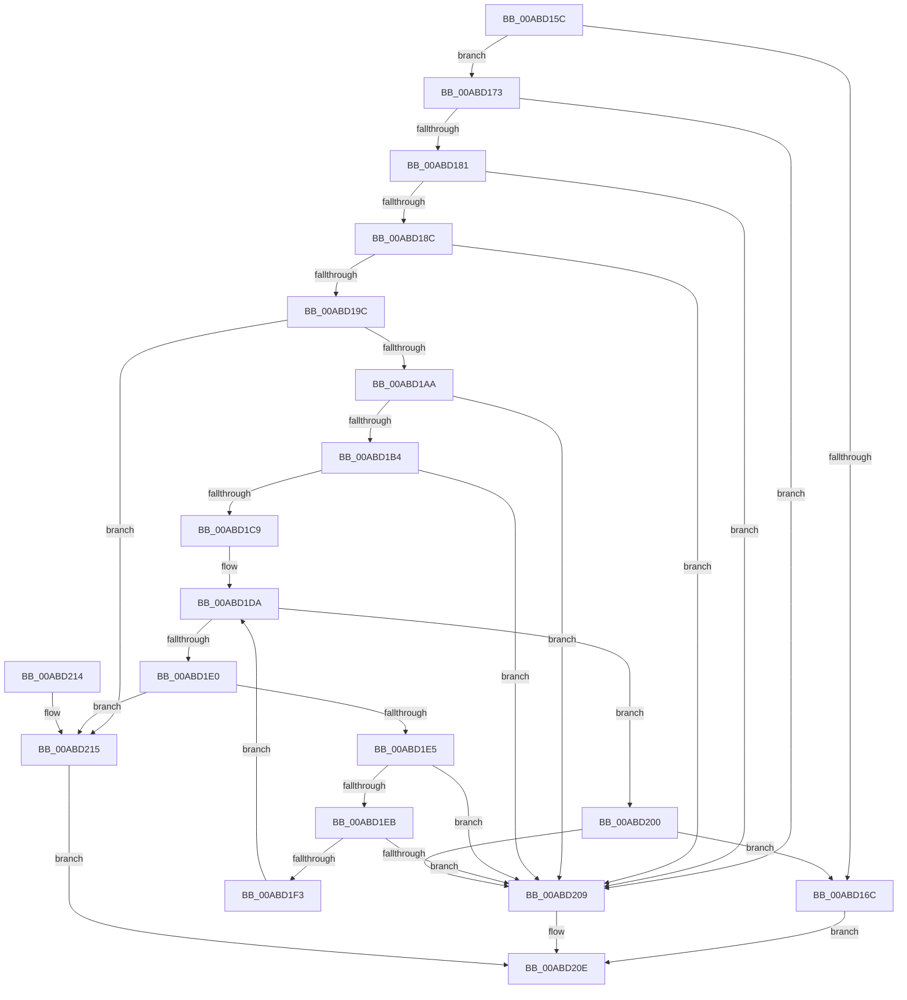

# EtwpValidateFlagExtension

- RVA: `0x00ABD15C`–`0x00ABD21C` (길이 `192` bytes)
- VA: `0x0000000140ABD15C`
- 실행 섹션: `PAGE`
- PDB 이름 있음: `예`; PDB Function 태그: `아니요`
- unwind 정보 RVA: `0x0007517C`
- 디코드: `58`개 명령, `192/192` bytes 표시
- 미해석 바이트: `0` (있으면 어셈블리에 `.byte`로 보존)

> 이 문서는 커널 이미지의 기계어와 PDB 기호를 분석해 생성했습니다. 4번과 5번은 함수 원형과 자료형을 바이너리 사용 방식에서 추정한 C 해석이며 원본 소스 복구 결과는 아닙니다.

## 1. Dependencies

- 직접 호출 지점: **0**; 고유 호출 대상: **0**
- 직접 호출자로 확인된 함수: **2**
- RIP 상대 이미지 참조: **0**

### Outgoing calls
- 직접 디코드된 call 명령이 없습니다.

### Direct callers
- [EtwpStartLogger](../A9/EtwpStartLogger_function_00A99D80.md) at `0x00A9A15D`
- [EtwpUpdateTrace](EtwpUpdateTrace_function_00ABCC7C.md) at `0x00ABCCBC`

### Static image references
- 디코드된 RIP-relative 메모리 참조가 없습니다.

## 2. Other-region calls and transfers

- 다른 실행 섹션으로 향하는 call: **0**
- 별도 외부 분기/꼬리 이동을 확인하지 못했습니다.

## 3. Assembly (complete function range)

```asm
00ABD15C  48 89 5C 24 08                  mov qword ptr [rsp + 8], rbx
00ABD161  44 8B 41 48                     mov r8d, dword ptr [rcx + 0x48]
00ABD165  33 DB                           xor ebx, ebx
00ABD167  45 85 C0                        test r8d, r8d
00ABD16A  78 07                           js 0x140abd173
00ABD16C  33 C0                           xor eax, eax
00ABD16E  E9 9B 00 00 00                  jmp 0x140abd20e
00ABD173  41 8B C0                        mov eax, r8d
00ABD176  C1 E8 10                        shr eax, 0x10
00ABD179  3C FF                           cmp al, 0xff
00ABD17B  0F 85 88 00 00 00               jne 0x140abd209
00ABD181  B8 B0 00 00 00                  mov eax, 0xb0
00ABD186  66 44 3B C0                     cmp r8w, ax
00ABD18A  72 7D                           jb 0x140abd209
00ABD18C  44 8B 11                        mov r10d, dword ptr [rcx]
00ABD18F  41 0F B7 D0                     movzx edx, r8w
00ABD193  48 8D 42 04                     lea rax, [rdx + 4]
00ABD197  4C 3B D0                        cmp r10, rax
00ABD19A  72 6D                           jb 0x140abd209
00ABD19C  4C 8D 0C 0A                     lea r9, [rdx + rcx]
00ABD1A0  66 41 BB 01 00                  mov r11w, 1
00ABD1A5  45 84 CB                        test r11b, r9b
00ABD1A8  75 6B                           jne 0x140abd215
00ABD1AA  41 0F B7 11                     movzx edx, word ptr [r9]
00ABD1AE  66 41 3B D3                     cmp dx, r11w
00ABD1B2  72 55                           jb 0x140abd209
00ABD1B4  41 0F B7 C0                     movzx eax, r8w
00ABD1B8  44 2B D0                        sub r10d, eax
00ABD1BB  8B C2                           mov eax, edx
00ABD1BD  48 C1 E0 02                     shl rax, 2
00ABD1C1  41 8B CA                        mov ecx, r10d
00ABD1C4  48 3B C1                        cmp rax, rcx
00ABD1C7  77 40                           ja 0x140abd209
00ABD1C9  45 0F B7 51 02                  movzx r10d, word ptr [r9 + 2]
00ABD1CE  49 8D 49 04                     lea rcx, [r9 + 4]
00ABD1D2  66 41 2B D3                     sub dx, r11w
00ABD1D6  44 0F B7 C3                     movzx r8d, bx
00ABD1DA  66 45 3B C2                     cmp r8w, r10w
00ABD1DE  73 20                           jae 0x140abd200
00ABD1E0  41 84 CB                        test r11b, cl
00ABD1E3  75 30                           jne 0x140abd215
00ABD1E5  66 41 3B D3                     cmp dx, r11w
00ABD1E9  72 1E                           jb 0x140abd209
00ABD1EB  0F B7 01                        movzx eax, word ptr [rcx]
00ABD1EE  66 3B D0                        cmp dx, ax
00ABD1F1  72 16                           jb 0x140abd209
00ABD1F3  66 2B D0                        sub dx, ax
00ABD1F6  48 8D 0C 81                     lea rcx, [rcx + rax*4]
00ABD1FA  66 45 03 C3                     add r8w, r11w
00ABD1FE  EB DA                           jmp 0x140abd1da
00ABD200  66 85 D2                        test dx, dx
00ABD203  0F 84 63 FF FF FF               je 0x140abd16c
00ABD209  B8 0D 00 00 C0                  mov eax, 0xc000000d
00ABD20E  48 8B 5C 24 08                  mov rbx, qword ptr [rsp + 8]
00ABD213  C3                              ret
00ABD214  CC                              int3
00ABD215  B8 C5 02 00 C0                  mov eax, 0xc00002c5
00ABD21A  EB F2                           jmp 0x140abd20e
```

## 4. C-style interpretation (structured pseudocode)

```c
__int64 __fastcall EtwpValidateFlagExtension(__int64 a1)
{
    __int64 result;
    __int64 v_r10;
    __int64 v_rbx;
    unsigned __int64 v_stack_p8;

    v_stack_p8 = v_rbx;
    v_rbx = 0;
    if (sign_flag) goto loc_00ABD173;
loc_00ABD16C:
    result = 0;
    goto loc_00ABD20E;
loc_00ABD173:
    result = (unsigned int)(((unsigned int)((unsigned int)((unsigned int)(*(unsigned int *)(a1 + 72))))) >> (16));
    if (((unsigned __int8)(result)) != 255) goto loc_00ABD209;
    if (((unsigned __int16)((unsigned int)(*(unsigned int *)(a1 + 72)))) < 176) goto loc_00ABD209;
    if (((unsigned int)(*(unsigned int *)(a1))) < ((unsigned __int16)((unsigned int)(*(unsigned int *)(a1 + 72))) + 4)) goto loc_00ABD209;
    if (((1) & ((unsigned __int8)((unsigned __int16)((unsigned int)(*(unsigned int *)(a1 + 72))) + a1 * 1))) != 0) goto loc_00ABD215;
    if (((unsigned __int16)(*(unsigned __int16 *)((unsigned __int16)((unsigned int)(*(unsigned int *)(a1 + 72))) + a1 * 1))) < 1) goto loc_00ABD209;
    v_r10 = (unsigned int)(((unsigned int)(*(unsigned int *)(a1))) - ((unsigned int)((unsigned __int16)((unsigned int)(*(unsigned int *)(a1 + 72))))));
    result = ((unsigned int)((unsigned int)(*(unsigned __int16 *)((unsigned __int16)((unsigned int)(*(unsigned int *)(a1 + 72))) + a1 * 1)))) << (2);
    if (result > ((unsigned int)((unsigned int)(v_r10)))) goto loc_00ABD209;
    a2 = (unsigned __int16)((*(unsigned __int16 *)((unsigned __int16)((unsigned int)(*(unsigned int *)(a1 + 72))) + a1 * 1)) - (1));
loc_00ABD1DA:
    if (0 >= ((unsigned __int16)(*(unsigned __int16 *)((unsigned __int16)((unsigned int)(*(unsigned int *)(a1 + 72))) + a1 * 1 + 2)))) goto loc_00ABD200;
    if (((1) & ((unsigned __int8)((unsigned __int16)((unsigned int)(*(unsigned int *)(a1 + 72))) + a1 * 1 + 4))) != 0) goto loc_00ABD215;
    if (((unsigned __int16)(a2)) < 1) goto loc_00ABD209;
    if (((unsigned __int16)(a2)) < ((unsigned __int16)(*(unsigned __int16 *)((unsigned __int16)((unsigned int)(*(unsigned int *)(a1 + 72))) + a1 * 1 + 4)))) goto loc_00ABD209;
    a2 = (unsigned __int16)((a2) - ((unsigned __int16)(*(unsigned __int16 *)((unsigned __int16)((unsigned int)(*(unsigned int *)(a1 + 72))) + a1 * 1 + 4))));
    a3 = (unsigned __int16)((0) + (1));
    goto loc_00ABD1DA;
loc_00ABD200:
    if ((unsigned __int16)(a2) == 0) goto loc_00ABD16C;
loc_00ABD209:
loc_00ABD20E:
    return (unsigned int)(0xC000000DULL);
loc_00ABD215:
    goto loc_00ABD20E;
}
```

## 5. (Beta) C Style

```c
int64_t EtwpValidateFlagExtension(void *Arg1)
{
    uint8_t *arg1 = (uint8_t *)Arg1;

    int64_t result;
    int64_t local_r10;
    int64_t local_rbx;
    uint64_t v_stack_p8;

    v_stack_p8 = local_rbx;
    local_rbx = 0;
    if (sign_flag) goto loc_00ABD173;
loc_00ABD16C:
    result = 0;
    goto loc_00ABD20E;
loc_00ABD173:
    result = (uint32_t)(((uint32_t)((uint32_t)((uint32_t)(*(uint32_t *)(arg1 + 0x48))))) >> (16));
    if (((uint8_t)(result)) != 255) goto loc_00ABD209;
    if (((uint16_t)((uint32_t)(*(uint32_t *)(arg1 + 0x48)))) < 176) goto loc_00ABD209;
    if (((uint32_t)(*(uint32_t *)(arg1))) < ((uint16_t)((uint32_t)(*(uint32_t *)(arg1 + 0x48))) + 4)) goto loc_00ABD209;
    if (((1) & ((uint8_t)((uint16_t)((uint32_t)(*(uint32_t *)(arg1 + 0x48))) + Arg1 * 1))) != 0) goto loc_00ABD215;
    if (((uint16_t)(*(uint16_t *)((uint16_t)((uint32_t)(*(uint32_t *)(arg1 + 0x48))) + arg1 * 1))) < 1) goto loc_00ABD209;
    local_r10 = (uint32_t)(((uint32_t)(*(uint32_t *)(arg1))) - ((uint32_t)((uint16_t)((uint32_t)(*(uint32_t *)(arg1 + 0x48))))));
    result = ((uint32_t)((uint32_t)(*(uint16_t *)((uint16_t)((uint32_t)(*(uint32_t *)(arg1 + 0x48))) + arg1 * 1)))) << (2);
    if (result > ((uint32_t)((uint32_t)(local_r10)))) goto loc_00ABD209;
    a2 = (uint16_t)((*(uint16_t *)((uint16_t)((uint32_t)(*(uint32_t *)(arg1 + 0x48))) + arg1 * 1)) - (1));
loc_00ABD1DA:
    if (0 >= ((uint16_t)(*(uint16_t *)((uint16_t)((uint32_t)(*(uint32_t *)(arg1 + 0x48))) + arg1 * 1 + 0x2)))) goto loc_00ABD200;
    if (((1) & ((uint8_t)((uint16_t)((uint32_t)(*(uint32_t *)(arg1 + 0x48))) + Arg1 * 1 + 4))) != 0) goto loc_00ABD215;
    if (((uint16_t)(a2)) < 1) goto loc_00ABD209;
    if (((uint16_t)(a2)) < ((uint16_t)(*(uint16_t *)((uint16_t)((uint32_t)(*(uint32_t *)(arg1 + 0x48))) + arg1 * 1 + 0x4)))) goto loc_00ABD209;
    a2 = (uint16_t)((a2) - ((uint16_t)(*(uint16_t *)((uint16_t)((uint32_t)(*(uint32_t *)(arg1 + 0x48))) + arg1 * 1 + 0x4))));
    a3 = (uint16_t)((0) + (1));
    goto loc_00ABD1DA;
loc_00ABD200:
    if ((uint16_t)(a2) == 0) goto loc_00ABD16C;
loc_00ABD209:
loc_00ABD20E:
    return (uint32_t)(0xC000000DULL);
loc_00ABD215:
    goto loc_00ABD20E;
}
```

### 관측된 메모리 오프셋

구조체 형식이 확인되지 않은 접근은 인자 기준의 오프셋으로만 기록했습니다.

| 기준 인자 | 오프셋 표현 | 폭 (bit) | 접근 |
|---|---:|---:|---|
| `Arg1` | `+ 0x0` | `32` | `R` |
| `Arg1` | `+ 0x48` | `32` | `R` |

## 6. Execution-region graph

[열기: 2D/3D 그래프와 함수 탐색 컨트롤 패널](../../../control-panel.html?section=page&rva=0x00ABD15C&view=graph)

- 2D 그래프는 위에서 아래로 흐르고, 3D 그래프는 빈 공간을 드래그해 회전합니다. Shift+드래그는 이동, 휠은 확대·축소, 함수 노드 선택은 대상 보고서 이동입니다.

### Static fallback


